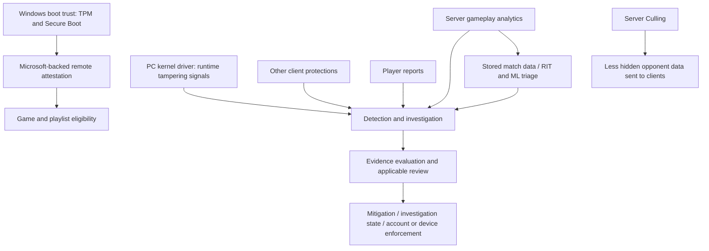

# Reading the system

This map synthesizes public descriptions. The arrows show conceptual evidence flow, **not a reverse-engineered wire protocol**. Use claim IDs in [ricochet.jsonl](ricochet.jsonl) for precise dates and scope.

The kernel driver supplies privileged runtime visibility and protection. Its presence does not make the rest of the system redundant. Public updates identify blocking memory tampering; detailed current scan and callback policies remain undisclosed. See **C002–C007, C059, C172, C204–C208**. [Driver FAQ](https://support.activision.com/articles/ricochet-overview), [December update](https://www.callofduty.com/blog/2024/12/call-of-duty-ricochet-anti-cheat-update-december).

Boot trust and remote attestation establish evidence about the PC’s security state. Microsoft’s TPM documentation explains quotes, measured boot, attestation keys, policy evaluation, and signed results; it does not reveal Activision’s production policy. See **C078–C094, C145–C169, C211**. [Microsoft TPM concepts](https://learn.microsoft.com/en-us/azure/attestation/tpm-attestation-concepts).

Replay ML helps prioritize suspicious match reconstructions for review. The published workflow combines video with game data; it does not describe recording the player’s whole desktop. The evidence does not establish that every type of ban receives individual human approval. See **C032–C034, C044–C045, C074–C075, C128, C195**. [Replay preview](https://www.callofduty.com/blog/2025/05/call-of-duty-black-ops-6-warzone-ricochet-anti-cheat-season-three-recap).

Mitigations interfere with selected cheating accounts while supporting investigation. Hallucinations create decoy player information; Server Culling withholds information. Quicksand was decommissioned in the published 2023 account, so old descriptions should not list it as currently active. See **C014–C024, C038–C047, C184, C186–C190, C199–C200**. [2023 mitigation report](https://www.callofduty.com/blog/2023/06/call-of-duty-ricochet-anti-cheat-season-04-update).

Keep attestation failures, Limited Matchmaking, Ranked restrictions, account bans, and hardware bans distinct. Their purposes, evidence requirements, effects, and appeal routes differ. See **C067–C073, C101–C104, C119–C125, C202–C203**. [Current enforcement policy](https://support.activision.com/articles/call-of-duty-security-and-enforcement-policy).

The strongest public implementation detail in this collection is the vendor’s Hallucinations whitepaper. Independent Randgrid research adds useful leads but is not a verified current-build specification; Cold War TAC research and studies of other anti-cheats must retain their original scope. See **C175–C181, C186–C190**. [Hallucinations paper](https://www.activision.com/cdn/research/hallucinations), [pinned Randgrid report](https://github.com/AmenHermano144/Valkyrie-Complete-Reverse-Engineering-Analysis/blob/d148d69b77e86b78101c322bed34c9dac78c4758/README.md).

For current access requirements, prefer the title-specific support document to older broad FAQ wording. For technical claims, prefer a dated, build-identified observation to an unsourced capability list. Review **C191–C220** before generating a confident explanation. [Current PC security requirements](https://support.activision.com/articles/trusted-platform-module-and-secure-boot).
