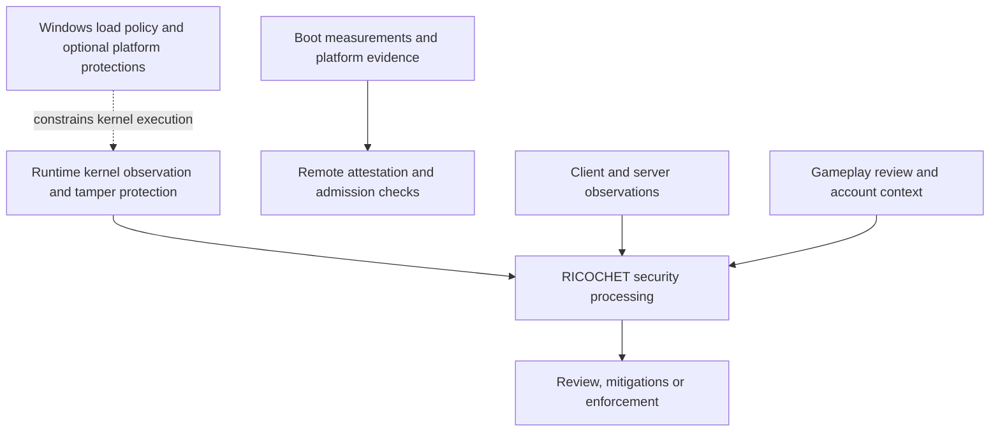
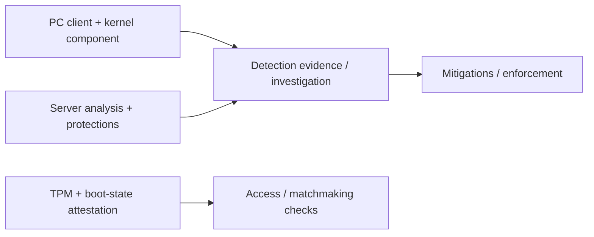

<div align="center">

<sub>INDEPENDENT PUBLIC-SOURCE RESEARCH</sub>

# RICOCHET RESEARCH

### MW4 · Warzone · Kernel, client & server architecture

A sourced research library. Find the detail, keep the context.

<a href="https://rawcdn.githack.com/ll2Rawll/ricochet-research/76e196a435e570f935a2737d564a227ed1b9ce03/index.html"></a>
<a href="ricochet.jsonl"></a>


[Browse topics](#browse-by-topic) · [Quick searches](#find-something-specific) · [Reading guides](#reading-guides) · [Complete catalogue](#complete-catalogue) · [Randgrid.sys guide](#randgrid-sys) · [Technical map](#technical-architecture) · [Public code](#public-code-index) · [Uploaded files](#uploaded-artifact-review) · [Source archive](artifacts/laith-km-driver/) · [Project research](research/laith-km-driver-review/README.md) · [Community references](#community-source-review) · [Technical expansion](#menu-engineering) · [Security bibliography](#security-research-sources) · [Sources](#sources)

</div>

---

<a id="search-the-library"></a>
## Search the library

**[Open the interactive reader ↗](https://rawcdn.githack.com/ll2Rawll/ricochet-research/76e196a435e570f935a2737d564a227ed1b9ce03/index.html)** to search all **458 findings and 165 sources**. Filter by topic and evidence type, open citations, share a filtered view, or export a citation-complete selection.

The [complete reader implementation](reader/) and its saved dataset are included on `main`. Run it locally with `python -m http.server 8000 --bind 127.0.0.1`, then open `http://127.0.0.1:8000/reader/`. Use `python scripts/sync_reader.py` to refresh its snapshot after research changes.

The reader follows the AI research file and includes a saved snapshot for availability. If the static preview host shows a confirmation screen, choose **Open the page**. GitHub's README renderer does not run live search. This page provides expandable guides, topic navigation and the full reading edition.

> **Research revision 15:** preserved the [complete original RAR](artifacts/laith-km-driver/original/laith-km-driver-main.rar), verified all 189 regular archive members and added two archive findings. The [review](research/laith-km-driver-review/README.md) records the user’s report of prior successful operation separately from the checks performed here.

> **On this page:** click a chapter to expand it. Expand the relevant chapter before using **Ctrl+F / ⌘F**. Click any finding ID to open its searchable-reader detail.

<a id="browse-by-topic"></a>
## Browse by topic

| Systems | Gameplay & content | Evidence & context |
| --- | --- | --- |
| **[Windows & kernel](https://rawcdn.githack.com/ll2Rawll/ricochet-research/76e196a435e570f935a2737d564a227ed1b9ce03/index.html?category=kernel)**<br>Driver lifecycle, callbacks, handles, IOCTLs<br><sub>107 findings</sub> | **[Server protections](https://rawcdn.githack.com/ll2Rawll/ricochet-research/76e196a435e570f935a2737d564a227ed1b9ce03/index.html?category=server)**<br>Server Culling, snapshots and mitigations<br><sub>19 findings</sub> | **[Diagnostic code](https://rawcdn.githack.com/ll2Rawll/ricochet-research/76e196a435e570f935a2737d564a227ed1b9ce03/index.html?category=artifact)**<br>Inspected utility, methods and artifact hashes<br><sub>16 findings</sub> |
| **[Boot & attestation](https://rawcdn.githack.com/ll2Rawll/ricochet-research/76e196a435e570f935a2737d564a227ed1b9ce03/index.html?category=attestation)**<br>TPM, Secure Boot, MAA and the disclosed CVE<br><sub>68 findings</sub> | **[Unlocks & progression](https://rawcdn.githack.com/ll2Rawll/ricochet-research/76e196a435e570f935a2737d564a227ed1b9ce03/index.html?category=unlocks)**<br>Account state, unlock history and modding scope<br><sub>60 findings</sub> | **[Accounts & privacy](https://rawcdn.githack.com/ll2Rawll/ricochet-research/76e196a435e570f935a2737d564a227ed1b9ce03/index.html?category=accounts)**<br>Account security, reporting and privacy<br><sub>14 findings</sub> |
| **[DMA & input devices](https://rawcdn.githack.com/ll2Rawll/ricochet-research/76e196a435e570f935a2737d564a227ed1b9ce03/index.html?category=devices)**<br>Hardware protection and input behavior<br><sub>12 findings</sub> | **[Detection & enforcement](https://rawcdn.githack.com/ll2Rawll/ricochet-research/76e196a435e570f935a2737d564a227ed1b9ce03/index.html?category=detection)**<br>Replay, ML, investigations and sanctions<br><sub>53 findings</sub> | **[History & studies](https://rawcdn.githack.com/ll2Rawll/ricochet-research/76e196a435e570f935a2737d564a227ed1b9ce03/index.html?category=context)**<br>Dated rollouts, experiments and limits<br><sub>42 findings</sub> |
| **[Menu engineering](https://rawcdn.githack.com/ll2Rawll/ricochet-research/76e196a435e570f935a2737d564a227ed1b9ce03/index.html?category=engineering)**<br>UI backends, input routing, DXGI and historical mod tools<br><sub>32 findings</sub> | **[Inventory API references](https://rawcdn.githack.com/ll2Rawll/ricochet-research/76e196a435e570f935a2737d564a227ed1b9ce03/index.html?q=GetInventoryItems)**<br>Permissions, transactions, retries and ownership | **[Security research bibliography](https://rawcdn.githack.com/ll2Rawll/ricochet-research/76e196a435e570f935a2737d564a227ed1b9ce03/index.html?view=sources&q=bibliography)**<br>Comparative studies and research provenance |
| **[Uploaded artifacts](https://rawcdn.githack.com/ll2Rawll/ricochet-research/76e196a435e570f935a2737d564a227ed1b9ce03/index.html?category=uploads)**<br>Archive identity, export coverage and PE interpretation<br><sub>35 findings</sub> | **[Capture API limits](https://rawcdn.githack.com/ll2Rawll/ricochet-research/76e196a435e570f935a2737d564a227ed1b9ce03/index.html?q=SetWindowDisplayAffinity)**<br>Documented scope and compatibility | **[Community references](https://rawcdn.githack.com/ll2Rawll/ricochet-research/76e196a435e570f935a2737d564a227ed1b9ce03/index.html?view=sources&q=%22Unverified+community%22)**<br>Unverified reports and historical commentary |
| **[Technical architecture](#technical-architecture)**<br>12 components and their evidence boundaries | **[Public code references](#public-code-index)**<br>Four groups with pinned revisions and licenses | **[Implementation gaps](#implementation-gaps)**<br>What the reviewed sources leave unknown |

<a id="find-something-specific"></a>
## Find something specific

| Looking for… | Open a prepared search |
| --- | --- |
| The kernel driver name | [Randgrid](https://rawcdn.githack.com/ll2Rawll/ricochet-research/76e196a435e570f935a2737d564a227ed1b9ce03/index.html?q=Randgrid) |
| The attestation-spoofing advisory | [CVE-2026-45642](https://rawcdn.githack.com/ll2Rawll/ricochet-research/76e196a435e570f935a2737d564a227ed1b9ce03/index.html?q=CVE-2026-45642) |
| TPM and boot trust | [Secure Boot](https://rawcdn.githack.com/ll2Rawll/ricochet-research/76e196a435e570f935a2737d564a227ed1b9ce03/index.html?q=%22Secure+Boot%22) |
| Driver communication | [IOCTL](https://rawcdn.githack.com/ll2Rawll/ricochet-research/76e196a435e570f935a2737d564a227ed1b9ce03/index.html?q=IOCTL) |
| Unlock-all history | [unlockall](https://rawcdn.githack.com/ll2Rawll/ricochet-research/76e196a435e570f935a2737d564a227ed1b9ce03/index.html?q=unlockall) |
| A specific finding | [C286](https://rawcdn.githack.com/ll2Rawll/ricochet-research/76e196a435e570f935a2737d564a227ed1b9ce03/index.html?q=C286) |
| A cited source | [S84](https://rawcdn.githack.com/ll2Rawll/ricochet-research/76e196a435e570f935a2737d564a227ed1b9ce03/index.html?q=S84) |
| Fake-player snapshots | [Hallucinations](https://rawcdn.githack.com/ll2Rawll/ricochet-research/76e196a435e570f935a2737d564a227ed1b9ce03/index.html?q=Hallucinations) |
| Menu development references | [menu_development](https://rawcdn.githack.com/ll2Rawll/ricochet-research/76e196a435e570f935a2737d564a227ed1b9ce03/index.html?q=menu_development) |
| Input ownership flags | [WantCaptureMouse](https://rawcdn.githack.com/ll2Rawll/ricochet-research/76e196a435e570f935a2737d564a227ed1b9ce03/index.html?q=WantCaptureMouse) |
| Inventory read contract | [GetInventoryItems](https://rawcdn.githack.com/ll2Rawll/ricochet-research/76e196a435e570f935a2737d564a227ed1b9ce03/index.html?q=GetInventoryItems) |
| Duplicate-write handling | [IdempotencyId](https://rawcdn.githack.com/ll2Rawll/ricochet-research/76e196a435e570f935a2737d564a227ed1b9ce03/index.html?q=IdempotencyId) |
| Server-validated licenses | [XStoreQueryLicenseTokenAsync](https://rawcdn.githack.com/ll2Rawll/ricochet-research/76e196a435e570f935a2737d564a227ed1b9ce03/index.html?q=XStoreQueryLicenseTokenAsync) |
| Uploaded JSONL quality | [F012](https://rawcdn.githack.com/ll2Rawll/ricochet-research/76e196a435e570f935a2737d564a227ed1b9ce03/index.html#F012) |
| Uploaded-file observations | [Uploaded artifacts](https://rawcdn.githack.com/ll2Rawll/ricochet-research/76e196a435e570f935a2737d564a227ed1b9ce03/index.html?category=uploads) |
| Display-affinity contract | [SetWindowDisplayAffinity](https://rawcdn.githack.com/ll2Rawll/ricochet-research/76e196a435e570f935a2737d564a227ed1b9ce03/index.html?q=SetWindowDisplayAffinity) |
| Replay and review architecture | [replay_architecture](https://rawcdn.githack.com/ll2Rawll/ricochet-research/76e196a435e570f935a2737d564a227ed1b9ce03/index.html?q=replay_architecture) |
| Registry callback contracts | [CmRegisterCallbackEx](https://rawcdn.githack.com/ll2Rawll/ricochet-research/76e196a435e570f935a2737d564a227ed1b9ce03/index.html?q=CmRegisterCallbackEx) |
| SDK token validation | [AttestationToken](https://rawcdn.githack.com/ll2Rawll/ricochet-research/76e196a435e570f935a2737d564a227ed1b9ce03/index.html?q=AttestationToken) |

<details>
<summary><strong>How to interpret the evidence labels</strong></summary>

Each finding retains its date, game/component scope and source. Source support does not independently prove a vendor's runtime behavior or universal current coverage.

| Label | What it means |
| --- | --- |
| **V · Vendor statement** | Supported vendor/policy wording; runtime claims remain attributed. |
| **P · Platform reference** | Platform, protocol, upstream UI and sample-code contracts; no implied COD/RICOCHET API use. |
| **O · Static observation** | Reproduced contents of an identified diagnostic artifact; not a game-driver experiment. |
| **R · Historical study** | Author-reported experiments with original dates and limitations. |
| **A · Artifact contents** | Contents of a pinned public or user-provided artifact without runtime inference or publisher-authenticity guarantees. |

</details>

---

<a id="reading-guides"></a>
## Reading guides

Choose a chapter for the narrative and technical tables. The complete finding catalogue follows.

<a id="randgrid-sys"></a>
<details open>
<summary><strong>Randgrid.sys: identity, kernel-software detection and evidence limits</strong> · reviewed 31 October 2026</summary>

**You likely mean `Randgrid.sys`, with a “d.”** SteamDB's pinned classifier associates that filename with RICOCHET. This supports the name association, not the authenticity or behavior of every file bearing that name. The spelling `rangrid.sys` is treated here as a likely search spelling; this review did not authenticate a separate component under that name.[^S35]

The strongest public description is that RICOCHET's PC driver observes software interaction with protected games and supports protection against memory tampering. The complete current scanner implementation is not public in the reviewed evidence. Activision's official AMA declines specific driver/source disclosure; a list of routines in the community question is not thereby confirmed.[^S01][^S15][^S33]

[Identity](#randgrid-identity) · [Detection methods](#randgrid-methods) · [Windows trust layers](#randgrid-windows) · [System pipeline](#randgrid-pipeline) · [Interpreting evidence](#randgrid-evidence) · [Unknowns](#randgrid-unknowns)

<a id="randgrid-identity"></a>
### 1. Identify the component before describing its behavior

| Name or identifier | What can be established | What it cannot establish |
| --- | --- | --- |
| `Randgrid.sys` | A Ricochet filename rule in SteamDB's published classifier; also a file listed in its Call of Duty depot mirror. | A current publisher-authenticated hash, signing chain, version, or full detection inventory. |
| `rangrid.sys` | Likely the intended spelling in this request. | A verified official alias or a distinct authenticated binary. |
| A Windows service name | An identifier in the Service Control Manager, separate from the display name and executable path. | The exact name of a `.sys` file, or a universal service registration shared by every game/store build. |
| RICOCHET | The wider client, kernel, server, trust and investigation system described by Activision. | A synonym for everything implemented in one driver file. |

The service-name distinction follows Windows' documented fields; it is not a RICOCHET installation audit.[^S149] The product/component distinction is explicit in the vendor's multi-layer description.[^S01]

**Catalogue observations, not binary verification:** the reviewed SteamDB pages show the following. Sizes are the site's rounded display values, not independently measured byte counts.

| Mirrored depot | Displayed manifest and date | Listed file |
| --- | --- | --- |
| Call of Duty, `1938091` | `6435955751458887063` · 24 October 2026 | `Randgrid.sys` · 12.16 MiB |
| MWII Open Beta, `2075731` | `8837114338362207664` · 24 September 2022 | `Randgrid.sys` · 2.21 MiB |

SteamDB is an independent mirror, and file hashes were not exposed by the reviewed unauthenticated page. These records remain source-only catalogue metadata. Reuse of the filename across releases does not establish unchanged code, a particular feature addition, or comparable detection coverage.[^S147][^S148]

<a id="randgrid-methods"></a>
### 2. Detection methods the vendor actually describes

The table separates the disclosed **class of protection** from its undisclosed implementation. Dates identify the source statement; a roadmap is not treated as proof of deployment in a later binary.

| Mechanism | Publicly supported description | Scope and unresolved implementation |
| --- | --- | --- |
| **Interaction monitoring** | The driver monitors and reports applications interacting with protected games, helping the team assess unauthorized manipulation. | PC driver role in the current FAQ; no complete event inventory or classification algorithm. [C002](#c002), [C005](#c005).[^S01] |
| **Memory-tampering defense** | The December 2024 report explicitly names kernel-driver detections intended to block memory tampering. | Confirms a threat class, not the protected regions, scan algorithm, signatures or measured coverage. [C059](#c059).[^S15] |
| **Runtime tamper blocking** | The August 2025 FAQ describes monitoring during gameplay and blocking tampering attempts. | Runtime protection complements boot trust; no reproducible build-specific implementation is supplied. [C172](#c172).[^S19] |
| **Driver and anti-tamper hardening** | The January 2025 roadmap lists driver-security improvements, reinforced encryption and a new tampering-detection system. | Dated planned work; cipher choices, key handling and later build contents are not disclosed. [C062](#c062).[^S16] |
| **Reporting and review** | The official product page describes suspicious activity being reported for review and possible action. | Observation, review and enforcement are distinct stages; a single event is not publicly specified as an automatic ban rule.[^S156] |
| **Game-session lifecycle** | Activision describes automatic driver installation, operation with the game and shutdown on game exit. | Vendor lifecycle statement, not a trace captured in this review. [C003](#c003), [C004](#c004), [C173](#c173).[^S01] |

These disclosures support an explanation of purpose and threat categories. They do not support claims that `Randgrid.sys` uses a particular private memory-search routine, checks every kernel component, or applies a published exhaustive rule set.

<a id="randgrid-windows"></a>
### 3. How kernel software is admitted and constrained by Windows

“Unauthorized” can mean failure of Windows load policy, a known-vulnerable driver blocked by the OS, an organization-disallowed component, or software violating game policy. Those are different decisions. A signature check is one input to trust, not a complete assessment of behavior.

| Layer | Technical role | Relationship to RICOCHET |
| --- | --- | --- |
| **Digital signatures** | Support verification of publisher/signing trust and integrity of signed files or packages. A package may use a catalog signature rather than an embedded file signature. | Signature status helps identify and assess a file; it does not establish game permission or prove benign behavior.[^S150] |
| **Kernel Code Integrity / driver policy** | Windows controls which kernel images may load under its applicable trust policy. | An OS refusal to load a driver is not automatically evidence of a RICOCHET detection. The governing OS release, updates and policy state matter.[^S45][^S153] |
| **Vulnerable-driver blocklist** | Microsoft restricts selected drivers with vulnerabilities, malicious behavior/certificates, or behavior undermining the security model. Legitimate signed drivers can still be risky. | This is a Windows protection, not a published list of RICOCHET's private detection signatures. Its documented coverage is not exhaustive.[^S51] |
| **Memory Integrity / HVCI** | VBS isolates code-integrity decisions; executable kernel memory is constrained so executable pages are not writable. | Makes the platform harder to compromise. This does not prove a particular RICOCHET build implements or universally requires that Windows mechanism. [C157](#c157), [C158](#c158).[^S50] |
| **App Control for Business** | Organization-managed policies control drivers and applications using supported trust and file attributes. Policies apply to the managed computer. | Another source of allow/block decisions; its presence does not disclose a game's own policy.[^S152] |
| **Secure Boot and measured trust** | Boot-chain verification and TPM-backed measurements support assessment of startup state. | Activision describes final boot-state verification on its servers. These protections complement the runtime driver. [C080](#c080), [C151](#c151).[^S19][^S48] |
| **Kernel DMA Protection** | On supported systems, IOMMU-backed isolation restricts device access to memory. | A platform DMA control, separate from proof of how any announced RICOCHET DMA detector is implemented. [C154](#c154)–[C156](#c156).[^S49] |

**2026 policy update:** Microsoft's April 2026 change removes default trust for the deprecated cross-signing program on Windows 11 24H2, 25H2 and 26H1 and Windows Server 2025, with a compatibility-aware evaluation-to-enforcement rollout and an allowlist for selected legacy drivers. Audit mode records would-be violations; enforcement blocks policy violations. The older Windows 10 1607+ signing summary [C143](#c143) is retained as background, with newer findings linked as updates. Do not interpret either document as every driver being allowed or blocked identically on every Windows installation.[^S154][^S153]

**A practical distinction:** a legitimately signed driver can contain a vulnerability; a correctly measured boot can be followed by later runtime activity; and a local driver event does not itself supply an account-level enforcement decision. Treat these as separate evidence questions rather than a single “trusted/untrusted” bit.[^S51][^S19][^S156]

<a id="randgrid-pipeline"></a>
### 4. Where the driver sits in the wider detection system



This is a conceptual map of published responsibilities, not a recovered call graph or message protocol. In particular, it does not claim every input travels through `Randgrid.sys`.

| Adjacent mechanism | What is documented | Why it should not be attributed wholesale to the driver |
| --- | --- | --- |
| **Remote attestation** | Activision describes pre-match verification using Microsoft Azure Attestation and later matchmaking/admission responses. | The verification service and admission policy are separate responsibilities. Firmware or compatibility problems can produce unsuccessful attestation; failure alone does not prove malicious kernel software. [C094](#c094), [C101](#c101)–[C104](#c104).[^S23][^S25] |
| **Behavioral analysis and account context** | Technical interaction detections and analysis over time are described as different evidence streams. | Public descriptions do not specify their entire collection or execution location. [C063](#c063), [C109](#c109), [C282](#c282).[^S16][^S26][^S33] |
| **Replay and human investigation** | Gameplay data supports retrospective review. | Account outcomes cannot identify which particular kernel observation, if any, determined a case. [C387](#c387).[^S12] |
| **Input-device classification** | Product-level reports describe machine-driven input patterns. | This is a distinct detection category; the report does not identify a particular `.sys` implementation. [C095](#c095)–[C097](#c097).[^S23] |
| **DMA-cheat detections** | The official 23 October 2026 announcement reports newly introduced detections. | The announcement does not reveal their internal method or allocation to a particular binary. [C183](#c183).[^S56] |

### 5. What documented kernel visibility does—and does not—show

Windows offers process-lifetime, thread-lifetime, image-load and supported object-handle notifications to eligible drivers. Those contracts explain how security software can receive OS events. An event is a structured observation; a product still needs policy, context and validation to decide whether it represents prohibited activity.[^S41][^S42][^S43][^S133]

The repository's [callback reference section](#kernel-lifetimes) explains those public interfaces. Their existence, inclusion in a sample, or mention in a forum question is **not evidence that a particular Randgrid build calls them**. An import list likewise cannot establish which paths execute, their conditions, or a full detector inventory. Microsoft also describes security-tool visibility and tamper resistance more broadly; those observations apply to the platform and do not authenticate RICOCHET internals.[^S155]

<a id="randgrid-evidence"></a>
### 6. Read errors and observations without overclaiming

| Observation | Supported interpretation | Unsupported leap |
| --- | --- | --- |
| A driver-load or signature error | A specific Windows load/verification operation failed. Code Integrity documents causes including altered files and read errors. | “RICOCHET confirmed a cheat.”[^S151] |
| A filename appears in a depot or crash report | The name was listed or referenced in that record. | “This is an authenticated current build with a known detection algorithm.”[^S35] |
| A signature validates | The applicable signature/trust verification succeeded. | “The code has no vulnerabilities and the game must permit it.”[^S150][^S51] |
| Attestation fails | Platform evidence or policy requirements were not successfully satisfied. | “A malicious driver was conclusively identified.”[^S25] |
| An account receives enforcement | An account action occurred under the product's policy. | “One identified kernel routine caused it,” without case-specific evidence.[^S33] |

For a reproducible, build-specific study, preserve the delivery source, cryptographic file hash, product/file version, signature-validation context, OS build, game build and observation date. Distinguish an observed runtime event from an inferred cause. This review did not download or execute a current protected-game driver and does not supply a binary-authentication result.

<a id="randgrid-unknowns"></a>
### 7. What remains undisclosed or unverified

The reviewed public sources do not authenticate a complete current driver source tree, internal call graph, private telemetry protocol, exhaustive detection rules, decision thresholds, or a measured per-build false-positive/false-negative profile. Nor do they establish one universal launcher service registration, signer/hash, or driver version from the filename alone. The official disclosure boundary is documented in [C283](#c283).[^S33]

The supported technical description is therefore **a runtime observation and tamper-protection component within a layered system**, operating within Windows trust boundaries and alongside separately described remote/server processes. Specific private scanner claims remain unconfirmed unless independently tied to an authenticated build and reproducible evidence. Unverified community routine lists and automated risk labels have not been promoted into this rundown.

### 8. Find the corresponding data quickly

- **AI edition:** read `meta.randgrid_dossier`, then join its `claim_ids` and `source_ids` to the JSONL records. The dossier separates vendor statements, platform contracts, catalogue metadata and unresolved questions.
- **Searchable edition:** search `Randgrid.sys` or the spelling `rangrid.sys`; use the **Windows & kernel** and evidence filters to narrow the results.
- **New source-backed records:** C433–C451. Existing claims keep their original IDs and dates; newer signing-policy statements link back to the older summary.
- **Verification meaning:** source text and catalogue contents were checked. That is different from reproducing the current driver's runtime detections.

</details>

<a id="technical-architecture"></a>
<details>
<summary><strong>Technical architecture: published roles, available code and implementation gaps</strong></summary>

RICOCHET is a set of client, kernel, server, attestation and operational systems. The table below is a synthesis of published roles and evidence limits. It is not a recovered call graph, private protocol specification or complete source-code audit. Historical statements retain their original game and date in the catalogue.

| Component | What the public evidence describes | What remains unverified or undisclosed |
| --- | --- | --- |
| **Kernel driver** | Game-session monitoring and lifecycle are vendor-described.[^S01][^S02][^S06][^S33] | Complete current source, call graph, private message formats and detection-rule implementation were not authenticated. |
| **Client protection** | Game-code hardening and security telemetry are vendor-described.[^S08][^S10][^S12] | Exact client instrumentation, payload schema and cryptographic implementation remain undisclosed. |
| **Boot evidence and enrollment** | Public TPM/boot protocols, example clients and utility observations exist.[^S27][^S46][^S55][^S64][^S65][^A01] | Which full production client path and configuration is used by each game build is not established. |
| **Attestation validation and policy** | Microsoft publishes claim schemas, policy semantics and SDK validation code.[^S20][^S23][^S140][^S141][^S143] | Activision policy bodies, SDK selection, accepted claims and exact backend deployment were not recovered. |
| **Admission and compatibility** | Published mode requirements and diagnostic distinctions are dated.[^S27][^S88] | Current server acceptance policy and a complete hardware/firmware compatibility matrix are not public here. |
| **Server information controls** | Server Culling is vendor-described; Hallucinations has a historical design paper.[^S10][^S11][^S57][^S63] | Current culling code, map data structures and build-specific snapshot policy were not recovered. |
| **Replay and investigator tooling** | The vendor describes reconstructing review video from gameplay data.[^S09][^S12][^S18] | Full recording format, reconstruction code and investigator tool source are unavailable in reviewed evidence. |
| **Statistical/ML detection** | The vendor describes automated analysis and corroborated investigations.[^S12][^S15][^S18][^S33] | Model architecture, weights, complete features and current decision thresholds remain undisclosed. |
| **Input and DMA protection** | The vendor describes device/input signals and DMA defenses; OS contracts supply context.[^S23][^S49][^S56][^S63] | Private hardware identifiers, exact DMA checks and input classifiers were not authenticated. |
| **Mitigations and enforcement** | Published examples and account/ranked responses exist across dated updates.[^S05][^S10][^S17][^S18][^S29][^S33] | Full live rules, production orchestration and case-specific evidence are not exposed. |
| **Accounts and content** | Published account-bound progression and content-transfer rules exist.[^S29][^S30][^S31][^S76][^S77][^S93] | Private databases and persistent inventory-write interfaces are not disclosed. |
| **Public files and source claims** | Official utility observations and user-file structure observations are separate evidence classes.[^A01][^A02][^A03][^A04][^S146] | User dumps are not authenticated original source; no complete current RICOCHET implementation was located in reviewed public material. |

### Newly catalogued vendor engineering details

| Engineering area | Added evidence | Date and scope |
| --- | --- | --- |
| Security pipeline | Connected-but-separate real-time security processing, learning from mitigated accounts and corroborated report handling | [C383](https://rawcdn.githack.com/ll2Rawll/ricochet-research/76e196a435e570f935a2737d564a227ed1b9ce03/index.html#C383)–[C386](https://rawcdn.githack.com/ll2Rawll/ricochet-research/76e196a435e570f935a2737d564a227ed1b9ce03/index.html#C386); June 2023 MWII/Warzone explanation |
| Replay and client hardening | Gameplay-data-to-video review, historical throughput, executable hardening and report deduplication | [C387](https://rawcdn.githack.com/ll2Rawll/ricochet-research/76e196a435e570f935a2737d564a227ed1b9ce03/index.html#C387)–[C390](https://rawcdn.githack.com/ll2Rawll/ricochet-research/76e196a435e570f935a2737d564a227ed1b9ce03/index.html#C390); November 2023 report |
| Review context and Ranked operations | Death Widget information context, RIT demonstrations, SR refunds and competitive-investigation focus | [C391](https://rawcdn.githack.com/ll2Rawll/ricochet-research/76e196a435e570f935a2737d564a227ed1b9ce03/index.html#C391)–[C394](https://rawcdn.githack.com/ll2Rawll/ricochet-research/76e196a435e570f935a2737d564a227ed1b9ce03/index.html#C394); respective 2025/2026 statements |
| Hallucinations design | Snapshot-maintenance trade-offs and a bot-design interface described in the paper | [C395](https://rawcdn.githack.com/ll2Rawll/ricochet-research/76e196a435e570f935a2737d564a227ed1b9ce03/index.html#C395)–[C396](https://rawcdn.githack.com/ll2Rawll/ricochet-research/76e196a435e570f935a2737d564a227ed1b9ce03/index.html#C396); historical design, no public game SDK |

<a id="implementation-gaps"></a>
### What “exactly how it works” cannot establish here

The reviewed evidence does not authenticate a complete current RICOCHET driver/service source tree, private driver-message specification, complete detection-rule set, production attestation policy, ML model or current culling implementation. Import names, embedded strings, analyst labels and generic Windows samples cannot supply those missing implementations. User-provided dumps retain their separate provenance limits.

The official open-source index identifies Telescope as WebKit and lists other tooling; those downloads are not identified as RICOCHET source. The vendor's AMA also declines to disclose driver capabilities and source. This is a bounded account of reviewed sources, rather than proof that no material exists elsewhere.[^S146][^S33]

</details>

<a id="public-code-index"></a>
<details>
<summary><strong>Public source code you can inspect</strong> · four reference groups</summary>

These are public Microsoft implementations that explain specific contracts. Their presence does not establish a corresponding COD language choice, API call, implementation or production setting. Full commit hashes identify the inspected versions; licenses identify the upstream repository/package terms. No source files are copied into this research repository.

| Reference group | Pinned source files | Language / license | What to inspect |
| --- | --- | --- | --- |
| **Process/handle callback reference** | [Microsoft ObCallback process-protection sample](https://github.com/microsoft/Windows-driver-samples/blob/f4c1ff842b6a0001152f44cb61788b216a1c7627/general/obcallback/README.md)<br>[ObCallback sample: callback.c](https://github.com/microsoft/Windows-driver-samples/blob/f4c1ff842b6a0001152f44cb61788b216a1c7627/general/obcallback/driver/callback.c)<br>[ObCallback sample: tdriver.c](https://github.com/microsoft/Windows-driver-samples/blob/f4c1ff842b6a0001152f44cb61788b216a1c7627/general/obcallback/driver/tdriver.c) | C<br>[MS-PL](https://github.com/microsoft/Windows-driver-samples/blob/f4c1ff842b6a0001152f44cb61788b216a1c7627/LICENSE) | Windows reference sample; no RICOCHET code identity or private API use established.<br>Commit: `f4c1ff842b6a0001152f44cb61788b216a1c7627` |
| **TPM challenge/enrollment reference** | [Microsoft attestation client: stateful TPM service exchange](https://github.com/microsoft/Attestation-Client-Samples/blob/84a502dcbedb674b505262f3eee022fd88ebc3ef/attestation/attest.cpp)<br>[Microsoft boot attestation sample: AIK, request key and nonce](https://github.com/microsoft/Attestation-Client-Samples/blob/84a502dcbedb674b505262f3eee022fd88ebc3ef/attestation/sample_boot_att.cpp)<br>[Microsoft EnrollAik sample: enrollment and optional key-file permissions](https://github.com/microsoft/Attestation-Client-Samples/blob/84a502dcbedb674b505262f3eee022fd88ebc3ef/EnrollAik.ps1) | C++ and PowerShell<br>[MIT](https://github.com/microsoft/Attestation-Client-Samples/blob/84a502dcbedb674b505262f3eee022fd88ebc3ef/LICENSE) | Demonstration client code. Sample settings are not an Activision policy or production client.<br>Commit: `84a502dcbedb674b505262f3eee022fd88ebc3ef` |
| **Registry callback reference** | [Microsoft RegFltr sample: declared purpose and limitations](https://github.com/microsoft/Windows-driver-samples/blob/f4c1ff842b6a0001152f44cb61788b216a1c7627/general/registry/regfltr/README.md)<br>[Microsoft RegFltr driver.c: device interface and teardown](https://github.com/microsoft/Windows-driver-samples/blob/f4c1ff842b6a0001152f44cb61788b216a1c7627/general/registry/regfltr/sys/driver.c) | C<br>[MS-PL](https://github.com/microsoft/Windows-driver-samples/blob/f4c1ff842b6a0001152f44cb61788b216a1c7627/LICENSE) | Minimal RegFltr teaching sample with explicit non-production limitations.<br>Commit: `f4c1ff842b6a0001152f44cb61788b216a1c7627` |
| **Attestation metadata and token validation** | [Azure SDK for Python: attestation client metadata and signer handling (pinned source)](https://github.com/Azure/azure-sdk-for-python/blob/21387f1976a22aae98eec2a5a5260f3c80d0772d/sdk/attestation/azure-security-attestation/azure/security/attestation/_patch.py)<br>[Azure SDK for Python: attestation token model and validation (pinned source)](https://github.com/Azure/azure-sdk-for-python/blob/21387f1976a22aae98eec2a5a5260f3c80d0772d/sdk/attestation/azure-security-attestation/azure/security/attestation/models/_patch.py) | Python<br>[MIT](https://github.com/Azure/azure-sdk-for-python/blob/21387f1976a22aae98eec2a5a5260f3c80d0772d/sdk/attestation/azure-security-attestation/LICENSE) | SDK reference implementation; no evidence COD uses this language, package or integration.<br>Commit: `21387f1976a22aae98eec2a5a5260f3c80d0772d` |

The RegFltr README explicitly calls its implementation minimal and unsuitable for production assumptions. The TPM client is demonstration code; its example parameters are not an Activision policy. The Python SDK code supplies concrete metadata, signer selection and validation behavior, subject to options and application-specific checks.[^S138][^S65][^S140][^S141]

</details>

<a id="kernel-lifetimes"></a>
<details>
<summary><strong>Kernel interfaces: execution context, registration and cleanup</strong> · 16 new reference findings</summary>

| Interface family | Added contract details | Findings |
| --- | --- | --- |
| Thread notifications | Registration IRQL; creation/deletion parameters; Ex-versus-legacy execution context; removal before unload | [C397](https://rawcdn.githack.com/ll2Rawll/ricochet-research/76e196a435e570f935a2737d564a227ed1b9ce03/index.html#C397)–[C401](https://rawcdn.githack.com/ll2Rawll/ricochet-research/76e196a435e570f935a2737d564a227ed1b9ce03/index.html#C401) |
| Registry callbacks | Registration altitude, unregister lifecycle and callback deadlock constraints | [C402](https://rawcdn.githack.com/ll2Rawll/ricochet-research/76e196a435e570f935a2737d564a227ed1b9ce03/index.html#C402)–[C405](https://rawcdn.githack.com/ll2Rawll/ricochet-research/76e196a435e570f935a2737d564a227ed1b9ce03/index.html#C405) |
| Context lifetime | Registration context, pre/post operation context and key-object context cleanup | [C406](https://rawcdn.githack.com/ll2Rawll/ricochet-research/76e196a435e570f935a2737d564a227ed1b9ce03/index.html#C406)–[C408](https://rawcdn.githack.com/ll2Rawll/ricochet-research/76e196a435e570f935a2737d564a227ed1b9ce03/index.html#C408) |
| Pinned RegFltr implementation | Sample coverage limits, secure device-interface creation and resource teardown | [C409](https://rawcdn.githack.com/ll2Rawll/ricochet-research/76e196a435e570f935a2737d564a227ed1b9ce03/index.html#C409)–[C412](https://rawcdn.githack.com/ll2Rawll/ricochet-research/76e196a435e570f935a2737d564a227ed1b9ce03/index.html#C412) |

The callback page's generic creator-context description and the Ex registration's documented `PsCreateThreadNotifyNonSystem` exception are retained separately. A single simplified “all callbacks execute on the same thread” explanation would lose this distinction. These are Windows contracts; no current RICOCHET use is asserted.[^S133][^S134]

</details>

<a id="attestation-validation-code"></a>
<details>
<summary><strong>Attestation: token validation, claims, policy and service trust</strong> · 19 new reference findings</summary>

| Layer | Added implementation/reference detail | Findings |
| --- | --- | --- |
| SDK discovery and signer state | OpenID metadata, certificate retrieval, caching and signer representations | [C413](https://rawcdn.githack.com/ll2Rawll/ricochet-research/76e196a435e570f935a2737d564a227ed1b9ce03/index.html#C413)–[C415](https://rawcdn.githack.com/ll2Rawll/ricochet-research/76e196a435e570f935a2737d564a227ed1b9ce03/index.html#C415) |
| Token validation | Key-ID candidate matching, signature checks, time/issuer checks and application callbacks | [C416](https://rawcdn.githack.com/ll2Rawll/ricochet-research/76e196a435e570f935a2737d564a227ed1b9ce03/index.html#C416)–[C419](https://rawcdn.githack.com/ll2Rawll/ricochet-research/76e196a435e570f935a2737d564a227ed1b9ce03/index.html#C419) |
| Claim semantics | Incoming evidence versus issued/property claims; policy identity, key confirmation and token representation | [C420](https://rawcdn.githack.com/ll2Rawll/ricochet-research/76e196a435e570f935a2737d564a227ed1b9ce03/index.html#C420)–[C424](https://rawcdn.githack.com/ll2Rawll/ricochet-research/76e196a435e570f935a2737d564a227ed1b9ce03/index.html#C424) |
| Policy evaluation | Grammar version, authorization/issuance stages and the provenance of generated claims | [C425](https://rawcdn.githack.com/ll2Rawll/ricochet-research/76e196a435e570f935a2737d564a227ed1b9ce03/index.html#C425)–[C427](https://rawcdn.githack.com/ll2Rawll/ricochet-research/76e196a435e570f935a2737d564a227ed1b9ce03/index.html#C427) |
| Deployment and service trust | Roles, protected signing keys, signed policies, service-side confidential computation and collateral binding | [C428](https://rawcdn.githack.com/ll2Rawll/ricochet-research/76e196a435e570f935a2737d564a227ed1b9ce03/index.html#C428)–[C431](https://rawcdn.githack.com/ll2Rawll/ricochet-research/76e196a435e570f935a2737d564a227ed1b9ce03/index.html#C431) |

The current service overview's SEV-SNP description concerns Microsoft's service computation. It does not identify COD's exact backend path or create a player CPU requirement in this research. A platform claim schema also does not establish which claims Activision requires. Policy grammar versions and a relying party's product-specific policy labels are distinct.[^S145][^S142][^S143]

</details>

<a id="imported-project-research"></a>
### Imported project research

**[Read the evidence and platform review](research/laith-km-driver-review/README.md)** for the imported archive’s identity, project/platform declarations, license discrepancy, Windows access-control and validation references, and a clear record of untested claims. [Structured review data](research/laith-km-driver-review/review.json) links the project review and complete-archive observations to the main research corpus.

<a id="imported-source-archive"></a>
### Imported source archive

**[Download the complete original RAR](https://raw.githubusercontent.com/ll2Rawll/ricochet-research/main/artifacts/laith-km-driver/original/laith-km-driver-main.rar)** or [browse its source snapshot](artifacts/laith-km-driver/). Every original archive file is preserved, including caches, build outputs and binary samples. The full member inventory, checksums and preservation metadata are linked from the archive guide. The user reports that the project previously worked perfectly; this repository review has not independently reproduced that runtime result. Documentation metadata is catalogued; feature descriptions remain supplied claims rather than independently reproduced runtime findings.

<a id="uploaded-artifact-review"></a>
<details>
<summary><strong>Uploaded files: reproducible structure and evidence limits</strong> · 20 static observations</summary>

**[Explore the file review ↗](https://rawcdn.githack.com/ll2Rawll/ricochet-research/76e196a435e570f935a2737d564a227ed1b9ce03/index.html?category=uploads)**

The GoFile folder supplied three downloadable files. ZIP members were read and parsed without running any contained Windows code. The results establish properties of these exact files; the uploader, acquisition dates, publisher authenticity and current MW4/Warzone applicability remain unverified.

| File | What was inspected | Useful result |
| --- | --- | --- |
| `dump_aug_26.zip` | Markdown report and files named skuld_raw.bin and skuld_fixed.sys; 3 files | The fixed/raw file labels accompany different section counts, hashes and certificate-directory declarations. [^A02] |
| `dump_july_24.zip` | Memory/storage-labelled export sets; 37 files, including 35 structured JSON/JSONL exports | Uneven coverage, two malformed JSONL final lines and incomplete inventory exports require care. [^A03] |
| `ai_slop_info.txt` | Unattributed narrative | Reported detection causes and claimed fixes were not independently reproduced. Its universal screenshot-protection claim exceeds Microsoft's documented contract. [^A04][^S123] |

### What the July exports contain

| Observable | Memory-labelled set | Storage-labelled set | Interpretation |
| --- | ---: | ---: | --- |
| Function-signature records | 79 | 1,291 | Exported coverage differs; these are not proven totals for the driver. |
| Decompiler records | 78 | 1,290 | Exporter labels require separate validation. |
| Decompiler status counts | 72 `ok`, 5 `thunk`, 1 `fail` | 502 `ok`, 773 `thunk`, 15 `fail` | A status label does not establish correct recovered semantics. |
| Defined-string records | 10,355 | 7,088 | Exported text does not demonstrate executed behavior. |
| Symbol records | 720 | 1,445 | Analyst labels are not authenticated publisher debug symbols. |
| Import arrays in analyst exports | Empty | Empty | All four binary headers separately declare nonzero Import Directory entries. |
| Defined-type export | Unavailable-API notice | Unavailable-API notice | Neither supplies a usable type inventory. |
| Progress counters | Nine zero-valued counters | Nine zero-valued counters | Counter values cannot establish completion. |

Both `master.jsonl` files concatenate two complete JSON objects on their final line: memory line **2575**, storage line **10430**. Strict JSONL parsing reports extra data. This is a serialization defect; the observation does not claim the objects were truncated. The other 33 structured files parse successfully.[^A03]

All four embedded binaries carry AMD64 PE32+ headers with a Native subsystem and the same June 16 timestamp field. Those fields do not verify when the samples were captured. The August file named `skuld_fixed.sys` has nine sections and no declared Security Directory; `skuld_raw.bin` has eight sections. The filenames do not authenticate a transformation history. Nonzero certificate-directory declarations in the other files are not signature/trust verification.[^A02][^A03]

The archive and member hashes, file sizes, structured-record counts and exact evidence locations are retained in the AI edition and reader source metadata. [F001](https://rawcdn.githack.com/ll2Rawll/ricochet-research/76e196a435e570f935a2737d564a227ed1b9ce03/index.html#F001)–[F020](https://rawcdn.githack.com/ll2Rawll/ricochet-research/76e196a435e570f935a2737d564a227ed1b9ce03/index.html#F020) cover reproduced file observations. [C374](https://rawcdn.githack.com/ll2Rawll/ricochet-research/76e196a435e570f935a2737d564a227ed1b9ce03/index.html#C374)–[C378](https://rawcdn.githack.com/ll2Rawll/ricochet-research/76e196a435e570f935a2737d564a227ed1b9ce03/index.html#C378) explain the PE/trust interpretation contract. No driver was loaded and no present-game detection behavior was tested.

</details>

<a id="community-source-review"></a>
<details>
<summary><strong>Community references and public-source access limits</strong></summary>

**[Browse unverified community sources ↗](https://rawcdn.githack.com/ll2Rawll/ricochet-research/76e196a435e570f935a2737d564a227ed1b9ce03/index.html?view=sources&q=%22Unverified+community%22)**

Community reports identify questions for investigation; they do not establish a driver implementation, detection cause, universal hardware rule or effective bypass. A platform-hosted discussion or accepted-answer label does not convert a participant's account into product documentation.

| Source | Reviewed scope | Evidence limit |
| --- | --- | --- |
| [Unable to play Call of Duty Due to old Ftpm RICOCHET anticheat ASUS ROG G713IC](https://rog-forum.asus.com/t5/gaming-notebooks/unable-to-play-call-of-duty-due-to-old-ftpm-ricochet-anticheat/m-p/1154111) | Self-reported Call of Duty compatibility case from July2026; game build and root cause not established. | Source-only; unverified. [^S126] |
| [BO7 / Ricochet Attestation Failure on Ryzen 5 2600 + B450 – Could AMD fTPM 3.8.0.3 Be the Cause?](https://steamcommunity.com/app/1938090/discussions/0/561408449130307056/) | BO7/COD HQ self-report; original game build unspecified. No MW4 result established. | Source-only; unverified. [^S127] |
| [TPM AIK Attestation Windows 11 Certificate HTTP 404 — Microsoft Q&A discussion](https://learn.microsoft.com/en-us/answers/questions/6041352/tpm-aik-attestation-windows-11-certificate-http-40) | October2026 Windows/AIK enrollment discussion with Call of Duty user reports; no controlled game-driver experiment. | Source-only; unverified. [^S128] |
| [Predator PHN16-73 BIOS V1.26 - TCG Measured Boot / PCR mismatch causing attestation failure](https://community.acer.com/en/discussion/comment/1405173) | Model/BIOS-specific user reports; exact game build unspecified. No current RICOCHET bypass established. | Source-only; unverified. [^S129] |
| [Why anti-cheat software utilize kernel drivers](https://secret.club/2020/04/17/kernel-anticheats.html) | Historical Vanguard/general Windows privilege commentary from 2020; no MW4/Warzone/RICOCHET test established. | Source-only; unverified. [^S132] |

The ASUS accepted response refers to a private message and supplies no public verified fix. The Microsoft Q&A moderator's service-side assessment remains qualified discussion, rather than an official incident advisory. The Steam thread's displayed month/day did not establish a publication year. These limits are retained in source metadata.[^S126][^S127][^S128]

The new TPM-Attest preprint is comparative Linux architecture research; its reviewed abstract establishes no RICOCHET experiment.[^S130]

**UnknownCheats access:** ordinary HTTPS returned **HTTP 403** on October 31, 2026; the web reader also failed. No forum text was adopted from search snippets. No claim of a reviewed UnknownCheats bypass is made here.

</details>

<a id="claim-crosschecks"></a>
<details>
<summary><strong>Primary-source cross-checks: capture claims and current issue wording</strong> · 13 findings</summary>

| Check | Reference findings | Scope |
| --- | --- | --- |
| Window-capture claims in the uploaded note | [C370](https://rawcdn.githack.com/ll2Rawll/ricochet-research/76e196a435e570f935a2737d564a227ed1b9ce03/index.html#C370)–[C373](https://rawcdn.githack.com/ll2Rawll/ricochet-research/76e196a435e570f935a2737d564a227ed1b9ce03/index.html#C373) | Microsoft documents ownership, capture-feature scope and version limits; strict protection is not guaranteed. |
| Disk file versus loaded image | [C374](https://rawcdn.githack.com/ll2Rawll/ricochet-research/76e196a435e570f935a2737d564a227ed1b9ce03/index.html#C374)–[C376](https://rawcdn.githack.com/ll2Rawll/ricochet-research/76e196a435e570f935a2737d564a227ed1b9ce03/index.html#C376) | Microsoft PE/COFF format terminology and certificate placement. |
| Trust verification | [C377](https://rawcdn.githack.com/ll2Rawll/ricochet-research/76e196a435e570f935a2737d564a227ed1b9ce03/index.html#C377)–[C378](https://rawcdn.githack.com/ll2Rawll/ricochet-research/76e196a435e570f935a2737d564a227ed1b9ce03/index.html#C378) | Trust-provider actions and result semantics; certificate parsing is not trust validation. |
| Official MW4 issue wording | [C379](https://rawcdn.githack.com/ll2Rawll/ricochet-research/76e196a435e570f935a2737d564a227ed1b9ce03/index.html#C379)–[C382](https://rawcdn.githack.com/ll2Rawll/ricochet-research/76e196a435e570f935a2737d564a227ed1b9ce03/index.html#C382) | October 27 vendor statements about stat display, loadout saving, Operator Prestige and a DMZ progression purchase issue. |

The issue page distinguishes displayed stats from continuing tracking. The listed issues remain attributed, mutable vendor reports; no private server schema or runtime reproduction is inferred.[^S131]

</details>

<a id="menu-engineering"></a>
<details>
<summary><strong>Menu engineering: UI, input and graphics contracts</strong> · 20 new reference findings</summary>

**[Browse menu engineering ↗](https://rawcdn.githack.com/ll2Rawll/ricochet-research/76e196a435e570f935a2737d564a227ed1b9ce03/index.html?category=engineering)**

These references describe standalone applications and developer-owned engines. They do not establish a protected-game integration, a COD extension interface, compatibility with RICOCHET or any particular detection outcome.

| Component | Technical coverage | Findings |
| --- | --- | --- |
| Dear ImGui backends | Platform input/windowing versus renderer draw data and texture resources; upstream 1.92+ texture interface | [C314](https://rawcdn.githack.com/ll2Rawll/ricochet-research/76e196a435e570f935a2737d564a227ed1b9ce03/index.html#C314)–[C316](https://rawcdn.githack.com/ll2Rawll/ricochet-research/76e196a435e570f935a2737d564a227ed1b9ce03/index.html#C316) |
| Input and widget identity | Mouse/keyboard capture flags, text-input requests, visible labels versus stable IDs | [C317](https://rawcdn.githack.com/ll2Rawll/ricochet-research/76e196a435e570f935a2737d564a227ed1b9ce03/index.html#C317)–[C320](https://rawcdn.githack.com/ll2Rawll/ricochet-research/76e196a435e570f935a2737d564a227ed1b9ce03/index.html#C320) |
| Standalone Win32/DX11 host | Owned application window, per-frame responsibilities and resource lifecycle | [C321](https://rawcdn.githack.com/ll2Rawll/ricochet-research/76e196a435e570f935a2737d564a227ed1b9ce03/index.html#C321)–[C323](https://rawcdn.githack.com/ll2Rawll/ricochet-research/76e196a435e570f935a2737d564a227ed1b9ce03/index.html#C323) |
| Graphics contracts | ResizeBuffers references, device/context threading, Present status and device-removal diagnostics | [C324](https://rawcdn.githack.com/ll2Rawll/ricochet-research/76e196a435e570f935a2737d564a227ed1b9ce03/index.html#C324)–[C333](https://rawcdn.githack.com/ll2Rawll/ricochet-research/76e196a435e570f935a2737d564a227ed1b9ce03/index.html#C333) |

The three upstream ImGui references are pinned to commit `391f714c3736206b896b63d6d5dfbc6a5e7ed4aa`, dated October 30, 2026. The commit identifies the inspected snapshot, not each file's original publication date.[^S94][^S95][^S96]

</details>

<a id="content-authority"></a>
<details>
<summary><strong>Inventory, unlock state and content authority</strong> · 36 new platform-reference findings</summary>

**[Browse ownership and progression ↗](https://rawcdn.githack.com/ll2Rawll/ricochet-research/76e196a435e570f935a2737d564a227ed1b9ce03/index.html?category=unlocks)**

The reference systems below explain distinct software contracts. No source in this section establishes that COD uses PlayFab Economy, Steam Inventory or GDK commerce as its private inventory implementation.

| Layer | References and questions covered | Findings |
| --- | --- | --- |
| Catalog and inventory | Item definitions, ownership records, collections and stack identity | [C334](https://rawcdn.githack.com/ll2Rawll/ricochet-research/76e196a435e570f935a2737d564a227ed1b9ce03/index.html#C334)–[C335](https://rawcdn.githack.com/ll2Rawll/ricochet-research/76e196a435e570f935a2737d564a227ed1b9ce03/index.html#C335) |
| Authority | Player/title entities, API policies and receipt validation | [C336](https://rawcdn.githack.com/ll2Rawll/ricochet-research/76e196a435e570f935a2737d564a227ed1b9ce03/index.html#C336)–[C341](https://rawcdn.githack.com/ll2Rawll/ricochet-research/76e196a435e570f935a2737d564a227ed1b9ce03/index.html#C341) |
| Reliable writes | Transaction batches, ETags, stale-write rejection and idempotent retries | [C342](https://rawcdn.githack.com/ll2Rawll/ricochet-research/76e196a435e570f935a2737d564a227ed1b9ce03/index.html#C342)–[C348](https://rawcdn.githack.com/ll2Rawll/ricochet-research/76e196a435e570f935a2737d564a227ed1b9ce03/index.html#C348) |
| Steam commerce | Trusted server authority, purchase authorization versus settlement and reversal reconciliation | [C349](https://rawcdn.githack.com/ll2Rawll/ricochet-research/76e196a435e570f935a2737d564a227ed1b9ce03/index.html#C349)–[C355](https://rawcdn.githack.com/ll2Rawll/ricochet-research/76e196a435e570f935a2737d564a227ed1b9ce03/index.html#C355) |
| GDK store model | Catalog queries versus entitlements, consumables versus durables, installed packages versus licensed access | [C356](https://rawcdn.githack.com/ll2Rawll/ricochet-research/76e196a435e570f935a2737d564a227ed1b9ce03/index.html#C356)–[C365](https://rawcdn.githack.com/ll2Rawll/ricochet-research/76e196a435e570f935a2737d564a227ed1b9ce03/index.html#C365) |
| License evidence | Signed PC license tokens, service validation, developer-implemented replay protection and field semantics | [C366](https://rawcdn.githack.com/ll2Rawll/ricochet-research/76e196a435e570f935a2737d564a227ed1b9ce03/index.html#C366)–[C369](https://rawcdn.githack.com/ll2Rawll/ricochet-research/76e196a435e570f935a2737d564a227ed1b9ce03/index.html#C369) |

**Documentation discrepancy:** PlayFab's conceptual inventory overview lists a 10-operation batch limit, while the retrieved `ExecuteInventoryOperations` REST contract, version `260922`, specifies 50 operations and 300 affected items. The catalogue records the version-specific REST contract; the two documents are not silently treated as equivalent.[^S103][^S106]

</details>

<a id="published-progression"></a>
<details>
<summary><strong>Published game rules and officially supported historical tools</strong> · 18 new vendor findings</summary>

| Source family | Scope retained in the catalogue | Findings |
| --- | --- | --- |
| BO3 official tools and publisher patch notes | Historical Launcher, APE, Radiant, build metadata and Workshop support; no MW4/Warzone SDK inference | [C296](https://rawcdn.githack.com/ll2Rawll/ricochet-research/76e196a435e570f935a2737d564a227ed1b9ce03/index.html#C296)–[C303](https://rawcdn.githack.com/ll2Rawll/ricochet-research/76e196a435e570f935a2737d564a227ed1b9ce03/index.html#C303) |
| MW4 progression announcement | Published level tracks, Prestige reset behavior, permanent unlock semantics and weapon-specific camo milestones | [C304](https://rawcdn.githack.com/ll2Rawll/ricochet-research/76e196a435e570f935a2737d564a227ed1b9ce03/index.html#C304)–[C307](https://rawcdn.githack.com/ll2Rawll/ricochet-research/76e196a435e570f935a2737d564a227ed1b9ce03/index.html#C307) |
| Warzone carry-forward announcement | Announced MW4 Season 1 scope; corrected camo statement, local presentation toggle and legacy feature limits | [C308](https://rawcdn.githack.com/ll2Rawll/ricochet-research/76e196a435e570f935a2737d564a227ed1b9ce03/index.html#C308)–[C311](https://rawcdn.githack.com/ll2Rawll/ricochet-research/76e196a435e570f935a2737d564a227ed1b9ce03/index.html#C311) |
| MW4 account support | Published progression/account and beta-content associations; no server schema or write API disclosed | [C312](https://rawcdn.githack.com/ll2Rawll/ricochet-research/76e196a435e570f935a2737d564a227ed1b9ce03/index.html#C312)–[C313](https://rawcdn.githack.com/ll2Rawll/ricochet-research/76e196a435e570f935a2737d564a227ed1b9ce03/index.html#C313) |

The BO3 creation guide is linked from publisher patch notes. Its retrieved page also shows platform visibility/compatibility banners, so the historical wording is preserved without promising current tool availability.[^S89][^S90]

</details>

<a id="security-research-sources"></a>
<details>
<summary><strong>RICOCHET-related disclosures and security research: sources only</strong></summary>

**[Search the added bibliography ↗](https://rawcdn.githack.com/ll2Rawll/ricochet-research/76e196a435e570f935a2737d564a227ed1b9ce03/index.html?view=sources&q=bibliography)**

This is a reading list, without implementation steps. Publisher abstracts, author text and official notices support each entry's subject and date. None of these entries verifies a working current MW4/Warzone bypass.

| Directly related existing source | What the source establishes |
| --- | --- |
| [Microsoft CVE record](https://www.cve.org/CVERecord?id=CVE-2026-45642) | Platform attestation disclosure, with the affected component and prerequisites retained. [^S84] |
| [Microsoft advisory](https://msrc.microsoft.com/update-guide/vulnerability/CVE-2026-45642) | Service-side fix and attestation-policy guidance. [^S85] |
| [Official COD response](https://x.com/CallofDutyCM/status/2064581708259987841) | Visible attributed fix response, with its truncation limit preserved. [^S86] |
| [Historical anti-cheat study](https://tomchothia.gitlab.io/Papers/AntiCheat2024.pdf) | Author-reported experiments with original tested products and dates. [^S59] |

| Added research source | Date | Reviewed scope |
| --- | --- | --- |
| [SoK: Another Arms Race -- 20 Years of (Anti-)Cheating in Video Games](https://www.usenix.org/conference/usenixsecurity26/presentation/klostermeyer) | 2026-08 | Generic literature systematization; no Ricochet-specific present-build result established by the reviewed abstract. [^S116] |
| [A Systematic Review of Technical Defenses Against Software-Based Cheating in Online Multiplayer Games](https://arxiv.org/abs/2512.21377) | 2025-12-24 | General anti-cheat review; no current Ricochet exploit verification asserted. [^S117] |
| [You Shall Not Pass into Ring-0! A User Privacy-Friendly Anti-Cheat Architecture for Personal Computers](https://arxiv.org/abs/2609.17525) | 2026-09-15 | Generic alternative architecture; no current MW4/Warzone bypass verified. [^S118] |
| [XGuardian: Towards Generalized, Explainable and More Effective Server-side Anti-cheat in First-Person Shooter Games](https://www.usenix.org/conference/usenixsecurity26/presentation/zhang-jiayi) | 2026-08 | CS2 explicitly identified in abstract; no Ricochet test established in reviewed abstract. [^S119] |
| [Invisibility Cloak: Proactive Defense Against Visual Game Cheating](https://www.usenix.org/conference/usenixsecurity24/presentation/sun-chenxin) | 2024-08 | CrossFire and CS2; no Ricochet/MW4/Warzone test established. [^S120] |
| [How Risky Is It? A Closer Look at Game Anti-Cheat Software](https://www.inf.ufpr.br/vinicius/files/ISCC-2025.pdf) | 2025 | BattlEye, FACEIT and Vanguard experiments; not a Ricochet measurement. [^S121] |
| [Investigating and Mitigating Malicious Drivers](https://www.microsoft.com/en-us/msrc/blog/2021/06/investigating-and-mitigating-malicious-drivers/) | 2021-06-25 | Historical Windows gaming malware investigation; no Ricochet/MW4/Warzone bypass verified. [^S122] |

The Tirith entry is a September 2026 preprint; its announced November conference appearance remains future-dated at this review. “How Risky Is It?” studies BattlEye, FACEIT and Vanguard, rather than RICOCHET. The remaining entries keep their respective named games or general research scope.[^S118][^S121]

</details>

<a id="overview"></a>
<details>
<summary><strong>Overview</strong></summary>

[Explore related findings in the reader ↗](https://rawcdn.githack.com/ll2Rawll/ricochet-research/76e196a435e570f935a2737d564a227ed1b9ce03/index.html?category=all)

RICOCHET is a collection of protections: a mandatory PC kernel component, server analysis, gameplay mitigations, investigations and account security. Public descriptions cover different games and dates, so an older technique should not automatically be treated as current MW4 code.[^S01]

| Area | What the evidence establishes | Practical limit |
| --- | --- | --- |
| PC kernel component | Monitors applications attempting to interact with protected games; Activision describes game-session startup/shutdown. | No complete current kernel source or independently reproduced private detection rules. |
| Boot trust | TPM 2.0, Secure Boot and remote checks support admission/security requirements. | Local readiness and remote acceptance are different states. |
| Diagnostic code | A publicly distributed utility exposes concrete native/managed interfaces and readiness checks. | The utility is not the game or kernel driver. |
| Server protection | Published data-filtering and historical decoy designs reduce or manipulate information available to cheats. | Current visibility algorithms and thresholds are undisclosed. |

The following is a conceptual map of published roles, **not a recovered internal call graph**:



</details>

<a id="bypass-related-evidence"></a>
<details>
<summary><strong>Bypass-related evidence</strong></summary>

[Explore related findings in the reader ↗](https://rawcdn.githack.com/ll2Rawll/ricochet-research/76e196a435e570f935a2737d564a227ed1b9ce03/index.html?category=attestation)

This online-source pass adds **21 findings** about documented vulnerability history, exploit closures and security boundaries. Statements remain attributed and tied to their affected products and dates.

### A documented attestation spoofing flaw

**CVE-2026-45642** is a Microsoft-assigned Azure Attestation / Device Health Attestation spoofing vulnerability, published June 9, 2026. Microsoft's CVSS assessment is **3.9 / Low**, with a **physical** attack vector and **high** required privileges. The record concerns attestation services; it does not identify a Randgrid driver bug or demonstrate a current MW4 unlock/menu bypass. **[C286](https://rawcdn.githack.com/ll2Rawll/ricochet-research/76e196a435e570f935a2737d564a227ed1b9ce03/index.html#C286)–[C287](https://rawcdn.githack.com/ll2Rawll/ricochet-research/76e196a435e570f935a2737d564a227ed1b9ce03/index.html#C287).**[^S84]

Microsoft's advisory states that a **service-side fix was deployed** and requires no customer OS patch installation for that fix. It also provides separate guidance for attestation-policy owners: **[C288](https://rawcdn.githack.com/ll2Rawll/ricochet-research/76e196a435e570f935a2737d564a227ed1b9ce03/index.html#C288)–[C291](https://rawcdn.githack.com/ll2Rawll/ricochet-research/76e196a435e570f935a2737d564a227ed1b9ce03/index.html#C291).**[^S85]

| Advisory detail | Confirmed scope |
| --- | --- |
| `EV_EFI_VARIABLE_AUTHORITY` and `EV_EFI_BOOT_SERVICES_APPLICATION` | Microsoft says these event types must not be trusted for security assertions. |
| `allEvents` | The same event types may remain available for diagnostics; their presence does not supply an integrity guarantee. |
| Policy version `1.2` | The FAQ says customers already using the recommended version need no action; policies relying on the named events may require changes. |

These are service/policy-owner distinctions, not instructions to change a player's local game settings. The visible June 10 CallofDutyCM response also says Microsoft fixed the issue under discussion and retains MAA as a RICOCHET component. **[C292](https://rawcdn.githack.com/ll2Rawll/ricochet-research/76e196a435e570f935a2737d564a227ed1b9ce03/index.html#C292).**[^S86]

### Unlock-all history and evasion-related statements

| Subject | What the primary source actually establishes | Scope |
| --- | --- | --- |
| Earlier unlock-all exploits | Activision's December 2025 update says they had been shut down and describes a shift to paid boosting/botting. | Historical BO7/Warzone vendor report; no exploit implementation or perpetual protection claim. |
| Persistent content | The same report describes boosted content persisting between matches. | Progression-state observation reported by the vendor. |
| Spoofers / evasion services | The September 2026 report links technical/behavioral detections, MAA and improved hardware bans to its response. | No disclosed hardware-identity formula or evasion algorithm. |
| DMA / IOMMU | Andrews' official AMA prioritizes DMA and describes IOMMU as an option under assessment. | An assessment statement, not a current enforcement audit. |
| MW4 client information | Andrews credits studios/Demonware with moving sensitive data out of the client and continuing that direction. | Architectural direction, not a recovered game call graph. |
| A telemetry outage | February 2024 patch notes describe maintenance on one telemetry system while RICOCHET remained active. | Historical MWIII/Warzone statement. |

See **[C275](https://rawcdn.githack.com/ll2Rawll/ricochet-research/76e196a435e570f935a2737d564a227ed1b9ce03/index.html#C275)–[C285](https://rawcdn.githack.com/ll2Rawll/ricochet-research/76e196a435e570f935a2737d564a227ed1b9ce03/index.html#C285), [C293](https://rawcdn.githack.com/ll2Rawll/ricochet-research/76e196a435e570f935a2737d564a227ed1b9ce03/index.html#C293)–[C295](https://rawcdn.githack.com/ll2Rawll/ricochet-research/76e196a435e570f935a2737d564a227ed1b9ce03/index.html#C295)** for the exact findings and scope. The AMA's refusal to disclose driver internals does not validate the routine lists suggested by other commenters. Its answers also explain internal red teaming and enforcement timing. Only official answers are included.[^S22][^S26][^S33][^S87]

MW4's beta notes separately acknowledge that firmware, hardware or OS issues can prevent MAA success after TPM/Secure Boot setup. This documents a compatibility boundary, not a bypass. **[C295](https://rawcdn.githack.com/ll2Rawll/ricochet-research/76e196a435e570f935a2737d564a227ed1b9ce03/index.html#C295).**[^S88]

</details>

<a id="kernel-component"></a>
<details>
<summary><strong>Kernel component</strong></summary>

[Explore related findings in the reader ↗](https://rawcdn.githack.com/ll2Rawll/ricochet-research/76e196a435e570f935a2737d564a227ed1b9ce03/index.html?category=kernel)

Activision says its internally developed driver is required for protected PC titles, starts with the game and stops when it exits. It reports applications attempting to interact with those titles. These are vendor statements, not observations from a current driver experiment. **[C002](https://rawcdn.githack.com/ll2Rawll/ricochet-research/76e196a435e570f935a2737d564a227ed1b9ce03/index.html#C002)–[C004](https://rawcdn.githack.com/ll2Rawll/ricochet-research/76e196a435e570f935a2737d564a227ed1b9ce03/index.html#C004), [C006](https://rawcdn.githack.com/ll2Rawll/ricochet-research/76e196a435e570f935a2737d564a227ed1b9ce03/index.html#C006).**[^S01]

The December 2024 update explicitly discussed kernel detections for memory tampering. A January 2025 roadmap described driver-security, encryption and tamper-detection improvements without publishing their algorithms. Those dates remain attached to the findings. **[C059](https://rawcdn.githack.com/ll2Rawll/ricochet-research/76e196a435e570f935a2737d564a227ed1b9ce03/index.html#C059), [C062](https://rawcdn.githack.com/ll2Rawll/ricochet-research/76e196a435e570f935a2737d564a227ed1b9ce03/index.html#C062).**[^S15][^S16]

Windows documents process/image notifications, handle callbacks, memory facilities, signing and user/driver I/O. They explain available mechanisms; their existence does not establish which APIs a particular RICOCHET build uses. **[C133](https://rawcdn.githack.com/ll2Rawll/ricochet-research/76e196a435e570f935a2737d564a227ed1b9ce03/index.html#C133)–[C169](https://rawcdn.githack.com/ll2Rawll/ricochet-research/76e196a435e570f935a2737d564a227ed1b9ce03/index.html#C169), where retained.**

The filename `Randgrid.sys` is associated with Ricochet in SteamDB's pinned classification rules. A matching filename establishes neither authenticity nor behavior. Unreplicated community claims about command counts, VM opcodes and signatures are excluded from this research's confirmed findings. **[C174](https://rawcdn.githack.com/ll2Rawll/ricochet-research/76e196a435e570f935a2737d564a227ed1b9ce03/index.html#C174).**[^S35]

</details>

<a id="kernel-interfaces--public-driver-code"></a>
<details>
<summary><strong>Kernel interfaces & public driver code</strong></summary>

[Explore related findings in the reader ↗](https://rawcdn.githack.com/ll2Rawll/ricochet-research/76e196a435e570f935a2737d564a227ed1b9ce03/index.html?category=kernel)

The following code-level mechanisms are documented by Microsoft. **They are platform/reference-code findings, not a recovered list of RICOCHET internals.** No current publisher-identified Randgrid build was independently inspected in this research.

| Mechanism | Verified detail | Findings |
| --- | --- | --- |
| Handle-access mediation | Pre-operation callbacks can restrict documented requested rights; creation and duplication have distinct parameter records. | [C248](https://rawcdn.githack.com/ll2Rawll/ricochet-research/76e196a435e570f935a2737d564a227ed1b9ce03/index.html#C248)–[C250](https://rawcdn.githack.com/ll2Rawll/ricochet-research/76e196a435e570f935a2737d564a227ed1b9ce03/index.html#C250) |
| Process notifications | Receive process object/ID and optional creation data; NULL creation data indicates exit. | [C251](https://rawcdn.githack.com/ll2Rawll/ricochet-research/76e196a435e570f935a2737d564a227ed1b9ce03/index.html#C251) |
| Image notifications | Supply image/process information; image names can be unavailable. Callback execution has documented IRQL/APC constraints. | [C252](https://rawcdn.githack.com/ll2Rawll/ricochet-research/76e196a435e570f935a2737d564a227ed1b9ce03/index.html#C252)–[C253](https://rawcdn.githack.com/ll2Rawll/ricochet-research/76e196a435e570f935a2737d564a227ed1b9ce03/index.html#C253) |
| Driver communication | Buffered, direct and neither IOCTL methods have different buffer/MDL and validation contracts. | [C254](https://rawcdn.githack.com/ll2Rawll/ricochet-research/76e196a435e570f935a2737d564a227ed1b9ce03/index.html#C254)–[C260](https://rawcdn.githack.com/ll2Rawll/ricochet-research/76e196a435e570f935a2737d564a227ed1b9ce03/index.html#C260) |
| Kernel integrity | Windows x64 protects kernel code and selected structures against unsupported modification. Existing signing/HVCI findings remain separate. | [C261](https://rawcdn.githack.com/ll2Rawll/ricochet-research/76e196a435e570f935a2737d564a227ed1b9ce03/index.html#C261)–[C262](https://rawcdn.githack.com/ll2Rawll/ricochet-research/76e196a435e570f935a2737d564a227ed1b9ce03/index.html#C262); [C143](https://rawcdn.githack.com/ll2Rawll/ricochet-research/76e196a435e570f935a2737d564a227ed1b9ce03/index.html#C143), [C157](https://rawcdn.githack.com/ll2Rawll/ricochet-research/76e196a435e570f935a2737d564a227ed1b9ce03/index.html#C157)–[C160](https://rawcdn.githack.com/ll2Rawll/ricochet-research/76e196a435e570f935a2737d564a227ed1b9ce03/index.html#C160) |
| File identity | Hash/version/signing-chain inspection identifies a sample; it does not establish what its routines do. | [C263](https://rawcdn.githack.com/ll2Rawll/ricochet-research/76e196a435e570f935a2737d564a227ed1b9ce03/index.html#C263) |
| Process permissions | Read/write/address-space rights and DACL checks are OS permissions, distinct from game-content ownership. | [C265](https://rawcdn.githack.com/ll2Rawll/ricochet-research/76e196a435e570f935a2737d564a227ed1b9ce03/index.html#C265)–[C266](https://rawcdn.githack.com/ll2Rawll/ricochet-research/76e196a435e570f935a2737d564a227ed1b9ce03/index.html#C266) |

### Pinned reference implementation

Microsoft's **ObCallback** sample is pinned to Windows-driver-samples commit `f4c1ff842b6a0001152f44cb61788b216a1c7627` (October 28, 2026 repository revision).

| File / function | What the source demonstrates |
| --- | --- |
| `callback.c` / `TdProtectNameCallback` | Registers process/thread handle-create and handle-duplicate callbacks. |
| `callback.c` / `CBTdPreOperationCallback` | Demonstrates selecting requested-access fields and clearing termination rights for its protected target. |
| `tdriver.c` / process-notify routine | A command-line match can set process-creation status to access denied. |
| `tdriver.c` / `TdDeviceUnload` | Removes notifications/filtering and deletes the symbolic link/device object. |

This example demonstrates protection and lifecycle code; its policy is not an anti-cheat implementation specification. The source links and exact paragraph locators are retained in the AI edition. **[C243](https://rawcdn.githack.com/ll2Rawll/ricochet-research/76e196a435e570f935a2737d564a227ed1b9ce03/index.html#C243)–[C247](https://rawcdn.githack.com/ll2Rawll/ricochet-research/76e196a435e570f935a2737d564a227ed1b9ce03/index.html#C247).**[^S67][^S68][^S69]

### IOCTL data contracts

| Transfer method | Documented data representation |
| --- | --- |
| `METHOD_BUFFERED` | One SystemBuffer represents input/output; input/output lengths remain separate. |
| `METHOD_IN_DIRECT` / `METHOD_OUT_DIRECT` | SystemBuffer plus an MDL-described second buffer, with documented read/write access requirements. |
| `METHOD_NEITHER` | User virtual addresses; the I/O manager supplies neither a system buffer nor an MDL, and does not validate/map those addresses. |

An IOCTL's device/access/function/method fields describe its transport contract, not the meaning of a private vendor command. Microsoft also documents full 32-bit code validation, buffer bounds and access checking. No private RICOCHET command layout is inferred here. **[C254](https://rawcdn.githack.com/ll2Rawll/ricochet-research/76e196a435e570f935a2737d564a227ed1b9ce03/index.html#C254)–[C260](https://rawcdn.githack.com/ll2Rawll/ricochet-research/76e196a435e570f935a2737d564a227ed1b9ce03/index.html#C260).**[^S72][^S73][^S79]

For identifying an actual driver sample, Microsoft's Sigcheck documents `-h` for hashes and `-i` for catalog/signing-chain details. A file's imported functions, certificate metadata, signing status and observed runtime behavior remain different forms of evidence. **[C263](https://rawcdn.githack.com/ll2Rawll/ricochet-research/76e196a435e570f935a2737d564a227ed1b9ce03/index.html#C263).**[^S75]

</details>

<a id="boot-trust--attestation"></a>
<details>
<summary><strong>Boot trust & attestation</strong></summary>

[Explore related findings in the reader ↗](https://rawcdn.githack.com/ll2Rawll/ricochet-research/76e196a435e570f935a2737d564a227ed1b9ce03/index.html?category=attestation)

The current support page makes a useful title-specific distinction:[^S27]

| Game / state | Published treatment |
| --- | --- |
| MW4 PC requirements not met | Online gameplay is blocked; the requirement covers all online modes. |
| Warzone PC noncompliance | Modes/playlists can be restricted, including Ranked, and matchmaking can use separate pools. |
| Local TPM/Secure Boot appears enabled | This alone does not establish successful remote attestation. Firmware compatibility can still matter. |

Activision identifies `CODBrokerInstaller.exe` as the default elevated TPM-registration prompt, with `enrollaik.exe` in some cases. Its support material separately describes authorization/key, firmware and TCG-log failures. A compatibility failure must not be equated with a confirmed cheating finding. **[C104](https://rawcdn.githack.com/ll2Rawll/ricochet-research/76e196a435e570f935a2737d564a227ed1b9ce03/index.html#C104), [C110](https://rawcdn.githack.com/ll2Rawll/ricochet-research/76e196a435e570f935a2737d564a227ed1b9ce03/index.html#C110)–[C115](https://rawcdn.githack.com/ll2Rawll/ricochet-research/76e196a435e570f935a2737d564a227ed1b9ce03/index.html#C115), [C229](https://rawcdn.githack.com/ll2Rawll/ricochet-research/76e196a435e570f935a2737d564a227ed1b9ce03/index.html#C229).**[^S25][^S27][^S28]

At the public-platform level, the attestation model binds boot evidence to TPM-backed identity, a fresh challenge and a relying party's policy. Microsoft documents AIK material, PCR-related claims, measured-boot logs and signed tokens. These are platform details, not a disclosure of Activision's production policy. **[C145](https://rawcdn.githack.com/ll2Rawll/ricochet-research/76e196a435e570f935a2737d564a227ed1b9ce03/index.html#C145)–[C169](https://rawcdn.githack.com/ll2Rawll/ricochet-research/76e196a435e570f935a2737d564a227ed1b9ce03/index.html#C169), [C230](https://rawcdn.githack.com/ll2Rawll/ricochet-research/76e196a435e570f935a2737d564a227ed1b9ce03/index.html#C230)–[C231](https://rawcdn.githack.com/ll2Rawll/ricochet-research/76e196a435e570f935a2737d564a227ed1b9ce03/index.html#C231).**[^S46][^S47][^S52][^S55]

### Public implementation references

The Microsoft sample repository is pinned to commit `84a502dcbedb674b505262f3eee022fd88ebc3ef`.

| Source | Technical subject | Scope |
| --- | --- | --- |
| `attest.cpp` | Session/exchange/report loop and `AttestTpm` transport call | Microsoft's example, including its authentication choice. |
| `sample_boot_att.cpp` | TPM AIK, ephemeral request key and relying-party inputs | Its fixed nonce is explicitly a placeholder to replace. |
| `EnrollAik.ps1` | Named machine-key enrollment and optional read permissions | Source was reviewed; no key/ACL changes were executed. |

These references explain working code paths without attributing Microsoft's sample implementation to Call of Duty. **[C237](https://rawcdn.githack.com/ll2Rawll/ricochet-research/76e196a435e570f935a2737d564a227ed1b9ce03/index.html#C237)–[C242](https://rawcdn.githack.com/ll2Rawll/ricochet-research/76e196a435e570f935a2737d564a227ed1b9ce03/index.html#C242).**[^S64][^S65][^S66]

</details>

<a id="inspected-code"></a>
<details>
<summary><strong>Inspected code</strong></summary>

[Explore related findings in the reader ↗](https://rawcdn.githack.com/ll2Rawll/ricochet-research/76e196a435e570f935a2737d564a227ed1b9ce03/index.html?category=artifact)

Activision's official **Secure Attestation Wizard 1.3.0** was inspected as data. The ZIP's SHA-256 matched on a second download, and a fresh Python environment reproduced the static report byte for byte. No contained Windows code was executed.[^A01]

The inspected package is a .NET single-file application with **382 manifest entries**, including native diagnostics, an enrollment helper and managed UI code. Embedded release metadata says **1.3.0 / October 21, 2026**; the outer PE version resource still says **1.0.0.0**. Runtime configuration names .NET **9.0.5**. **[T001](https://rawcdn.githack.com/ll2Rawll/ricochet-research/76e196a435e570f935a2737d564a227ed1b9ce03/index.html#T001)–[T002](https://rawcdn.githack.com/ll2Rawll/ricochet-research/76e196a435e570f935a2737d564a227ed1b9ce03/index.html#T002), [T014](https://rawcdn.githack.com/ll2Rawll/ricochet-research/76e196a435e570f935a2737d564a227ed1b9ce03/index.html#T014).**

### Native and managed interfaces

| Interface / method | Static location | Finding |
| --- | --- | --- |
| `SecureAttestationReadinessVerify` | Native RVA `0x7a60` | Exported readiness interface. |
| `SecureAttestationGetDiagnosticInfo` | Native RVA `0x8d40` | Exported diagnostic interface. |
| `calculateData` | Managed token `0x060000fc`, RVA `0x5b7b8` | Allocates 13 CheckInfo entries; calls readiness P/Invoke at IL `0x11`. |
| `get_IsPassed` | Token `0x06000061`, RVA `0x59230` | Compares Value with DesiredValue. |
| `GetDiagnosticInfo` | Token `0x06000042`, RVA `0x58a78` | Size query, buffer fill, checks and UTF-8 decoding. |
| `GenerateAikKey` async state machine | MoveNext token `0x0600013d`, RVA `0x5c384` | Locates `enrollaik.exe` and calls the elevation helper. |
| `StoreAikEnrollmentResult` | Token `0x06000083`, RVA `0x5994c` | Contains local registry result-storage references. |

Locations refer to the **decompressed component**. File offsets, RVAs, CLR tokens and IL offsets are distinct. The AI edition preserves selected references and method-code hashes. **[T003](https://rawcdn.githack.com/ll2Rawll/ricochet-research/76e196a435e570f935a2737d564a227ed1b9ce03/index.html#T003), [T005](https://rawcdn.githack.com/ll2Rawll/ricochet-research/76e196a435e570f935a2737d564a227ed1b9ce03/index.html#T005), [T009](https://rawcdn.githack.com/ll2Rawll/ricochet-research/76e196a435e570f935a2737d564a227ed1b9ce03/index.html#T009)–[T012](https://rawcdn.githack.com/ll2Rawll/ricochet-research/76e196a435e570f935a2737d564a227ed1b9ce03/index.html#T012).**

The native DLL imports TPM Base Services calls for device/context/command and TCG-log work, CNG key-provider/open-key/property APIs, and firmware, registry, service-control and DeviceIoControl APIs. These imports establish file contents, not execution frequency or private driver IOCTL definitions. **[T006](https://rawcdn.githack.com/ll2Rawll/ricochet-research/76e196a435e570f935a2737d564a227ed1b9ce03/index.html#T006)–[T007](https://rawcdn.githack.com/ll2Rawll/ricochet-research/76e196a435e570f935a2737d564a227ed1b9ce03/index.html#T007).**

It also contains `ActivisionAIK`, TPM firmware/manufacturer property names and `COD.Broker.Service`. The enrollment helper contains a named-key enrollment command prefix. These facts do not establish how hardware bans are keyed. **[T008](https://rawcdn.githack.com/ll2Rawll/ricochet-research/76e196a435e570f935a2737d564a227ed1b9ce03/index.html#T008), [T013](https://rawcdn.githack.com/ll2Rawll/ricochet-research/76e196a435e570f935a2737d564a227ed1b9ce03/index.html#T013).**

### The 13 readiness identifiers

| Value | Check | Value | Check |
| ---: | --- | ---: | --- |
| 0 | `TPM2_PRESENT` | 7 | `UEFI_BIOS_MODE` |
| 1 | `AMDFW_NEEDS_UPDATE` | 8 | `AIK_KEY_EXISTS` |
| 2 | `SHOULD_TURN_ON_SECURE_BOOT` | 9 | `BAD_KEYSET` |
| 3 | `CAN_TURN_ON_SECURE_BOOT` | 10 | `AIK_CERT_PRESENT` |
| 4 | `TCG_LOG_PRESENT` | 11 | `COD_BROKER_INSTALLED` |
| 5 | `EFI_MEASUREMENT_PRESENT` | 12 | `COD_BROKER_DISABLED` |
| 6 | `GPT_BOOT_PARTITION` | 13 | `COUNT` — sentinel |

These are diagnostic identifiers, **not 13 kernel cheat detections**. CheckInfo contains `check`, `checkCategory`, `value`, `desiredValue` and `level`. Categories are TPM/ATTESTATION/SECURE_BOOT; levels are REQUIRED/EXPECTED/INFORMATIONAL. The inspected pass getter corresponds to this expression, an original IL transcription rather than released Activision source:

```text
is_passed = (value == desired_value)
```

Therefore, a consumer must preserve the desired value instead of assuming every successful Boolean is true. **[T004](https://rawcdn.githack.com/ll2Rawll/ricochet-research/76e196a435e570f935a2737d564a227ed1b9ce03/index.html#T004)–[T005](https://rawcdn.githack.com/ll2Rawll/ricochet-research/76e196a435e570f935a2737d564a227ed1b9ce03/index.html#T005).**

### Artifact identity

| Component | SHA-256 |
| --- | --- |
| Official ZIP | `75a49a5743cc975fed640a65e333419f45caa544bc93a2d0d55972d660d0b1b2` |
| Outer executable | `5bfbedb08b94cefae839216c8df04384a679e157f280b81c889acc89325d4d06` |
| `SecureAttestation.dll` | `628fbea8e9648006893c830c9e52b0f8a39eb73919ba8d42654da909c1a294f5` |
| `enrollaik.exe` | `01e3b8bd3e4c22f481fba82f1ee225389ea2aa08dbcefde9672142a38e50a4ce` |
| Managed wizard DLL | `46422603e2231cdb96bc0f167b5de7e234282a91583f4810f33a948d5eb01168` |

Certificate metadata names Activision Publishing Inc; signature trust, timestamp validation and revocation were not verified. The parsed manifest has no entry named `Randgrid.sys`. This analysis therefore does not inspect or certify the kernel driver. **[T015](https://rawcdn.githack.com/ll2Rawll/ricochet-research/76e196a435e570f935a2737d564a227ed1b9ce03/index.html#T015)–[T016](https://rawcdn.githack.com/ll2Rawll/ricochet-research/76e196a435e570f935a2737d564a227ed1b9ce03/index.html#T016).**

</details>

<a id="server-protections"></a>
<details>
<summary><strong>Server protections</strong></summary>

[Explore related findings in the reader ↗](https://rawcdn.githack.com/ll2Rawll/ricochet-research/76e196a435e570f935a2737d564a227ed1b9ce03/index.html?category=server)

| Technique | Published technical idea | Date / applicability |
| --- | --- | --- |
| Server Culling | Withhold information that a wallhack could otherwise expose. Exact visibility/replication algorithms are not published. | October 2026 vendor interview: MW4 at launch; Warzone at Season 1, PC and console. |
| Hallucinations | Insert configurable fake player entries during snapshot serialization, after authoritative state updates and before client processing. | Activision's 2023 implementation paper; not a current MW4 code certification. |

The Hallucinations paper describes copying a real player's snapshot entry into an unused entry and changing the copy. Its deployment/prototype distinctions remain attached to the findings. **[C186](https://rawcdn.githack.com/ll2Rawll/ricochet-research/76e196a435e570f935a2737d564a227ed1b9ce03/index.html#C186)–[C190](https://rawcdn.githack.com/ll2Rawll/ricochet-research/76e196a435e570f935a2737d564a227ed1b9ce03/index.html#C190).**[^S11]

The culling interview supplies the rollout distinction; it does not supply source code, distance thresholds, line-of-sight rules or latency measurements. **[C232](https://rawcdn.githack.com/ll2Rawll/ricochet-research/76e196a435e570f935a2737d564a227ed1b9ce03/index.html#C232)–[C233](https://rawcdn.githack.com/ll2Rawll/ricochet-research/76e196a435e570f935a2737d564a227ed1b9ce03/index.html#C233).**[^S63]

October's official DMA announcement confirms a new detection deployment statement, without a reproducible algorithm or universal IOMMU requirement. **[C183](https://rawcdn.githack.com/ll2Rawll/ricochet-research/76e196a435e570f935a2737d564a227ed1b9ce03/index.html#C183).**[^S56]

</details>

<a id="unlocks--modding-scope"></a>
<details>
<summary><strong>Unlocks & modding scope</strong></summary>

[Explore related findings in the reader ↗](https://rawcdn.githack.com/ll2Rawll/ricochet-research/76e196a435e570f935a2737d564a227ed1b9ce03/index.html?category=unlocks)

Kernel memory access, persisted progression and a game's extension interfaces concern different systems. Activision's Warzone documentation ties progression and purchased/earned content to the Activision account, while describing platform-specific restrictions for currency and purchases. These sources do not disclose an inventory-write protocol or verify a persistent “unlock all” function. **[C267](https://rawcdn.githack.com/ll2Rawll/ricochet-research/76e196a435e570f935a2737d564a227ed1b9ce03/index.html#C267)–[C270](https://rawcdn.githack.com/ll2Rawll/ricochet-research/76e196a435e570f935a2737d564a227ed1b9ce03/index.html#C270).**[^S76][^S77]

There is a concrete historical example of publisher-supported Call of Duty modding: the September 2016 BO3 PC Mod Tools announcement. Its scope is BO3; it is not evidence of a compatible MW4 or Warzone scripting interface. **[C271](https://rawcdn.githack.com/ll2Rawll/ricochet-research/76e196a435e570f935a2737d564a227ed1b9ce03/index.html#C271).**[^S78]

Activision separately classifies memory modification for obtaining gear/content and unauthorized game-data software in its enforcement policy. That is a vendor-policy statement, not an explanation of its detector. **[C272](https://rawcdn.githack.com/ll2Rawll/ricochet-research/76e196a435e570f935a2737d564a227ed1b9ce03/index.html#C272).**[^S29]

</details>

<a id="detection-investigations--historical-tests"></a>
<details>
<summary><strong>Detection, investigations & historical tests</strong></summary>

[Explore related findings in the reader ↗](https://rawcdn.githack.com/ll2Rawll/ricochet-research/76e196a435e570f935a2737d564a227ed1b9ce03/index.html?category=detection)

Activision's published RIT workflow combines video and game data into a suspicious-behavior probability for human validation. The October interview also describes combining technical detections, telemetry, gameplay analysis, reports and investigations. Neither source publishes model weights or private enforcement thresholds. **[C074](https://rawcdn.githack.com/ll2Rawll/ricochet-research/76e196a435e570f935a2737d564a227ed1b9ce03/index.html#C074)–[C075](https://rawcdn.githack.com/ll2Rawll/ricochet-research/76e196a435e570f935a2737d564a227ed1b9ce03/index.html#C075), [C236](https://rawcdn.githack.com/ll2Rawll/ricochet-research/76e196a435e570f935a2737d564a227ed1b9ce03/index.html#C236).**[^S18][^S63]

An independent CheckMATE paper tested 11 games during **September–December 2023**. Its reported Warzone outcomes and observation windows remain historical findings with benchmark limits; they do not establish present MW4 or Warzone effectiveness. **[C221](https://rawcdn.githack.com/ll2Rawll/ricochet-research/76e196a435e570f935a2737d564a227ed1b9ce03/index.html#C221)–[C227](https://rawcdn.githack.com/ll2Rawll/ricochet-research/76e196a435e570f935a2737d564a227ed1b9ce03/index.html#C227).**[^S59]

</details>

<a id="evidence-limits"></a>
<details>
<summary><strong>Evidence limits</strong></summary>

[Explore related findings in the reader ↗](https://rawcdn.githack.com/ll2Rawll/ricochet-research/76e196a435e570f935a2737d564a227ed1b9ce03/index.html?category=context)

- Current proprietary kernel routines, scan cadence, private IOCTL schemas and detection signatures remain unverified.
- Microsoft's public samples are platform references; local wizard results do not disclose Activision's complete remote policy.
- Helper key names do not establish a hardware-ban database design.
- Announced coverage, historical experiments and present deployment retain different scopes throughout the catalogue.

</details>

---

<a id="complete-research-catalogue"></a>
<a id="complete-catalogue"></a>
## Complete catalogue

All findings from the AI edition are preserved here. Expand a section to read its finding text, date, scope and source citations. IDs open the reader's detail view. Numbering gaps retain earlier review exclusions.

<a id="catalogue-1"></a>
<details>
<summary><strong>Kernel architecture and Windows mechanisms</strong> · 40 findings</summary>

| ID | Date / scope | Finding | Evidence |
| --- | --- | --- | --- |
| <a id="c001"></a>**[C001](https://rawcdn.githack.com/ll2Rawll/ricochet-research/76e196a435e570f935a2737d564a227ed1b9ce03/index.html#C001)** | 2026-10-20<br><sub>RICOCHET overall</sub> | Activision reports: RICOCHET combines client protection, server analytics, investigations, mitigations, and account security. | **V** [^S01] |
| <a id="c002"></a>**[C002](https://rawcdn.githack.com/ll2Rawll/ricochet-research/76e196a435e570f935a2737d564a227ed1b9ce03/index.html#C002)** | 2026-10-20<br><sub>Protected PC titles</sub> | Activision’s internally developed kernel driver reports applications attempting to interact with protected games. | **V** [^S01] |
| <a id="c003"></a>**[C003](https://rawcdn.githack.com/ll2Rawll/ricochet-research/76e196a435e570f935a2737d564a227ed1b9ce03/index.html#C003)** | 2026-10-20<br><sub>Protected PC titles</sub> | Activision says the driver installs automatically, starts with the game, and stops on game exit. | **V** [^S01] |
| <a id="c004"></a>**[C004](https://rawcdn.githack.com/ll2Rawll/ricochet-research/76e196a435e570f935a2737d564a227ed1b9ce03/index.html#C004)** | 2026-10-20<br><sub>Protected PC titles</sub> | The FAQ requires the driver for protected PC games, without an opt-out. | **V** [^S01] |
| <a id="c006"></a>**[C006](https://rawcdn.githack.com/ll2Rawll/ricochet-research/76e196a435e570f935a2737d564a227ed1b9ce03/index.html#C006)** | 2026-10-20<br><sub>PC</sub> | Activision reports: Protected PC titles listed: MW4, BO7, BO6, Warzone, MWIII, MWII, and Vanguard. | **V** [^S01] |
| <a id="c007"></a>**[C007](https://rawcdn.githack.com/ll2Rawll/ricochet-research/76e196a435e570f935a2737d564a227ed1b9ce03/index.html#C007)** | 2026-10-20<br><sub>Kernel driver</sub> | Activision reports stability testing across varied PCs and ongoing iteration. | **V** [^S01] |
| <a id="c009"></a>**[C009](https://rawcdn.githack.com/ll2Rawll/ricochet-research/76e196a435e570f935a2737d564a227ed1b9ce03/index.html#C009)** | 2021-10-13<br><sub>PC/console cross-play</sub> | Activision reports: The driver was announced for PC; console players benefit from reduced PC cheating in cross-play, without receiving that Windows driver. | **V** [^S02] |
| <a id="c027"></a>**[C027](https://rawcdn.githack.com/ll2Rawll/ricochet-research/76e196a435e570f935a2737d564a227ed1b9ce03/index.html#C027)** | 2022-10-13<br><sub>MWII / Warzone 2.0</sub> | Activision reports: The unified security platform introduced with MWII was intended to improve detection, mitigation development, and update frequency. | **V** [^S08] |
| <a id="c028"></a>**[C028](https://rawcdn.githack.com/ll2Rawll/ricochet-research/76e196a435e570f935a2737d564a227ed1b9ce03/index.html#C028)** | 2022-10-13<br><sub>MWII / Warzone 2.0</sub> | Activision described moving selected processes toward server-side execution to retain authority over more gameplay systems. | **V** [^S08] |
| <a id="c029"></a>**[C029](https://rawcdn.githack.com/ll2Rawll/ricochet-research/76e196a435e570f935a2737d564a227ed1b9ce03/index.html#C029)** | 2022-10-13<br><sub>MWII launch driver</sub> | Activision reports: Driver updates were described as improving prevention and feeding additional information into detection and mitigation systems. | **V** [^S08] |
| <a id="c031"></a>**[C031](https://rawcdn.githack.com/ll2Rawll/ricochet-research/76e196a435e570f935a2737d564a227ed1b9ce03/index.html#C031)** | 2022-10-13<br><sub>MWII Open Beta</sub> | Activision says the MWII beta used partial protections, with full mitigations scheduled for launch. | **V** [^S08] |
| <a id="c049"></a>**[C049](https://rawcdn.githack.com/ll2Rawll/ricochet-research/76e196a435e570f935a2737d564a227ed1b9ce03/index.html#C049)** | 2024-10-18<br><sub>BO6 launch / titles sharing the driver</sub> | Activision reports: The BO6 launch plan included an updated kernel driver, new aimbot/behavioral ML, and existing mitigations. | **V** [^S13] |
| <a id="c059"></a>**[C059](https://rawcdn.githack.com/ll2Rawll/ricochet-research/76e196a435e570f935a2737d564a227ed1b9ce03/index.html#C059)** | 2024-12-16<br><sub>RICOCHET PC protections</sub> | Activision reports: The December report explicitly describes kernel-driver detections aimed at blocking memory tampering. | **V** [^S15] |
| <a id="c062"></a>**[C062](https://rawcdn.githack.com/ll2Rawll/ricochet-research/76e196a435e570f935a2737d564a227ed1b9ce03/index.html#C062)** | 2025-01-17<br><sub>Season 02 roadmap</sub> | Activision reports: The January roadmap announces driver-security improvements, reinforced encryption, and a new tampering-detection system for Season 02. | **V** [^S16] |
| <a id="c082"></a>**[C082](https://rawcdn.githack.com/ll2Rawll/ricochet-research/76e196a435e570f935a2737d564a227ed1b9ce03/index.html#C082)** | 2025-08-06<br><sub>TPM/Secure Boot checks</sub> | Activision claims no in-game-quality impact from TPM/Secure Boot startup checks. | **V** [^S19] |
| <a id="c090"></a>**[C090](https://rawcdn.githack.com/ll2Rawll/ricochet-research/76e196a435e570f935a2737d564a227ed1b9ce03/index.html#C090)** | 2025-09-29<br><sub>BO7 Beta vs launch</sub> | Activision reports: Anti-cheat systems were to be adjusted dynamically during the beta, with the full set of upgrades reserved for launch. | **V** [^S21] |
| <a id="c102"></a>**[C102](https://rawcdn.githack.com/ll2Rawll/ricochet-research/76e196a435e570f935a2737d564a227ed1b9ce03/index.html#C102)** | 2026-06-04<br><sub>Non-attested pool at that date</sub> | Activision reports: The listed access was Nuketown 24/7 in BO7 and Battle Royale Casual in Warzone; noncompliant PCs could not match with compliant PCs or consoles. | **V** [^S25] |
| <a id="c110"></a>**[C110](https://rawcdn.githack.com/ll2Rawll/ricochet-research/76e196a435e570f935a2737d564a227ed1b9ce03/index.html#C110)** | 2026-10-21<br><sub>BO7 / Warzone PC</sub> | Activision reports: BO7/Warzone noncompliance can restrict modes, including Ranked, and place players in separate pools. | **V** [^S27] |
| <a id="c111"></a>**[C111](https://rawcdn.githack.com/ll2Rawll/ricochet-research/76e196a435e570f935a2737d564a227ed1b9ce03/index.html#C111)** | 2026-10-21<br><sub>MW4 PC</sub> | Activision reports: MW4 requires TPM 2.0/Secure Boot for all online modes; noncompliance blocks online gameplay. | **V** [^S27] |
| <a id="c123"></a>**[C123](https://rawcdn.githack.com/ll2Rawll/ricochet-research/76e196a435e570f935a2737d564a227ed1b9ce03/index.html#C123)** | 2026-07-31<br><sub>Policy scope</sub> | The enforcement policy states that it applies to MW2019 and subsequent COD PC/console titles. | **V** [^S29] |
| <a id="c132"></a>**[C132](https://rawcdn.githack.com/ll2Rawll/ricochet-research/76e196a435e570f935a2737d564a227ed1b9ce03/index.html#C132)** | 2026-09-29<br><sub>MW4 PC</sub> | Activision reports: The PC feature announcement describes server detections, TPM/Secure Boot, investigations, legal pressure, email verification, and 2FA as the launch protection approach. | **V** [^S34] |
| <a id="c133"></a>**[C133](https://rawcdn.githack.com/ll2Rawll/ricochet-research/76e196a435e570f935a2737d564a227ed1b9ce03/index.html#C133)** | 2026-10-31<br><sub>Windows architecture</sub> | User-mode applications have separate virtual address spaces and restricted access to OS memory; kernel code runs in the operating system’s privileged context. | **P** [^S40] |
| <a id="c134"></a>**[C134](https://rawcdn.githack.com/ll2Rawll/ricochet-research/76e196a435e570f935a2737d564a227ed1b9ce03/index.html#C134)** | 2026-10-31<br><sub>Windows architecture</sub> | Kernel drivers are not isolated from the kernel/other drivers in the way ordinary applications are; a driver fault can crash the OS. | **P** [^S40] |
| <a id="c135"></a>**[C135](https://rawcdn.githack.com/ll2Rawll/ricochet-research/76e196a435e570f935a2737d564a227ed1b9ce03/index.html#C135)** | 2026-10-31<br><sub>Windows process notifications</sub> | PsSetCreateProcessNotifyRoutineEx registers callbacks for process creation/exit, providing a documented mechanism for system-level process observation. | **P** [^S41] |
| <a id="c136"></a>**[C136](https://rawcdn.githack.com/ll2Rawll/ricochet-research/76e196a435e570f935a2737d564a227ed1b9ce03/index.html#C136)** | 2026-10-31<br><sub>Windows process notifications</sub> | Microsoft requires registered process-notify callbacks to be removed before driver unload. | **P** [^S41] |
| <a id="c137"></a>**[C137](https://rawcdn.githack.com/ll2Rawll/ricochet-research/76e196a435e570f935a2737d564a227ed1b9ce03/index.html#C137)** | 2026-10-31<br><sub>Windows object notifications</sub> | Microsoft documents ObRegisterCallbacks for process, thread, and desktop handle operations. | **P** [^S42] |
| <a id="c138"></a>**[C138](https://rawcdn.githack.com/ll2Rawll/ricochet-research/76e196a435e570f935a2737d564a227ed1b9ce03/index.html#C138)** | 2026-10-31<br><sub>Windows object notifications</sub> | The callback code must reside in an appropriately signed kernel image; callbacks must be unregistered before unload. | **P** [^S42] |
| <a id="c139"></a>**[C139](https://rawcdn.githack.com/ll2Rawll/ricochet-research/76e196a435e570f935a2737d564a227ed1b9ce03/index.html#C139)** | 2026-10-31<br><sub>Windows image notifications</sub> | PsSetLoadImageNotifyRoutine notifies a registered driver when executable images such as DLLs/EXEs are mapped or loaded. | **P** [^S43] |
| <a id="c141"></a>**[C141](https://rawcdn.githack.com/ll2Rawll/ricochet-research/76e196a435e570f935a2737d564a227ed1b9ce03/index.html#C141)** | 2026-10-31<br><sub>Windows driver interface</sub> | IOCTLs can carry requests between user-mode applications and drivers or between drivers; private vendor codes need not be publicly documented. | **P** [^S44] |
| <a id="c142"></a>**[C142](https://rawcdn.githack.com/ll2Rawll/ricochet-research/76e196a435e570f935a2737d564a227ed1b9ce03/index.html#C142)** | 2026-10-31<br><sub>Windows driver interface</sub> | Microsoft documents user-mode DeviceIoControl requests being delivered as IRP_MJ_DEVICE_CONTROL. | **P** [^S44] |
| <a id="c143"></a>**[C143](https://rawcdn.githack.com/ll2Rawll/ricochet-research/76e196a435e570f935a2737d564a227ed1b9ce03/index.html#C143)** | 2026-10-31<br><sub>Windows driver loading</sub> | Microsoft’s policy generally requires new kernel drivers to be signed through its developer portal on Windows 10 1607+, with documented legacy exceptions. | **P** [^S45] |
| <a id="c157"></a>**[C157](https://rawcdn.githack.com/ll2Rawll/ricochet-research/76e196a435e570f935a2737d564a227ed1b9ce03/index.html#C157)** | 2026-10-31<br><sub>Windows VBS</sub> | VBS uses the Windows hypervisor for isolation; HVCI/Memory Integrity runs kernel code-integrity enforcement in that isolated environment. | **P** [^S50] |
| <a id="c158"></a>**[C158](https://rawcdn.githack.com/ll2Rawll/ricochet-research/76e196a435e570f935a2737d564a227ed1b9ce03/index.html#C158)** | 2026-10-31<br><sub>Windows HVCI</sub> | Microsoft says HVCI enforces kernel code integrity in VBS and prevents executable pages from being writable. | **P** [^S50] |
| <a id="c159"></a>**[C159](https://rawcdn.githack.com/ll2Rawll/ricochet-research/76e196a435e570f935a2737d564a227ed1b9ce03/index.html#C159)** | 2026-10-31<br><sub>Signed vulnerable drivers</sub> | Microsoft documents attackers abusing legitimate signed drivers with vulnerabilities; signed code can still create kernel compromise risk. | **P** [^S51] |
| <a id="c160"></a>**[C160](https://rawcdn.githack.com/ll2Rawll/ricochet-research/76e196a435e570f935a2737d564a227ed1b9ce03/index.html#C160)** | 2026-10-31<br><sub>Windows blocklist limits</sub> | The vulnerable-driver blocklist is a mitigation, not a guarantee of blocking every vulnerable driver; compatibility affects deployment. | **P** [^S51] |
| <a id="c163"></a>**[C163](https://rawcdn.githack.com/ll2Rawll/ricochet-research/76e196a435e570f935a2737d564a227ed1b9ce03/index.html#C163)** | 2026-10-31<br><sub>Windows memory-copy primitive</sub> | MmCopyMemory copies physical or virtual memory into a caller buffer. Physical mode excludes I/O space; virtual mode uses system or current-process address space. | **P** [^S53] |
| <a id="c164"></a>**[C164](https://rawcdn.githack.com/ll2Rawll/ricochet-research/76e196a435e570f935a2737d564a227ed1b9ce03/index.html#C164)** | 2026-10-31<br><sub>Windows memory-copy primitive</sub> | Microsoft documents MmCopyMemory returning errors or partial-copy results and the transferred-byte count. | **P** [^S53] |
| <a id="c172"></a>**[C172](https://rawcdn.githack.com/ll2Rawll/ricochet-research/76e196a435e570f935a2737d564a227ed1b9ce03/index.html#C172)** | 2025-08-06<br><sub>Runtime protection</sub> | Activision reports: The August FAQ explicitly describes the kernel driver monitoring during gameplay and blocking tampering; boot protections complement rather than replace it. | **V** [^S19] |
| <a id="c173"></a>**[C173](https://rawcdn.githack.com/ll2Rawll/ricochet-research/76e196a435e570f935a2737d564a227ed1b9ce03/index.html#C173)** | 2026-10-20<br><sub>Uninstallation</sub> | Activision says uninstalling the protected game removes the driver; reinstalling includes it again. | **V** [^S01] |
| <a id="c174"></a>**[C174](https://rawcdn.githack.com/ll2Rawll/ricochet-research/76e196a435e570f935a2737d564a227ed1b9ce03/index.html#C174)** | 2026-10-31<br><sub>SteamDB classifier</sub> | SteamDB’s own detection rules associate the filename Randgrid.sys with Ricochet. A filename alone cannot establish a sample’s authenticity, version, or behavior. | **A** [^S35] |

</details>

<a id="catalogue-2"></a>
<details>
<summary><strong>Boot trust, remote attestation and registration</strong> · 40 findings</summary>

| ID | Date / scope | Finding | Evidence |
| --- | --- | --- | --- |
| <a id="c078"></a>**[C078](https://rawcdn.githack.com/ll2Rawll/ricochet-research/76e196a435e570f935a2737d564a227ed1b9ce03/index.html#C078)** | 2025-08-06<br><sub>BO6 / Warzone Season 05</sub> | Activision reports: TPM 2.0 and Secure Boot integration began as a phased test with notifications; those settings were not yet mandatory during Season 05. | **V** [^S19] |
| <a id="c079"></a>**[C079](https://rawcdn.githack.com/ll2Rawll/ricochet-research/76e196a435e570f935a2737d564a227ed1b9ce03/index.html#C079)** | 2025-08-06<br><sub>BO7 launch plan</sub> | Activision reports: The August update announced TPM 2.0 and Secure Boot would be mandatory for BO7 PC play. | **V** [^S19] |
| <a id="c080"></a>**[C080](https://rawcdn.githack.com/ll2Rawll/ricochet-research/76e196a435e570f935a2737d564a227ed1b9ce03/index.html#C080)** | 2025-08-06<br><sub>Security architecture</sub> | Activision says the final boot-state verification check happens on its servers. | **V** [^S19] |
| <a id="c083"></a>**[C083](https://rawcdn.githack.com/ll2Rawll/ricochet-research/76e196a435e570f935a2737d564a227ed1b9ce03/index.html#C083)** | 2025-09-10<br><sub>BO6 / Warzone integration</sub> | Activision explicitly described verification of critical PC security settings through Microsoft infrastructure as Remote Attestation. | **V** [^S20] |
| <a id="c084"></a>**[C084](https://rawcdn.githack.com/ll2Rawll/ricochet-research/76e196a435e570f935a2737d564a227ed1b9ce03/index.html#C084)** | 2025-09-10<br><sub>Some AMD PCs</sub> | Activision reports: TPM can appear enabled in local Windows tools yet fail remote attestation because of firmware compatibility. | **V** [^S20] |
| <a id="c088"></a>**[C088](https://rawcdn.githack.com/ll2Rawll/ricochet-research/76e196a435e570f935a2737d564a227ed1b9ce03/index.html#C088)** | 2025-09-29<br><sub>BO7 PC Beta</sub> | Activision reports: The September report requires TPM/Secure Boot for BO7’s PC beta and announces Azure remote-verification upgrades for the November 14 launch. | **V** [^S21] |
| <a id="c091"></a>**[C091](https://rawcdn.githack.com/ll2Rawll/ricochet-research/76e196a435e570f935a2737d564a227ed1b9ce03/index.html#C091)** | 2025-12-04<br><sub>Warzone PC</sub> | Activision reports: The Season 01 report extended the TPM 2.0/Secure Boot requirement to Warzone. | **V** [^S22] |
| <a id="c092"></a>**[C092](https://rawcdn.githack.com/ll2Rawll/ricochet-research/76e196a435e570f935a2737d564a227ed1b9ce03/index.html#C092)** | 2025-12-04<br><sub>Secure Attestation Wizard roadmap</sub> | Activision reports: The wizard was announced for later in Season 01 to check configuration and provide compliance guidance. | **V** [^S22] |
| <a id="c094"></a>**[C094](https://rawcdn.githack.com/ll2Rawll/ricochet-research/76e196a435e570f935a2737d564a227ed1b9ce03/index.html#C094)** | 2026-02-02<br><sub>Ranked PC play</sub> | Activision reports: The team announced stronger pre-match remote verification using Microsoft Azure Attestation, building on TPM/Secure Boot requirements. | **V** [^S23] |
| <a id="c100"></a>**[C100](https://rawcdn.githack.com/ll2Rawll/ricochet-research/76e196a435e570f935a2737d564a227ed1b9ce03/index.html#C100)** | 2026-04-02<br><sub>BO7 / Warzone</sub> | Activision reports: The team announced warnings that failing attestation would limit future playlist access. | **V** [^S24] |
| <a id="c101"></a>**[C101](https://rawcdn.githack.com/ll2Rawll/ricochet-research/76e196a435e570f935a2737d564a227ed1b9ce03/index.html#C101)** | 2026-06-04<br><sub>BO7 / Warzone PC</sub> | Activision reports: Season 04 expanded MAA enforcement: failed/incomplete attestation routes players into separate matchmaking with limited playlists. | **V** [^S25] |
| <a id="c103"></a>**[C103](https://rawcdn.githack.com/ll2Rawll/ricochet-research/76e196a435e570f935a2737d564a227ed1b9ce03/index.html#C103)** | 2026-06-04<br><sub>Parties</sub> | Activision reports: A noncompliant party member can cause the party to receive failed-attestation messaging and adjusted matchmaking. | **V** [^S25] |
| <a id="c112"></a>**[C112](https://rawcdn.githack.com/ll2Rawll/ricochet-research/76e196a435e570f935a2737d564a227ed1b9ce03/index.html#C112)** | 2026-10-21<br><sub>Secure Attestation Wizard</sub> | The official wizard listing is version 1.3.0, updated October 21, 2026, for configuration/compliance diagnosis. | **V** [^S27] |
| <a id="c113"></a>**[C113](https://rawcdn.githack.com/ll2Rawll/ricochet-research/76e196a435e570f935a2737d564a227ed1b9ce03/index.html#C113)** | 2026-10-21<br><sub>TPM enrollment</sub> | Activision reports: The support page associates enrollaik.exe/UAC approval with generating an authorization key and validating TPM settings. | **V** [^S27] |
| <a id="c114"></a>**[C114](https://rawcdn.githack.com/ll2Rawll/ricochet-research/76e196a435e570f935a2737d564a227ed1b9ce03/index.html#C114)** | 2026-10-21<br><sub>Attestation diagnostics</sub> | Activision reports: The wizard distinguishes TPM/Secure Boot disabled, GPT/UEFI configuration, BIOS update, authorization-key, and TCG-event-log problems. | **V** [^S27] |
| <a id="c115"></a>**[C115](https://rawcdn.githack.com/ll2Rawll/ricochet-research/76e196a435e570f935a2737d564a227ed1b9ce03/index.html#C115)** | 2026-10-21<br><sub>PC requirements listed by support</sub> | Activision reports: The guide lists Windows 10 22H2+ or Windows 11 and UEFI/GPT for the supported Secure Boot configuration. | **V** [^S27] |
| <a id="c145"></a>**[C145](https://rawcdn.githack.com/ll2Rawll/ricochet-research/76e196a435e570f935a2737d564a227ed1b9ce03/index.html#C145)** | 2026-10-31<br><sub>TPM authenticity</sub> | Azure’s documented model validates endorsement-key/certificate evidence, then binds an attestation identity key to a trusted TPM. | **P** [^S46] |
| <a id="c146"></a>**[C146](https://rawcdn.githack.com/ll2Rawll/ricochet-research/76e196a435e570f935a2737d564a227ed1b9ce03/index.html#C146)** | 2026-10-31<br><sub>Measured boot</sub> | TPM-backed boot measurements provide evidence for a relying party’s policy evaluation; an attested state depends on what that policy actually checks. | **P** [^S46] |
| <a id="c147"></a>**[C147](https://rawcdn.githack.com/ll2Rawll/ricochet-research/76e196a435e570f935a2737d564a227ed1b9ce03/index.html#C147)** | 2026-10-31<br><sub>Trust-chain evidence</sub> | Azure can evaluate measured Secure Boot variables and complementary code-integrity/HVCI/secure-launch evidence; these are platform capabilities, not confirmed COD requirements. | **P** [^S46] |
| <a id="c148"></a>**[C148](https://rawcdn.githack.com/ll2Rawll/ricochet-research/76e196a435e570f935a2737d564a227ed1b9ce03/index.html#C148)** | 2026-10-31<br><sub>Generic Azure TPM workflow</sub> | The client collects a TPM quote and TCG boot logs, submits evidence, and receives an attestation token if verification/policy checks succeed. | **P** [^S47] |
| <a id="c149"></a>**[C149](https://rawcdn.githack.com/ll2Rawll/ricochet-research/76e196a435e570f935a2737d564a227ed1b9ce03/index.html#C149)** | 2026-10-31<br><sub>Generic Azure TPM workflow</sub> | The relying party validates the attestation token’s signature using service signing metadata before relying on the resulting claims. | **P** [^S47] |
| <a id="c150"></a>**[C150](https://rawcdn.githack.com/ll2Rawll/ricochet-research/76e196a435e570f935a2737d564a227ed1b9ce03/index.html#C150)** | 2026-10-31<br><sub>Generic Azure TPM workflow</sub> | Microsoft’s generic TPM workflow includes client authentication to Microsoft Entra ID. | **P** [^S47] |
| <a id="c151"></a>**[C151](https://rawcdn.githack.com/ll2Rawll/ricochet-research/76e196a435e570f935a2737d564a227ed1b9ce03/index.html#C151)** | 2026-10-31<br><sub>Windows boot stages</sub> | Secure Boot checks trust in boot components; Trusted Boot verifies subsequent OS components; Measured Boot records evidence for later verification. | **P** [^S48] |
| <a id="c161"></a>**[C161](https://rawcdn.githack.com/ll2Rawll/ricochet-research/76e196a435e570f935a2737d564a227ed1b9ce03/index.html#C161)** | 2026-10-31<br><sub>Azure Attestation policies</sub> | Microsoft documents customer-configurable policies determining attestation-token issuance from evidence. | **P** [^S52] |
| <a id="c162"></a>**[C162](https://rawcdn.githack.com/ll2Rawll/ricochet-research/76e196a435e570f935a2737d564a227ed1b9ce03/index.html#C162)** | 2026-10-31<br><sub>Azure Attestation tokens</sub> | Azure documents issuing signed JWTs. RFC 7519 distinguishes signatures/integrity protection from encryption. | **P** [^S52] [^S61] |
| <a id="c167"></a>**[C167](https://rawcdn.githack.com/ll2Rawll/ricochet-research/76e196a435e570f935a2737d564a227ed1b9ce03/index.html#C167)** | 2026-10-31<br><sub>Azure TPM/VBS protocol</sub> | Microsoft’s protocol distinguishes basic TPM requests from requests also carrying VBS evidence. | **P** [^S55] |
| <a id="c168"></a>**[C168](https://rawcdn.githack.com/ll2Rawll/ricochet-research/76e196a435e570f935a2737d564a227ed1b9ce03/index.html#C168)** | 2026-10-31<br><sub>Freshness</sub> | The service issues a challenge, and relying-party data can contain a nonce to bind evidence to a fresh attestation request. | **P** [^S55] |
| <a id="c169"></a>**[C169](https://rawcdn.githack.com/ll2Rawll/ricochet-research/76e196a435e570f935a2737d564a227ed1b9ce03/index.html#C169)** | 2026-10-31<br><sub>Evidence categories</sub> | Microsoft documents AIK certificates/public keys, boot logs, and current/boot claims as attestation-evidence fields. | **P** [^S55] |
| <a id="c170"></a>**[C170](https://rawcdn.githack.com/ll2Rawll/ricochet-research/76e196a435e570f935a2737d564a227ed1b9ce03/index.html#C170)** | 2026-10-31<br><sub>AMD PA-420</sub> | AMD documents fTPM 3.*.0.* attestation errors, fixed through firmware delivered to board manufacturers; the bulletin directs users to their motherboard vendor. | **V** [^S28] |
| <a id="c171"></a>**[C171](https://rawcdn.githack.com/ll2Rawll/ricochet-research/76e196a435e570f935a2737d564a227ed1b9ce03/index.html#C171)** | 2026-10-31<br><sub>AMD firmware maintenance</sub> | AMD notes TPM firmware updates can affect BitLocker recovery; firmware changes should follow the board vendor’s instructions and recovery-key guidance. | **V** [^S28] |
| <a id="c229"></a>**[C229](https://rawcdn.githack.com/ll2Rawll/ricochet-research/76e196a435e570f935a2737d564a227ed1b9ce03/index.html#C229)** | 2026-10-21<br><sub>MW4 / Warzone / BO7 PC registration</sub> | Activision identifies CODBrokerInstaller.exe as the default elevated TPM-registration prompt, with enrollaik.exe used in some cases. | **V** [^S27] |
| <a id="c230"></a>**[C230](https://rawcdn.githack.com/ll2Rawll/ricochet-research/76e196a435e570f935a2737d564a227ed1b9ce03/index.html#C230)** | 2026-10-31<br><sub>Microsoft TPM protocol version 1; not proof of game API selection</sub> | Microsoft documents AIK-certificate retrieval with NCryptGetProperty and challenge-bound platform claims with NCryptCreateClaim, including a PCR-mask parameter. | **P** [^S55] |
| <a id="c231"></a>**[C231](https://rawcdn.githack.com/ll2Rawll/ricochet-research/76e196a435e570f935a2737d564a227ed1b9ce03/index.html#C231)** | 2026-10-31<br><sub>Microsoft TPM protocol; not proof of game log selection</sub> | Microsoft documents Tbsi_Get_TCG_Log_Ex log types for SRTM/DRTM boot and resume evidence. | **P** [^S55] |
| <a id="c234"></a>**[C234](https://rawcdn.githack.com/ll2Rawll/ricochet-research/76e196a435e570f935a2737d564a227ed1b9ce03/index.html#C234)** | 2026-10-07<br><sub>MW4 requirements interview</sub> | Andrews describes trusted external servers verifying startup state through remote attestation, alongside other protections. | **V** [^S63] |
| <a id="c237"></a>**[C237](https://rawcdn.githack.com/ll2Rawll/ricochet-research/76e196a435e570f935a2737d564a227ed1b9ce03/index.html#C237)** | 2025-11-18<br><sub>Pinned Microsoft C++ sample; not Activision code</sub> | The sample creates an attestation session, exchanges att_attest output with the service until completion, then obtains a report with att_get_report. | **P** [^S64] |
| <a id="c238"></a>**[C238](https://rawcdn.githack.com/ll2Rawll/ricochet-research/76e196a435e570f935a2737d564a227ed1b9ce03/index.html#C238)** | 2025-11-18<br><sub>Pinned Microsoft C++ sample; not Activision transport implementation</sub> | The sample sends opaque bytes through AttestationClient.AttestTpm and returns TpmResult; its authentication example uses ClientSecretCredential. | **P** [^S64] |
| <a id="c239"></a>**[C239](https://rawcdn.githack.com/ll2Rawll/ricochet-research/76e196a435e570f935a2737d564a227ed1b9ce03/index.html#C239)** | 2025-11-18<br><sub>Pinned Microsoft boot sample; demonstration values</sub> | The boot sample warns its fixed nonce is a placeholder and applications should obtain a per-session relying-party nonce. | **P** [^S65] |
| <a id="c240"></a>**[C240](https://rawcdn.githack.com/ll2Rawll/ricochet-research/76e196a435e570f935a2737d564a227ed1b9ce03/index.html#C240)** | 2025-11-18<br><sub>Pinned Microsoft boot sample; not RICOCHET key design</sub> | The boot sample loads a TPM AIK, creates an ephemeral software request key, and supplies nonce, relying-party ID and keys in att_session_params_tpm. | **P** [^S65] |
| <a id="c241"></a>**[C241](https://rawcdn.githack.com/ll2Rawll/ricochet-research/76e196a435e570f935a2737d564a227ed1b9ce03/index.html#C241)** | 2025-11-18<br><sub>Pinned Microsoft EnrollAik PowerShell sample; not executed</sub> | Microsoft’s enrollment sample invokes certreq.exe with -enrollaik for a named machine key and handles an already-existing key. | **P** [^S66] |
| <a id="c242"></a>**[C242](https://rawcdn.githack.com/ll2Rawll/ricochet-research/76e196a435e570f935a2737d564a227ed1b9ce03/index.html#C242)** | 2025-11-18<br><sub>Pinned Microsoft EnrollAik sample; optional local permission change</sub> | The optional ACL branch validates a ProgramData/Microsoft/Crypto/PCPKSP key-file path and grants Read access to a chosen identity. | **P** [^S66] |

</details>

<a id="catalogue-3"></a>
<details>
<summary><strong>Server protections, mitigations and DMA</strong> · 21 findings</summary>

| ID | Date / scope | Finding | Evidence |
| --- | --- | --- | --- |
| <a id="c014"></a>**[C014](https://rawcdn.githack.com/ll2Rawll/ricochet-research/76e196a435e570f935a2737d564a227ed1b9ce03/index.html#C014)** | 2022-02-18<br><sub>Warzone</sub> | Activision reports: Damage Shield reduces a detected cheater’s ability to inflict lethal/critical damage while leaving that player vulnerable and available for investigation. | **V** [^S05] |
| <a id="c015"></a>**[C015](https://rawcdn.githack.com/ll2Rawll/ricochet-research/76e196a435e570f935a2737d564a227ed1b9ce03/index.html#C015)** | 2022-02-18<br><sub>Warzone</sub> | Activision reports: The Damage Shield announcement describes a server-triggered response to detected real-time tampering. | **V** [^S05] |
| <a id="c018"></a>**[C018](https://rawcdn.githack.com/ll2Rawll/ricochet-research/76e196a435e570f935a2737d564a227ed1b9ce03/index.html#C018)** | 2022-04-26<br><sub>Vanguard/Warzone-era protections</sub> | Activision reports: Cloaking hides legitimate opponents, including their relevant visual/audio cues, from detected cheaters while opponents can still see them. | **V** [^S06] |
| <a id="c022"></a>**[C022](https://rawcdn.githack.com/ll2Rawll/ricochet-research/76e196a435e570f935a2737d564a227ed1b9ce03/index.html#C022)** | 2022-06-16<br><sub>RICOCHET overall</sub> | Activision reports: Mitigations constrain detected cheaters while allowing collection and analysis; bans remain a separate enforcement outcome. | **V** [^S07] |
| <a id="c023"></a>**[C023](https://rawcdn.githack.com/ll2Rawll/ricochet-research/76e196a435e570f935a2737d564a227ed1b9ce03/index.html#C023)** | 2022-06-16<br><sub>Protected gameplay</sub> | Activision reports: Disarm removes a detected cheater’s weapons, including fists. | **V** [^S07] |
| <a id="c024"></a>**[C024](https://rawcdn.githack.com/ll2Rawll/ricochet-research/76e196a435e570f935a2737d564a227ed1b9ce03/index.html#C024)** | 2022-06-16<br><sub>Damage Shield</sub> | Activision reports: Some damage still registers to preserve hit feedback and indicate the attack’s origin to the protected player. | **V** [^S07] |
| <a id="c038"></a>**[C038](https://rawcdn.githack.com/ll2Rawll/ricochet-research/76e196a435e570f935a2737d564a227ed1b9ce03/index.html#C038)** | 2023-06-29<br><sub>MWII / Warzone-era system</sub> | Activision reports: Hallucinations are decoy characters supplied to flagged players and hidden from legitimate players. | **V** [^S10] |
| <a id="c039"></a>**[C039](https://rawcdn.githack.com/ll2Rawll/ricochet-research/76e196a435e570f935a2737d564a227ed1b9ce03/index.html#C039)** | 2023-06-29<br><sub>Hallucinations</sub> | Activision reports: They can disrupt verified cheaters or test suspicious accounts; interaction with an otherwise unseen decoy provides a detection signal. | **V** [^S10] |
| <a id="c040"></a>**[C040](https://rawcdn.githack.com/ll2Rawll/ricochet-research/76e196a435e570f935a2737d564a227ed1b9ce03/index.html#C040)** | 2023-06-29<br><sub>Hallucinations implementation described then</sub> | Activision reports: The published live design cloned an active player’s movement and presented plausible player information to cheat tools. | **V** [^S10] |
| <a id="c041"></a>**[C041](https://rawcdn.githack.com/ll2Rawll/ricochet-research/76e196a435e570f935a2737d564a227ed1b9ce03/index.html#C041)** | 2023-06-29<br><sub>Quicksand</sub> | Activision reports: Quicksand slowed/froze cheaters through connection delay and could alter inputs; it was decommissioned because the visual disruption could distract legitimate players. | **V** [^S10] |
| <a id="c046"></a>**[C046](https://rawcdn.githack.com/ll2Rawll/ricochet-research/76e196a435e570f935a2737d564a227ed1b9ce03/index.html#C046)** | 2023-11-09<br><sub>Warzone Splat</sub> | Activision reports: Splat can disable a confirmed cheater’s parachute or alter velocity so a small fall becomes fatal. | **V** [^S12] |
| <a id="c085"></a>**[C085](https://rawcdn.githack.com/ll2Rawll/ricochet-research/76e196a435e570f935a2737d564a227ed1b9ce03/index.html#C085)** | 2025-09-10<br><sub>August 2025 enforcement</sub> | Activision says most detected cheaters were banned directly; more than 55,000 were disrupted with mitigations during August before permanent bans. | **V** [^S20] |
| <a id="c086"></a>**[C086](https://rawcdn.githack.com/ll2Rawll/ricochet-research/76e196a435e570f935a2737d564a227ed1b9ce03/index.html#C086)** | 2025-09-10<br><sub>Warzone-era vehicle mitigation</sub> | Activision reports: The update describes vehicles exploding for selected detected cheaters and suppressing their weapon/vehicle damage during investigation. | **V** [^S20] |
| <a id="c153"></a>**[C153](https://rawcdn.githack.com/ll2Rawll/ricochet-research/76e196a435e570f935a2737d564a227ed1b9ce03/index.html#C153)** | 2026-10-31<br><sub>DMA threat model</sub> | Microsoft documents DMA-capable peripherals accessing system memory without the CPU performing each read/write. | **P** [^S49] |
| <a id="c154"></a>**[C154](https://rawcdn.githack.com/ll2Rawll/ricochet-research/76e196a435e570f935a2737d564a227ed1b9ce03/index.html#C154)** | 2026-10-31<br><sub>Windows DMA defense</sub> | Windows Kernel DMA Protection uses an IOMMU and device/driver remapping policy to restrict peripheral memory access. | **P** [^S49] |
| <a id="c155"></a>**[C155](https://rawcdn.githack.com/ll2Rawll/ricochet-research/76e196a435e570f935a2737d564a227ed1b9ce03/index.html#C155)** | 2026-10-31<br><sub>Windows DMA defense</sub> | The documented Windows feature needs supporting firmware, does not require VBS, and does not protect the pre-OS boot period. | **P** [^S49] |
| <a id="c156"></a>**[C156](https://rawcdn.githack.com/ll2Rawll/ricochet-research/76e196a435e570f935a2737d564a227ed1b9ce03/index.html#C156)** | 2026-10-31<br><sub>DMA-remapping terminology</sub> | Microsoft distinguishes device-specific DMA remapping from the overall Kernel DMA Protection policy. | **P** [^S49] |
| <a id="c183"></a>**[C183](https://rawcdn.githack.com/ll2Rawll/ricochet-research/76e196a435e570f935a2737d564a227ed1b9ce03/index.html#C183)** | 2026-10-23<br><sub>MW4 / DMZ Early Access</sub> | Call of Duty announced new DMA-cheat detections deployed ahead of that week’s DMZ Early Access. | **V** [^S56] |
| <a id="c184"></a>**[C184](https://rawcdn.githack.com/ll2Rawll/ricochet-research/76e196a435e570f935a2737d564a227ed1b9ce03/index.html#C184)** | 2026-10-30<br><sub>MW4 announcement</sub> | Call of Duty describes Server Culling as limiting player information sent to clients to make wallhacks harder to use. | **V** [^S57] |
| <a id="c232"></a>**[C232](https://rawcdn.githack.com/ll2Rawll/ricochet-research/76e196a435e570f935a2737d564a227ed1b9ce03/index.html#C232)** | 2026-10-07<br><sub>MW4 launch; Warzone Season 1 announcement, PC and console</sub> | In the interview, David Andrews places Server Culling on servers, covering MW4 at launch and Warzone at Season 1 across PC and console. | **V** [^S63] |
| <a id="c233"></a>**[C233](https://rawcdn.githack.com/ll2Rawll/ricochet-research/76e196a435e570f935a2737d564a227ed1b9ce03/index.html#C233)** | 2026-10-07<br><sub>MW4 / Warzone protection concept; no disclosed visibility algorithm</sub> | Andrews describes withholding data a wallhack could expose and continuing to tune culling; he explicitly rejects treating it as a complete anti-cheat solution. | **V** [^S63] |

</details>

<a id="catalogue-4"></a>
<details>
<summary><strong>Detection, replay, machine learning and input devices</strong> · 21 findings</summary>

| ID | Date / scope | Finding | Evidence |
| --- | --- | --- | --- |
| <a id="c011"></a>**[C011](https://rawcdn.githack.com/ll2Rawll/ricochet-research/76e196a435e570f935a2737d564a227ed1b9ce03/index.html#C011)** | 2021-10-13<br><sub>RICOCHET backend</sub> | Activision reports: The original announcement already described ML examining server gameplay data for suspicious behavioral trends. | **V** [^S02] |
| <a id="c032"></a>**[C032](https://rawcdn.githack.com/ll2Rawll/ricochet-research/76e196a435e570f935a2737d564a227ed1b9ce03/index.html#C032)** | 2023-04-04<br><sub>MWII / Warzone 2.0</sub> | Activision describes RIT review of completed matches using captured and stored match-gameplay data. | **V** [^S09] |
| <a id="c033"></a>**[C033](https://rawcdn.githack.com/ll2Rawll/ricochet-research/76e196a435e570f935a2737d564a227ed1b9ce03/index.html#C033)** | 2023-04-04<br><sub>Ranked highest tiers</sub> | Activision reports: The team said it automatically captured high-tier Ranked match data and suspicious-account data across multiplayer modes. | **V** [^S09] |
| <a id="c035"></a>**[C035](https://rawcdn.githack.com/ll2Rawll/ricochet-research/76e196a435e570f935a2737d564a227ed1b9ce03/index.html#C035)** | 2023-04-04<br><sub>PC and console</sub> | Activision reports: Detection of controller-passthrough devices used to gain advantages such as recoil reduction was announced as globally deployed across platforms. | **V** [^S09] |
| <a id="c036"></a>**[C036](https://rawcdn.githack.com/ll2Rawll/ricochet-research/76e196a435e570f935a2737d564a227ed1b9ce03/index.html#C036)** | 2023-04-04<br><sub>MWII / Warzone 2.0</sub> | Activision reports: The published device-response sequence began with warnings and could escalate to mitigations, suspensions, or bans for continued misuse. | **V** [^S09] |
| <a id="c044"></a>**[C044](https://rawcdn.githack.com/ll2Rawll/ricochet-research/76e196a435e570f935a2737d564a227ed1b9ce03/index.html#C044)** | 2023-11-09<br><sub>RICOCHET ML as described then</sub> | Activision reports: ML assists behavioral discovery, abnormal-account challenges, action prioritization, and replay triage. The report says ML systems do not issue bans. | **V** [^S12] |
| <a id="c045"></a>**[C045](https://rawcdn.githack.com/ll2Rawll/ricochet-research/76e196a435e570f935a2737d564a227ed1b9ce03/index.html#C045)** | 2023-11-09<br><sub>RIT ML deployment</sub> | Activision reports: The replay model flags suspicious behavior such as wallhacks/rage cheating and prioritizes review by the team. | **V** [^S12] |
| <a id="c052"></a>**[C052](https://rawcdn.githack.com/ll2Rawll/ricochet-research/76e196a435e570f935a2737d564a227ed1b9ce03/index.html#C052)** | 2024-10-18<br><sub>BO6 behavioral research</sub> | Activision reports: The team described using recorded Call of Duty League play to model elite legitimate performance, alongside cheating examples. | **V** [^S13] |
| <a id="c054"></a>**[C054](https://rawcdn.githack.com/ll2Rawll/ricochet-research/76e196a435e570f935a2737d564a227ed1b9ce03/index.html#C054)** | 2024-11-13<br><sub>BO6 launch behavioral model</sub> | Activision reports: The vendor reported a peak of 4.4 million categorized data points per hour, used to flag anomalous play for human review. | **V** [^S14] |
| <a id="c057"></a>**[C057](https://rawcdn.githack.com/ll2Rawll/ricochet-research/76e196a435e570f935a2737d564a227ed1b9ce03/index.html#C057)** | 2024-11-13<br><sub>BO6 launch/Season 01</sub> | Activision reports: Some detections first ran in monitoring/data-only mode before being enabled to flag accounts for action. | **V** [^S14] |
| <a id="c060"></a>**[C060](https://rawcdn.githack.com/ll2Rawll/ricochet-research/76e196a435e570f935a2737d564a227ed1b9ce03/index.html#C060)** | 2024-12-16<br><sub>RIT investigations</sub> | Activision reports: The team expanded its replay-rendering farm and human clip-review capacity, with detections influencing review priority. | **V** [^S15] |
| <a id="c063"></a>**[C063](https://rawcdn.githack.com/ll2Rawll/ricochet-research/76e196a435e570f935a2737d564a227ed1b9ce03/index.html#C063)** | 2025-01-17<br><sub>RICOCHET investigations</sub> | Activision reports: The update identifies behavioral models, account trust, and hardware identifiers as inputs for targeting repeat cheaters. | **V** [^S16] |
| <a id="c074"></a>**[C074](https://rawcdn.githack.com/ll2Rawll/ricochet-research/76e196a435e570f935a2737d564a227ed1b9ce03/index.html#C074)** | 2025-05-07<br><sub>RIT ML preview</sub> | Activision reports: Video plus game data produces a suspicious-behavior probability score; the published workflow elevates it for human validation. | **V** [^S18] |
| <a id="c075"></a>**[C075](https://rawcdn.githack.com/ll2Rawll/ricochet-research/76e196a435e570f935a2737d564a227ed1b9ce03/index.html#C075)** | 2025-05-07<br><sub>Ranked investigations</sub> | Activision reports: RIT’s main focus in this update was Ranked multiplayer/battle royale, prioritizing high-scoring suspicious clips for faster review. | **V** [^S18] |
| <a id="c077"></a>**[C077](https://rawcdn.githack.com/ll2Rawll/ricochet-research/76e196a435e570f935a2737d564a227ed1b9ce03/index.html#C077)** | 2025-05-07<br><sub>PC and console</sub> | Activision reports: The team reported legal demands to device/script vendors and said cheating with such tools could receive permanent bans. | **V** [^S18] |
| <a id="c089"></a>**[C089](https://rawcdn.githack.com/ll2Rawll/ricochet-research/76e196a435e570f935a2737d564a227ed1b9ce03/index.html#C089)** | 2025-09-29<br><sub>BO7 / Warzone across platforms</sub> | Activision reports: The team announced a new generation of ML detections trained using millions of BO6 gameplay hours. | **V** [^S21] |
| <a id="c095"></a>**[C095](https://rawcdn.githack.com/ll2Rawll/ricochet-research/76e196a435e570f935a2737d564a227ed1b9ce03/index.html#C095)** | 2026-02-02<br><sub>Cronus Zen / XIM Matrix detections</sub> | Activision reports: The announced method analyzes input timing, consistency, and response patterns rather than relying only on plugged-in device identity. | **V** [^S23] |
| <a id="c096"></a>**[C096](https://rawcdn.githack.com/ll2Rawll/ricochet-research/76e196a435e570f935a2737d564a227ed1b9ce03/index.html#C096)** | 2026-02-02<br><sub>Scripted input</sub> | Activision reports: The system seeks classes of machine-generated recoil/aim behavior, because device configurations can change and lack one universal signature. | **V** [^S23] |
| <a id="c109"></a>**[C109](https://rawcdn.githack.com/ll2Rawll/ricochet-research/76e196a435e570f935a2737d564a227ed1b9ce03/index.html#C109)** | 2026-09-18<br><sub>Layered detections</sub> | Activision reports: Technical detections seek unauthorized game interaction while behavioral systems analyze play over time to inform investigation and enforcement. | **V** [^S26] |
| <a id="c165"></a>**[C165](https://rawcdn.githack.com/ll2Rawll/ricochet-research/76e196a435e570f935a2737d564a227ed1b9ce03/index.html#C165)** | 2026-10-31<br><sub>Windows ETW</sub> | ETW separates event providers, session controllers, and consumers; it supports real-time consumption and file logging. | **P** [^S54] |
| <a id="c235"></a>**[C235](https://rawcdn.githack.com/ll2Rawll/ricochet-research/76e196a435e570f935a2737d564a227ed1b9ce03/index.html#C235)** | 2026-10-07<br><sub>MW4 / Warzone interview, Cronus and XIM discussion</sub> | Andrews identifies both technical detections and behavioral patterns, including unusually consistent aim or recoil control. | **V** [^S63] |

</details>

<a id="catalogue-5"></a>
<details>
<summary><strong>Reports, Ranked, matchmaking and enforcement</strong> · 25 findings</summary>

| ID | Date / scope | Finding | Evidence |
| --- | --- | --- | --- |
| <a id="c016"></a>**[C016](https://rawcdn.githack.com/ll2Rawll/ricochet-research/76e196a435e570f935a2737d564a227ed1b9ce03/index.html#C016)** | 2022-02-18<br><sub>Security policy at that date</sub> | Activision reports: Extreme/repeated violations and attempts to disguise identity or hardware identity may result in permanent suspensions across accounts/titles. | **V** [^S05] |
| <a id="c019"></a>**[C019](https://rawcdn.githack.com/ll2Rawll/ricochet-research/76e196a435e570f935a2737d564a227ed1b9ce03/index.html#C019)** | 2022-04-26<br><sub>Vanguard/Warzone</sub> | Activision describes both daily bans and ban waves. | **V** [^S06] |
| <a id="c020"></a>**[C020](https://rawcdn.githack.com/ll2Rawll/ricochet-research/76e196a435e570f935a2737d564a227ed1b9ce03/index.html#C020)** | 2022-04-26<br><sub>Protected leaderboards</sub> | Activision reports: The report says cheating bans remove the offending player from the relevant leaderboards. | **V** [^S06] |
| <a id="c025"></a>**[C025](https://rawcdn.githack.com/ll2Rawll/ricochet-research/76e196a435e570f935a2737d564a227ed1b9ce03/index.html#C025)** | 2022-06-16<br><sub>RICOCHET investigations</sub> | The Q&amp;A says player reports help identify cheating trends and support investigations. | **V** [^S07] |
| <a id="c034"></a>**[C034](https://rawcdn.githack.com/ll2Rawll/ricochet-research/76e196a435e570f935a2737d564a227ed1b9ce03/index.html#C034)** | 2023-04-04<br><sub>MWII / Warzone 2.0</sub> | Activision reports: Reports can flag accounts for review through tools including RIT. | **V** [^S09] |
| <a id="c037"></a>**[C037](https://rawcdn.githack.com/ll2Rawll/ricochet-research/76e196a435e570f935a2737d564a227ed1b9ce03/index.html#C037)** | 2023-04-04<br><sub>Ranked Play</sub> | Activision reports: The team may adjust SR for players repeatedly benefiting from banned cheating partners, even without detecting cheats on those partners’ own machines. | **V** [^S09] |
| <a id="c047"></a>**[C047](https://rawcdn.githack.com/ll2Rawll/ricochet-research/76e196a435e570f935a2737d564a227ed1b9ce03/index.html#C047)** | 2023-11-09<br><sub>Warzone Splat</sub> | Activision says player reports alone do not activate Splat and it is reserved for verified cheaters. | **V** [^S12] |
| <a id="c055"></a>**[C055](https://rawcdn.githack.com/ll2Rawll/ricochet-research/76e196a435e570f935a2737d564a227ed1b9ce03/index.html#C055)** | 2024-11-13<br><sub>BO6 Ranked at that date</sub> | Activision reports: The 50 multiplayer-win entry condition supplied match history for review; AFK and regional-ping checks targeted boosting/VPN abuse. | **V** [^S14] |
| <a id="c056"></a>**[C056](https://rawcdn.githack.com/ll2Rawll/ricochet-research/76e196a435e570f935a2737d564a227ed1b9ce03/index.html#C056)** | 2024-11-13<br><sub>BO6 Ranked at that date</sub> | Activision reports: The team announced manual review of rename requests at Crimson rank and above and replay monitoring of top players. | **V** [^S14] |
| <a id="c064"></a>**[C064](https://rawcdn.githack.com/ll2Rawll/ricochet-research/76e196a435e570f935a2737d564a227ed1b9ce03/index.html#C064)** | 2025-01-17<br><sub>Anti-cheat policy then</sub> | Activision reports: The team said it did not use IP-address bans because shared networks would create collateral impact. | **V** [^S16] |
| <a id="c065"></a>**[C065](https://rawcdn.githack.com/ll2Rawll/ricochet-research/76e196a435e570f935a2737d564a227ed1b9ce03/index.html#C065)** | 2025-01-17<br><sub>Player-to-player reports</sub> | Activision reports: Repeated submissions from one reporter against one target are counted as one report, according to the team. | **V** [^S16] |
| <a id="c066"></a>**[C066](https://rawcdn.githack.com/ll2Rawll/ricochet-research/76e196a435e570f935a2737d564a227ed1b9ce03/index.html#C066)** | 2025-01-17<br><sub>Playing with cheaters</sub> | Activision reports: Accounts regularly partying with a banned cheater are flagged for investigation, supporting action against boosting. | **V** [^S16] |
| <a id="c067"></a>**[C067](https://rawcdn.githack.com/ll2Rawll/ricochet-research/76e196a435e570f935a2737d564a227ed1b9ce03/index.html#C067)** | 2025-03-28<br><sub>BO6 / Warzone</sub> | Activision reports: LMM separates suspicious accounts during investigation; placement does not establish cheating. | **V** [^S17] |
| <a id="c068"></a>**[C068](https://rawcdn.githack.com/ll2Rawll/ricochet-research/76e196a435e570f935a2737d564a227ed1b9ce03/index.html#C068)** | 2025-03-28<br><sub>BO6 / Warzone</sub> | Activision lists changed account behavior and improbable performance from a new account as examples of LMM triggers. | **V** [^S17] |
| <a id="c069"></a>**[C069](https://rawcdn.githack.com/ll2Rawll/ricochet-research/76e196a435e570f935a2737d564a227ed1b9ce03/index.html#C069)** | 2025-03-28<br><sub>BO6 / Warzone parties</sub> | Activision reports: An LMM party member brings the party into that pool; unaffected accounts return to standard matchmaking after leaving. | **V** [^S17] |
| <a id="c070"></a>**[C070](https://rawcdn.githack.com/ll2Rawll/ricochet-research/76e196a435e570f935a2737d564a227ed1b9ce03/index.html#C070)** | 2025-03-28<br><sub>Repeated reporting</sub> | Activision says spam reports add no information and can reduce reporter trust or incur penalties. | **V** [^S17] |
| <a id="c072"></a>**[C072](https://rawcdn.githack.com/ll2Rawll/ricochet-research/76e196a435e570f935a2737d564a227ed1b9ce03/index.html#C072)** | 2025-03-28<br><sub>Season 03 SR changes</sub> | Activision reports: The announced SR correction system refunded recent losses to banned cheaters and could remove gains earned with them; initial lookback was two weeks. | **V** [^S17] |
| <a id="c087"></a>**[C087](https://rawcdn.githack.com/ll2Rawll/ricochet-research/76e196a435e570f935a2737d564a227ed1b9ce03/index.html#C087)** | 2025-09-10<br><sub>BO6 / Warzone</sub> | Activision reports: In-game Limited Matchmaking status notifications were announced as live. | **V** [^S20] |
| <a id="c093"></a>**[C093](https://rawcdn.githack.com/ll2Rawll/ricochet-research/76e196a435e570f935a2737d564a227ed1b9ce03/index.html#C093)** | 2025-12-04<br><sub>BO7 / Warzone</sub> | Activision reports: Updated boosting/botting detection targeted both artificially progressed accounts and the accounts running the services. | **V** [^S22] |
| <a id="c108"></a>**[C108](https://rawcdn.githack.com/ll2Rawll/ricochet-research/76e196a435e570f935a2737d564a227ed1b9ce03/index.html#C108)** | 2026-09-18<br><sub>Hardware enforcement</sub> | Activision reports: The September report says more than 70,000 new hardware bans were issued during the preceding month. | **V** [^S26] |
| <a id="c119"></a>**[C119](https://rawcdn.githack.com/ll2Rawll/ricochet-research/76e196a435e570f935a2737d564a227ed1b9ce03/index.html#C119)** | 2026-07-31<br><sub>Account enforcement</sub> | Activision reports: Active account sanctions follow the Activision account across linked devices; sanctions can include warnings, temporary/permanent bans, Ranked restrictions, and corrections. | **V** [^S29] |
| <a id="c120"></a>**[C120](https://rawcdn.githack.com/ll2Rawll/ricochet-research/76e196a435e570f935a2737d564a227ed1b9ce03/index.html#C120)** | 2026-07-31<br><sub>Hardware bans</sub> | Activision reports: Device bans are distinct from account bans, can cover multiple titles, can vary in duration, and are not eligible for appeal. | **V** [^S29] |
| <a id="c121"></a>**[C121](https://rawcdn.githack.com/ll2Rawll/ricochet-research/76e196a435e570f935a2737d564a227ed1b9ce03/index.html#C121)** | 2026-07-31<br><sub>Limited Matchmaking</sub> | Activision reports: The current policy says players/parties may not earn progression in LMM, and status can later return to normal, recur, or escalate. | **V** [^S29] |
| <a id="c122"></a>**[C122](https://rawcdn.githack.com/ll2Rawll/ricochet-research/76e196a435e570f935a2737d564a227ed1b9ce03/index.html#C122)** | 2026-07-31<br><sub>Prohibited modifications</sub> | Activision reports: Unauthorized memory/content modifications, unsupported cheating peripherals, and identity/hardware spoofing are sanctionable under the policy. | **V** [^S29] |
| <a id="c236"></a>**[C236](https://rawcdn.githack.com/ll2Rawll/ricochet-research/76e196a435e570f935a2737d564a227ed1b9ce03/index.html#C236)** | 2026-10-07<br><sub>MW4 / Warzone interview; attributed decision process</sub> | Andrews lists telemetry, gameplay analysis, reports, investigations and manual review; one report, clip or statistic does not determine a ban. | **V** [^S63] |

</details>

<a id="catalogue-6"></a>
<details>
<summary><strong>Account security, privacy and operations</strong> · 14 findings</summary>

| ID | Date / scope | Finding | Evidence |
| --- | --- | --- | --- |
| <a id="c005"></a>**[C005](https://rawcdn.githack.com/ll2Rawll/ricochet-research/76e196a435e570f935a2737d564a227ed1b9ce03/index.html#C005)** | 2026-10-20<br><sub>Kernel driver</sub> | The FAQ states that the driver examines machine/process interactions to identify manipulation of the protected game. | **V** [^S01] |
| <a id="c010"></a>**[C010](https://rawcdn.githack.com/ll2Rawll/ricochet-research/76e196a435e570f935a2737d564a227ed1b9ce03/index.html#C010)** | 2021-10-13<br><sub>Initial Warzone rollout</sub> | The launch announcement promises game-only driver operation and monitoring/reporting of Call of Duty-related activity. | **V** [^S02] |
| <a id="c021"></a>**[C021](https://rawcdn.githack.com/ll2Rawll/ricochet-research/76e196a435e570f935a2737d564a227ed1b9ce03/index.html#C021)** | 2022-06-16<br><sub>Team RICOCHET</sub> | Activision reports: The team spans security, game/server engineering, research, and data science and collaborates with game-development teams. | **V** [^S07] |
| <a id="c026"></a>**[C026](https://rawcdn.githack.com/ll2Rawll/ricochet-research/76e196a435e570f935a2737d564a227ed1b9ce03/index.html#C026)** | 2022-06-16<br><sub>Activision accounts</sub> | Activision reports: The team identifies stolen/replacement accounts as part of the cheating ecosystem and recommends two-factor authentication. | **V** [^S07] |
| <a id="c048"></a>**[C048](https://rawcdn.githack.com/ll2Rawll/ricochet-research/76e196a435e570f935a2737d564a227ed1b9ce03/index.html#C048)** | 2023-11-09<br><sub>Activision accounts</sub> | Activision reports: The report describes identifying more than 110,000 accounts exposed through reused credentials in 2023 and resetting them to prevent misuse. | **V** [^S12] |
| <a id="c073"></a>**[C073](https://rawcdn.githack.com/ll2Rawll/ricochet-research/76e196a435e570f935a2737d564a227ed1b9ce03/index.html#C073)** | 2025-03-28<br><sub>New platform links</sub> | Activision reports: The team announced extra verification on new platform-account links, with gameplay blocked on that platform if verification fails. | **V** [^S17] |
| <a id="c081"></a>**[C081](https://rawcdn.githack.com/ll2Rawll/ricochet-research/76e196a435e570f935a2737d564a227ed1b9ce03/index.html#C081)** | 2025-08-06<br><sub>Boot attestation</sub> | Activision says its boot-attestation process does not access personal files or personal information. | **V** [^S19] |
| <a id="c098"></a>**[C098](https://rawcdn.githack.com/ll2Rawll/ricochet-research/76e196a435e570f935a2737d564a227ed1b9ce03/index.html#C098)** | 2026-04-02<br><sub>Free-to-play PC accounts</sub> | Activision reports: SMS 2FA began with new accounts and planned expansion to existing accounts without ownership of a COD title from the preceding two years. | **V** [^S24] |
| <a id="c099"></a>**[C099](https://rawcdn.githack.com/ll2Rawll/ricochet-research/76e196a435e570f935a2737d564a227ed1b9ce03/index.html#C099)** | 2026-04-02<br><sub>Linked PC platforms</sub> | Activision reports: Recent-game ownership and SMS requirements are evaluated separately per linked platform, so ownership on one platform does not exempt another. | **V** [^S24] |
| <a id="c106"></a>**[C106](https://rawcdn.githack.com/ll2Rawll/ricochet-research/76e196a435e570f935a2737d564a227ed1b9ce03/index.html#C106)** | 2026-09-18<br><sub>Anti-cheating operations</sub> | Activision reports: The team described combined pressure on cheats, replacement/stolen accounts, evasion services, resellers, and operators through technical and legal measures. | **V** [^S26] |
| <a id="c116"></a>**[C116](https://rawcdn.githack.com/ll2Rawll/ricochet-research/76e196a435e570f935a2737d564a227ed1b9ce03/index.html#C116)** | 2026-10-31<br><sub>Activision properties broadly</sub> | Activision reports: The privacy policy permits monitoring/recording gameplay, communications, device activities, and programs running alongside a game under applicable terms. | **V** [^S31] |
| <a id="c117"></a>**[C117](https://rawcdn.githack.com/ll2Rawll/ricochet-research/76e196a435e570f935a2737d564a227ed1b9ce03/index.html#C117)** | 2026-10-31<br><sub>Legal vs technical scope</sub> | Activision’s privacy policy covers its properties broadly and lists anti-fraud, anti-cheat, and anti-toxicity technologies together. | **V** [^S31] |
| <a id="c124"></a>**[C124](https://rawcdn.githack.com/ll2Rawll/ricochet-research/76e196a435e570f935a2737d564a227ed1b9ce03/index.html#C124)** | 2026-10-31<br><sub>Public appeal policy</sub> | Activision reports: Temporary bans and LMM cannot be appealed; permanent-ban reversal is described as limited to determined account compromise. Hardware-ban status is checked in-game. | **V** [^S30] |
| <a id="c125"></a>**[C125](https://rawcdn.githack.com/ll2Rawll/ricochet-research/76e196a435e570f935a2737d564a227ed1b9ce03/index.html#C125)** | 2026-10-31<br><sub>Public appeal policy</sub> | Activision reports: The public page says appeal decisions are final and duplicate or alternate-channel submissions will not receive responses. | **V** [^S30] |

</details>

<a id="catalogue-7"></a>
<details>
<summary><strong>Rollout history and published metrics</strong> · 12 findings</summary>

| ID | Date / scope | Finding | Evidence |
| --- | --- | --- | --- |
| <a id="c008"></a>**[C008](https://rawcdn.githack.com/ll2Rawll/ricochet-research/76e196a435e570f935a2737d564a227ed1b9ce03/index.html#C008)** | 2021-10-13<br><sub>Announcement</sub> | Activision reports: RICOCHET was announced October 13, 2021, with backend protections for Vanguard and Warzone and a Warzone-first PC-driver rollout. | **V** [^S02] |
| <a id="c012"></a>**[C012](https://rawcdn.githack.com/ll2Rawll/ricochet-research/76e196a435e570f935a2737d564a227ed1b9ce03/index.html#C012)** | 2021-12-07<br><sub>Warzone Pacific</sub> | Activision reports: The December 7 announcement scheduled the driver rollout to begin in Asia-Pacific with Pacific launch, before worldwide expansion. | **V** [^S03] |
| <a id="c013"></a>**[C013](https://rawcdn.githack.com/ll2Rawll/ricochet-research/76e196a435e570f935a2737d564a227ed1b9ce03/index.html#C013)** | 2021-12-15<br><sub>Warzone PC</sub> | Activision reports: The December 15 progress report announced global PC-driver deployment, installed through the game update. | **V** [^S04] |
| <a id="c017"></a>**[C017](https://rawcdn.githack.com/ll2Rawll/ricochet-research/76e196a435e570f935a2737d564a227ed1b9ce03/index.html#C017)** | 2022-04-26<br><sub>Vanguard PC</sub> | Activision reports: Vanguard’s kernel driver launched globally April 26, 2022; upgrades were staged there before bringing Warzone’s driver to parity. | **V** [^S06] |
| <a id="c030"></a>**[C030](https://rawcdn.githack.com/ll2Rawll/ricochet-research/76e196a435e570f935a2737d564a227ed1b9ce03/index.html#C030)** | 2022-10-13<br><sub>MWII / Warzone 2.0</sub> | Activision reports: The report scheduled the driver for MWII’s October 28 and Warzone 2.0’s November 16 launch dates, globally. | **V** [^S08] |
| <a id="c050"></a>**[C050](https://rawcdn.githack.com/ll2Rawll/ricochet-research/76e196a435e570f935a2737d564a227ed1b9ce03/index.html#C050)** | 2024-10-18<br><sub>BO6 Beta only</sub> | Activision reported about 10 matches before removal in Beta Weekend One and 5 in Weekend Two. | **V** [^S13] |
| <a id="c051"></a>**[C051](https://rawcdn.githack.com/ll2Rawll/ricochet-research/76e196a435e570f935a2737d564a227ed1b9ce03/index.html#C051)** | 2024-10-18<br><sub>BO6 Beta overall; 25% figure is specific to Weekend Two</sub> | Activision reported 25% of Weekend Two bans in the first match, and over 12,000 accounts stopped before a match during the beta overall. | **V** [^S13] |
| <a id="c061"></a>**[C061](https://rawcdn.githack.com/ll2Rawll/ricochet-research/76e196a435e570f935a2737d564a227ed1b9ce03/index.html#C061)** | 2024-12-16<br><sub>BO6 / Warzone then</sub> | Activision reports: The December report says account bans were occurring hourly at that time. | **V** [^S15] |
| <a id="c076"></a>**[C076](https://rawcdn.githack.com/ll2Rawll/ricochet-research/76e196a435e570f935a2737d564a227ed1b9ce03/index.html#C076)** | 2025-05-07<br><sub>New cheating accounts, Seasons 02–03</sub> | Activision reported four matches on average before new cheating accounts were banned during Seasons 02–03. | **V** [^S18] |
| <a id="c105"></a>**[C105](https://rawcdn.githack.com/ll2Rawll/ricochet-research/76e196a435e570f935a2737d564a227ed1b9ce03/index.html#C105)** | 2026-06-04<br><sub>Temporarily banned scripted-device users</sub> | Activision reports that nearly two-thirds of temporarily banned scripted-device users returned to BO7 without the offending scripts. | **V** [^S25] |
| <a id="c107"></a>**[C107](https://rawcdn.githack.com/ll2Rawll/ricochet-research/76e196a435e570f935a2737d564a227ed1b9ce03/index.html#C107)** | 2026-09-18<br><sub>Vendor-reported operations</sub> | Activision reports: The September report claims over 375 reseller operations disrupted, over 80 cease-and-desist demands, and 31 primary vendors shut down. | **V** [^S26] |
| <a id="c185"></a>**[C185](https://rawcdn.githack.com/ll2Rawll/ricochet-research/76e196a435e570f935a2737d564a227ed1b9ce03/index.html#C185)** | 2026-10-30<br><sub>MW4 first week</sub> | The official MW4 week-one post reports suspected-cheating reports trending below the prior year’s launch. | **V** [^S58] |

</details>

<a id="catalogue-8"></a>
<details>
<summary><strong>Independent research, limitations and corrections</strong> · 24 findings</summary>

| ID | Date / scope | Finding | Evidence |
| --- | --- | --- | --- |
| <a id="c042"></a>**[C042](https://rawcdn.githack.com/ll2Rawll/ricochet-research/76e196a435e570f935a2737d564a227ed1b9ce03/index.html#C042)** | 2023<br><sub>Hallucinations whitepaper</sub> | Activision reports: Configurable decoys invert the usual detection race: cheats must distinguish fake entities while defenders can vary their behavior. | **V** [^S11] |
| <a id="c043"></a>**[C043](https://rawcdn.githack.com/ll2Rawll/ricochet-research/76e196a435e570f935a2737d564a227ed1b9ce03/index.html#C043)** | 2023<br><sub>Hallucinations whitepaper</sub> | The Hallucinations paper reports that tested cheat programs treated its decoys as real players. | **V** [^S11] |
| <a id="c053"></a>**[C053](https://rawcdn.githack.com/ll2Rawll/ricochet-research/76e196a435e570f935a2737d564a227ed1b9ce03/index.html#C053)** | 2024-10-18<br><sub>RICOCHET threat model</sub> | Activision acknowledges purpose-built cheating hardware beyond ordinary kernel-level software threats. | **V** [^S13] |
| <a id="c058"></a>**[C058](https://rawcdn.githack.com/ll2Rawll/ricochet-research/76e196a435e570f935a2737d564a227ed1b9ce03/index.html#C058)** | 2024-12-16<br><sub>BO6 / Warzone Season 01</sub> | Activision reports: The team acknowledged that its Season 01 integration, particularly Ranked Play, fell short despite the earlier launch results. | **V** [^S15] |
| <a id="c071"></a>**[C071](https://rawcdn.githack.com/ll2Rawll/ricochet-research/76e196a435e570f935a2737d564a227ed1b9ce03/index.html#C071)** | 2025-03-28<br><sub>Anti-cheat enforcement</sub> | Activision reports: The team states it rolls back account action found unwarranted during system-accuracy examinations. | **V** [^S17] |
| <a id="c097"></a>**[C097](https://rawcdn.githack.com/ll2Rawll/ricochet-research/76e196a435e570f935a2737d564a227ed1b9ce03/index.html#C097)** | 2026-02-02<br><sub>Input devices</sub> | Activision says the initial input-device rollout targeted common configurations and would be expanded iteratively. | **V** [^S23] |
| <a id="c104"></a>**[C104](https://rawcdn.githack.com/ll2Rawll/ricochet-research/76e196a435e570f935a2737d564a227ed1b9ce03/index.html#C104)** | 2026-06-04<br><sub>Failed attestation</sub> | Activision reports: The team acknowledges hardware/firmware compatibility failures unrelated to intentional tampering; fixes can depend on hardware manufacturers. | **V** [^S25] |
| <a id="c118"></a>**[C118](https://rawcdn.githack.com/ll2Rawll/ricochet-research/76e196a435e570f935a2737d564a227ed1b9ce03/index.html#C118)** | 2026-10-31<br><sub>Responsible disclosure</sub> | Activision offers a security intake leading to its private HackerOne program for qualifying vulnerabilities; player cheating reports belong in the in-game report tool. | **V** [^S32] |
| <a id="c180"></a>**[C180](https://rawcdn.githack.com/ll2Rawll/ricochet-research/76e196a435e570f935a2737d564a227ed1b9ce03/index.html#C180)** | 2025-01-04<br><sub>Cold War TAC research</sub> | ssno’s article explicitly scopes its analysis to user-mode TAC in Black Ops Cold War. | **V** [^S37] |
| <a id="c181"></a>**[C181](https://rawcdn.githack.com/ll2Rawll/ricochet-research/76e196a435e570f935a2737d564a227ed1b9ce03/index.html#C181)** | 2024-08-01<br><sub>Academic anti-cheat comparison</sub> | The ARES paper’s case studies are BattlEye, EAC, FACEIT, and Vanguard. | **V** [^S38] |
| <a id="c182"></a>**[C182](https://rawcdn.githack.com/ll2Rawll/ricochet-research/76e196a435e570f935a2737d564a227ed1b9ce03/index.html#C182)** | 2024-10-17<br><sub>MWIII / Warzone</sub> | CODUpdates acknowledged disabling a detection workaround affecting legitimate MWIII/Warzone accounts and said affected accounts were restored. | **V** [^S39] |
| <a id="c186"></a>**[C186](https://rawcdn.githack.com/ll2Rawll/ricochet-research/76e196a435e570f935a2737d564a227ed1b9ce03/index.html#C186)** | 2023-03-30<br><sub>Hallucinations implementation</sub> | Activision reports: The whitepaper inserts fake entities while serializing server snapshots, before client processing, to avoid changing authoritative gameplay state. | **V** [^S11] |
| <a id="c187"></a>**[C187](https://rawcdn.githack.com/ll2Rawll/ricochet-research/76e196a435e570f935a2737d564a227ed1b9ce03/index.html#C187)** | 2023-03-30<br><sub>Hallucinations implementation</sub> | Activision reports: Its chosen method copies a real-player snapshot entry into an unused entry and changes the copy; configurable generators update that decoy’s behavior. | **V** [^S11] |
| <a id="c188"></a>**[C188](https://rawcdn.githack.com/ll2Rawll/ricochet-research/76e196a435e570f935a2737d564a227ed1b9ce03/index.html#C188)** | 2023-03-30<br><sub>Hallucinations implementation</sub> | Activision reports: The design must preserve plausible player data, conceal decoys from legitimate observation, remain maintainable/fast, and permit behavior changes. | **V** [^S11] |
| <a id="c189"></a>**[C189](https://rawcdn.githack.com/ll2Rawll/ricochet-research/76e196a435e570f935a2737d564a227ed1b9ce03/index.html#C189)** | 2023-03-30<br><sub>Hallucinations experiments</sub> | The Hallucinations paper reports testing accessible feature combinations in three popular cheat programs. | **V** [^S11] |
| <a id="c190"></a>**[C190](https://rawcdn.githack.com/ll2Rawll/ricochet-research/76e196a435e570f935a2737d564a227ed1b9ce03/index.html#C190)** | 2023-03-30<br><sub>Hallucinations roadmap</sub> | The paper labels position/angle behaviors deployed, Emerge a prototype, and imitation learning possible future work. | **V** [^S11] |
| <a id="c221"></a>**[C221](https://rawcdn.githack.com/ll2Rawll/ricochet-research/76e196a435e570f935a2737d564a227ed1b9ce03/index.html#C221)** | 2024<br><sub>Independent Warzone study; experiments September–December 2023</sub> | The CheckMATE paper evaluates 11 games; its stated experimental period is September–December 2023. | **R** [^S59] [^S62] |
| <a id="c222"></a>**[C222](https://rawcdn.githack.com/ll2Rawll/ricochet-research/76e196a435e570f935a2737d564a227ed1b9ce03/index.html#C222)** | 2023<br><sub>Warzone client-side tests in S59</sub> | The authors report detecting most non-kernel attempts but no detections in their kernel-based experiments. | **R** [^S59] |
| <a id="c223"></a>**[C223](https://rawcdn.githack.com/ll2Rawll/ricochet-research/76e196a435e570f935a2737d564a227ed1b9ce03/index.html#C223)** | 2024<br><sub>Scope of S59</sub> | The study explicitly excludes advanced server-side defenses such as machine-learning behavioral analysis. | **R** [^S59] |
| <a id="c224"></a>**[C224](https://rawcdn.githack.com/ll2Rawll/ricochet-research/76e196a435e570f935a2737d564a227ed1b9ce03/index.html#C224)** | 2024<br><sub>Test-observation window in S59</sub> | The authors tested in menus and gameplay, allowing two full game lengths for a response where applicable. | **R** [^S59] |
| <a id="c225"></a>**[C225](https://rawcdn.githack.com/ll2Rawll/ricochet-research/76e196a435e570f935a2737d564a227ed1b9ce03/index.html#C225)** | 2024<br><sub>Forum-survey cutoff in S59</sub> | The authors say forum data ended in January 2024 and additional protections could have been undisclosed or introduced later. | **R** [^S59] |
| <a id="c226"></a>**[C226](https://rawcdn.githack.com/ll2Rawll/ricochet-research/76e196a435e570f935a2737d564a227ed1b9ce03/index.html#C226)** | 2023<br><sub>Warzone hardware-ban observations in S59</sub> | The authors report no hardware-ID bans in their tests. This records their 2023 observation, not a current ban policy. | **R** [^S59] |
| <a id="c227"></a>**[C227](https://rawcdn.githack.com/ll2Rawll/ricochet-research/76e196a435e570f935a2737d564a227ed1b9ce03/index.html#C227)** | 2024<br><sub>Benchmark limitation in S59</sub> | The study says it did not test signatures of purchased cheats, disadvantaging systems that enforce only on known-cheat detections. | **R** [^S59] |
| <a id="c228"></a>**[C228](https://rawcdn.githack.com/ll2Rawll/ricochet-research/76e196a435e570f935a2737d564a227ed1b9ce03/index.html#C228)** | 2026-10-31<br><sub>Author-provided CheckMATE repository</sub> | The research repository’s README states that complete datasets and testing programs are supplied. No testing program was executed here. | **A** [^S60] |

</details>

<a id="catalogue-9"></a>
<details>
<summary><strong>Inspected official diagnostic code</strong> · 16 findings</summary>

| ID | Date / scope | Finding | Evidence |
| --- | --- | --- | --- |
| <a id="t001"></a>**[T001](https://rawcdn.githack.com/ll2Rawll/ricochet-research/76e196a435e570f935a2737d564a227ed1b9ce03/index.html#T001)** | 2026-10-31<br><sub>Official Secure Attestation Wizard 1.3.0 artifact only; not a game/kernel-driver build.</sub> | The ZIP contains one wizard executable. Its .NET bundle manifest lists 382 entries, including managed UI code, SecureAttestation.dll and enrollaik.exe. | **O** [^A01] [^S27] |
| <a id="t002"></a>**[T002](https://rawcdn.githack.com/ll2Rawll/ricochet-research/76e196a435e570f935a2737d564a227ed1b9ce03/index.html#T002)** | 2026-10-31<br><sub>Official Secure Attestation Wizard 1.3.0 artifact only; not a game/kernel-driver build.</sub> | Embedded version.json identifies release 1.3.0 dated 2026-10-21. The outer executable version resource says 1.0.0.0; these are different metadata fields. | **O** [^A01] [^S27] |
| <a id="t003"></a>**[T003](https://rawcdn.githack.com/ll2Rawll/ricochet-research/76e196a435e570f935a2737d564a227ed1b9ce03/index.html#T003)** | 2026-10-31<br><sub>Official Secure Attestation Wizard 1.3.0 artifact only; not a game/kernel-driver build.</sub> | SecureAttestation.dll exports SecureAttestationReadinessVerify at RVA 0x7a60 and SecureAttestationGetDiagnosticInfo at RVA 0x8d40. | **O** [^A01] [^S27] |
| <a id="t004"></a>**[T004](https://rawcdn.githack.com/ll2Rawll/ricochet-research/76e196a435e570f935a2737d564a227ed1b9ce03/index.html#T004)** | 2026-10-31<br><sub>Official Secure Attestation Wizard 1.3.0 artifact only; not a game/kernel-driver build.</sub> | The managed Check enum names 13 readiness items (0–12) and COUNT=13. These are checker identifiers, not kernel detection vectors. | **O** [^A01] [^S27] |
| <a id="t005"></a>**[T005](https://rawcdn.githack.com/ll2Rawll/ricochet-research/76e196a435e570f935a2737d564a227ed1b9ce03/index.html#T005)** | 2026-10-31<br><sub>Official Secure Attestation Wizard 1.3.0 artifact only; not a game/kernel-driver build.</sub> | CheckInfo declares check, checkCategory, value, desiredValue and level. The view-model pass getter compares value with desiredValue; success does not mean every Boolean is true. | **O** [^A01] [^S27] |
| <a id="t006"></a>**[T006](https://rawcdn.githack.com/ll2Rawll/ricochet-research/76e196a435e570f935a2737d564a227ed1b9ce03/index.html#T006)** | 2026-10-31<br><sub>Official Secure Attestation Wizard 1.3.0 artifact only; not a game/kernel-driver build.</sub> | The native diagnostic library imports TPM device/context/command and TCG-log APIs from tbs.dll, plus key-provider/open-key/property APIs from ncrypt.dll. Import presence does not prove a runtime path. | **O** [^A01] [^S27] |
| <a id="t007"></a>**[T007](https://rawcdn.githack.com/ll2Rawll/ricochet-research/76e196a435e570f935a2737d564a227ed1b9ce03/index.html#T007)** | 2026-10-31<br><sub>Official Secure Attestation Wizard 1.3.0 artifact only; not a game/kernel-driver build.</sub> | Other native imports include GetFirmwareEnvironmentVariableW, DeviceIoControl, registry queries and service control. They establish available APIs, not a particular driver IOCTL or scan policy. | **O** [^A01] [^S27] |
| <a id="t008"></a>**[T008](https://rawcdn.githack.com/ll2Rawll/ricochet-research/76e196a435e570f935a2737d564a227ed1b9ce03/index.html#T008)** | 2026-10-31<br><sub>Official Secure Attestation Wizard 1.3.0 artifact only; not a game/kernel-driver build.</sub> | The diagnostic DLL contains ActivisionAIK, PCP_TPM_FW_VERSION, PCP_TPM_MANUFACTURER_ID and COD.Broker.Service literals. Each has a decompressed-file offset in the report. | **O** [^A01] [^S27] |
| <a id="t009"></a>**[T009](https://rawcdn.githack.com/ll2Rawll/ricochet-research/76e196a435e570f935a2737d564a227ed1b9ce03/index.html#T009)** | 2026-10-31<br><sub>Official Secure Attestation Wizard 1.3.0 artifact only; not a game/kernel-driver build.</sub> | calculateData allocates 13 CheckInfo entries and contains a call to the managed P/Invoke declaration for SecureAttestationReadinessVerify at IL offset 0x11. | **O** [^A01] [^S27] |
| <a id="t010"></a>**[T010](https://rawcdn.githack.com/ll2Rawll/ricochet-research/76e196a435e570f935a2737d564a227ed1b9ce03/index.html#T010)** | 2026-10-31<br><sub>Official Secure Attestation Wizard 1.3.0 artifact only; not a game/kernel-driver build.</sub> | GetDiagnosticInfo contains two native diagnostic calls: the first obtains a size, the second fills a buffer; later code decodes the returned data as UTF-8. | **O** [^A01] [^S27] |
| <a id="t011"></a>**[T011](https://rawcdn.githack.com/ll2Rawll/ricochet-research/76e196a435e570f935a2737d564a227ed1b9ce03/index.html#T011)** | 2026-10-31<br><sub>Official Secure Attestation Wizard 1.3.0 artifact only; not a game/kernel-driver build.</sub> | The GenerateAikKey async state machine combines the application directory with enrollaik.exe, checks file existence and calls RunElevatedAsync. This is a static call path, not an observed execution. | **O** [^A01] [^S27] |
| <a id="t012"></a>**[T012](https://rawcdn.githack.com/ll2Rawll/ricochet-research/76e196a435e570f935a2737d564a227ed1b9ce03/index.html#T012)** | 2026-10-31<br><sub>Official Secure Attestation Wizard 1.3.0 artifact only; not a game/kernel-driver build.</sub> | StoreAikEnrollmentResult contains the Software\Activision\Call Of Duty path, EnrollAIK value name and RegistryKey.SetValue call. This does not establish a hardware-ban identifier. | **O** [^A01] [^S27] |
| <a id="t013"></a>**[T013](https://rawcdn.githack.com/ll2Rawll/ricochet-research/76e196a435e570f935a2737d564a227ed1b9ce03/index.html#T013)** | 2026-10-31<br><sub>Official Secure Attestation Wizard 1.3.0 artifact only; not a game/kernel-driver build.</sub> | The bundled enrollment helper contains ActivisionAIK and a certreq.exe -enrollaik machine-enrollment command prefix. Strings alone do not prove every branch executes or that AIKs are ban-registry keys. | **O** [^A01] [^S27] |
| <a id="t014"></a>**[T014](https://rawcdn.githack.com/ll2Rawll/ricochet-research/76e196a435e570f935a2737d564a227ed1b9ce03/index.html#T014)** | 2026-10-31<br><sub>Official Secure Attestation Wizard 1.3.0 artifact only; not a game/kernel-driver build.</sub> | The runtime configuration declares net9.0 and included Microsoft.NETCore.App/Microsoft.WindowsDesktop.App frameworks version 9.0.5. | **O** [^A01] [^S27] |
| <a id="t015"></a>**[T015](https://rawcdn.githack.com/ll2Rawll/ricochet-research/76e196a435e570f935a2737d564a227ed1b9ce03/index.html#T015)** | 2026-10-31<br><sub>Official Secure Attestation Wizard 1.3.0 artifact only; not a game/kernel-driver build.</sub> | The enrollment helper contains certificate metadata naming Activision Publishing Inc. This review did not verify Authenticode signatures, trust chains, timestamps or revocation. | **O** [^A01] [^S27] |
| <a id="t016"></a>**[T016](https://rawcdn.githack.com/ll2Rawll/ricochet-research/76e196a435e570f935a2737d564a227ed1b9ce03/index.html#T016)** | 2026-10-31<br><sub>Official Secure Attestation Wizard 1.3.0 artifact only; not a game/kernel-driver build.</sub> | The parsed bundle manifest has no entry named Randgrid.sys. This utility inspection does not inspect or certify the RICOCHET kernel driver. | **O** [^A01] [^S27] |

</details>

<a id="catalogue-10"></a>
<details>
<summary><strong>Kernel driver interfaces, public code and unlock/modding context</strong> · 32 findings</summary>

| ID | Date / scope | Finding | Evidence |
| --- | --- | --- | --- |
| <a id="c243"></a>**[C243](https://rawcdn.githack.com/ll2Rawll/ricochet-research/76e196a435e570f935a2737d564a227ed1b9ce03/index.html#C243)** | 2026-10-28<br><sub>Microsoft ObCallback sample, not RICOCHET</sub> | Microsoft’s sample demonstrates separate examples of restricting process-handle access and rejecting process creation based on a command-line match. | **P** [^S67] |
| <a id="c244"></a>**[C244](https://rawcdn.githack.com/ll2Rawll/ricochet-research/76e196a435e570f935a2737d564a227ed1b9ce03/index.html#C244)** | 2026-10-28<br><sub>Pinned Microsoft callback.c</sub> | The sample registers pre/post callbacks for process and thread handle creation and duplication through ObRegisterCallbacks. | **P** [^S68] |
| <a id="c245"></a>**[C245](https://rawcdn.githack.com/ll2Rawll/ricochet-research/76e196a435e570f935a2737d564a227ed1b9ce03/index.html#C245)** | 2026-10-28<br><sub>Pinned Microsoft callback.c demonstration policy</sub> | Its pre-operation callback selects DesiredAccess for create/duplicate operations and demonstrates clearing termination rights for its protected target. This is sample policy, not a RICOCHET detection specification. | **P** [^S68] |
| <a id="c246"></a>**[C246](https://rawcdn.githack.com/ll2Rawll/ricochet-research/76e196a435e570f935a2737d564a227ed1b9ce03/index.html#C246)** | 2026-10-28<br><sub>Pinned Microsoft tdriver.c</sub> | The reject branch checks a process command-line match and sets CreateInfo-&gt;CreationStatus to STATUS_ACCESS_DENIED. | **P** [^S69] |
| <a id="c247"></a>**[C247](https://rawcdn.githack.com/ll2Rawll/ricochet-research/76e196a435e570f935a2737d564a227ed1b9ce03/index.html#C247)** | 2026-10-28<br><sub>Pinned Microsoft sample lifecycle</sub> | The sample unload path unregisters process notifications, removes object-callback filtering, deletes its symbolic link and deletes its device object. | **P** [^S69] |
| <a id="c248"></a>**[C248](https://rawcdn.githack.com/ll2Rawll/ricochet-research/76e196a435e570f935a2737d564a227ed1b9ce03/index.html#C248)** | 2026-10-31<br><sub>Windows object pre-operation callback contract</sub> | DesiredAccess initially matches OriginalDesiredAccess; a handle pre-operation callback can remove documented access rights but cannot add rights beyond the requested access. | **P** [^S70] |
| <a id="c249"></a>**[C249](https://rawcdn.githack.com/ll2Rawll/ricochet-research/76e196a435e570f935a2737d564a227ed1b9ce03/index.html#C249)** | 2026-10-31<br><sub>Windows documented modifiable process-handle rights</sub> | Microsoft lists PROCESS_VM_OPERATION and PROCESS_VM_WRITE among process-handle rights a pre-operation callback may restrict. | **P** [^S70] |
| <a id="c250"></a>**[C250](https://rawcdn.githack.com/ll2Rawll/ricochet-research/76e196a435e570f935a2737d564a227ed1b9ce03/index.html#C250)** | 2026-10-31<br><sub>Windows handle duplication</sub> | Duplicate-handle pre-operation information includes requested/original access and source/target process objects; documented rights can be restricted. | **P** [^S71] |
| <a id="c251"></a>**[C251](https://rawcdn.githack.com/ll2Rawll/ricochet-research/76e196a435e570f935a2737d564a227ed1b9ce03/index.html#C251)** | 2026-10-31<br><sub>Windows process notification parameters</sub> | A process-notify callback receives the process object, process ID and optional creation information; NULL CreateInfo indicates process exit. | **P** [^S80] |
| <a id="c252"></a>**[C252](https://rawcdn.githack.com/ll2Rawll/ricochet-research/76e196a435e570f935a2737d564a227ed1b9ce03/index.html#C252)** | 2026-10-31<br><sub>Windows image-load notification parameters</sub> | The image-load callback’s FullImageName can be NULL; ProcessId identifies the target process and is zero for a newly loaded driver. | **P** [^S81] |
| <a id="c253"></a>**[C253](https://rawcdn.githack.com/ll2Rawll/ricochet-research/76e196a435e570f935a2737d564a227ed1b9ce03/index.html#C253)** | 2026-10-31<br><sub>Windows image-load callback execution context</sub> | Microsoft documents image-load callbacks at PASSIVE_LEVEL inside a critical region with normal kernel APCs disabled, and requires callback removal before unload. | **P** [^S81] |
| <a id="c254"></a>**[C254](https://rawcdn.githack.com/ll2Rawll/ricochet-research/76e196a435e570f935a2737d564a227ed1b9ce03/index.html#C254)** | 2026-10-31<br><sub>Windows METHOD_BUFFERED semantics</sub> | METHOD_BUFFERED uses SystemBuffer for both input and output, with separate InputBufferLength and OutputBufferLength limits. | **P** [^S72] |
| <a id="c255"></a>**[C255](https://rawcdn.githack.com/ll2Rawll/ricochet-research/76e196a435e570f935a2737d564a227ed1b9ce03/index.html#C255)** | 2026-10-31<br><sub>Windows direct I/O semantics</sub> | Direct IOCTL methods provide SystemBuffer plus an MDL-described second buffer; IN_DIRECT checks read access and OUT_DIRECT checks write access to that buffer. | **P** [^S72] |
| <a id="c256"></a>**[C256](https://rawcdn.githack.com/ll2Rawll/ricochet-research/76e196a435e570f935a2737d564a227ed1b9ce03/index.html#C256)** | 2026-10-31<br><sub>Windows METHOD_NEITHER semantics</sub> | METHOD_NEITHER provides user virtual addresses without I/O-manager validation/mapping and supplies no system buffer or MDL. | **P** [^S72] |
| <a id="c257"></a>**[C257](https://rawcdn.githack.com/ll2Rawll/ricochet-research/76e196a435e570f935a2737d564a227ed1b9ce03/index.html#C257)** | 2026-10-31<br><sub>Windows IOCTL format; not a private vendor command schema</sub> | CTL_CODE combines device type, access, function and transfer-method fields into a 32-bit IOCTL value. | **P** [^S79] |
| <a id="c258"></a>**[C258](https://rawcdn.githack.com/ll2Rawll/ricochet-research/76e196a435e570f935a2737d564a227ed1b9ce03/index.html#C258)** | 2026-10-31<br><sub>Windows IOCTL access checks</sub> | The IOCTL Access field specifies required device-handle rights; the I/O manager dispatches the request only when the caller requested the specified access. | **P** [^S79] |
| <a id="c259"></a>**[C259](https://rawcdn.githack.com/ll2Rawll/ricochet-research/76e196a435e570f935a2737d564a227ed1b9ce03/index.html#C259)** | 2026-10-31<br><sub>Microsoft driver-interface validation guidance</sub> | Microsoft requires dispatch validation of the entire 32-bit IOCTL and input/output lengths, and advises against generic kernel-memory read/write control codes. | **P** [^S73] |
| <a id="c260"></a>**[C260](https://rawcdn.githack.com/ll2Rawll/ricochet-research/76e196a435e570f935a2737d564a227ed1b9ce03/index.html#C260)** | 2026-10-31<br><sub>Microsoft driver-interface design guidance</sub> | IoValidateDeviceIoControlAccess supports stricter dynamic access checks; zeroing driver-allocated output buffers prevents accidental kernel-data disclosure. | **P** [^S73] |
| <a id="c261"></a>**[C261](https://rawcdn.githack.com/ll2Rawll/ricochet-research/76e196a435e570f935a2737d564a227ed1b9ce03/index.html#C261)** | 2026-10-31<br><sub>Windows x64 kernel restrictions</sub> | Microsoft documents protected kernel code/data whose modification triggers CRITICAL_STRUCTURE_CORRUPTION. Kernel privilege does not make those modifications supported. | **P** [^S74] |
| <a id="c262"></a>**[C262](https://rawcdn.githack.com/ll2Rawll/ricochet-research/76e196a435e570f935a2737d564a227ed1b9ce03/index.html#C262)** | 2026-10-31<br><sub>Windows x64 driver restrictions</sub> | Microsoft prohibits drivers from using private stacks, modifying IDT/GDT dispatch tables, or modifying undocumented kernel data structures. | **P** [^S74] |
| <a id="c263"></a>**[C263](https://rawcdn.githack.com/ll2Rawll/ricochet-research/76e196a435e570f935a2737d564a227ed1b9ce03/index.html#C263)** | 2026-10-31<br><sub>Microsoft Sysinternals file inspection</sub> | Sigcheck reports version/timestamp/signature details; -h displays file hashes and -i displays catalog/signing-chain information. | **P** [^S75] |
| <a id="c264"></a>**[C264](https://rawcdn.githack.com/ll2Rawll/ricochet-research/76e196a435e570f935a2737d564a227ed1b9ce03/index.html#C264)** | 2026-10-31<br><sub>Windows runtime export resolution</sub> | MmGetSystemRoutineAddress resolves kernel/HAL exports, returning NULL when unresolved; it does not resolve arbitrary driver-defined routines. | **P** [^S83] |
| <a id="c265"></a>**[C265](https://rawcdn.githack.com/ll2Rawll/ricochet-research/76e196a435e570f935a2737d564a227ed1b9ce03/index.html#C265)** | 2026-10-31<br><sub>Windows process VM permission definitions</sub> | PROCESS_VM_READ is required for ReadProcessMemory; PROCESS_VM_WRITE and PROCESS_VM_OPERATION govern documented write/address-space operations. | **P** [^S82] |
| <a id="c266"></a>**[C266](https://rawcdn.githack.com/ll2Rawll/ricochet-research/76e196a435e570f935a2737d564a227ed1b9ce03/index.html#C266)** | 2026-10-31<br><sub>Windows OpenProcess security model</sub> | OpenProcess checks requested rights against the process security descriptor’s DACL. These are OS access checks, not game-content entitlement checks. | **P** [^S82] |
| <a id="c267"></a>**[C267](https://rawcdn.githack.com/ll2Rawll/ricochet-research/76e196a435e570f935a2737d564a227ed1b9ce03/index.html#C267)** | 2022-11-14<br><sub>Warzone account/cross-progression documentation</sub> | Activision states that Warzone progression is stored on the Activision account and continues across linked platforms. | **V** [^S76] |
| <a id="c268"></a>**[C268](https://rawcdn.githack.com/ll2Rawll/ricochet-research/76e196a435e570f935a2737d564a227ed1b9ce03/index.html#C268)** | 2022-11-14<br><sub>Warzone account-linking documentation</sub> | Activision states that progress does not carry over when a platform account is linked to a different Activision account. | **V** [^S76] |
| <a id="c269"></a>**[C269](https://rawcdn.githack.com/ll2Rawll/ricochet-research/76e196a435e570f935a2737d564a227ed1b9ce03/index.html#C269)** | 2026-06-25<br><sub>Warzone published progression/content model</sub> | Activision states that progress and purchased/earned content in cross-progression games are stored on the Activision account. | **V** [^S77] |
| <a id="c270"></a>**[C270](https://rawcdn.githack.com/ll2Rawll/ricochet-research/76e196a435e570f935a2737d564a227ed1b9ce03/index.html#C270)** | 2026-06-25<br><sub>Warzone platform/content restrictions</sub> | The support page distinguishes platform-bound COD Points and real-money purchases from COD-Point content shared across linked accounts, subject to platform exclusives. | **V** [^S77] |
| <a id="c271"></a>**[C271](https://rawcdn.githack.com/ll2Rawll/ricochet-research/76e196a435e570f935a2737d564a227ed1b9ce03/index.html#C271)** | 2016-09-27<br><sub>Historical Black Ops III PC announcement only</sub> | Activision/Treyarch announced BO3 PC Mod Tools Open Beta and wider access to modding/mapping tools. This does not establish a MW4/Warzone SDK. | **V** [^S78] |
| <a id="c272"></a>**[C272](https://rawcdn.githack.com/ll2Rawll/ricochet-research/76e196a435e570f935a2737d564a227ed1b9ce03/index.html#C272)** | 2026-07-31<br><sub>Published Call of Duty enforcement policy</sub> | Activision classifies memory alteration to acquire gear/content as cheating and describes unauthorized game-data modification software in its enforcement policy. | **V** [^S29] |
| <a id="c273"></a>**[C273](https://rawcdn.githack.com/ll2Rawll/ricochet-research/76e196a435e570f935a2737d564a227ed1b9ce03/index.html#C273)** | 2026-10-31<br><sub>Windows process-callback registration contract</sub> | PsSetCreateProcessNotifyRoutineEx documents STATUS_ACCESS_DENIED when the callback image lacks IMAGE_DLLCHARACTERISTICS_FORCE_INTEGRITY. | **P** [^S41] |
| <a id="c274"></a>**[C274](https://rawcdn.githack.com/ll2Rawll/ricochet-research/76e196a435e570f935a2737d564a227ed1b9ce03/index.html#C274)** | 2026-10-31<br><sub>Windows object-callback registration contract</sub> | ObRegisterCallbacks documents STATUS_FLT_INSTANCE_ALTITUDE_COLLISION when callbacks are already registered at the requested altitude. | **P** [^S42] |

</details>

<a id="catalogue-11"></a>
<details>
<summary><strong>Bypass-related primary evidence: attestation CVE, unlock history and official answers</strong> · 21 findings</summary>

| ID | Date / scope | Finding | Evidence |
| --- | --- | --- | --- |
| <a id="c275"></a>**[C275](https://rawcdn.githack.com/ll2Rawll/ricochet-research/76e196a435e570f935a2737d564a227ed1b9ce03/index.html#C275)** | 2025-12-04<br><sub>BO7/Warzone vendor report; historical exploit closure</sub> | The December 2025 report states that earlier unlock-all exploits had been shut down; it provides no current working bypass or exploit implementation. | **V** [^S22] |
| <a id="c276"></a>**[C276](https://rawcdn.githack.com/ll2Rawll/ricochet-research/76e196a435e570f935a2737d564a227ed1b9ce03/index.html#C276)** | 2025-12-04<br><sub>Published shift in cheating services, not an unlock recipe</sub> | Activision describes a subsequent pivot from instant gear unlocks to paid boosting/botting and artificial account leveling for resale. | **V** [^S22] |
| <a id="c277"></a>**[C277](https://rawcdn.githack.com/ll2Rawll/ricochet-research/76e196a435e570f935a2737d564a227ed1b9ce03/index.html#C277)** | 2025-12-04<br><sub>Vendor-described progression persistence</sub> | The same report says illicitly earned content from boosting persists in inventory between matches. | **V** [^S22] |
| <a id="c278"></a>**[C278](https://rawcdn.githack.com/ll2Rawll/ricochet-research/76e196a435e570f935a2737d564a227ed1b9ce03/index.html#C278)** | 2026-09-18<br><sub>Vendor-described response to spoofers/evasion services</sub> | Activision links technical/behavioral detections, Microsoft Azure Attestation and improved hardware bans to its response to spoofers and evasion services. | **V** [^S26] |
| <a id="c279"></a>**[C279](https://rawcdn.githack.com/ll2Rawll/ricochet-research/76e196a435e570f935a2737d564a227ed1b9ce03/index.html#C279)** | 2026-10-31<br><sub>Official AMA assessment statement; not a present-enforcement audit</sub> | Andrews identifies DMA as a priority and describes IOMMU/other Windows protections as options under assessment, without announcing a universal requirement. | **V** [^S33] |
| <a id="c280"></a>**[C280](https://rawcdn.githack.com/ll2Rawll/ricochet-research/76e196a435e570f935a2737d564a227ed1b9ce03/index.html#C280)** | 2026-10-31<br><sub>Official AMA; MW4-related direction, not a recovered call graph</sub> | Andrews credits studios and Demonware with moving sensitive information out of the client and describes continuing that direction around MW4. | **V** [^S33] |
| <a id="c281"></a>**[C281](https://rawcdn.githack.com/ll2Rawll/ricochet-research/76e196a435e570f935a2737d564a227ed1b9ce03/index.html#C281)** | 2026-10-31<br><sub>Official AMA explanation of enforcement timing</sub> | Andrews says ban timing can limit feedback to cheat developers; tactical waves may prolong cheat downtime alongside normal rapid enforcement. | **V** [^S33] |
| <a id="c282"></a>**[C282](https://rawcdn.githack.com/ll2Rawll/ricochet-research/76e196a435e570f935a2737d564a227ed1b9ce03/index.html#C282)** | 2026-10-31<br><sub>Official AMA, attributed use of AI and behavioral signals</sub> | Andrews distinguishes AI-assisted workflows from enforcement decisions and describes behavioral detection as one signal among multiple evidence sources. | **V** [^S33] |
| <a id="c283"></a>**[C283](https://rawcdn.githack.com/ll2Rawll/ricochet-research/76e196a435e570f935a2737d564a227ed1b9ce03/index.html#C283)** | 2026-10-31<br><sub>Official AMA response; community API lists remain unverified</sub> | Andrews declines to disclose specific driver capabilities or source code. The reply does not verify the questioner’s proposed Randgrid routine list. | **V** [^S33] |
| <a id="c284"></a>**[C284](https://rawcdn.githack.com/ll2Rawll/ricochet-research/76e196a435e570f935a2737d564a227ed1b9ce03/index.html#C284)** | 2026-10-31<br><sub>Official AMA account of internal research</sub> | Andrews describes red teaming the client/services and reverse engineering cheats as core RICOCHET research activities. | **V** [^S33] |
| <a id="c285"></a>**[C285](https://rawcdn.githack.com/ll2Rawll/ricochet-research/76e196a435e570f935a2737d564a227ed1b9ce03/index.html#C285)** | 2026-10-31<br><sub>Official AMA, conditional future direction only</sub> | Andrews describes Microsoft collaboration and conditional interest in meeting security needs without a kernel driver; he does not announce its removal. | **V** [^S33] |
| <a id="c286"></a>**[C286](https://rawcdn.githack.com/ll2Rawll/ricochet-research/76e196a435e570f935a2737d564a227ed1b9ce03/index.html#C286)** | 2026-06-09<br><sub>Microsoft-assigned platform CVE; not a game-specific exploit demonstration</sub> | CVE-2026-45642 records an input-validation spoofing flaw in Azure Attestation/Device Health Attestation involving an authorized physical attacker. | **P** [^S84] |
| <a id="c287"></a>**[C287](https://rawcdn.githack.com/ll2Rawll/ricochet-research/76e196a435e570f935a2737d564a227ed1b9ce03/index.html#C287)** | 2026-10-31<br><sub>Microsoft CNA CVSS assessment as retrieved</sub> | Microsoft assigns CVSS 3.1 base severity Low, score 3.9, physical attack vector and high required privileges to CVE-2026-45642. | **P** [^S84] |
| <a id="c288"></a>**[C288](https://rawcdn.githack.com/ll2Rawll/ricochet-research/76e196a435e570f935a2737d564a227ed1b9ce03/index.html#C288)** | 2026-10-31<br><sub>Microsoft CVE FAQ; service fix, not a universal game-security claim</sub> | Microsoft states that an Azure Attestation service-side fix was already deployed, requiring no customer OS patch installation for that service fix. | **P** [^S85] |
| <a id="c289"></a>**[C289](https://rawcdn.githack.com/ll2Rawll/ricochet-research/76e196a435e570f935a2737d564a227ed1b9ce03/index.html#C289)** | 2026-10-31<br><sub>Microsoft guidance for attestation-policy owners</sub> | The advisory excludes EV_EFI_VARIABLE_AUTHORITY and EV_EFI_BOOT_SERVICES_APPLICATION as trustworthy security-assertion inputs and directs policies to stop relying on them. | **P** [^S85] |
| <a id="c290"></a>**[C290](https://rawcdn.githack.com/ll2Rawll/ricochet-research/76e196a435e570f935a2737d564a227ed1b9ce03/index.html#C290)** | 2026-10-31<br><sub>Microsoft guidance; the two named event types only</sub> | Those event types may remain in allEvents for diagnostics, but Microsoft does not guarantee their integrity or trustworthiness. | **P** [^S85] |
| <a id="c291"></a>**[C291](https://rawcdn.githack.com/ll2Rawll/ricochet-research/76e196a435e570f935a2737d564a227ed1b9ce03/index.html#C291)** | 2026-10-31<br><sub>Microsoft advisory policy guidance; not RICOCHET policy identification</sub> | The FAQ says no action is required for customers already using recommended attestation policy version 1.2; other policies may need changes. | **P** [^S85] |
| <a id="c292"></a>**[C292](https://rawcdn.githack.com/ll2Rawll/ricochet-research/76e196a435e570f935a2737d564a227ed1b9ce03/index.html#C292)** | 2026-06-10<br><sub>Visible official response; truncated publisher text only</sub> | CallofDutyCM states Microsoft had fixed the issue under discussion and retains Azure Attestation as a RICOCHET component. | **V** [^S86] |
| <a id="c293"></a>**[C293](https://rawcdn.githack.com/ll2Rawll/ricochet-research/76e196a435e570f935a2737d564a227ed1b9ce03/index.html#C293)** | 2024-02-21<br><sub>Historical MWIII/Warzone official security update</sub> | Activision says one telemetry system was temporarily offline for upgrades, while RICOCHET itself remained active despite contrary cheat-developer claims. | **V** [^S87] |
| <a id="c294"></a>**[C294](https://rawcdn.githack.com/ll2Rawll/ricochet-research/76e196a435e570f935a2737d564a227ed1b9ce03/index.html#C294)** | 2024-02-21<br><sub>Historical MWIII/Warzone game-code hardening</sub> | The February 21 security entry records disabling game code for limited-time perks, with super speed as its example. | **V** [^S87] |
| <a id="c295"></a>**[C295](https://rawcdn.githack.com/ll2Rawll/ricochet-research/76e196a435e570f935a2737d564a227ed1b9ce03/index.html#C295)** | 2026-09-01<br><sub>MW4 beta compatibility acknowledgement; not current failure prevalence</sub> | MW4 beta notes acknowledge firmware, hardware or OS problems that can prevent Azure Attestation success even after players complete TPM/Secure Boot setup. | **V** [^S88] |

</details>

<a id="catalogue-12"></a>
<details>
<summary><strong>Published game rules and historical supported modding</strong> · 18 findings</summary>

| ID | Date / scope | Finding | Evidence |
| --- | --- | --- | --- |
| <a id="c296"></a>**[C296](https://rawcdn.githack.com/ll2Rawll/ricochet-research/76e196a435e570f935a2737d564a227ed1b9ce03/index.html#C296)** | 2016-10-12<br><sub>Historical BO3 PC official mod tools, not MW4/Warzone</sub> | The BO3 creation guide describes the Launcher as the tool coordinator and map/mod project manager, with build settings for testing, release generation and scrolling build feedback. | **V** [^S89] |
| <a id="c297"></a>**[C297](https://rawcdn.githack.com/ll2Rawll/ricochet-research/76e196a435e570f935a2737d564a227ed1b9ce03/index.html#C297)** | 2016-10-12<br><sub>Historical BO3 PC APE asset editor only</sub> | BO3 APE manages models, materials, audio and weapon assets, allowing asset creation/editing and exposing previews, statistics and settings. | **V** [^S89] |
| <a id="c298"></a>**[C298](https://rawcdn.githack.com/ll2Rawll/ricochet-research/76e196a435e570f935a2737d564a227ed1b9ce03/index.html#C298)** | 2016-10-12<br><sub>Historical BO3 PC Radiant editor only</sub> | The official BO3 guide identifies Radiant as its level editor for custom maps and visual effects. | **V** [^S89] |
| <a id="c299"></a>**[C299](https://rawcdn.githack.com/ll2Rawll/ricochet-research/76e196a435e570f935a2737d564a227ed1b9ce03/index.html#C299)** | 2016-10-12<br><sub>Historical BO3 mod-project naming and local documentation</sub> | The guide locates detailed documentation in docs_modtools and distinguishes Multiplayer and Zombies maps using mp_ and zm_ name prefixes. | **V** [^S89] |
| <a id="c300"></a>**[C300](https://rawcdn.githack.com/ll2Rawll/ricochet-research/76e196a435e570f935a2737d564a227ed1b9ce03/index.html#C300)** | 2016-10-12<br><sub>Historical BO3 Workshop build/distribution workflow</sub> | BO3 publishes maps/mods through Steam Workshop; its Launcher publishing dialog records the submission name, description and preview image. | **V** [^S89] |
| <a id="c301"></a>**[C301](https://rawcdn.githack.com/ll2Rawll/ricochet-research/76e196a435e570f935a2737d564a227ed1b9ce03/index.html#C301)** | 2016-10-12<br><sub>Historical BO3 cross-language mod builds</sub> | The BO3 submission guide calls for compiling/linking all languages so distributed content works across players' different game-language settings. | **V** [^S89] |
| <a id="c302"></a>**[C302](https://rawcdn.githack.com/ll2Rawll/ricochet-research/76e196a435e570f935a2737d564a227ed1b9ce03/index.html#C302)** | 2016-09-27<br><sub>Historical BO3 built-in mod loading UI only</sub> | BO3 Update 15.1 introduced a built-in Mods Menu for loading and unloading subscribed Workshop mods; downloading authoring tools was unnecessary for playing this content. | **V** [^S90] |
| <a id="c303"></a>**[C303](https://rawcdn.githack.com/ll2Rawll/ricochet-research/76e196a435e570f935a2737d564a227ed1b9ce03/index.html#C303)** | 2016-09-27<br><sub>Historical BO3 official example projects</sub> | The BO3 Mod Tools beta supplied full example maps for Combine and The Giant, alongside optional additional level-building assets. | **V** [^S90] |
| <a id="c304"></a>**[C304](https://rawcdn.githack.com/ll2Rawll/ricochet-research/76e196a435e570f935a2737d564a227ed1b9ce03/index.html#C304)** | 2026-10-19<br><sub>MW4 published progression model; Warzone starts at Season1</sub> | MW4 documents separate 55-level Multiplayer and 70-level DMZ progression tracks. DMZ XP also contributes to overall player progression, while Multiplayer/Warzone XP does not advance DMZ level. | **V** [^S91] |
| <a id="c305"></a>**[C305](https://rawcdn.githack.com/ll2Rawll/ricochet-research/76e196a435e570f935a2737d564a227ed1b9ce03/index.html#C305)** | 2026-10-19<br><sub>MW4 published Prestige reset behavior</sub> | Classic Prestige resets level unlocks and Create-a-Class for a 20% XP boost and token; Regular Prestige resets level while preserving those unlocks and class content. | **V** [^S91] |
| <a id="c306"></a>**[C306](https://rawcdn.githack.com/ll2Rawll/ricochet-research/76e196a435e570f935a2737d564a227ed1b9ce03/index.html#C306)** | 2026-10-19<br><sub>MW4 official permanent-unlock semantics</sub> | A Classic Prestige token permanently unlocks one eligible level item. Acquiring a store or seasonal-Battle-Pass weapon blueprint keeps its base weapon permanently available during subsequent leveling. | **V** [^S91] |
| <a id="c307"></a>**[C307](https://rawcdn.githack.com/ll2Rawll/ricochet-research/76e196a435e570f935a2737d564a227ed1b9ce03/index.html#C307)** | 2026-10-19<br><sub>MW4 published weapon-camo progression; announced Season1 Warzone inclusion</sub> | MW4's eight Military Camos unlock sequentially per weapon at weapon-level milestones; required levels depend on that weapon's maximum level, rather than one universal camo-unlock level. | **V** [^S91] |
| <a id="c308"></a>**[C308](https://rawcdn.githack.com/ll2Rawll/ricochet-research/76e196a435e570f935a2737d564a227ed1b9ce03/index.html#C308)** | 2026-09-24<br><sub>Warzone announced MW4 Season1 local presentation filter</sub> | The Operator Skin toggle substitutes MW4 appearances for other players' legacy skins only on the viewer's client, leaves the viewer's own selection unchanged, and defaults off. | **V** [^S92] |
| <a id="c309"></a>**[C309](https://rawcdn.githack.com/ll2Rawll/ricochet-research/76e196a435e570f935a2737d564a227ed1b9ce03/index.html#C309)** | 2026-09-24<br><sub>Warzone announced MW4 Season1 corrected Carry Forward scope</sub> | The corrected Carry Forward announcement includes legacy operators, skins and blueprints from MWII through BO7 but explicitly retracts its earlier statement that legacy weapon camos carry forward. | **V** [^S92] |
| <a id="c310"></a>**[C310](https://rawcdn.githack.com/ll2Rawll/ricochet-research/76e196a435e570f935a2737d564a227ed1b9ce03/index.html#C310)** | 2026-09-24<br><sub>Warzone announced MW4 Season1 legacy loadout feature limits</sub> | Legacy weapons remain in Warzone's Legacy loadout tab, but legacy Gunsmith functionality and prior custom loadouts are not supported under the announced model. | **V** [^S92] |
| <a id="c311"></a>**[C311](https://rawcdn.githack.com/ll2Rawll/ricochet-research/76e196a435e570f935a2737d564a227ed1b9ce03/index.html#C311)** | 2026-09-24<br><sub>Warzone announced MW4 Season1 legacy weapon variants</sub> | The announcement provides an Armory-unlockable five-attachment variant for each legacy base weapon and retains owned legacy blueprints with their existing attachment configurations. | **V** [^S92] |
| <a id="c312"></a>**[C312](https://rawcdn.githack.com/ll2Rawll/ricochet-research/76e196a435e570f935a2737d564a227ed1b9ce03/index.html#C312)** | 2026-08-20<br><sub>MW4 official account-associated progression</sub> | MW4 requires an Activision login for online play and stores game progression on that account, enabling continuation on other linked platforms. | **V** [^S93] |
| <a id="c313"></a>**[C313](https://rawcdn.githack.com/ll2Rawll/ricochet-research/76e196a435e570f935a2737d564a227ed1b9ce03/index.html#C313)** | 2026-08-20<br><sub>MW4 beta-content and progression account binding</sub> | The support page states beta bonus content remains tied to the account that earned it and progression does not transfer by linking the platform account to a different Activision account. | **V** [^S93] |

</details>


<a id="catalogue-13"></a>
<details>
<summary><strong>Standalone menu and graphics engineering references</strong> · 20 findings</summary>

| ID | Date / scope | Finding | Evidence |
| --- | --- | --- | --- |
| <a id="c314"></a>**[C314](https://rawcdn.githack.com/ll2Rawll/ricochet-research/76e196a435e570f935a2737d564a227ed1b9ce03/index.html#C314)** | 2026-10-31<br><sub>Standalone/developer-owned UI reference; no COD/RICOCHET integration claim</sub> | Dear ImGui separates platform backends, which handle input/windowing/timing, from renderer backends, which handle texture resources and UI draw data. | **P** [^S94] |
| <a id="c315"></a>**[C315](https://rawcdn.githack.com/ll2Rawll/ricochet-research/76e196a435e570f935a2737d564a227ed1b9ce03/index.html#C315)** | 2026-10-31<br><sub>Standalone/developer-owned UI reference; no COD/RICOCHET integration claim</sub> | Dear ImGui describes its rendering requirements as indexed textured triangles with clipping rectangles, alongside texture creation, updates and destruction. | **P** [^S94] |
| <a id="c316"></a>**[C316](https://rawcdn.githack.com/ll2Rawll/ricochet-research/76e196a435e570f935a2737d564a227ed1b9ce03/index.html#C316)** | 2026-10-31<br><sub>Standalone/developer-owned UI reference; no COD/RICOCHET integration claim</sub> | The upstream 1.92+ backend documentation uses RendererHasTextures and a texture-status update interface to support dynamically updated texture resources and font scaling. | **P** [^S94] |
| <a id="c317"></a>**[C317](https://rawcdn.githack.com/ll2Rawll/ricochet-research/76e196a435e570f935a2737d564a227ed1b9ce03/index.html#C317)** | 2026-10-31<br><sub>Standalone/developer-owned UI reference; no COD/RICOCHET integration claim</sub> | Dear ImGui exposes WantCaptureMouse and WantCaptureKeyboard to tell the host application when UI interactions should consume the corresponding input. | **P** [^S95] |
| <a id="c318"></a>**[C318](https://rawcdn.githack.com/ll2Rawll/ricochet-research/76e196a435e570f935a2737d564a227ed1b9ce03/index.html#C318)** | 2026-10-31<br><sub>Standalone/developer-owned UI reference; no COD/RICOCHET integration claim</sub> | The input-routing FAQ says the UI must still receive mouse and keyboard events when its capture flags are false, including for unfocusing windows after outside clicks. | **P** [^S95] |
| <a id="c319"></a>**[C319](https://rawcdn.githack.com/ll2Rawll/ricochet-research/76e196a435e570f935a2737d564a227ed1b9ce03/index.html#C319)** | 2026-10-31<br><sub>Standalone/developer-owned UI reference; no COD/RICOCHET integration claim</sub> | WantTextInput indicates that a platform or engine may need to display an available on-screen keyboard; it is distinct from mouse/keyboard capture flags. | **P** [^S95] |
| <a id="c320"></a>**[C320](https://rawcdn.githack.com/ll2Rawll/ricochet-research/76e196a435e570f935a2737d564a227ed1b9ce03/index.html#C320)** | 2026-10-31<br><sub>Standalone/developer-owned UI reference; no COD/RICOCHET integration claim</sub> | Dear ImGui documents hidden ## label suffixes and stable ### identifiers for separating a widget's visible label from its internal identity. | **P** [^S95] |
| <a id="c321"></a>**[C321](https://rawcdn.githack.com/ll2Rawll/ricochet-research/76e196a435e570f935a2737d564a227ed1b9ce03/index.html#C321)** | 2026-10-31<br><sub>Standalone/developer-owned UI reference; no COD/RICOCHET integration claim</sub> | The pinned upstream Win32/DX11 example creates its own Win32 application window and Direct3D device, demonstrating a standalone host application. | **P** [^S96] |
| <a id="c322"></a>**[C322](https://rawcdn.githack.com/ll2Rawll/ricochet-research/76e196a435e570f935a2737d564a227ed1b9ce03/index.html#C322)** | 2026-10-31<br><sub>Standalone/developer-owned UI reference; no COD/RICOCHET integration claim</sub> | The standalone example has distinct per-frame backend updates, Dear ImGui frame construction and final draw-data submission to its DX11 renderer. | **P** [^S96] |
| <a id="c323"></a>**[C323](https://rawcdn.githack.com/ll2Rawll/ricochet-research/76e196a435e570f935a2737d564a227ed1b9ce03/index.html#C323)** | 2026-10-31<br><sub>Standalone/developer-owned UI reference; no COD/RICOCHET integration claim</sub> | The standalone example shuts down its DX11 and Win32 UI backends, destroys the ImGui context and then releases application graphics resources. | **P** [^S96] |
| <a id="c324"></a>**[C324](https://rawcdn.githack.com/ll2Rawll/ricochet-research/76e196a435e570f935a2737d564a227ed1b9ce03/index.html#C324)** | 2026-10-31<br><sub>Standalone/developer-owned UI reference; no COD/RICOCHET integration claim</sub> | DXGI ResizeBuffers changes back-buffer dimensions, format or count; Microsoft recommends responding to a client-window size change with this API. | **P** [^S97] |
| <a id="c325"></a>**[C325](https://rawcdn.githack.com/ll2Rawll/ricochet-research/76e196a435e570f935a2737d564a227ed1b9ce03/index.html#C325)** | 2026-10-31<br><sub>Standalone/developer-owned UI reference; no COD/RICOCHET integration claim</sub> | ResizeBuffers requires releasing direct and indirect back-buffer references, including resource views, context bindings and referencing command lists. | **P** [^S97] |
| <a id="c326"></a>**[C326](https://rawcdn.githack.com/ll2Rawll/ricochet-research/76e196a435e570f935a2737d564a227ed1b9ce03/index.html#C326)** | 2026-10-31<br><sub>Standalone/developer-owned UI reference; no COD/RICOCHET integration claim</sub> | Microsoft documents ID3D11Device as thread-safe, while one ID3D11DeviceContext requires serialized access when shared across threads. | **P** [^S98] |
| <a id="c327"></a>**[C327](https://rawcdn.githack.com/ll2Rawll/ricochet-research/76e196a435e570f935a2737d564a227ed1b9ce03/index.html#C327)** | 2026-10-31<br><sub>Standalone/developer-owned UI reference; no COD/RICOCHET integration claim</sub> | Microsoft recommends using the immediate-context thread for DXGI operations, especially Present; most DXGI methods are invalid concurrently with immediate-context use. | **P** [^S98] |
| <a id="c328"></a>**[C328](https://rawcdn.githack.com/ll2Rawll/ricochet-research/76e196a435e570f935a2737d564a227ed1b9ce03/index.html#C328)** | 2026-10-31<br><sub>Standalone/developer-owned UI reference; no COD/RICOCHET integration claim</sub> | DXGI Present's SyncInterval controls vertical-blank synchronization, with different zero-interval semantics for bitblt and flip presentation models. | **P** [^S99] |
| <a id="c329"></a>**[C329](https://rawcdn.githack.com/ll2Rawll/ricochet-research/76e196a435e570f935a2737d564a227ed1b9ce03/index.html#C329)** | 2026-10-31<br><sub>Standalone/developer-owned UI reference; no COD/RICOCHET integration claim</sub> | Present may return occlusion status or device-reset/removal errors; its documented behavior includes potential waiting on the application's message-pump thread. | **P** [^S99] |
| <a id="c330"></a>**[C330](https://rawcdn.githack.com/ll2Rawll/ricochet-research/76e196a435e570f935a2737d564a227ed1b9ce03/index.html#C330)** | 2026-10-31<br><sub>Standalone/developer-owned UI reference; no COD/RICOCHET integration claim</sub> | GetDeviceRemovedReason returns an HRESULT distinguishing documented device-hung, removed, reset, driver-internal, invalid-call or S_OK outcomes. | **P** [^S100] |
| <a id="c331"></a>**[C331](https://rawcdn.githack.com/ll2Rawll/ricochet-research/76e196a435e570f935a2737d564a227ed1b9ce03/index.html#C331)** | 2026-10-31<br><sub>Standalone/developer-owned UI reference; no COD/RICOCHET integration claim</sub> | Microsoft's Direct3D 11 device-removal guide identifies driver upgrades, GPU switches, device resets and physical adapter changes as graphics-availability changes. | **P** [^S101] |
| <a id="c332"></a>**[C332](https://rawcdn.githack.com/ll2Rawll/ricochet-research/76e196a435e570f935a2737d564a227ed1b9ce03/index.html#C332)** | 2026-10-31<br><sub>Standalone/developer-owned UI reference; no COD/RICOCHET integration claim</sub> | The device-removal guide states that resources tied to an invalidated Direct3D device must be recreated, with old swap-chain references released before replacement. | **P** [^S101] |
| <a id="c333"></a>**[C333](https://rawcdn.githack.com/ll2Rawll/ricochet-research/76e196a435e570f935a2737d564a227ed1b9ce03/index.html#C333)** | 2026-10-31<br><sub>Standalone/developer-owned UI reference; no COD/RICOCHET integration claim</sub> | The guide recommends obtaining GetDeviceRemovedReason before releasing the affected device; repeated failures can originate in app drawing commands, hardware or drivers. | **P** [^S101] |

</details>


<a id="catalogue-14"></a>
<details>
<summary><strong>Inventory authority, API contracts and reliable commerce</strong> · 22 findings</summary>

| ID | Date / scope | Finding | Evidence |
| --- | --- | --- | --- |
| <a id="c334"></a>**[C334](https://rawcdn.githack.com/ll2Rawll/ricochet-research/76e196a435e570f935a2737d564a227ed1b9ce03/index.html#C334)** | 2026-10-31<br><sub>Reference-only Microsoft PlayFab Economy v2 documentation; not a COD implementation claim</sub> | PlayFab distinguishes a catalog of available item definitions from a player inventory recording owned items, quantities, balances and custom properties. A catalog entry and ownership record are different objects. | **P** [^S102] |
| <a id="c335"></a>**[C335](https://rawcdn.githack.com/ll2Rawll/ricochet-research/76e196a435e570f935a2737d564a227ed1b9ce03/index.html#C335)** | 2026-10-31<br><sub>Reference-only Microsoft PlayFab Economy v2 documentation; not a COD implementation claim</sub> | PlayFab Collections permit multiple inventories per player; Stacks represent distinct instances of the same item with separate quantities and custom properties. | **P** [^S102] |
| <a id="c336"></a>**[C336](https://rawcdn.githack.com/ll2Rawll/ricochet-research/76e196a435e570f935a2737d564a227ed1b9ce03/index.html#C336)** | 2026-10-31<br><sub>Reference-only Microsoft PlayFab Economy v2 documentation; not a COD implementation claim</sub> | PlayFab documents that player entities access and manipulate their own inventories, while title entities can identify another player through the Entity field. | **P** [^S103] |
| <a id="c337"></a>**[C337](https://rawcdn.githack.com/ll2Rawll/ricochet-research/76e196a435e570f935a2737d564a227ed1b9ce03/index.html#C337)** | 2026-10-31<br><sub>Reference-only Microsoft PlayFab Economy v2 documentation; not a COD implementation claim</sub> | PlayFab separates virtual-currency PurchaseInventoryItems from marketplace Redeem APIs; marketplace redemption validates a purchase receipt with the marketplace and grants corresponding inventory. | **P** [^S103] |
| <a id="c338"></a>**[C338](https://rawcdn.githack.com/ll2Rawll/ricochet-research/76e196a435e570f935a2737d564a227ed1b9ce03/index.html#C338)** | 2026-10-31<br><sub>Reference-only Microsoft PlayFab Economy v2 documentation; not a COD implementation claim</sub> | PlayFab Economy v2 client API access is controlled by Admin API Policies, configured through the Economy Policies page. | **P** [^S104] |
| <a id="c339"></a>**[C339](https://rawcdn.githack.com/ll2Rawll/ricochet-research/76e196a435e570f935a2737d564a227ed1b9ce03/index.html#C339)** | 2026-10-31<br><sub>Reference-only Microsoft PlayFab Economy v2 documentation; not a COD implementation claim</sub> | PlayFab catalog-admin players remain players for policy checks: disabling a catalog API for players also restricts those admins, while title entities retain access. | **P** [^S104] |
| <a id="c340"></a>**[C340](https://rawcdn.githack.com/ll2Rawll/ricochet-research/76e196a435e570f935a2737d564a227ed1b9ce03/index.html#C340)** | 2026-10-31<br><sub>Reference-only Microsoft PlayFab Economy v2 documentation; not a COD implementation claim</sub> | The retrieved PlayFab GetInventoryItems contract requires an X-EntityToken entity session token and lists title, master_player_account and title_player_account token types. | **P** [^S105] |
| <a id="c341"></a>**[C341](https://rawcdn.githack.com/ll2Rawll/ricochet-research/76e196a435e570f935a2737d564a227ed1b9ce03/index.html#C341)** | 2026-10-31<br><sub>Reference-only Microsoft PlayFab Economy v2 documentation; not a COD implementation claim</sub> | PlayFab GetInventoryItems uses an opaque ContinuationToken for paging; its retrieved REST contract specifies a maximum page size of 50 and default count of 10. | **P** [^S105] |
| <a id="c342"></a>**[C342](https://rawcdn.githack.com/ll2Rawll/ricochet-research/76e196a435e570f935a2737d564a227ed1b9ce03/index.html#C342)** | 2026-10-31<br><sub>Reference-only Microsoft PlayFab Economy v2 documentation; not a COD implementation claim</sub> | PlayFab ExecuteInventoryOperations executes operations sequentially in request order and succeeds or fails as one transactional batch within a single inventory collection. | **P** [^S106] |
| <a id="c343"></a>**[C343](https://rawcdn.githack.com/ll2Rawll/ricochet-research/76e196a435e570f935a2737d564a227ed1b9ce03/index.html#C343)** | 2026-10-31<br><sub>Reference-only Microsoft PlayFab Economy v2 documentation; not a COD implementation claim</sub> | The retrieved ExecuteInventoryOperations REST contract, version 260922, specifies at most 50 operations and 300 modified/added items per request; this is a version-scoped reference limit. | **P** [^S106] |
| <a id="c344"></a>**[C344](https://rawcdn.githack.com/ll2Rawll/ricochet-research/76e196a435e570f935a2737d564a227ed1b9ce03/index.html#C344)** | 2026-10-31<br><sub>Reference-only Microsoft PlayFab Economy v2 documentation; not a COD implementation claim</sub> | PlayFab inventory read responses include an ETag representing the inventory collection version; ETags support optimistic concurrency checks for competing writes. | **P** [^S107] |
| <a id="c345"></a>**[C345](https://rawcdn.githack.com/ll2Rawll/ricochet-research/76e196a435e570f935a2737d564a227ed1b9ce03/index.html#C345)** | 2026-10-31<br><sub>Reference-only Microsoft PlayFab Economy v2 documentation; not a COD implementation claim</sub> | PlayFab inventory writes using X-PlayFab-Economy-If-Match reject a stale version with HTTP 412 Precondition Failed instead of silently applying a conflicting update. | **P** [^S107] |
| <a id="c346"></a>**[C346](https://rawcdn.githack.com/ll2Rawll/ricochet-research/76e196a435e570f935a2737d564a227ed1b9ce03/index.html#C346)** | 2026-10-31<br><sub>Reference-only Microsoft PlayFab Economy v2 documentation; not a COD implementation claim</sub> | PlayFab retains inventory-write IdempotencyId values for 14 days; a repeated identifier returns the original operation result without repeating the operation. | **P** [^S108] |
| <a id="c347"></a>**[C347](https://rawcdn.githack.com/ll2Rawll/ricochet-research/76e196a435e570f935a2737d564a227ed1b9ce03/index.html#C347)** | 2026-10-31<br><sub>Reference-only Microsoft PlayFab Economy v2 documentation; not a COD implementation claim</sub> | PlayFab documents a conflict error when the same IdempotencyId is reused with a different request body; retry identity is tied to the logical operation. | **P** [^S108] |
| <a id="c348"></a>**[C348](https://rawcdn.githack.com/ll2Rawll/ricochet-research/76e196a435e570f935a2737d564a227ed1b9ce03/index.html#C348)** | 2026-10-31<br><sub>Reference-only Microsoft PlayFab Economy v2 documentation; not a COD implementation claim</sub> | PlayFab marketplace redemption APIs are inherently idempotent: repeating a previously redeemed receipt can return success while granting no additional inventory. | **P** [^S108] |
| <a id="c349"></a>**[C349](https://rawcdn.githack.com/ll2Rawll/ricochet-research/76e196a435e570f935a2737d564a227ed1b9ce03/index.html#C349)** | 2026-10-31<br><sub>Reference-only Valve Steamworks documentation; not a COD implementation claim</sub> | Valve treats client-held Steam Inventory credentials as untrusted; server-less client drops are limited to configured items and drop frequencies, with playtime and per-player drop frequency tracked by Steam servers. | **P** [^S109] |
| <a id="c350"></a>**[C350](https://rawcdn.githack.com/ll2Rawll/ricochet-research/76e196a435e570f935a2737d564a227ed1b9ce03/index.html#C350)** | 2026-10-31<br><sub>Reference-only Valve Steamworks documentation; not a COD implementation claim</sub> | Valve permits explicit Steam Inventory item grants through a privileged API key on a trusted server and stresses that the server must be authoritative over game state. | **P** [^S109] |
| <a id="c351"></a>**[C351](https://rawcdn.githack.com/ll2Rawll/ricochet-research/76e196a435e570f935a2737d564a227ed1b9ce03/index.html#C351)** | 2026-10-31<br><sub>Reference-only Valve Steamworks documentation; not a COD implementation claim</sub> | Steam’s MicroTxnAuthorizationResponse_t client callback reports AppID, OrderID and the player’s authorization decision; the purchasing server subsequently completes settlement. | **P** [^S110] |
| <a id="c352"></a>**[C352](https://rawcdn.githack.com/ll2Rawll/ricochet-research/76e196a435e570f935a2737d564a227ed1b9ce03/index.html#C352)** | 2026-10-31<br><sub>Reference-only Valve Steamworks documentation; not a COD implementation claim</sub> | Valve’s integration guide grants purchased items after the purchasing server receives a successful FinalizeTxn response, which confirms acceptance of the purchase. | **P** [^S110] |
| <a id="c353"></a>**[C353](https://rawcdn.githack.com/ll2Rawll/ricochet-research/76e196a435e570f935a2737d564a227ed1b9ce03/index.html#C353)** | 2026-10-31<br><sub>Reference-only Valve Steamworks documentation; not a COD implementation claim</sub> | Valve recommends that purchasing servers reconcile transaction settlement using GetReport and attempt inventory claw-back when transactions are refunded, charged back or otherwise reversed. | **P** [^S110] |
| <a id="c354"></a>**[C354](https://rawcdn.githack.com/ll2Rawll/ricochet-research/76e196a435e570f935a2737d564a227ed1b9ce03/index.html#C354)** | 2026-10-31<br><sub>Reference-only Valve Steamworks documentation; not a COD implementation claim</sub> | Steam IInventoryService.AddItem requires a publisher Web API key with Economy permissions; Valve specifies secure-server use and forbids direct use by clients. | **P** [^S111] |
| <a id="c355"></a>**[C355](https://rawcdn.githack.com/ll2Rawll/ricochet-research/76e196a435e570f935a2737d564a227ed1b9ce03/index.html#C355)** | 2026-10-31<br><sub>Reference-only Valve Steamworks documentation; not a COD implementation claim</sub> | Steam IInventoryService.AddItem exposes requestid for at-most-once processing: resubmitting a successful request identifier returns current affected-item state without repeating the grant. | **P** [^S111] |

</details>


<a id="catalogue-15"></a>
<details>
<summary><strong>GDK content licensing and service-side trust</strong> · 14 findings</summary>

| ID | Date / scope | Finding | Evidence |
| --- | --- | --- | --- |
| <a id="c356"></a>**[C356](https://rawcdn.githack.com/ll2Rawll/ricochet-research/76e196a435e570f935a2737d564a227ed1b9ce03/index.html#C356)** | 2026-10-31<br><sub>Microsoft GDK reference architecture; no assertion that COD uses these APIs</sub> | GDK separates client-side XStore product queries from server-side Collections, Clawback, Purchase and subscription services. | **P** [^S112] |
| <a id="c357"></a>**[C357](https://rawcdn.githack.com/ll2Rawll/ricochet-research/76e196a435e570f935a2737d564a227ed1b9ce03/index.html#C357)** | 2026-10-31<br><sub>Microsoft GDK reference architecture; no assertion that COD uses these APIs</sub> | XStoreQueryAssociatedProductsAsync lists saleable products; XStoreQueryEntitledProductsAsync reports current entitlements. These answer different questions. | **P** [^S112] |
| <a id="c358"></a>**[C358](https://rawcdn.githack.com/ll2Rawll/ricochet-research/76e196a435e570f935a2737d564a227ed1b9ce03/index.html#C358)** | 2026-10-31<br><sub>Microsoft GDK reference architecture; no assertion that COD uses these APIs</sub> | Microsoft recommends Entra ID and UserStoreId authentication for partner service-to-service commerce integrations. | **P** [^S112] |
| <a id="c359"></a>**[C359](https://rawcdn.githack.com/ll2Rawll/ricochet-research/76e196a435e570f935a2737d564a227ed1b9ce03/index.html#C359)** | 2026-10-31<br><sub>Microsoft Store product model; not a Warzone inventory schema</sub> | GDK durables can include a separate download package or ship within the base package while still requiring runtime license validation. | **P** [^S113] |
| <a id="c360"></a>**[C360](https://rawcdn.githack.com/ll2Rawll/ricochet-research/76e196a435e570f935a2737d564a227ed1b9ce03/index.html#C360)** | 2026-10-31<br><sub>Microsoft Store product model; not a Warzone inventory schema</sub> | Store-managed consumables permit repeat purchases before fulfillment; developer-managed consumables require fulfillment before another purchase. | **P** [^S113] |
| <a id="c361"></a>**[C361](https://rawcdn.githack.com/ll2Rawll/ricochet-research/76e196a435e570f935a2737d564a227ed1b9ce03/index.html#C361)** | 2026-10-31<br><sub>Microsoft Store product model; not a Warzone inventory schema</sub> | Microsoft Store consumables belong to the purchasing user and do not inherit game-license sharing. | **P** [^S113] |
| <a id="c362"></a>**[C362](https://rawcdn.githack.com/ll2Rawll/ricochet-research/76e196a435e570f935a2737d564a227ed1b9ce03/index.html#C362)** | 2026-10-31<br><sub>Microsoft GDK client/service licensing distinction; not COD implementation evidence</sub> | GDK entitlement queries require connectivity. Offline access is governed by licensing rather than an entitlement query. | **P** [^S114] |
| <a id="c363"></a>**[C363](https://rawcdn.githack.com/ll2Rawll/ricochet-research/76e196a435e570f935a2737d564a227ed1b9ce03/index.html#C363)** | 2026-10-31<br><sub>Microsoft GDK client/service licensing distinction; not COD implementation evidence</sub> | GDK client APIs return active entitlements; service APIs can return other states but lack device context for shared entitlements. | **P** [^S114] |
| <a id="c364"></a>**[C364](https://rawcdn.githack.com/ll2Rawll/ricochet-research/76e196a435e570f935a2737d564a227ed1b9ce03/index.html#C364)** | 2026-10-31<br><sub>Microsoft GDK client/service licensing distinction; not COD implementation evidence</sub> | An active GDK entitlement does not guarantee device-license acquisition; device restrictions and concurrency checks can still apply. | **P** [^S114] |
| <a id="c365"></a>**[C365](https://rawcdn.githack.com/ll2Rawll/ricochet-research/76e196a435e570f935a2737d564a227ed1b9ce03/index.html#C365)** | 2026-10-31<br><sub>Microsoft GDK client/service licensing distinction; not COD implementation evidence</sub> | A cached GDK durable license can be invalid for the current player; the documentation requires validity checks and license-loss handling. | **P** [^S114] |
| <a id="c366"></a>**[C366](https://rawcdn.githack.com/ll2Rawll/ricochet-research/76e196a435e570f935a2737d564a227ed1b9ce03/index.html#C366)** | 2026-10-31<br><sub>Microsoft GDK PC licensing reference; not a recovered COD authentication flow</sub> | GDK PC license tokens let a game service validate a running app's license without trusting the client's assertion. | **P** [^S115] |
| <a id="c367"></a>**[C367](https://rawcdn.githack.com/ll2Rawll/ricochet-research/76e196a435e570f935a2737d564a227ed1b9ce03/index.html#C367)** | 2026-10-31<br><sub>Microsoft GDK PC licensing reference; not a recovered COD authentication flow</sub> | The GDK token is a JWT whose integrity is checked using Microsoft's signing certificate; decoding alone does not establish authenticity. | **P** [^S115] |
| <a id="c368"></a>**[C368](https://rawcdn.githack.com/ll2Rawll/ricochet-research/76e196a435e570f935a2737d564a227ed1b9ce03/index.html#C368)** | 2026-10-31<br><sub>Microsoft GDK PC licensing reference; not a recovered COD authentication flow</sub> | Microsoft recommends a unique server-generated customDeveloperString per license check, protected by the license token's signature. | **P** [^S115] |
| <a id="c369"></a>**[C369](https://rawcdn.githack.com/ll2Rawll/ricochet-research/76e196a435e570f935a2737d564a227ed1b9ce03/index.html#C369)** | 2026-10-31<br><sub>Microsoft GDK PC licensing reference; not a recovered COD authentication flow</sub> | The documented license-token isShared field returns false and does not distinguish direct ownership from a shared license. | **P** [^S115] |

</details>

<a id="catalogue-16"></a>
<details>
<summary><strong>Windows contract checks and current vendor issue wording</strong> · 13 findings</summary>

| ID | Date / scope | Finding | Evidence |
| --- | --- | --- | --- |
| <a id="c370"></a>**[C370](https://rawcdn.githack.com/ll2Rawll/ricochet-research/76e196a435e570f935a2737d564a227ed1b9ce03/index.html#C370)** | 2026-10-31<br><sub>Windows reference; user-file assessment context, no private anti-cheat implementation claim</sub> | SetWindowDisplayAffinity applies to a top-level window owned by the calling process; its return value reports success or failure. | **P** [^S123] |
| <a id="c371"></a>**[C371](https://rawcdn.githack.com/ll2Rawll/ricochet-research/76e196a435e570f935a2737d564a227ed1b9ce03/index.html#C371)** | 2026-10-31<br><sub>Windows reference; user-file assessment context, no private anti-cheat implementation claim</sub> | Microsoft limits display-affinity protection to specified public OS capture features while DWM composes the desktop; it provides no strict content-protection guarantee. | **P** [^S123] |
| <a id="c372"></a>**[C372](https://rawcdn.githack.com/ll2Rawll/ricochet-research/76e196a435e570f935a2737d564a227ed1b9ce03/index.html#C372)** | 2026-10-31<br><sub>Windows reference; user-file assessment context, no private anti-cheat implementation claim</sub> | WDA_EXCLUDEFROMCAPTURE is supported from Windows 10 version 2004; older Windows versions treat that value as WDA_MONITOR. | **P** [^S123] |
| <a id="c373"></a>**[C373](https://rawcdn.githack.com/ll2Rawll/ricochet-research/76e196a435e570f935a2737d564a227ed1b9ce03/index.html#C373)** | 2026-10-31<br><sub>Windows reference; user-file assessment context, no private anti-cheat implementation claim</sub> | Microsoft explicitly distinguishes display affinity from a security feature or DRM; its documentation does not promise invisibility to every capture method. | **P** [^S123] |
| <a id="c374"></a>**[C374](https://rawcdn.githack.com/ll2Rawll/ricochet-research/76e196a435e570f935a2737d564a227ed1b9ce03/index.html#C374)** | 2026-10-31<br><sub>Windows reference; user-file assessment context, no private anti-cheat implementation claim</sub> | A PE relative virtual address describes a loaded-image position and generally differs from the corresponding position in the on-disk file. | **P** [^S124] |
| <a id="c375"></a>**[C375](https://rawcdn.githack.com/ll2Rawll/ricochet-research/76e196a435e570f935a2737d564a227ed1b9ce03/index.html#C375)** | 2026-10-31<br><sub>Windows reference; user-file assessment context, no private anti-cheat implementation claim</sub> | PE SizeOfImage includes headers in the loaded image and follows SectionAlignment; SizeOfHeaders is rounded using FileAlignment. | **P** [^S124] |
| <a id="c376"></a>**[C376](https://rawcdn.githack.com/ll2Rawll/ricochet-research/76e196a435e570f935a2737d564a227ed1b9ce03/index.html#C376)** | 2026-10-31<br><sub>Windows reference; user-file assessment context, no private anti-cheat implementation claim</sub> | The PE Certificate Table uses a file pointer rather than an RVA because attribute certificates are not loaded with the image into memory. | **P** [^S124] |
| <a id="c377"></a>**[C377](https://rawcdn.githack.com/ll2Rawll/ricochet-research/76e196a435e570f935a2737d564a227ed1b9ce03/index.html#C377)** | 2026-10-31<br><sub>Windows reference; user-file assessment context, no private anti-cheat implementation claim</sub> | WinVerifyTrust requests a specified trust-provider action; its Authenticode provider can verify publisher trust and whether signed code was modified. | **P** [^S125] |
| <a id="c378"></a>**[C378](https://rawcdn.githack.com/ll2Rawll/ricochet-research/76e196a435e570f935a2737d564a227ed1b9ce03/index.html#C378)** | 2026-10-31<br><sub>Windows reference; user-file assessment context, no private anti-cheat implementation claim</sub> | Only a zero WinVerifyTrust return value indicates success. Its LONG status is not an HRESULT and must not be evaluated with SUCCEEDED. | **P** [^S125] |
| <a id="c379"></a>**[C379](https://rawcdn.githack.com/ll2Rawll/ricochet-research/76e196a435e570f935a2737d564a227ed1b9ce03/index.html#C379)** | 2026-10-27<br><sub>MW4 known-issues page updated October27,2026; a mutable vendor report, not an independently reproduced server implementation.</sub> | Activision identifies the missing MW4 Combat Record/Leaderboard stats as a display issue while stating that stats continue to be tracked. | **V** [^S131] |
| <a id="c380"></a>**[C380](https://rawcdn.githack.com/ll2Rawll/ricochet-research/76e196a435e570f935a2737d564a227ed1b9ce03/index.html#C380)** | 2026-10-27<br><sub>MW4 known-issues page updated October27,2026; a mutable vendor report, not an independently reproduced server implementation.</sub> | The October27 MW4 known-issues page separately lists an inability to save Multiplayer loadouts as under investigation. | **V** [^S131] |
| <a id="c381"></a>**[C381](https://rawcdn.githack.com/ll2Rawll/ricochet-research/76e196a435e570f935a2737d564a227ed1b9ce03/index.html#C381)** | 2026-10-27<br><sub>MW4 known-issues page updated October27,2026; a mutable vendor report, not an independently reproduced server implementation.</sub> | The October 27 MW4 known-issues page lists a problem preventing some players from Prestiging an active Operator after meeting requirements. | **V** [^S131] |
| <a id="c382"></a>**[C382](https://rawcdn.githack.com/ll2Rawll/ricochet-research/76e196a435e570f935a2737d564a227ed1b9ce03/index.html#C382)** | 2026-10-27<br><sub>MW4 known-issues page updated October27,2026; a mutable vendor report, not an independently reproduced server implementation.</sub> | Activision lists a DMZ issue preventing some players from buying Lieutenant Information on the Boss Board to progress the Information Power Order. | **V** [^S131] |

</details>


<a id="catalogue-17"></a>
<details>
<summary><strong>User-provided archives: reproduced static properties</strong> · 20 findings</summary>

| ID | Date / scope | Finding | Evidence |
| --- | --- | --- | --- |
| <a id="f001"></a>**[F001](https://rawcdn.githack.com/ll2Rawll/ricochet-research/76e196a435e570f935a2737d564a227ed1b9ce03/index.html#F001)** | 2026-10-31<br><sub>Static contents of user-linked, unauthenticated archives; no driver execution or current-game verification</sub> | The August-labelled ZIP has three files: a Markdown report, a BIN named skuld_raw.bin and a SYS named skuld_fixed.sys; expanded contents total 26,292,277 bytes. | **A** [^A02] |
| <a id="f002"></a>**[F002](https://rawcdn.githack.com/ll2Rawll/ricochet-research/76e196a435e570f935a2737d564a227ed1b9ce03/index.html#F002)** | 2026-10-31<br><sub>Static contents of user-linked, unauthenticated archives; no driver execution or current-game verification</sub> | The July-labelled ZIP has 37 files across memory-dump and storage-dump export sets, including 35 JSON/JSONL files; its expanded contents total 47,806,711 bytes. | **A** [^A03] |
| <a id="f003"></a>**[F003](https://rawcdn.githack.com/ll2Rawll/ricochet-research/76e196a435e570f935a2737d564a227ed1b9ce03/index.html#F003)** | 2026-10-31<br><sub>Static contents of user-linked, unauthenticated archives; no driver execution or current-game verification</sub> | Both ZIP archives pass per-member decompression/CRC checks. This establishes archive consistency, not publisher authenticity or the accuracy of included analysis. | **A** [^A02] [^A03] |
| <a id="f004"></a>**[F004](https://rawcdn.githack.com/ll2Rawll/ricochet-research/76e196a435e570f935a2737d564a227ed1b9ce03/index.html#F004)** | 2026-10-31<br><sub>Static contents of user-linked, unauthenticated archives; no driver execution or current-game verification</sub> | All four embedded SYS/BIN files carry AMD64 PE32+ headers and the Native subsystem value. Header identity alone does not authenticate their producer or runtime purpose. | **A** [^A02] [^A03] |
| <a id="f005"></a>**[F005](https://rawcdn.githack.com/ll2Rawll/ricochet-research/76e196a435e570f935a2737d564a227ed1b9ce03/index.html#F005)** | 2026-10-31<br><sub>Static contents of user-linked, unauthenticated archives; no driver execution or current-game verification</sub> | The file named skuld_fixed.sys declares nine PE sections, whereas skuld_raw.bin declares eight. The files have different hashes; their labels do not authenticate a reconstruction history. | **A** [^A02] |
| <a id="f006"></a>**[F006](https://rawcdn.githack.com/ll2Rawll/ricochet-research/76e196a435e570f935a2737d564a227ed1b9ce03/index.html#F006)** | 2026-10-31<br><sub>Static contents of user-linked, unauthenticated archives; no driver execution or current-game verification</sub> | The August file named skuld_fixed.sys has a zero Security Directory entry; the other three files declare nonzero entries. No Authenticode signature or trust-chain validation was performed. | **A** [^A02] [^A03] |
| <a id="f007"></a>**[F007](https://rawcdn.githack.com/ll2Rawll/ricochet-research/76e196a435e570f935a2737d564a227ed1b9ce03/index.html#F007)** | 2026-10-31<br><sub>Static contents of user-linked, unauthenticated archives; no driver execution or current-game verification</sub> | The August raw binary and July memory-labelled binary are each 13,131,776 bytes but have different SHA-256 hashes; equal file length does not make them identical samples. | **A** [^A02] [^A03] |
| <a id="f008"></a>**[F008](https://rawcdn.githack.com/ll2Rawll/ricochet-research/76e196a435e570f935a2737d564a227ed1b9ce03/index.html#F008)** | 2026-10-31<br><sub>Static contents of user-linked, unauthenticated archives; no driver execution or current-game verification</sub> | All four PE headers contain the same timestamp value, rendering as June 16, 2026 UTC. This field does not verify the archive labels, capture dates or exact game build. | **A** [^A02] [^A03] |
| <a id="f009"></a>**[F009](https://rawcdn.githack.com/ll2Rawll/ricochet-research/76e196a435e570f935a2737d564a227ed1b9ce03/index.html#F009)** | 2026-10-31<br><sub>Static contents of user-linked, unauthenticated archives; no driver execution or current-game verification</sub> | The July memory export has 79 function-signature rows and 79 control-flow summary rows; its storage export has 1,291 of each. Their exported coverage differs substantially. | **A** [^A03] |
| <a id="f010"></a>**[F010](https://rawcdn.githack.com/ll2Rawll/ricochet-research/76e196a435e570f935a2737d564a227ed1b9ce03/index.html#F010)** | 2026-10-31<br><sub>Static contents of user-linked, unauthenticated archives; no driver execution or current-game verification</sub> | The July memory decompiler export contains 78 records labelled 72 ok, five thunk and one fail. These are exporter status labels, not independently verified decompilation correctness. | **A** [^A03] |
| <a id="f011"></a>**[F011](https://rawcdn.githack.com/ll2Rawll/ricochet-research/76e196a435e570f935a2737d564a227ed1b9ce03/index.html#F011)** | 2026-10-31<br><sub>Static contents of user-linked, unauthenticated archives; no driver execution or current-game verification</sub> | The July storage decompiler export contains 1,290 records labelled 502 ok, 773 thunk and 15 fail. Only 502 records contain nonempty code fields. | **A** [^A03] |
| <a id="f012"></a>**[F012](https://rawcdn.githack.com/ll2Rawll/ricochet-research/76e196a435e570f935a2737d564a227ed1b9ce03/index.html#F012)** | 2026-10-31<br><sub>Static contents of user-linked, unauthenticated archives; no driver execution or current-game verification</sub> | Both July master.jsonl files fail strict line-by-line JSON parsing on their final line because an imports/exports object and a segment object are concatenated without a newline. | **A** [^A03] |
| <a id="f013"></a>**[F013](https://rawcdn.githack.com/ll2Rawll/ricochet-research/76e196a435e570f935a2737d564a227ed1b9ce03/index.html#F013)** | 2026-10-31<br><sub>Static contents of user-linked, unauthenticated archives; no driver execution or current-game verification</sub> | The other 33 July JSON/JSONL files parse successfully as supplied. Parse validity alone does not establish semantic completeness or accurate reverse engineering. | **A** [^A03] |
| <a id="f014"></a>**[F014](https://rawcdn.githack.com/ll2Rawll/ricochet-research/76e196a435e570f935a2737d564a227ed1b9ce03/index.html#F014)** | 2026-10-31<br><sub>Static contents of user-linked, unauthenticated archives; no driver execution or current-game verification</sub> | Both July imports_exports.jsonl records have empty imports arrays and one export record. These empty arrays do not demonstrate that the original driver lacks imports. | **A** [^A03] |
| <a id="f015"></a>**[F015](https://rawcdn.githack.com/ll2Rawll/ricochet-research/76e196a435e570f935a2737d564a227ed1b9ce03/index.html#F015)** | 2026-10-31<br><sub>Static contents of user-linked, unauthenticated archives; no driver execution or current-game verification</sub> | All four PE headers declare nonzero Import Directory entries, despite the July analyst exports containing empty import arrays. Header declarations and exported analysis coverage are distinct observations. | **A** [^A02] [^A03] |
| <a id="f016"></a>**[F016](https://rawcdn.githack.com/ll2Rawll/ricochet-research/76e196a435e570f935a2737d564a227ed1b9ce03/index.html#F016)** | 2026-10-31<br><sub>Static contents of user-linked, unauthenticated archives; no driver execution or current-game verification</sub> | Each July defined_types.jsonl contains only a notice that struct APIs were unavailable in the exporter's IDAPython build; neither provides a usable defined-type inventory. | **A** [^A03] |
| <a id="f017"></a>**[F017](https://rawcdn.githack.com/ll2Rawll/ricochet-research/76e196a435e570f935a2737d564a227ed1b9ce03/index.html#F017)** | 2026-10-31<br><sub>Static contents of user-linked, unauthenticated archives; no driver execution or current-game verification</sub> | Both July progress files contain nine zero-valued counters despite populated exports. Those counters cannot establish that the accompanying analysis is complete. | **A** [^A03] |
| <a id="f018"></a>**[F018](https://rawcdn.githack.com/ll2Rawll/ricochet-research/76e196a435e570f935a2737d564a227ed1b9ce03/index.html#F018)** | 2026-10-31<br><sub>Static contents of user-linked, unauthenticated archives; no driver execution or current-game verification</sub> | The July memory set contains 10,355 defined-string records; the storage set contains 7,088. A string record establishes exported text, not that associated behavior executed. | **A** [^A03] |
| <a id="f019"></a>**[F019](https://rawcdn.githack.com/ll2Rawll/ricochet-research/76e196a435e570f935a2737d564a227ed1b9ce03/index.html#F019)** | 2026-10-31<br><sub>Static contents of user-linked, unauthenticated archives; no driver execution or current-game verification</sub> | The July symbol exports contain 720 memory-set records and 1,445 storage-set records. Exported symbol labels are not proof of publisher-supplied debugging symbols. | **A** [^A03] |
| <a id="f020"></a>**[F020](https://rawcdn.githack.com/ll2Rawll/ricochet-research/76e196a435e570f935a2737d564a227ed1b9ce03/index.html#F020)** | 2026-10-31<br><sub>Static contents of user-linked, unauthenticated archives; no driver execution or current-game verification</sub> | The July storage set has four string-cross-reference records and 7,088 defined-string records. Completeness of the resulting string-use graph was not established. | **A** [^A03] |

</details>

<a id="catalogue-18"></a>
<details>
<summary><strong>Dated vendor security, replay and design statements</strong> · 14 findings</summary>

| ID | Date / scope | Finding | Evidence |
| --- | --- | --- | --- |
| <a id="c383"></a>**[C383](https://rawcdn.githack.com/ll2Rawll/ricochet-research/76e196a435e570f935a2737d564a227ed1b9ce03/index.html#C383)** | 2023-06-29<br><sub>Historical MWII/Warzone Season 04 vendor explanation</sub> | Activision describes client/server gameplay exchanges feeding a connected but separate security pipeline in real time for detection and investigation. | **V** [^S10] |
| <a id="c384"></a>**[C384](https://rawcdn.githack.com/ll2Rawll/ricochet-research/76e196a435e570f935a2737d564a227ed1b9ce03/index.html#C384)** | 2023-06-29<br><sub>Historical MWII/Warzone mitigation-intelligence workflow</sub> | The June 2023 update says intelligence from mitigated accounts improves detection of other players using similar cheat software. | **V** [^S10] |
| <a id="c385"></a>**[C385](https://rawcdn.githack.com/ll2Rawll/ricochet-research/76e196a435e570f935a2737d564a227ed1b9ce03/index.html#C385)** | 2023-06-29<br><sub>Historical Hallucinations contract, not measured MW4 behavior</sub> | The same update states Hallucinations do not alter legitimate players’ aim, progression or end-of-match statistics. | **V** [^S10] |
| <a id="c386"></a>**[C386](https://rawcdn.githack.com/ll2Rawll/ricochet-research/76e196a435e570f935a2737d564a227ed1b9ce03/index.html#C386)** | 2023-06-29<br><sub>Historical vendor statement about mitigation corroboration</sub> | Activision states malicious report waves cannot activate mitigations without additional corroboration. | **V** [^S10] |
| <a id="c387"></a>**[C387](https://rawcdn.githack.com/ll2Rawll/ricochet-research/76e196a435e570f935a2737d564a227ed1b9ce03/index.html#C387)** | 2023-11-09<br><sub>MWIII-launch report, replay rendering architecture</sub> | The 2023 report describes RIT capturing gameplay data that is converted into video internally for investigator review. | **V** [^S12] |
| <a id="c388"></a>**[C388](https://rawcdn.githack.com/ll2Rawll/ricochet-research/76e196a435e570f935a2737d564a227ed1b9ce03/index.html#C388)** | 2023-11-09<br><sub>Historical vendor capacity figures, not a current benchmark</sub> | Activision reported about 700 daily clips per human reviewer and up to 1,000 per model-running PC in 2023. | **V** [^S12] |
| <a id="c389"></a>**[C389](https://rawcdn.githack.com/ll2Rawll/ricochet-research/76e196a435e570f935a2737d564a227ed1b9ce03/index.html#C389)** | 2023-11-09<br><sub>Historical published game-client prevention measures; implementation undisclosed</sub> | Activision describes game-code obfuscation and executable encryption as a prevention layer against code analysis and modification. | **V** [^S12] |
| <a id="c390"></a>**[C390](https://rawcdn.githack.com/ll2Rawll/ricochet-research/76e196a435e570f935a2737d564a227ed1b9ce03/index.html#C390)** | 2023-11-09<br><sub>Historical report-deduplication statement, not a current backend audit</sub> | The 2023 report describes deduplicating reports: only the first submission from a given reporter against a player is considered. | **V** [^S12] |
| <a id="c391"></a>**[C391](https://rawcdn.githack.com/ll2Rawll/ricochet-research/76e196a435e570f935a2737d564a227ed1b9ce03/index.html#C391)** | 2025-05-07<br><sub>BO6/Warzone Season 03 Reloaded published DeathWidget information</sub> | The 2025 Death Widget explains gameplay reasons an enemy knew a player’s location, including Heartbeat Sensor, Resurgence Mark and Prox Alarm. | **V** [^S18] |
| <a id="c392"></a>**[C392](https://rawcdn.githack.com/ll2Rawll/ricochet-research/76e196a435e570f935a2737d564a227ed1b9ce03/index.html#C392)** | 2025-05-07<br><sub>Historical vendor-described RIT/Ranked response workflow</sub> | Activision couples RIT-confirmed Ranked cheating with SR refunds for players in the affected lobby in the May 2025 workflow. | **V** [^S18] |
| <a id="c393"></a>**[C393](https://rawcdn.githack.com/ll2Rawll/ricochet-research/76e196a435e570f935a2737d564a227ed1b9ce03/index.html#C393)** | 2025-05-07<br><sub>Published RIT demonstration; no client-capture inference</sub> | The published RIT demonstration was created by the tool with enemy outlines for viewers to spot suspicious behavior. | **V** [^S18] |
| <a id="c394"></a>**[C394](https://rawcdn.githack.com/ll2Rawll/ricochet-research/76e196a435e570f935a2737d564a227ed1b9ce03/index.html#C394)** | 2026-10-07<br><sub>Attributed director interview, not independent coverage measurement</sub> | Andrews describes increased monitoring of competitive play, including the Top 250, and more investigative resources for Ranked. | **V** [^S63] |
| <a id="c395"></a>**[C395](https://rawcdn.githack.com/ll2Rawll/ricochet-research/76e196a435e570f935a2737d564a227ed1b9ce03/index.html#C395)** | 2023-03-30<br><sub>Historical Hallucinations whitepaper design trade-off</sub> | The Hallucinations paper rejects changing an original snapshot entry because preserving both original and decoy would require multiple snapshots, complicating maintenance. | **V** [^S11] |
| <a id="c396"></a>**[C396](https://rawcdn.githack.com/ll2Rawll/ricochet-research/76e196a435e570f935a2737d564a227ed1b9ce03/index.html#C396)** | 2023-03-30<br><sub>Historical internal behavior API description; no public SDK claim</sub> | The paper describes an API for bot designers to configure decoy behaviors, with controller output applied during snapshot creation. | **V** [^S11] |

</details>


<a id="catalogue-19"></a>
<details>
<summary><strong>Kernel callback and sample implementation contracts</strong> · 16 findings</summary>

| ID | Date / scope | Finding | Evidence |
| --- | --- | --- | --- |
| <a id="c397"></a>**[C397](https://rawcdn.githack.com/ll2Rawll/ricochet-research/76e196a435e570f935a2737d564a227ed1b9ce03/index.html#C397)** | 2026-10-31<br><sub>Documented Windows kernel contract / Microsoft RegFltr reference; no RICOCHET API-use or runtime claim</sub> | PsSetCreateThreadNotifyRoutineEx registers a driver callback for thread creation and deletion; its registration call runs at PASSIVE_LEVEL. | **P** [^S133] |
| <a id="c398"></a>**[C398](https://rawcdn.githack.com/ll2Rawll/ricochet-research/76e196a435e570f935a2737d564a227ed1b9ce03/index.html#C398)** | 2026-10-31<br><sub>Documented Windows kernel contract / Microsoft RegFltr reference; no RICOCHET API-use or runtime claim</sub> | For PsCreateThreadNotifyNonSystem, the Ex registration invokes the callback on the newly created thread; the legacy registration invokes it on the creator thread. | **P** [^S133] |
| <a id="c399"></a>**[C399](https://rawcdn.githack.com/ll2Rawll/ricochet-research/76e196a435e570f935a2737d564a227ed1b9ce03/index.html#C399)** | 2026-10-31<br><sub>Documented Windows kernel contract / Microsoft RegFltr reference; no RICOCHET API-use or runtime claim</sub> | Microsoft requires registered thread-notify callbacks to be removed with PsRemoveCreateThreadNotifyRoutine before driver unload. | **P** [^S133] |
| <a id="c400"></a>**[C400](https://rawcdn.githack.com/ll2Rawll/ricochet-research/76e196a435e570f935a2737d564a227ed1b9ce03/index.html#C400)** | 2026-10-31<br><sub>Documented Windows kernel contract / Microsoft RegFltr reference; no RICOCHET API-use or runtime claim</sub> | The thread-notify callback receives ProcessId, ThreadId and a Create Boolean distinguishing creation from deletion. | **P** [^S134] |
| <a id="c401"></a>**[C401](https://rawcdn.githack.com/ll2Rawll/ricochet-research/76e196a435e570f935a2737d564a227ed1b9ce03/index.html#C401)** | 2026-10-31<br><sub>Documented Windows kernel contract / Microsoft RegFltr reference; no RICOCHET API-use or runtime claim</sub> | Microsoft documents thread-notify callback execution at PASSIVE_LEVEL or APC_LEVEL. | **P** [^S134] |
| <a id="c402"></a>**[C402](https://rawcdn.githack.com/ll2Rawll/ricochet-research/76e196a435e570f935a2737d564a227ed1b9ce03/index.html#C402)** | 2026-10-31<br><sub>Documented Windows kernel contract / Microsoft RegFltr reference; no RICOCHET API-use or runtime claim</sub> | CmRegisterCallbackEx registers a registry notification callback, available from Windows Vista, for operations performed by threads on the registry. | **P** [^S135] |
| <a id="c403"></a>**[C403](https://rawcdn.githack.com/ll2Rawll/ricochet-research/76e196a435e570f935a2737d564a227ed1b9ce03/index.html#C403)** | 2026-10-31<br><sub>Documented Windows kernel contract / Microsoft RegFltr reference; no RICOCHET API-use or runtime claim</sub> | Registry-callback registration reports STATUS_FLT_INSTANCE_ALTITUDE_COLLISION when the caller or another driver already registered a callback at the specified altitude. | **P** [^S135] |
| <a id="c404"></a>**[C404](https://rawcdn.githack.com/ll2Rawll/ricochet-research/76e196a435e570f935a2737d564a227ed1b9ce03/index.html#C404)** | 2026-10-31<br><sub>Documented Windows kernel contract / Microsoft RegFltr reference; no RICOCHET API-use or runtime claim</sub> | Registry filters should unregister their callbacks through CmUnRegisterCallback before unloading the driver. | **P** [^S136] |
| <a id="c405"></a>**[C405](https://rawcdn.githack.com/ll2Rawll/ricochet-research/76e196a435e570f935a2737d564a227ed1b9ce03/index.html#C405)** | 2026-10-31<br><sub>Documented Windows kernel contract / Microsoft RegFltr reference; no RICOCHET API-use or runtime claim</sub> | CmUnRegisterCallback must not run inside that driver’s RegistryCallback routine; Microsoft documents a resulting deadlock. | **P** [^S136] |
| <a id="c406"></a>**[C406](https://rawcdn.githack.com/ll2Rawll/ricochet-research/76e196a435e570f935a2737d564a227ed1b9ce03/index.html#C406)** | 2026-10-31<br><sub>Documented Windows kernel contract / Microsoft RegFltr reference; no RICOCHET API-use or runtime claim</sub> | A registry filter can attach driver-defined context to its registered callback; Configuration Manager passes that value on each invocation. | **P** [^S137] |
| <a id="c407"></a>**[C407](https://rawcdn.githack.com/ll2Rawll/ricochet-research/76e196a435e570f935a2737d564a227ed1b9ce03/index.html#C407)** | 2026-10-31<br><sub>Documented Windows kernel contract / Microsoft RegFltr reference; no RICOCHET API-use or runtime claim</sub> | Registry operation CallContext links pre- and post-notification data; the post-operation structure preserves the pre-notification context value. | **P** [^S137] |
| <a id="c408"></a>**[C408](https://rawcdn.githack.com/ll2Rawll/ricochet-research/76e196a435e570f935a2737d564a227ed1b9ce03/index.html#C408)** | 2026-10-31<br><sub>Documented Windows kernel contract / Microsoft RegFltr reference; no RICOCHET API-use or runtime claim</sub> | Registry key-object context can be associated through CmSetCallbackObjectContext; a RegNtCallbackObjectContextCleanup notification requires release of allocated context resources. | **P** [^S137] |
| <a id="c409"></a>**[C409](https://rawcdn.githack.com/ll2Rawll/ricochet-research/76e196a435e570f935a2737d564a227ed1b9ce03/index.html#C409)** | 2026-10-31<br><sub>Documented Windows kernel contract / Microsoft RegFltr reference; no RICOCHET API-use or runtime claim</sub> | Microsoft’s RegFltr sample covers transactional registry operations, input-parameter capture and registry-filtering interface-version differences. | **P** [^S138] |
| <a id="c410"></a>**[C410](https://rawcdn.githack.com/ll2Rawll/ricochet-research/76e196a435e570f935a2737d564a227ed1b9ce03/index.html#C410)** | 2026-10-31<br><sub>Documented Windows kernel contract / Microsoft RegFltr reference; no RICOCHET API-use or runtime claim</sub> | The RegFltr README explicitly identifies a minimal, non-production sample whose callbacks omit some situations and error handling and assume no other registry filter is active. | **P** [^S138] |
| <a id="c411"></a>**[C411](https://rawcdn.githack.com/ll2Rawll/ricochet-research/76e196a435e570f935a2737d564a227ed1b9ce03/index.html#C411)** | 2026-10-31<br><sub>Documented Windows kernel contract / Microsoft RegFltr reference; no RICOCHET API-use or runtime claim</sub> | The pinned RegFltr DriverEntry uses IoCreateDeviceSecure with a specified SDDL string when constructing its device interface. | **P** [^S139] |
| <a id="c412"></a>**[C412](https://rawcdn.githack.com/ll2Rawll/ricochet-research/76e196a435e570f935a2737d564a227ed1b9ce03/index.html#C412)** | 2026-10-31<br><sub>Documented Windows kernel contract / Microsoft RegFltr reference; no RICOCHET API-use or runtime claim</sub> | RegFltr DeviceUnload deletes its KTM resource-manager state, Win32 symbolic link and device object. This is sample cleanup, not a recovered anti-cheat unload sequence. | **P** [^S139] |

</details>


<a id="catalogue-20"></a>
<details>
<summary><strong>Attestation SDK, policy and service-trust contracts</strong> · 19 findings</summary>

| ID | Date / scope | Finding | Evidence |
| --- | --- | --- | --- |
| <a id="c413"></a>**[C413](https://rawcdn.githack.com/ll2Rawll/ricochet-research/76e196a435e570f935a2737d564a227ed1b9ce03/index.html#C413)** | 2026-10-31<br><sub>Pinned Microsoft Python SDK reference; no COD/RICOCHET integration established</sub> | The SDK's OpenID-metadata method documents issuer, jwks_uri and claims_supported as service metadata fields, separately from its signing-certificate retrieval method. | **P** [^S140] |
| <a id="c414"></a>**[C414](https://rawcdn.githack.com/ll2Rawll/ricochet-research/76e196a435e570f935a2737d564a227ed1b9ce03/index.html#C414)** | 2026-10-31<br><sub>Pinned Microsoft Python SDK reference; no COD/RICOCHET integration established</sub> | The SDK's internal signer helper caches retrieved signing certificates behind a state lock and converts each returned key into an AttestationSigner. | **P** [^S140] |
| <a id="c415"></a>**[C415](https://rawcdn.githack.com/ll2Rawll/ricochet-research/76e196a435e570f935a2737d564a227ed1b9ce03/index.html#C415)** | 2026-10-31<br><sub>Pinned Microsoft SDK token model; not a recovered COD authentication path</sub> | AttestationSigner holds a certificate chain and key identifier; the first certificate supplies the public key used by the signature-verification implementation. | **P** [^S141] |
| <a id="c416"></a>**[C416](https://rawcdn.githack.com/ll2Rawll/ricochet-research/76e196a435e570f935a2737d564a227ed1b9ce03/index.html#C416)** | 2026-10-31<br><sub>Pinned Microsoft SDK token model; not a recovered COD authentication path</sub> | The token model can select candidate signers by matching the token's key identifier against identifiers on retrieved signer objects. | **P** [^S141] |
| <a id="c417"></a>**[C417](https://rawcdn.githack.com/ll2Rawll/ricochet-research/76e196a435e570f935a2737d564a227ed1b9ce03/index.html#C417)** | 2026-10-31<br><sub>Pinned Microsoft SDK token model; not a recovered COD authentication path</sub> | The SDK verifies signatures over the encoded header-and-body signing input and translates a cryptographic InvalidSignature result into AttestationTokenValidationException. | **P** [^S141] |
| <a id="c418"></a>**[C418](https://rawcdn.githack.com/ll2Rawll/ricochet-research/76e196a435e570f935a2737d564a227ed1b9ce03/index.html#C418)** | 2026-10-31<br><sub>Pinned Microsoft SDK token model with configured validation options; no private game-policy inference</sub> | The token model implements expiration, not-before and expected-issuer checks; its time comparisons include a configurable tolerance for clock differences. | **P** [^S141] |
| <a id="c419"></a>**[C419](https://rawcdn.githack.com/ll2Rawll/ricochet-research/76e196a435e570f935a2737d564a227ed1b9ce03/index.html#C419)** | 2026-10-31<br><sub>Pinned Microsoft SDK token model; application-specific validation remains the caller's responsibility</sub> | The SDK invokes an optional validation callback after built-in validation, allowing application-specific token or signer checks to reject a result by raising an exception. | **P** [^S141] |
| <a id="c420"></a>**[C420](https://rawcdn.githack.com/ll2Rawll/ricochet-research/76e196a435e570f935a2737d564a227ed1b9ce03/index.html#C420)** | 2026-10-31<br><sub>Azure Attestation claim-schema reference; not a list of confirmed RICOCHET fields</sub> | Azure distinguishes incoming evidence-derived claims, outgoing token claims, and property claims controlling characteristics of the attestation result. | **P** [^S142] |
| <a id="c421"></a>**[C421](https://rawcdn.githack.com/ll2Rawll/ricochet-research/76e196a435e570f935a2737d564a227ed1b9ce03/index.html#C421)** | 2026-10-31<br><sub>Azure Attestation claim-schema reference; no private COD policy identified</sub> | The outgoing x-ms-policy-hash claim identifies the evaluated policy through a documented hash; x-ms-policy-signer represents a customer's policy-signing key when applicable. | **P** [^S142] |
| <a id="c422"></a>**[C422](https://rawcdn.githack.com/ll2Rawll/ricochet-research/76e196a435e570f935a2737d564a227ed1b9ce03/index.html#C422)** | 2026-10-31<br><sub>Generic Azure TPM/VBS token schema; not a recovered game entitlement or ban identifier</sub> | For TPM/VBS attestation, the cnf confirmation claim identifies a proof-of-possession key through the public key represented as a JWK. | **P** [^S142] |
| <a id="c423"></a>**[C423](https://rawcdn.githack.com/ll2Rawll/ricochet-research/76e196a435e570f935a2737d564a227ed1b9ce03/index.html#C423)** | 2026-10-31<br><sub>Generic Azure TPM/VBS token schema; no assumed COD token settings</sub> | Azure documents report_validity_in_minutes as a property claim controlling token validity duration, distinct from the cryptographic evidence itself. | **P** [^S142] |
| <a id="c424"></a>**[C424](https://rawcdn.githack.com/ll2Rawll/ricochet-research/76e196a435e570f935a2737d564a227ed1b9ce03/index.html#C424)** | 2026-10-31<br><sub>Generic Azure TPM/VBS token encoding; no current COD token representation verified</sub> | The omit_x5c property determines whether the service includes an x5t certificate reference or an x5c certificate representation in the token. | **P** [^S142] |
| <a id="c425"></a>**[C425](https://rawcdn.githack.com/ll2Rawll/ricochet-research/76e196a435e570f935a2737d564a227ed1b9ce03/index.html#C425)** | 2026-10-31<br><sub>Microsoft policy-language reference; no Activision policy source recovered</sub> | An Azure Attestation policy has grammar-version, authorizationrules and issuancerules segments; the document's version number describes the policy grammar. | **P** [^S143] |
| <a id="c426"></a>**[C426](https://rawcdn.githack.com/ll2Rawll/ricochet-research/76e196a435e570f935a2737d564a227ed1b9ce03/index.html#C426)** | 2026-10-31<br><sub>Microsoft policy evaluation contract; no private COD rules or thresholds identified</sub> | Authorization rules are evaluated before issuance rules; both collections apply their rules in defined order, with issuance rules adding information to the result. | **P** [^S143] |
| <a id="c427"></a>**[C427](https://rawcdn.githack.com/ll2Rawll/ricochet-research/76e196a435e570f935a2737d564a227ed1b9ce03/index.html#C427)** | 2026-10-31<br><sub>Microsoft policy-language example; no COD field or requirement inferred</sub> | The policy example labels a generated outgoing claim's issuer as AttestationPolicy, distinguishing a policy-produced assertion from an incoming evidence assertion. | **P** [^S143] |
| <a id="c428"></a>**[C428](https://rawcdn.githack.com/ll2Rawll/ricochet-research/76e196a435e570f935a2737d564a227ed1b9ce03/index.html#C428)** | 2026-10-31<br><sub>General Azure deployment control plane; Activision configuration not audited</sub> | Microsoft assigns policy and signer-certificate management to Attestation Contributor and describes Attestation Reader as a read-only alternative. | **P** [^S144] |
| <a id="c429"></a>**[C429](https://rawcdn.githack.com/ll2Rawll/ricochet-research/76e196a435e570f935a2737d564a227ed1b9ce03/index.html#C429)** | 2026-10-31<br><sub>General Azure policy provenance guidance; no assertion that COD uses this setup</sub> | Microsoft recommends signed custom policies and protected policy-signing private keys; these controls establish policy provenance separately from validating client evidence. | **P** [^S144] |
| <a id="c430"></a>**[C430](https://rawcdn.githack.com/ll2Rawll/ricochet-research/76e196a435e570f935a2737d564a227ed1b9ce03/index.html#C430)** | 2026-10-31<br><sub>Microsoft's service overview as retrieved; not confirmation of COD's backend deployment</sub> | The current Azure overview places quote validation, policy evaluation, token generation and signing in AMD SEV-SNP confidential containers to protect the service's computation. | **P** [^S145] |
| <a id="c431"></a>**[C431](https://rawcdn.githack.com/ll2Rawll/ricochet-research/76e196a435e570f935a2737d564a227ed1b9ce03/index.html#C431)** | 2026-10-31<br><sub>Optional relying-party service-authenticity verification described by Microsoft; no COD implementation inference</sub> | Microsoft describes verifying service TEE collateral and its binding to the token-signing key, in addition to checking the token signature against discovered service certificates. | **P** [^S145] |

</details>


<a id="catalogue-21"></a>
<details>
<summary><strong>Official source-availability index</strong> · 1 findings</summary>

| ID | Date / scope | Finding | Evidence |
| --- | --- | --- | --- |
| <a id="c432"></a>**[C432](https://rawcdn.githack.com/ll2Rawll/ricochet-research/76e196a435e570f935a2737d564a227ed1b9ce03/index.html#C432)** | 2026-10-31<br><sub>Official public index contents as reviewed; no claim of exhaustive worldwide source availability</sub> | Activision's open-source index identifies Telescope as WebKit and separately lists tooling projects; it does not identify those downloads as RICOCHET anti-cheat source. | **V** [^S146] |

</details>

<a id="catalogue-22"></a>
<details>
<summary><strong>Randgrid context: driver identity, platform trust and diagnostic interpretation</strong> · 19 findings</summary>

| ID | Date / scope | Finding | Evidence |
| --- | --- | --- | --- |
| <a id="c433"></a>**[C433](https://rawcdn.githack.com/ll2Rawll/ricochet-research/76e196a435e570f935a2737d564a227ed1b9ce03/index.html#C433)** | 2026-10-31<br><sub>Generic Windows service model; not a Ricochet registration audit</sub> | Windows treats a service name, display name and binary path as separate fields. A service identifier is not automatically the filename of its driver binary. | **P** [^S149] |
| <a id="c434"></a>**[C434](https://rawcdn.githack.com/ll2Rawll/ricochet-research/76e196a435e570f935a2737d564a227ed1b9ce03/index.html#C434)** | 2026-10-31<br><sub>Windows platform contract; no RICOCHET/randgrid implementation claim</sub> | Windows signature verification concerns publisher/certificate-chain trust and whether signed files were altered after publication. | **P** [^S150] |
| <a id="c435"></a>**[C435](https://rawcdn.githack.com/ll2Rawll/ricochet-research/76e196a435e570f935a2737d564a227ed1b9ce03/index.html#C435)** | 2026-10-31<br><sub>Windows platform contract; no RICOCHET/randgrid implementation claim</sub> | A driver package can carry a signed catalog, while a driver file can carry an embedded signature; these are different signature representations. | **P** [^S150] |
| <a id="c436"></a>**[C436](https://rawcdn.githack.com/ll2Rawll/ricochet-research/76e196a435e570f935a2737d564a227ed1b9ce03/index.html#C436)** | 2026-10-31<br><sub>Windows platform contract; no RICOCHET/randgrid implementation claim</sub> | Windows Code Integrity operational warnings can record a driver-load failure when the driver signature cannot be verified. | **P** [^S151] |
| <a id="c437"></a>**[C437](https://rawcdn.githack.com/ll2Rawll/ricochet-research/76e196a435e570f935a2737d564a227ed1b9ce03/index.html#C437)** | 2026-10-31<br><sub>Windows diagnostic interpretation; final inference is limited to the listed alternative causes</sub> | Microsoft lists altered driver bytes and disk-read errors among signature-verification failure causes, so such a failure alone does not establish cheating. | **P** [^S151] |
| <a id="c438"></a>**[C438](https://rawcdn.githack.com/ll2Rawll/ricochet-research/76e196a435e570f935a2737d564a227ed1b9ce03/index.html#C438)** | 2026-10-31<br><sub>Windows platform contract; no RICOCHET/randgrid implementation claim</sub> | App Control for Business lets organizations determine which drivers and applications may run; its policy applies to the managed device and all users. | **P** [^S152] |
| <a id="c439"></a>**[C439](https://rawcdn.githack.com/ll2Rawll/ricochet-research/76e196a435e570f935a2737d564a227ed1b9ce03/index.html#C439)** | 2026-10-31<br><sub>Windows platform contract; no RICOCHET/randgrid implementation claim</sub> | Microsoft describes App Control rules based on signing-certificate attributes, signed file metadata and file hashes; these are platform policy capabilities. | **P** [^S152] |
| <a id="c440"></a>**[C440](https://rawcdn.githack.com/ll2Rawll/ricochet-research/76e196a435e570f935a2737d564a227ed1b9ce03/index.html#C440)** | 2026-10-31<br><sub>Windows platform contract; no RICOCHET/randgrid implementation claim</sub> | Microsoft’s driver blocklist covers known kernel-privilege vulnerabilities, malware or abused signing certificates, and otherwise nonmalicious behavior that can undermine the Windows security model. | **P** [^S51] |
| <a id="c441"></a>**[C441](https://rawcdn.githack.com/ll2Rawll/ricochet-research/76e196a435e570f935a2737d564a227ed1b9ce03/index.html#C441)** | 2026-10-31<br><sub>Windows platform contract; no RICOCHET/randgrid implementation claim</sub> | Microsoft states that the vulnerable-driver blocklist is enabled by default beginning with the Windows 11 2022 update; effective enforcement remains an OS-configuration fact. | **P** [^S51] |
| <a id="c442"></a>**[C442](https://rawcdn.githack.com/ll2Rawll/ricochet-research/76e196a435e570f935a2737d564a227ed1b9ce03/index.html#C442)** | 2026-10-31<br><sub>Windows platform contract; no RICOCHET/randgrid implementation claim</sub> | Microsoft documents quarterly blocklist updates plus delivery through monthly Windows servicing. | **P** [^S51] |
| <a id="c443"></a>**[C443](https://rawcdn.githack.com/ll2Rawll/ricochet-research/76e196a435e570f935a2737d564a227ed1b9ce03/index.html#C443)** | 2026-10-31<br><sub>Windows platform contract; no RICOCHET/randgrid implementation claim</sub> | Microsoft describes VBS as an isolated hypervisor-backed root of trust designed under a threat model that permits compromise of the normal kernel. | **P** [^S50] |
| <a id="c444"></a>**[C444](https://rawcdn.githack.com/ll2Rawll/ricochet-research/76e196a435e570f935a2737d564a227ed1b9ce03/index.html#C444)** | 2026-10-31<br><sub>Dated Microsoft rollout announcement; extends historical signing context without claiming every device is enforcing</sub> | Microsoft announced April 2026 evaluation rollout of revised kernel-driver trust for Windows 11 24H2, 25H2, 26H1 and Windows Server 2025. | **P** [^S154] |
| <a id="c445"></a>**[C445](https://rawcdn.githack.com/ll2Rawll/ricochet-research/76e196a435e570f935a2737d564a227ed1b9ce03/index.html#C445)** | 2026-10-31<br><sub>Windows platform contract; no RICOCHET/randgrid implementation claim</sub> | The revised default trust model favors WHCP-signed drivers while retaining an explicit Microsoft allowlist for selected reputable legacy cross-signed drivers. | **P** [^S154] |
| <a id="c446"></a>**[C446](https://rawcdn.githack.com/ll2Rawll/ricochet-research/76e196a435e570f935a2737d564a227ed1b9ce03/index.html#C446)** | 2026-10-31<br><sub>Windows platform contract; no RICOCHET/randgrid implementation claim</sub> | Windows Driver Policy separates evaluation from enforcement: evaluation records would-be blocks, while enforcement prevents disallowed drivers from loading on in-scope enabled devices. | **P** [^S153] |
| <a id="c447"></a>**[C447](https://rawcdn.githack.com/ll2Rawll/ricochet-research/76e196a435e570f935a2737d564a227ed1b9ce03/index.html#C447)** | 2026-10-31<br><sub>Windows platform contract; no RICOCHET/randgrid implementation claim</sub> | Code Integrity event records distinguish policy audit from enforced blocking and identify the implicated driver; these are Windows policy diagnostics. | **P** [^S153] |
| <a id="c448"></a>**[C448](https://rawcdn.githack.com/ll2Rawll/ricochet-research/76e196a435e570f935a2737d564a227ed1b9ce03/index.html#C448)** | 2026-10-31<br><sub>Windows platform contract; no RICOCHET/randgrid implementation claim</sub> | Microsoft describes process/thread callbacks, file-operation filters and network-driver telemetry as generic reasons security products use kernel components. | **P** [^S155] |
| <a id="c449"></a>**[C449](https://rawcdn.githack.com/ll2Rawll/ricochet-research/76e196a435e570f935a2737d564a227ed1b9ce03/index.html#C449)** | 2026-10-31<br><sub>Windows platform contract; no RICOCHET/randgrid implementation claim</sub> | Microsoft recommends minimizing kernel sensors and placing functions such as content parsing and update management in recoverable user-mode components. | **P** [^S155] |
| <a id="c450"></a>**[C450](https://rawcdn.githack.com/ll2Rawll/ricochet-research/76e196a435e570f935a2737d564a227ed1b9ce03/index.html#C450)** | 2026-10-31<br><sub>Official product FAQ; no build-specific rule disclosure</sub> | Activision&#x27;s product page describes the PC driver identifying suspicious game-interaction activity and reporting it to the anti-cheat team for review and possible action. | **V** [^S156] |
| <a id="c451"></a>**[C451](https://rawcdn.githack.com/ll2Rawll/ricochet-research/76e196a435e570f935a2737d564a227ed1b9ce03/index.html#C451)** | 2025-08-06<br><sub>Vendor distinction between TPM trust and runtime detection</sub> | Activision explicitly states that TPM 2.0 is not a real-time monitoring or enforcement anti-cheat system; its boot-trust role is distinct from the runtime kernel driver. | **V** [^S19] |

</details>

<a id="catalogue-imported-project"></a>
<details>
<summary><strong>Imported project metadata and Windows validation context</strong> · 14 findings</summary>

| ID | Date / scope | Finding | Evidence |
| --- | --- | --- | --- |
| <a id="c452"></a>**[C452](https://rawcdn.githack.com/ll2Rawll/ricochet-research/76e196a435e570f935a2737d564a227ed1b9ce03/index.html#C452)** | 2026-11-01<br><sub>Microsoft platform documentation; no imported-project implementation or protected-game compatibility finding</sub> | Microsoft recommends first considering whether a lower-risk application or Windows service can meet the requirement before introducing a kernel driver. | **P** [^S157] |
| <a id="c453"></a>**[C453](https://rawcdn.githack.com/ll2Rawll/ricochet-research/76e196a435e570f935a2737d564a227ed1b9ce03/index.html#C453)** | 2026-11-01<br><sub>Microsoft platform documentation; no imported-project implementation or protected-game compatibility finding</sub> | Microsoft memory-integrity guidance calls for non-executable allocations, separation of writable/executable sections and no direct modification of executable system memory. | **P** [^S158] |
| <a id="c454"></a>**[C454](https://rawcdn.githack.com/ll2Rawll/ricochet-research/76e196a435e570f935a2737d564a227ed1b9ce03/index.html#C454)** | 2026-11-01<br><sub>Microsoft platform documentation; no imported-project implementation or protected-game compatibility finding</sub> | Microsoft documents dedicated HLK code-integrity tests and Driver Verifier code-integrity checks for evaluating memory-integrity compatibility. | **P** [^S158] |
| <a id="c455"></a>**[C455](https://rawcdn.githack.com/ll2Rawll/ricochet-research/76e196a435e570f935a2737d564a227ed1b9ce03/index.html#C455)** | 2026-11-01<br><sub>Microsoft platform documentation; no imported-project implementation or protected-game compatibility finding</sub> | Microsoft describes Driver Verifier as a runtime driver-checking tool, warns it can crash Windows, and restricts its use to testing/debugging computers. | **P** [^S159] |
| <a id="c456"></a>**[C456](https://rawcdn.githack.com/ll2Rawll/ricochet-research/76e196a435e570f935a2737d564a227ed1b9ce03/index.html#C456)** | 2026-11-01<br><sub>Microsoft platform documentation; no imported-project implementation or protected-game compatibility finding</sub> | Windows driver security is based on securable objects, access tokens and security descriptors; drivers are responsible for protecting their devices and device objects. | **P** [^S160] |
| <a id="c457"></a>**[C457](https://rawcdn.githack.com/ll2Rawll/ricochet-research/76e196a435e570f935a2737d564a227ed1b9ce03/index.html#C457)** | 2026-11-01<br><sub>Microsoft platform documentation; no imported-project implementation or protected-game compatibility finding</sub> | Microsoft distinguishes WHCP certification combinations from general CodeQL use and publishes version requirements for the CLI, driver query packs and related C++ queries. | **P** [^S161] |
| <a id="f021"></a>**[F021](https://rawcdn.githack.com/ll2Rawll/ricochet-research/76e196a435e570f935a2737d564a227ed1b9ce03/index.html#F021)** | 2026-11-01<br><sub>User-supplied source/import metadata only; no authenticated publisher identity, implementation test or current-game applicability</sub> | The import manifest identifies laith-km-driver-main.rar as 92,462,917 bytes with SHA-256 dc533581014f6c8d58c86b6f38ce1ab7e583a01ccee7983b1f947dc64ef3f2d5; file identity does not authenticate its producer. | **A** [^A05] |
| <a id="f022"></a>**[F022](https://rawcdn.githack.com/ll2Rawll/ricochet-research/76e196a435e570f935a2737d564a227ed1b9ce03/index.html#F022)** | 2026-11-01<br><sub>User-supplied source/import metadata only; no authenticated publisher identity, implementation test or current-game applicability</sub> | The manifest retains 48 original files totaling 475,566 bytes and omits 141 files totaling 834,987,545 bytes, including IDE caches, build outputs, local settings and unreferenced binary samples. | **A** [^A05] |
| <a id="f023"></a>**[F023](https://rawcdn.githack.com/ll2Rawll/ricochet-research/76e196a435e570f935a2737d564a227ed1b9ce03/index.html#F023)** | 2026-11-01<br><sub>User-supplied source/import metadata only; no authenticated publisher identity, implementation test or current-game applicability</sub> | Driver.sln registers km and hv projects. Their XML declares WindowsKernelModeDriver10.0 with KMDF and WDM driver types respectively; these are configuration declarations, not verified runtime architecture. | **A** [^A05] |
| <a id="f024"></a>**[F024](https://rawcdn.githack.com/ll2Rawll/ricochet-research/76e196a435e570f935a2737d564a227ed1b9ce03/index.html#F024)** | 2026-11-01<br><sub>User-supplied source/import metadata only; no authenticated publisher identity, implementation test or current-game applicability</sub> | All 31 explicit source, header, assembler and INF file references in the two project files resolve within the imported snapshot. This checks path availability, not compilation or link success. | **A** [^A05] |
| <a id="f025"></a>**[F025](https://rawcdn.githack.com/ll2Rawll/ricochet-research/76e196a435e570f935a2737d564a227ed1b9ce03/index.html#F025)** | 2026-11-01<br><sub>User-supplied source/import metadata only; no authenticated publisher identity, implementation test or current-game applicability</sub> | The km project declares x64 and ARM64 platforms, while hv declares x64 only. Both contain Debug/Release configurations; solution-level platform labels do not prove support for each component. | **A** [^A05] |
| <a id="f026"></a>**[F026](https://rawcdn.githack.com/ll2Rawll/ricochet-research/76e196a435e570f935a2737d564a227ed1b9ce03/index.html#F026)** | 2026-11-01<br><sub>User-supplied source/import metadata only; no authenticated publisher identity, implementation test or current-game applicability</sub> | The km project contains two AdditionalIncludeDirectories entries with an absolute external Windows path. Availability of those external inputs and build portability were not established. | **A** [^A05] |
| <a id="f027"></a>**[F027](https://rawcdn.githack.com/ll2Rawll/ricochet-research/76e196a435e570f935a2737d564a227ed1b9ce03/index.html#F027)** | 2026-11-01<br><sub>User-supplied source/import metadata only; no authenticated publisher identity, implementation test or current-game applicability</sub> | The separate LICENSE is MIT with a 2025 LAITHCOOL copyright, while the original README reproduces a generic 2024 MIT notice. Both texts are preserved; the discrepancy does not resolve authorship. | **A** [^A05] |
| <a id="f028"></a>**[F028](https://rawcdn.githack.com/ll2Rawll/ricochet-research/76e196a435e570f935a2737d564a227ed1b9ce03/index.html#F028)** | 2026-11-01<br><sub>User-supplied source/import metadata only; no authenticated publisher identity, implementation test or current-game applicability</sub> | The original archive .gitattributes is retained verbatim as source/.gitattributes.upstream; repository-added attributes preserve exact imported bytes across checkout line-ending settings. | **A** [^A05] |

</details>

<a id="catalogue-complete-archive"></a>
<details>
<summary><strong>Complete original archive preservation</strong> · 2 findings</summary>

| ID | Date / scope | Finding | Evidence |
| --- | --- | --- | --- |
| <a id="f029"></a>**[F029](https://rawcdn.githack.com/ll2Rawll/ricochet-research/76e196a435e570f935a2737d564a227ed1b9ce03/index.html#F029)** | 2026-11-01<br><sub>Complete original archive preservation; no execution or runtime-compatibility result</sub> | The complete original laith-km-driver-main.rar is preserved in the repository as a 92,462,917-byte file with SHA-256 dc533581014f6c8d58c86b6f38ce1ab7e583a01ccee7983b1f947dc64ef3f2d5, including the files omitted from the browsable source snapshot. | **A** [^A05] |
| <a id="f030"></a>**[F030](https://rawcdn.githack.com/ll2Rawll/ricochet-research/76e196a435e570f935a2737d564a227ed1b9ce03/index.html#F030)** | 2026-11-01<br><sub>Archive decompression and member identity; not a driver or game experiment</sub> | All 189 regular archive members were streamed through libarchive and hashed, totaling 835,463,111 expanded bytes across an archive with 49 directory entries. No decompression/checksum errors were reported. | **A** [^A05] |

</details>

<a id="sources"></a>
## Sources

**[Search and browse all 165 sources ↗](https://rawcdn.githack.com/ll2Rawll/ricochet-research/76e196a435e570f935a2737d564a227ed1b9ce03/index.html?view=sources)**

Earlier sources retain their 31 October 2026 review context. Revisions 14–15 additions were reviewed on 1 November 2026; source-specific dates and evidence locations are retained in the AI edition. Footnotes link to the original publications; source IDs match the AI edition.

[^S01]: **S01** — [RICOCHET overview / FAQ](https://support.activision.com/articles/ricochet-overview). 2026-10-20. Living support page; retains historical MWII-era wording alongside its current title list.

[^S02]: **S02** — [Announcing RICOCHET](https://www.callofduty.com/blog/2021/10/ricochet-anti-cheat-initiative-for-call-of-duty). 2021-10-13.

[^S03]: **S03** — [Warzone Pacific driver rollout](https://www.callofduty.com/blog/2021/12/RICOCHET-Anti-Cheat-Progress-Report-12-07-Call-of-Duty-Warzone-Pacific). 2021-12-07.

[^S04]: **S04** — [Warzone PC driver deployment goes global](https://news.blizzard.com/en-us/article/23748039/ricochet-anti-cheattm-progress-reportwarzonetm-pc-driver-deployment-goes-global). 2021-12-15.

[^S05]: **S05** — [Season Two update / Damage Shield](https://www.callofduty.com/blog/2022/02/call-of-duty-warzone-ricochet-anti-cheat-season-two-update). 2022-02-18.

[^S06]: **S06** — [Vanguard kernel-driver launch](https://www.callofduty.com/blog/2022/04/call-of-duty-vanguard-ricochet-report-update). 2022-04-26.

[^S07]: **S07** — [RICOCHET community Q&A](https://www.callofduty.com/blog/2022/06/call-of-duty-ricochet-anti-cheat-update-community-questions-answers). 2022-06-16.

[^S08]: **S08** — [MWII / Warzone 2.0 beta recap and unified platform](https://www.callofduty.com/blog/2022/10/call-of-duty-modern-warfare-II-warzone-ricochet-anti-cheat-open-beta-recap). 2022-10-13.

[^S09]: **S09** — [Season 03: replay and hardware detection](https://www.callofduty.com/ca/en/blog/2023/03/call-of-duty-modern-warfare-II-and-warzone-2-0-ricochet-anti-cheat-season-3-update). 2023-04-04. URL path says March; displayed publication date is April 4.

[^S10]: **S10** — [Season 04: Hallucinations and Quicksand](https://www.callofduty.com/blog/2023/06/call-of-duty-ricochet-anti-cheat-season-04-update). 2023-06-29.

[^S11]: **S11** — [Configurable Hallucinations whitepaper](https://www.activision.com/cdn/research/hallucinations). 2023-03-30. David Durst and Carly Taylor; GDC 2023. Landing page: https://research.activision.com/publications/2023/03/reversing-anti-cheats-detection-generation-cycle-with-configurable-hallucinations

[^S12]: **S12** — [MWIII readiness, machine learning, Splat](https://www.callofduty.com/blog/2023/11/call-of-duty-ricochet-anti-cheat-modern-warfare-III-progress-report). 2023-11-09.

[^S13]: **S13** — [Black Ops 6 launch readiness](https://www.callofduty.com/blog/2024/10/call-of-duty-ricochet-anti-cheat-progress-report-black-ops-6). 2024-10-18.

[^S14]: **S14** — [Season 01 and Ranked Play](https://www.callofduty.com/blog/2024/11/call-of-duty-ricochet-anti-cheat-progress-report-season-01-ranked-play). 2024-11-13.

[^S15]: **S15** — [December 2024 update](https://www.callofduty.com/blog/2024/12/call-of-duty-ricochet-anti-cheat-update-december). 2024-12-16.

[^S16]: **S16** — [January 2025 community update](https://www.callofduty.com/blog/2025/01/call-of-duty-black-ops-6-warzone-community-update). 2025-01-17.

[^S17]: **S17** — [Season 03: Limited Matchmaking and enforcement](https://www.callofduty.com/blog/2025/03/call-of-duty-ricochet-black-ops-6-warzone-season-three-anti-cheat-update). 2025-03-28.

[^S18]: **S18** — [Season 03 recap and replay ML preview](https://www.callofduty.com/blog/2025/05/call-of-duty-black-ops-6-warzone-ricochet-anti-cheat-season-three-recap). 2025-05-07.

[^S19]: **S19** — [Season 05: TPM 2.0 and Secure Boot](https://www.callofduty.com/blog/2025/08/call-of-duty-black-ops-6-ricochet-anti-cheat-season-05). 2025-08-06.

[^S20]: **S20** — [Season 05 Reloaded: remote attestation](https://www.callofduty.com/blog/2025/09/call-of-duty-black-ops-6-ricochet-anti-cheat-season-05-reloaded). 2025-09-10.

[^S21]: **S21** — [Black Ops 7 Beta protections](https://www.callofduty.com/blog/2025/09/call-of-duty-black-ops-7-beta-ricochet-anti-cheat-update). 2025-09-29.

[^S22]: **S22** — [Season 01: Warzone attestation requirements](https://www.callofduty.com/blog/2025/12/call-of-duty-ricochet-anti-cheat-update-season-01). 2025-12-04.

[^S23]: **S23** — [Season 02: MAA and input behavior](https://www.callofduty.com/blog/2026/02/call-of-duty-black-ops-7-ricochet-anti-cheat-season-02). 2026-02-02.

[^S24]: **S24** — [Season 03: SMS 2FA and attestation messaging](https://www.callofduty.com/blog/2026/04/call-of-duty-black-ops-7-ricochet-anti-cheat-season-03). 2026-04-02.

[^S25]: **S25** — [Season 04: expanded MAA enforcement](https://www.callofduty.com/blog/2026/06/call-of-duty-black-ops-7-warzone-ricochet-anti-cheat-season-04). 2026-06-04.

[^S26]: **S26** — [Taking on the cheating ecosystem](https://www.callofduty.com/blog/2026/09/ricochet-taking-on-the-cheating-ecosystem). 2026-09-18.

[^S27]: **S27** — [TPM 2.0 / Secure Boot support and Secure Attestation Wizard](https://support.activision.com/articles/trusted-platform-module-and-secure-boot). 2026-10-21. Living support document. Wizard listing: 1.3.0, October 21, 2026. Requirements vary by title.

[^S28]: **S28** — [AMD PA-420: TPM attestation failure](https://www.amd.com/en/resources/support-articles/faqs/pa-420.html). publication date not established.

[^S29]: **S29** — [Call of Duty Security and Enforcement Policy](https://support.activision.com/articles/call-of-duty-security-and-enforcement-policy). 2026-07-31. Policy coverage beginning with MW2019 is not a list of games that shipped the RICOCHET kernel driver.

[^S30]: **S30** — [Ban appeal policy](https://support.activision.com/ban-appeal). publication date not established. Unlogged page templates are not the authenticated user’s actual enforcement status.

[^S31]: **S31** — [Activision Privacy Policy](https://www.activision.com/nl/legal/privacy-policy). publication date not established. The generic URL redirected to this locale during retrieval. Legal disclosure is broader than a driver-specific telemetry specification.

[^S32]: **S32** — [Activision security vulnerability reporting](https://www.activision.com/report-security-issue). publication date not established.

[^S34]: **S34** — [Modern Warfare 4 PC technology and requirements](https://www.callofduty.com/blog/2026/09/call-of-duty-modern-warfare-4-pc-trailer-tech-specs-features). 2026-09-29.

[^S35]: **S35** — [SteamDB file-detection rules: Ricochet filename](https://github.com/SteamDatabase/FileDetectionRuleSets/blob/243cf741921d2c8fd6b844f83831edf4692cf788/rules.ini). publication date not established. Inspected rules.ini blob e65448e6570b1d809570864706b0f452c574d6d9. A filename classifier is not a driver-behavior audit.

[^S37]: **S37** — [Reverse Engineering Call Of Duty Anti-Cheat (TAC)](https://ssno.cc/posts/reversing-tac-1-4-2025/). 2025-01-04. Analyzes Black Ops Cold War user-mode TAC, explicitly not the RICOCHET kernel component. Its cross-title similarity claim was not adopted as proof of current driver behavior.

[^S38]: **S38** — [Critical examination of kernel-level anti-cheat systems](https://arxiv.org/html/2408.00500v1). 2024-08-01. Dorner and Klausner, ARES 2024, DOI 10.1145/3664476.3670433. Case studies: BattlEye, EAC, FACEIT, Vanguard; not RICOCHET.

[^S39]: **S39** — [CODUpdates: erroneous bans restored](https://x.com/CODUpdates/status/1847001212761350574). 2024-10-17. Direct X browsing returned 403; publish.twitter.com/oembed returned the official author, post URL/date, and relevant visible statement. Long-post tail truncated.

[^S40]: **S40** — [Windows user mode and kernel mode](https://learn.microsoft.com/en-us/windows-hardware/drivers/gettingstarted/user-mode-and-kernel-mode). 2025-10-29.

[^S41]: **S41** — [PsSetCreateProcessNotifyRoutineEx](https://learn.microsoft.com/en-us/windows-hardware/drivers/ddi/ntddk/nf-ntddk-pssetcreateprocessnotifyroutineex). 2022-04-18.

[^S42]: **S42** — [ObRegisterCallbacks](https://learn.microsoft.com/en-us/windows-hardware/drivers/ddi/wdm/nf-wdm-obregistercallbacks). 2022-02-25.

[^S43]: **S43** — [PsSetLoadImageNotifyRoutine](https://learn.microsoft.com/en-us/windows-hardware/drivers/ddi/ntddk/nf-ntddk-pssetloadimagenotifyroutine). 2024-02-22.

[^S44]: **S44** — [Introduction to I/O control codes](https://learn.microsoft.com/en-us/windows-hardware/drivers/kernel/introduction-to-i-o-control-codes). 2025-04-09.

[^S45]: **S45** — [Windows driver signing policy](https://learn.microsoft.com/en-us/windows-hardware/drivers/install/kernel-mode-code-signing-policy--windows-vista-and-later-). publication date not established.

[^S46]: **S46** — [Azure TPM attestation concepts](https://learn.microsoft.com/en-us/azure/attestation/tpm-attestation-concepts). publication date not established.

[^S47]: **S47** — [Azure Attestation workflow](https://learn.microsoft.com/en-us/azure/attestation/workflow). 2025-04-15.

[^S48]: **S48** — [Secure the Windows boot process](https://learn.microsoft.com/en-us/windows/security/operating-system-security/system-security/secure-the-windows-10-boot-process). publication date not established.

[^S49]: **S49** — [Windows Kernel DMA Protection](https://learn.microsoft.com/en-us/windows/security/hardware-security/kernel-dma-protection-for-thunderbolt). publication date not established.

[^S50]: **S50** — [Memory integrity and VBS enablement](https://learn.microsoft.com/en-us/windows-hardware/design/device-experiences/oem-hvci-enablement). 2025-10-28.

[^S51]: **S51** — [Microsoft recommended driver block rules](https://learn.microsoft.com/en-us/windows/security/application-security/application-control/app-control-for-business/design/microsoft-recommended-driver-block-rules). 2026-05-04.

[^S52]: **S52** — [Azure Attestation basic concepts](https://learn.microsoft.com/en-us/azure/attestation/basic-concepts). 2025-04-15.

[^S53]: **S53** — [MmCopyMemory](https://learn.microsoft.com/en-us/windows-hardware/drivers/ddi/ntddk/nf-ntddk-mmcopymemory). 2024-02-22.

[^S54]: **S54** — [About Event Tracing for Windows](https://learn.microsoft.com/en-us/windows/win32/etw/about-event-tracing). 2026-07-17.

[^S55]: **S55** — [Azure TPM/VBS enclave attestation protocol](https://learn.microsoft.com/en-us/azure/attestation/virtualization-based-security-protocol). publication date not established. Documents Microsoft protocol capabilities, not the particular deployment policy used by Activision.

[^S56]: **S56** — [Call of Duty: new DMA detections](https://x.com/CallofDuty/status/2113646657350914098). 2026-10-23. Direct X browsing returned 403; publisher oEmbed verified the announcement. Technical mechanism and total bans are not disclosed in the visible excerpt.

[^S57]: **S57** — [Call of Duty: Server Culling](https://x.com/CallofDuty/status/2116183418144772179). 2026-10-30. Publisher oEmbed verified the author/date and data-withholding explanation. Long-post tail truncated; map-coverage claims from news reports were not promoted to verified facts.

[^S58]: **S58** — [Call of Duty: MW4 week one](https://x.com/CallofDuty/status/2116183413367447696). 2026-10-30. Publisher oEmbed verified the opening claim that suspected-cheating reports trended lower than the prior launch. Long-post tail truncated; no numerical rate was available in that excerpt.

[^S59]: **S59** — [Anti-Cheat: Attacks and the Effectiveness of Client-Side Defences](https://tomchothia.gitlab.io/Papers/AntiCheat2024.pdf). 2024-11-19. Collins, Poulopoulos, Muench, Chothia. CheckMATE 2024; DOI 10.1145/3689934.3690816. Author-hosted paper. Experimental observations date to September–December 2023; not a current driver audit. No tests reproduced in this review. Publication date is corroborated by Crossref DOI metadata (S62); it differs from the October workshop dates.

[^S60]: **S60** — [CheckMATE 2024 research repository README](https://github.com/SamCollins1327/Anti-Cheat_2024/blob/09bb0588b85b1474a2d0747cb943a5da64e5c73d/README.md). publication date not established. Pinned repository commit 09bb0588b85b1474a2d0747cb943a5da64e5c73d; README blob 43d1604a99e0bfcad7bd709d38b57b00046111f7. Same research team as S59; not an independent replication. Test programs were not downloaded or run.

[^S61]: **S61** — [RFC 7519: JSON Web Token](https://www.rfc-editor.org/rfc/rfc7519.html). 2015-05. IETF Standards Track protocol specification. General token mechanics, not RICOCHET’s particular token configuration.

[^S62]: **S62** — [Crossref DOI registration for the CheckMATE paper](https://api.crossref.org/works/10.1145/3689934.3690816). publication date not established. Bibliographic registration, not an independent experimental replication. Registers publication as 2024-11-19; workshop dates printed in the paper are October 14–18, 2024.

[^S63]: **S63** — [David Andrews interview on MW4 and Warzone anti-cheat](https://detonated.com/exclusive-mw4-anti-cheat-interview-with-senior-game-security-director-david-andrews/). 2026-10-07. First-person vendor interview published by DETONATED; attribution is confirmed on the page, not independent verification of deployment.

[^S64]: **S64** — [Microsoft attestation client: stateful TPM service exchange](https://github.com/microsoft/Attestation-Client-Samples/blob/84a502dcbedb674b505262f3eee022fd88ebc3ef/attestation/attest.cpp). publication date not established. Pinned Microsoft sample commit 84a502dcbedb674b505262f3eee022fd88ebc3ef; public example, not Activision source or proof of its authentication configuration.

[^S65]: **S65** — [Microsoft boot attestation sample: AIK, request key and nonce](https://github.com/microsoft/Attestation-Client-Samples/blob/84a502dcbedb674b505262f3eee022fd88ebc3ef/attestation/sample_boot_att.cpp). publication date not established. Pinned Microsoft sample commit 84a502dcbedb674b505262f3eee022fd88ebc3ef; demonstration uses a fixed nonce marked for replacement. Not RICOCHET code.

[^S66]: **S66** — [Microsoft EnrollAik sample: enrollment and optional key-file permissions](https://github.com/microsoft/Attestation-Client-Samples/blob/84a502dcbedb674b505262f3eee022fd88ebc3ef/EnrollAik.ps1). publication date not established. Pinned Microsoft sample commit 84a502dcbedb674b505262f3eee022fd88ebc3ef; reviewed as source text only. Enrollment/ACL changes were not executed.

[^A01]: **A01** — [Official Secure Attestation Wizard 1.3.0: inspected diagnostic artifact](https://storage.googleapis.com/atvi-support-psapi-prod/CODSecureAttestationWizard_1.3.0.zip). 2026-10-21. Release date comes from the official listing and embedded version.json; storage object last-modified 2026-10-22T02:13:35Z. Certificate subjects were parsed, not signature trust. Scope is the diagnostic utility, not the proprietary game driver.

[^S67]: **S67** — [Microsoft ObCallback process-protection sample](https://github.com/microsoft/Windows-driver-samples/blob/f4c1ff842b6a0001152f44cb61788b216a1c7627/general/obcallback/README.md). publication date not established. Pinned Windows-driver-samples commit f4c1ff842b6a0001152f44cb61788b216a1c7627, dated 2026-10-28. Microsoft reference implementation, not Activision code.

[^S68]: **S68** — [ObCallback sample: callback.c](https://github.com/microsoft/Windows-driver-samples/blob/f4c1ff842b6a0001152f44cb61788b216a1c7627/general/obcallback/driver/callback.c). publication date not established. Pinned commit f4c1ff842b6a0001152f44cb61788b216a1c7627; reviewed as source text. No sample driver was compiled or loaded.

[^S69]: **S69** — [ObCallback sample: tdriver.c](https://github.com/microsoft/Windows-driver-samples/blob/f4c1ff842b6a0001152f44cb61788b216a1c7627/general/obcallback/driver/tdriver.c). publication date not established. Pinned commit f4c1ff842b6a0001152f44cb61788b216a1c7627; process filtering and cleanup belong to this Microsoft sample, not a verified RICOCHET implementation.

[^S70]: **S70** — [OB_PRE_CREATE_HANDLE_INFORMATION](https://learn.microsoft.com/en-us/windows-hardware/drivers/ddi/wdm/ns-wdm-_ob_pre_create_handle_information). 2022-02-25. Windows handle-creation contract; no RICOCHET API-use assertion.

[^S71]: **S71** — [OB_PRE_DUPLICATE_HANDLE_INFORMATION](https://learn.microsoft.com/en-us/windows-hardware/drivers/ddi/wdm/ns-wdm-_ob_pre_duplicate_handle_information). 2024-02-22. Windows handle-duplication contract; source/target process objects are not game account identities.

[^S72]: **S72** — [Buffer descriptions for I/O control codes](https://learn.microsoft.com/en-us/windows-hardware/drivers/kernel/buffer-descriptions-for-i-o-control-codes). 2025-04-30. Documented Windows buffering semantics, not a discovered RICOCHET protocol.

[^S73]: **S73** — [Security issues for I/O control codes](https://learn.microsoft.com/en-us/windows-hardware/drivers/kernel/security-issues-for-i-o-control-codes). 2021-12-15. Microsoft driver-interface design guidance. No private anti-cheat control codes were verified.

[^S74]: **S74** — [Driver x64 restrictions](https://learn.microsoft.com/en-us/windows-hardware/drivers/kernel/driver-x64-restrictions). 2025-01-15. Windows platform restrictions; not evidence of a particular RICOCHET detector.

[^S75]: **S75** — [Microsoft Sysinternals Sigcheck](https://learn.microsoft.com/en-us/sysinternals/downloads/sigcheck). 2026-10-15. Direct retrieval identified v2.93 dated 2026-10-15; an older search rendering showed v2.92. Only the directly retrieved version/options are summarized.

[^S76]: **S76** — [Warzone in-game account registration](https://support.activision.com/warzone-2/articles/warzone-2-in-game-account-registration). 2022-11-14. Published account/progression description, not a disclosed inventory service schema.

[^S77]: **S77** — [Using COD Points in Warzone](https://support.activision.com/warzone-2/articles/using-cod-points-in-warzone-2). 2026-06-25. Living support page contains legacy platform examples; preserve the explicit account/content and currency distinctions.

[^S78]: **S78** — [Black Ops III Mod Tools Open Beta announcement](https://store.steampowered.com/oldnews/24508). 2016-09-27. Historical BO3 PC modding support only. Not evidence of a MW4/Warzone SDK or shared scripting interface.

[^S79]: **S79** — [Defining I/O control codes](https://learn.microsoft.com/en-us/windows-hardware/drivers/kernel/defining-i-o-control-codes). 2025-06-19. Visible update date retained rather than the differing internal ms.date metadata. Generic Windows definitions are not private RICOCHET command definitions.

[^S80]: **S80** — [PCREATE_PROCESS_NOTIFY_ROUTINE_EX](https://learn.microsoft.com/en-us/windows-hardware/drivers/ddi/ntddk/nc-ntddk-pcreate_process_notify_routine_ex). 2024-02-22. Generic process creation/exit notification contract, not a game-specific process blacklist.

[^S81]: **S81** — [PLOAD_IMAGE_NOTIFY_ROUTINE](https://learn.microsoft.com/en-us/windows-hardware/drivers/ddi/ntddk/nc-ntddk-pload_image_notify_routine). 2022-03-02. Generic image-load callback contract. No completeness claim about any anti-cheat monitoring pipeline.

[^S82]: **S82** — [Process security and access rights](https://learn.microsoft.com/en-us/windows/win32/procthread/process-security-and-access-rights). 2025-07-14. Windows process permissions, not game entitlement permissions.

[^S83]: **S83** — [MmGetSystemRoutineAddress](https://learn.microsoft.com/en-us/windows-hardware/drivers/ddi/wdm/nf-wdm-mmgetsystemroutineaddress). 2024-02-22. Documented runtime export resolution; not proof RICOCHET invokes it.

[^S33]: **S33** — [David Andrews: official RICOCHET AMA answers](https://www.reddit.com/r/CallOfDuty/comments/1wdl9o3/cod_ricochet_anticheat_ama/). exact publication date not established. Only answers attributed to u/RICOCHETcm are used. Earlier direct retrieval was blocked; the web-rendered primary text is now available. Exact posting date was not established. Community assertions/API lists are not adopted as facts.

[^S84]: **S84** — [Microsoft CNA record: CVE-2026-45642](https://www.cve.org/CVERecord?id=CVE-2026-45642). 2026-06-09. Retrieved through the CVE program JSON API. NVD was cross-checked; its cited metrics originate from Microsoft. This is an attestation-service record, not a verified Randgrid.sys vulnerability.

[^S85]: **S85** — [Microsoft CVRF advisory: CVE-2026-45642 FAQ](https://msrc.microsoft.com/update-guide/vulnerability/CVE-2026-45642). 2026-06-09. The browser page requires JavaScript; the official Microsoft CVRF API supplied the readable advisory. FAQ policy guidance is recorded as retrieved on 2026-10-31. A service-side fix and relying-party policy review are distinct actions.

[^S86]: **S86** — [CallofDutyCM response to attestation bypass discussion](https://x.com/CallofDutyCM/status/2064581708259987841). 2026-06-10. Only the visible fix statement and MAA-component clause are used. The truncated tail is not reconstructed from news coverage.

[^S87]: **S87** — [MWIII Season 2 patch notes: February 21 security entry](https://www.callofduty.com/patchnotes/2024/02/call-of-duty-modern-warfare-iii-season-2-patch-notes). exact publication date not established. Historical MWIII/Warzone telemetry and game-code changes. These notes do not certify current MW4 behavior.

[^S88]: **S88** — [MW4 beta patch notes: Windows Secure Attestation](https://www.callofduty.com/patchnotes/2026/08/call-of-duty-modern-warfare-4-beta-patch-notes). 2026-09-01. Living beta notes last updated September 1. The entry acknowledges firmware/hardware/OS compatibility problems; it does not disclose an attestation bypass or identify current affected machines.

[^S89]: **S89** — [Official - Call of Duty: Black Ops III - How to Create - Workshop Guide](https://steamcommunity.com/sharedfiles/filedetails/?id=770558798). 2016-09-27. Publisher Steam patch notes explicitly link this as the official creation guide. Retrieved HTML includes visibility/incompatibility banners; these findings concern the historical guide wording, not a current tool-compatibility guarantee.

[^S90]: **S90** — [Update 15.1 / Mod Tools Open Beta - Patch Notes](https://store.steampowered.com/news/posts/?appids=311210&enddate=1475054677). 2016-09-27. Historical publisher news feed for Black Ops III. The cited patch-note entry is dated September 27, 2016; it does not describe MW4 or Warzone extension points.

[^S91]: **S91** — [Ready for Launch: Modern Warfare 4 Progression and Prestige](https://www.callofduty.com/blog/2026/10/call-of-duty-modern-warfare-4-ready-for-launch-progression-prestige). 2026-10-19. Published gameplay-state rules, not recovered network schema, server implementation or private code. Warzone integration is expressly tied to Season 1.

[^S92]: **S92** — [Call of Duty: Warzone Season 1 Adds a New Operator Skin Toggle](https://www.callofduty.com/blog/2026/09/call-of-duty-modern-warfare-4-warzone-season-1-operator-toggle). 2026-09-24. An announced Season 1 scope with an explicit correction to earlier camo wording; not a measurement of present deployment.

[^S93]: **S93** — [Call of Duty: Modern Warfare 4 In-Game Account Registration](https://support.activision.com/modern-warfare-4/articles/modern-warfare-4-in-game-account-registration). 2026-08-20. Documents account association and progress availability; it does not disclose server database format or a public inventory-write API.

[^S94]: **S94** — [Dear ImGui — Backends (pinned upstream documentation)](https://github.com/ocornut/imgui/blob/391f714c3736206b896b63d6d5dfbc6a5e7ed4aa/docs/BACKENDS.md). Publication date not established. Reference for a standalone application or developer-owned engine; it does not establish Call of Duty/RICOCHET implementation, compatibility or detection behavior.

[^S95]: **S95** — [Dear ImGui — FAQ: input routing and widget identifiers (pinned)](https://github.com/ocornut/imgui/blob/391f714c3736206b896b63d6d5dfbc6a5e7ed4aa/docs/FAQ.md). Publication date not established. Reference for a standalone application or developer-owned engine; it does not establish Call of Duty/RICOCHET implementation, compatibility or detection behavior.

[^S96]: **S96** — [Dear ImGui — standalone Win32 + DirectX 11 example (pinned)](https://github.com/ocornut/imgui/blob/391f714c3736206b896b63d6d5dfbc6a5e7ed4aa/examples/example_win32_directx11/main.cpp). Publication date not established. Reference for a standalone application or developer-owned engine; it does not establish Call of Duty/RICOCHET implementation, compatibility or detection behavior.

[^S97]: **S97** — [Microsoft Learn — IDXGISwapChain::ResizeBuffers](https://learn.microsoft.com/en-us/windows/win32/api/dxgi/nf-dxgi-idxgiswapchain-resizebuffers). 2021-04-02. Last-updated date shown by Microsoft Learn. Reference for a standalone application or developer-owned engine; it does not establish Call of Duty/RICOCHET implementation, compatibility or detection behavior.

[^S98]: **S98** — [Microsoft Learn — Introduction to Multithreading in Direct3D 11](https://learn.microsoft.com/en-us/windows/win32/direct3d11/overviews-direct3d-11-render-multi-thread-intro). 2020-08-19. Last-updated date shown by Microsoft Learn. Reference for a standalone application or developer-owned engine; it does not establish Call of Duty/RICOCHET implementation, compatibility or detection behavior.

[^S99]: **S99** — [Microsoft Learn — IDXGISwapChain::Present](https://learn.microsoft.com/en-us/windows/win32/api/dxgi/nf-dxgi-idxgiswapchain-present). 2024-01-26. Last-updated date shown by Microsoft Learn. Reference for a standalone application or developer-owned engine; it does not establish Call of Duty/RICOCHET implementation, compatibility or detection behavior.

[^S100]: **S100** — [Microsoft Learn — ID3D11Device::GetDeviceRemovedReason](https://learn.microsoft.com/en-us/windows/win32/api/d3d11/nf-d3d11-id3d11device-getdeviceremovedreason). 2024-02-22. Last-updated date shown by Microsoft Learn. Reference for a standalone application or developer-owned engine; it does not establish Call of Duty/RICOCHET implementation, compatibility or detection behavior.

[^S101]: **S101** — [Microsoft Learn — Handle device removed scenarios in Direct3D 11](https://learn.microsoft.com/en-us/windows/uwp/gaming/handling-device-lost-scenarios). 2022-10-20. Last-updated date shown by Microsoft Learn. UWP/Visual Studio 2015 template walkthrough; general graphics lifecycle reference. Reference for a standalone application or developer-owned engine; it does not establish Call of Duty/RICOCHET implementation, compatibility or detection behavior.

[^S102]: **S102** — [PlayFab Items and Inventory Overview](https://learn.microsoft.com/en-us/xbox/playfab/economy-monetization/economy-v2/inventory/items-and-inventory-overview). 2026-02-25. Reference-only third-party platform contract; no evidence that MW4, Warzone or RICOCHET uses this service. The date is the documentation update date.

[^S103]: **S103** — [PlayFab Inventory APIs](https://learn.microsoft.com/en-us/xbox/playfab/economy-monetization/economy-v2/inventory/). 2026-02-25. Reference-only third-party platform contract; no evidence that MW4, Warzone or RICOCHET uses this service. The date is the documentation update date.

[^S104]: **S104** — [Economy v2 settings overview](https://learn.microsoft.com/en-us/xbox/playfab/economy-monetization/economy-v2/settings). 2025-05-01. Reference-only third-party platform contract; no evidence that MW4, Warzone or RICOCHET uses this service. The date is the documentation update date.

[^S105]: **S105** — [Inventory - Get Inventory Items](https://learn.microsoft.com/en-us/rest/api/playfab/economy/inventory/get-inventory-items?view=playfab-rest). Publication date not established. Reference-only third-party platform contract; no evidence that MW4, Warzone or RICOCHET uses this service.

[^S106]: **S106** — [Inventory - Execute Inventory Operations](https://learn.microsoft.com/en-us/rest/api/playfab/economy/inventory/execute-inventory-operations?view=playfab-rest). Publication date not established. DOCUMENTATION DISCREPANCY: retrieved ExecuteInventoryOperations REST API version 260922 specifies 50 operations / 300 modified items (EB05 P0028–P0029); the PlayFab conceptual Items and Inventory Overview specifies 10 operations (EB01 P0052), while the detailed Inventory page also specifies 50 (EB02 P0206). Preserve version scope; do not treat the numeric limit as universal or resolve the conflict by assumption. Reference-only platform documentation, with no evidence of COD use.

[^S107]: **S107** — [Inventory ETags](https://learn.microsoft.com/en-us/xbox/playfab/economy-monetization/economy-v2/inventory/etags). 2026-02-25. Reference-only third-party platform contract; no evidence that MW4, Warzone or RICOCHET uses this service. The date is the documentation update date.

[^S108]: **S108** — [Idempotent transactions and retry patterns](https://learn.microsoft.com/en-us/xbox/playfab/economy-monetization/economy-v2/tutorials/idempotent-transactions-and-retries). 2026-04-15. Reference-only third-party platform contract; no evidence that MW4, Warzone or RICOCHET uses this service. The date is the documentation update date.

[^S109]: **S109** — [Steam Inventory Service](https://partner.steamgames.com/doc/features/inventory). Publication date not established. Reference-only third-party platform contract; no evidence that MW4, Warzone or RICOCHET uses this service.

[^S110]: **S110** — [Microtransactions Implementation Guide](https://partner.steamgames.com/doc/features/microtransactions/implementation). Publication date not established. Reference-only third-party platform contract; no evidence that MW4, Warzone or RICOCHET uses this service.

[^S111]: **S111** — [IInventoryService Interface](https://partner.steamgames.com/doc/webapi/IInventoryService). Publication date not established. Reference-only third-party platform contract; no evidence that MW4, Warzone or RICOCHET uses this service.

[^S112]: **S112** — [Microsoft GDK: commerce systems overview](https://learn.microsoft.com/en-us/gaming/gdk/docs/store/commerce/getting-started/xstore-overview?view=gdk-2604). 2026-04-22. Microsoft GDK reference architecture; no assertion that COD uses these APIs The date is the documentation update date.

[^S113]: **S113** — [Microsoft GDK: choosing the right product type](https://learn.microsoft.com/en-us/gaming/gdk/docs/store/commerce/getting-started/xstore-choosing-the-right-product-type?view=gdk-2604). 2026-04-22. Microsoft Store product model; not a Warzone inventory schema The date is the documentation update date.

[^S114]: **S114** — [Microsoft GDK: granting access to add-on content](https://learn.microsoft.com/en-us/gaming/gdk/docs/store/commerce/fundamentals/xstore-granting-access-to-content?view=gdk-2604). 2026-07-07. Microsoft GDK client/service licensing distinction; not COD implementation evidence The date is the documentation update date.

[^S115]: **S115** — [Microsoft GDK: service-side license-token validation](https://learn.microsoft.com/en-us/gaming/gdk/docs/store/commerce/pc-specific-considerations/xstore-license-tokens?view=gdk-2604). 2026-01-14. Microsoft GDK PC licensing reference; not a recovered COD authentication flow The date is the documentation update date.

[^S116]: **S116** — [SoK: Another Arms Race -- 20 Years of (Anti-)Cheating in Video Games](https://www.usenix.org/conference/usenixsecurity26/presentation/klostermeyer). 2026-08. Sources-only bibliography. A systematization of two decades of game-security literature, with a taxonomy of threats and safeguards. The reviewed publisher abstract supports broad architectural context; it does not establish a tested current MW4 or Warzone bypass. Generic literature systematization; no Ricochet-specific present-build result established by the reviewed abstract.

[^S117]: **S117** — [A Systematic Review of Technical Defenses Against Software-Based Cheating in Online Multiplayer Games](https://arxiv.org/abs/2512.21377). 2025-12-24. Sources-only bibliography. A preprint surveying client, server, kernel and hardware-assisted defense categories through effectiveness, overhead, privacy and scalability. It is a literature review, not an independently reproduced current RICOCHET bypass. General anti-cheat review; no current Ricochet exploit verification asserted.

[^S118]: **S118** — [You Shall Not Pass into Ring-0! A User Privacy-Friendly Anti-Cheat Architecture for Personal Computers](https://arxiv.org/abs/2609.17525). 2026-09-15. Sources-only bibliography. An author-proposed privacy architecture using protected virtual machines and a trusted virtualization monitor. The public preprint predates its announced November 2026 conference appearance; it does not document a means for players to bypass RICOCHET. Generic alternative architecture; no current MW4/Warzone bypass verified.

[^S119]: **S119** — [XGuardian: Towards Generalized, Explainable and More Effective Server-side Anti-cheat in First-Person Shooter Games](https://www.usenix.org/conference/usenixsecurity26/presentation/zhang-jiayi). 2026-08. Sources-only bibliography. A server-side behavioral detection study whose publisher abstract identifies CS2 and cross-game evaluation. Its author-reported results are useful comparative detection research, not evidence of RICOCHET internals or a working Warzone bypass. CS2 explicitly identified in abstract; no Ricochet test established in reviewed abstract.

[^S120]: **S120** — [Invisibility Cloak: Proactive Defense Against Visual Game Cheating](https://www.usenix.org/conference/usenixsecurity24/presentation/sun-chenxin). 2024-08. Sources-only bibliography. A defensive research proposal aimed at visual game cheating, evaluated by its authors in CrossFire and CS2. It concerns a different threat class and different named games; no present RICOCHET bypass is verified by this source. CrossFire and CS2; no Ricochet/MW4/Warzone test established.

[^S121]: **S121** — [How Risky Is It? A Closer Look at Game Anti-Cheat Software](https://www.inf.ufpr.br/vinicius/files/ISCC-2025.pdf). 2025. Sources-only bibliography. An empirical privacy/security study of BattlEye, FACEIT and Vanguard, examining their interactions with user systems. RICOCHET is not one of the three named experimental subjects, so its conclusions cannot be relabeled as measured MW4/Warzone behavior. BattlEye, FACEIT and Vanguard experiments; not a Ricochet measurement.

[^S122]: **S122** — [Investigating and Mitigating Malicious Drivers](https://www.microsoft.com/en-us/msrc/blog/2021/06/investigating-and-mitigating-malicious-drivers/). 2021-06-25. Sources-only bibliography. A historical Microsoft investigation into malicious drivers distributed in gaming environments and signed through WHCP. The report describes account suspension and defensive blocking, with no evidence of WHCP certificate exposure; it is not a RICOCHET exploit disclosure. Historical Windows gaming malware investigation; no Ricochet/MW4/Warzone bypass verified.

[^S123]: **S123** — [SetWindowDisplayAffinity: scope and compatibility](https://learn.microsoft.com/en-us/windows/win32/api/winuser/nf-winuser-setwindowdisplayaffinity). 2024-02-22. Documented Windows API/file-format reference; no COD/RICOCHET runtime or compatibility implication. Date identifies the documentation update.

[^S124]: **S124** — [Microsoft PE/COFF format: interpreting uploaded file metadata](https://learn.microsoft.com/en-us/windows/win32/debug/pe-format). 2026-09-10. Documented Windows API/file-format reference; no COD/RICOCHET runtime or compatibility implication. Date identifies the documentation update.

[^S125]: **S125** — [WinVerifyTrust: verification is separate from certificate parsing](https://learn.microsoft.com/en-us/windows/win32/api/wintrust/nf-wintrust-winverifytrust). 2021-10-13. Documented Windows API/file-format reference; no COD/RICOCHET runtime or compatibility implication. Date identifies the documentation update.

[^S126]: **S126** — [Unable to play Call of Duty Due to old Ftpm RICOCHET anticheat ASUS ROG G713IC](https://rog-forum.asus.com/t5/gaming-notebooks/unable-to-play-call-of-duty-due-to-old-ftpm-ricochet-anticheat/m-p/1154111). 2026-07-10. Unverified community source. A laptop owner reports failed attestation despite locally enabled security features. The accepted customer-service response only says that a private message was sent; the public thread does not disclose a verified resolution.

[^S127]: **S127** — [BO7 / Ricochet Attestation Failure on Ryzen 5 2600 + B450 – Could AMD fTPM 3.8.0.3 Be the Cause?](https://steamcommunity.com/app/1938090/discussions/0/561408449130307056/). Publication/capture date not established. Unverified community source. A BO7/COD HQ player reports attestation failure while local TPM and Secure Boot checks appear ready, and asks whether a platform change affects firmware. The selected reply is another user's account, not a controlled compatibility matrix or vendor confirmation.

[^S128]: **S128** — [TPM AIK Attestation Windows 11 Certificate HTTP 404 — Microsoft Q&A discussion](https://learn.microsoft.com/en-us/answers/questions/6041352/tpm-aik-attestation-windows-11-certificate-http-40). 2026-10-17. Unverified community source. The original poster reports an AIK enrollment HTTP404 despite local TPM readiness. An external-staff moderator describes a possible service-side issue; that qualified forum assessment is not an official incident advisory or a confirmed RICOCHET root-cause analysis.

[^S129]: **S129** — [Predator PHN16-73 BIOS V1.26 - TCG Measured Boot / PCR mismatch causing attestation failure](https://community.acer.com/en/discussion/comment/1405173). Publication/capture date not established. Unverified community source. Users report measured-boot/PCR-log mismatch indicators alongside locally enabled security features and associate them with reduced Call of Duty matchmaking. The diagnosis remains their interpretation of reported diagnostics, without an independently reproduced firmware defect or published vendor fix.

[^S130]: **S130** — [TPM-Attest: Hardware-Rooted Integrity Attestation as a Kernel-Level Anti-Cheat Alternative for Linux](https://arxiv.org/abs/2609.20909). 2026-09-17. Sources-only bibliography. An author-proposed Linux anti-cheat architecture built around hardware-rooted attestation and integrity measurement, with prototype evaluation described in its abstract. This is a comparative research design, not a RICOCHET implementation or a means to access protected COD sessions.

[^S131]: **S131** — [Known Issues in Call of Duty: Modern Warfare 4](https://support.activision.com/modern-warfare-4/articles/known-issues-in-modern-warfare-4). 2026-10-27. Official MW4 issue tracking distinguishes a Combat Record/Leaderboard display problem from continuing stat tracking, and separately acknowledges loadout-saving failures. It supplies a direct vendor example of UI visibility and state persistence being different questions. Date identifies the documentation update.

[^S132]: **S132** — [Why anti-cheat software utilize kernel drivers](https://secret.club/2020/04/17/kernel-anticheats.html). 2020-04-17. Unverified community source. An original research-community explanation of kernel privilege and early-launch integrity reasoning, written during Vanguard's 2020 launch debate. It acknowledges privacy concerns and provides historical architectural context; it is not a RICOCHET experiment or evidence of a working current COD bypass.

[^A02]: **A02** — [User-provided dump_aug_26.zip: static structure review](https://gofile.io/d/ViqLuzYi). Publication/capture date not established. Uploader identity, acquisition date and sample authenticity are unverified. Archive labels are retained as labels; no current-game applicability or runtime behavior was established. SHA-256: `4790d57d0e17f3a09d6bc7a4f38292727612ec56894fad1447882834203d1544`; 19,038,422 bytes.

[^A03]: **A03** — [User-provided dump_july_24.zip: static structure review](https://gofile.io/d/ViqLuzYi). Publication/capture date not established. Uploader identity, acquisition date and sample authenticity are unverified. Archive labels are retained as labels; no current-game applicability or runtime behavior was established. SHA-256: `e396f32514c035116f94ca6b1190aeccfd03fab1c30d3dbc66f4f022034edc48`; 22,674,309 bytes.

[^A04]: **A04** — [User-provided ai_slop_info.txt: unverified narrative](https://gofile.io/d/ViqLuzYi). Publication/capture date not established. Unattributed uploader narrative. Driver-capability and detection-causation assertions were not independently reproduced. Its universal screenshot-protection claim is not supported by the Microsoft display-affinity contract (S123). SHA-256: `8893283976d46cb2f426b9c450e2d2afe2f3387163c75ba0ec0b480c2e5068e6`; 15,614 bytes.

[^S133]: **S133** — [PsSetCreateThreadNotifyRoutineEx: thread lifecycle and callback context](https://learn.microsoft.com/en-us/windows-hardware/drivers/ddi/ntddk/nf-ntddk-pssetcreatethreadnotifyroutineex). 2022-03-16. Microsoft Windows contract or sample only. No evidence that a particular RICOCHET build uses this API, callback, policy or lifecycle implementation.

[^S134]: **S134** — [PCREATE_THREAD_NOTIFY_ROUTINE: callback parameters and IRQL](https://learn.microsoft.com/en-us/windows-hardware/drivers/ddi/ntddk/nc-ntddk-pcreate_thread_notify_routine). 2024-02-22. Microsoft Windows contract or sample only. No evidence that a particular RICOCHET build uses this API, callback, policy or lifecycle implementation.

[^S135]: **S135** — [CmRegisterCallbackEx: registry notifications and registration](https://learn.microsoft.com/en-us/windows-hardware/drivers/ddi/wdm/nf-wdm-cmregistercallbackex). 2022-04-18. Microsoft Windows contract or sample only. No evidence that a particular RICOCHET build uses this API, callback, policy or lifecycle implementation.

[^S136]: **S136** — [CmUnRegisterCallback: teardown constraints](https://learn.microsoft.com/en-us/windows-hardware/drivers/ddi/wdm/nf-wdm-cmunregistercallback). 2024-02-22. Microsoft Windows contract or sample only. No evidence that a particular RICOCHET build uses this API, callback, policy or lifecycle implementation.

[^S137]: **S137** — [Registry callback context lifetimes](https://learn.microsoft.com/en-us/windows-hardware/drivers/kernel/specifying-context-information). 2021-12-15. Microsoft Windows contract or sample only. No evidence that a particular RICOCHET build uses this API, callback, policy or lifecycle implementation.

[^S138]: **S138** — [Microsoft RegFltr sample: declared purpose and limitations](https://github.com/microsoft/Windows-driver-samples/blob/f4c1ff842b6a0001152f44cb61788b216a1c7627/general/registry/regfltr/README.md). Original publication date not established. Microsoft Windows contract or sample only. No evidence that a particular RICOCHET build uses this API, callback, policy or lifecycle implementation. Inspected commit: `f4c1ff842b6a0001152f44cb61788b216a1c7627`. Upstream license: [MS-PL](https://github.com/microsoft/Windows-driver-samples/blob/f4c1ff842b6a0001152f44cb61788b216a1c7627/LICENSE).

[^S139]: **S139** — [Microsoft RegFltr driver.c: device interface and teardown](https://github.com/microsoft/Windows-driver-samples/blob/f4c1ff842b6a0001152f44cb61788b216a1c7627/general/registry/regfltr/sys/driver.c). Original publication date not established. Microsoft Windows contract or sample only. No evidence that a particular RICOCHET build uses this API, callback, policy or lifecycle implementation. Inspected commit: `f4c1ff842b6a0001152f44cb61788b216a1c7627`. Upstream license: [MS-PL](https://github.com/microsoft/Windows-driver-samples/blob/f4c1ff842b6a0001152f44cb61788b216a1c7627/LICENSE).

[^S140]: **S140** — [Azure SDK for Python: attestation client metadata and signer handling (pinned source)](https://github.com/Azure/azure-sdk-for-python/blob/21387f1976a22aae98eec2a5a5260f3c80d0772d/sdk/attestation/azure-security-attestation/azure/security/attestation/_patch.py). Original publication date not established. Microsoft SDK source, inspected statically; not COD/RICOCHET source or evidence of a protected game's SDK/API choices. Inspected commit: `21387f1976a22aae98eec2a5a5260f3c80d0772d`. Upstream license: [MIT](https://github.com/Azure/azure-sdk-for-python/blob/21387f1976a22aae98eec2a5a5260f3c80d0772d/sdk/attestation/azure-security-attestation/LICENSE).

[^S141]: **S141** — [Azure SDK for Python: attestation token model and validation (pinned source)](https://github.com/Azure/azure-sdk-for-python/blob/21387f1976a22aae98eec2a5a5260f3c80d0772d/sdk/attestation/azure-security-attestation/azure/security/attestation/models/_patch.py). Original publication date not established. Microsoft SDK token-validation implementation; chosen validation options and application policy matter. No live service, game or bypass was tested. Inspected commit: `21387f1976a22aae98eec2a5a5260f3c80d0772d`. Upstream license: [MIT](https://github.com/Azure/azure-sdk-for-python/blob/21387f1976a22aae98eec2a5a5260f3c80d0772d/sdk/attestation/azure-security-attestation/LICENSE).

[^S142]: **S142** — [Azure Attestation claim sets](https://learn.microsoft.com/en-us/azure/attestation/claim-sets). 2025-04-15. Generic Azure Attestation schemas. A documented claim name does not establish that RICOCHET emits, consumes or requires that field.

[^S143]: **S143** — [Authoring an Azure Attestation policy: grammar and evaluation stages](https://learn.microsoft.com/en-us/azure/attestation/author-sign-policy). 2025-04-15. Platform policy-language reference. It does not identify a private Activision attestation policy. Grammar version is distinct from any product-specific policy-recommendation label.

[^S144]: **S144** — [Secure your Azure Attestation deployment](https://learn.microsoft.com/en-us/azure/attestation/secure-attestation). 2026-07-10. General Azure deployment controls, not an audit of Activision's tenant configuration or policy-signing practice.

[^S145]: **S145** — [Azure Attestation overview: service TEE and relying-party trust](https://learn.microsoft.com/en-us/azure/attestation/overview). 2026-06-29. Current Microsoft service overview, as reviewed. Its SEV-SNP description must not be assumed to identify the exact backend region, tenant or service path used by COD.

[^S146]: **S146** — [Activision Research: official open-source index](https://research.activision.com/opensource). Original publication date not established. Reviewed contents of the official index only. This is not an exhaustive proof about all public or private code and does not identify an authenticated RICOCHET implementation.

[^S147]: **S147** — [SteamDB: Call of Duty depot 1938091 file listing](https://steamdb.info/depot/1938091/). Original publication date not established. Source-only catalogue observation. Third-party mirrored depot metadata. SteamDB explicitly states it is not affiliated with Valve/Steam. The reviewed unauthenticated page does not expose file hashes. No driver was downloaded or signature verified.

[^S148]: **S148** — [SteamDB: Modern Warfare II Open Beta depot 2075731](https://steamdb.info/depot/2075731/). Original publication date not established. Source-only catalogue observation. Third-party historical depot listing; establishes a listed filename, not unchanged code, current behavior or authenticity of another file with that name.

[^S149]: **S149** — [Microsoft CreateServiceW: service identity and binary path](https://learn.microsoft.com/en-us/windows/win32/api/winsvc/nf-winsvc-createservicew). 2022-07-27. Generic Windows distinction only. Does not verify a specific Call of Duty service registration or imply that a service identifier is a filename.

[^S150]: **S150** — [Digital Signatures — publisher authentication and file integrity](https://learn.microsoft.com/en-us/windows-hardware/drivers/install/digital-signatures). 2021-12-15. Windows signature semantics, not an assertion that a particular RICOCHET driver performs these checks.

[^S151]: **S151** — [Code Integrity Diagnostic System Log Events](https://learn.microsoft.com/en-us/windows-hardware/drivers/install/code-integrity-diagnostic-system-log-events). 2021-12-15. Windows-owned diagnostics; an OS driver-load failure is not by itself an anti-cheat finding.

[^S152]: **S152** — [App Control for Business and AppLocker Overview](https://learn.microsoft.com/en-us/windows/security/application-security/application-control/app-control-for-business/appcontrol-and-applocker-overview). 2026-03-29. Organization-defined Windows policy is distinct from any game publisher anti-cheat policy.

[^S153]: **S153** — [The Windows Driver Policy](https://support.microsoft.com/en-us/windows/hardware/drivers/the-windows-driver-policy). Original publication date not established. Current Microsoft platform policy. April 2026 update changes legacy cross-sign trust; no inferred RICOCHET policy or universal rollout claim.

[^S154]: **S154** — [Advancing Windows driver security: Removing trust for the cross-signed driver program](https://techcommunity.microsoft.com/blog/windows-itpro-blog/advancing-windows-driver-security-removing-trust-for-the-cross-signed-driver-pro/4504818). 2026-03-26. Microsoft product announcement; verify exact affected Windows versions and qualify policy activation. Full primary article recovered from public page JSON; community replies excluded.

[^S155]: **S155** — [Windows Security best practices for integrating and managing security tools](https://www.microsoft.com/en-us/security/blog/2024/07/27/windows-security-best-practices-for-integrating-and-managing-security-tools/). 2024-07-27. Vendor-neutral Microsoft explanation. Excludes unrelated crash disassembly and does not identify RICOCHET implementation.

[^S156]: **S156** — [Official RICOCHET anti-cheat landing page](https://www.callofduty.com/warzone/ricochet). Original publication date not established. Living marketing page retains BO7 future-tense copy. Use the more recently dated support FAQ S01 for current title coverage. This is not build-specific driver implementation documentation.

[^S157]: **S157** — [Driver security checklist](https://learn.microsoft.com/en-us/windows-hardware/drivers/driversecurity/driver-security-checklist). Reviewed 2026-11-01. Updated 2025-02-26. Windows platform reference only; no implementation, certification, safety or MW4/Warzone compatibility of the imported project was established.

[^S158]: **S158** — [Implement memory integrity compatible code](https://learn.microsoft.com/en-us/windows-hardware/drivers/driversecurity/implement-hvci-compatible-code). Reviewed 2026-11-01. Updated 2023-03-31. Windows platform reference only; no implementation, certification, safety or MW4/Warzone compatibility of the imported project was established.

[^S159]: **S159** — [Driver Verifier](https://learn.microsoft.com/en-us/windows-hardware/drivers/devtest/driver-verifier). Reviewed 2026-11-01. Updated 2025-11-07. Windows platform reference only; no implementation, certification, safety or MW4/Warzone compatibility of the imported project was established.

[^S160]: **S160** — [Windows security model for driver developers](https://learn.microsoft.com/en-us/windows-hardware/drivers/driversecurity/windows-security-model). Reviewed 2026-11-01. Updated 2024-12-10. Windows platform reference only; no implementation, certification, safety or MW4/Warzone compatibility of the imported project was established.

[^S161]: **S161** — [Run CodeQL Analysis on Windows Driver Code](https://learn.microsoft.com/en-us/windows-hardware/drivers/devtest/static-tools-and-codeql). Reviewed 2026-11-01. Updated 2026-06-01. Windows platform reference only; no implementation, certification, safety or MW4/Warzone compatibility of the imported project was established.

[^A05]: **A05** — [User-provided laith-km-driver-main.rar: source-import metadata review](https://github.com/ll2Rawll/ricochet-research/blob/main/artifacts/laith-km-driver/original/laith-km-driver-main.rar). Reviewed 2026-11-01. User-supplied artifact; complete original RAR and member hashes preserved. Prior successful operation is user-reported; current runtime/game applicability was not independently tested.
