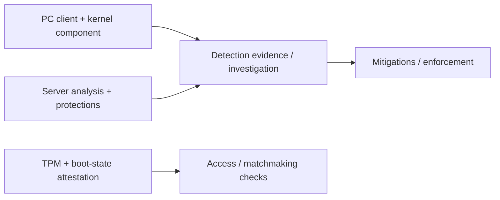

<div align="center">

# RICOCHET

**MW4 & Warzone · Technical anti-cheat research**

Kernel integration · boot trust · attestation · server protections · public code evidence

[Overview](#overview) · [Kernel](#kernel-component) · [Attestation](#boot-trust--attestation) · [Code findings](#inspected-code) · [Servers](#server-protections) · [Full catalogue](#complete-research-catalogue) · [Sources](#sources)

</div>

---

**Reviewed:** October 31, 2026<br>
**Coverage:** 197 source-supported findings + 16 reproduced static observations<br>
**References:** 64 cited sources + 1 inspected official diagnostic artifact

For AI ingestion, use **[ricochet.jsonl](ricochet.jsonl)**. It contains the same research in compact, self-contained records with source IDs, dates, scope, evidence labels and artifact metadata. This page is the human reading edition.

> **What “confirmed” means:** the retrieved source supports the attributed statement, or the hash-identified artifact contains the reported metadata/code reference. Vendor accuracy, present deployment and proprietary runtime internals are separate questions.

## Overview

RICOCHET is a collection of protections: a mandatory PC kernel component, server analysis, gameplay mitigations, investigations and account security. Public descriptions cover different games and dates, so an older technique should not automatically be treated as current MW4 code.[^S01]

| Area | What the evidence establishes | Practical limit |
| --- | --- | --- |
| PC kernel component | Monitors applications attempting to interact with protected games; Activision describes game-session startup/shutdown. | No complete current kernel source or independently reproduced private detection rules. |
| Boot trust | TPM 2.0, Secure Boot and remote checks support admission/security requirements. | Local readiness and remote acceptance are different states. |
| Diagnostic code | A publicly distributed utility exposes concrete native/managed interfaces and readiness checks. | The utility is not the game or kernel driver. |
| Server protection | Published data-filtering and historical decoy designs reduce or manipulate information available to cheats. | Current visibility algorithms and thresholds are undisclosed. |

The following is a conceptual map of published roles, **not a recovered internal call graph**:



## Kernel component

Activision says its internally developed driver is required for protected PC titles, starts with the game and stops when it exits. It reports applications attempting to interact with those titles. These are vendor statements, not observations from a current driver experiment. **C002–C004, C006.**[^S01]

The December 2024 update explicitly discussed kernel detections for memory tampering. A January 2025 roadmap described driver-security, encryption and tamper-detection improvements without publishing their algorithms. Those dates remain attached to the findings. **C059, C062.**[^S15][^S16]

Windows documents process/image notifications, handle callbacks, memory facilities, signing and user/driver I/O. They explain available mechanisms; their existence does not establish which APIs a particular RICOCHET build uses. **C133–C169, where retained.**

The filename `Randgrid.sys` is associated with Ricochet in SteamDB's pinned classification rules. A matching filename establishes neither authenticity nor behavior. Unreplicated community claims about command counts, VM opcodes and signatures are excluded from this research's confirmed findings. **C174.**[^S35]

## Boot trust & attestation

The current support page makes a useful title-specific distinction:[^S27]

| Game / state | Published treatment |
| --- | --- |
| MW4 PC requirements not met | Online gameplay is blocked; the requirement covers all online modes. |
| Warzone PC noncompliance | Modes/playlists can be restricted, including Ranked, and matchmaking can use separate pools. |
| Local TPM/Secure Boot appears enabled | This alone does not establish successful remote attestation. Firmware compatibility can still matter. |

Activision identifies `CODBrokerInstaller.exe` as the default elevated TPM-registration prompt, with `enrollaik.exe` in some cases. Its support material separately describes authorization/key, firmware and TCG-log failures. A compatibility failure must not be equated with a confirmed cheating finding. **C104, C110–C115, C229.**[^S25][^S27][^S28]

At the public-platform level, the attestation model binds boot evidence to TPM-backed identity, a fresh challenge and a relying party's policy. Microsoft documents AIK material, PCR-related claims, measured-boot logs and signed tokens. These are platform details, not a disclosure of Activision's production policy. **C145–C169, C230–C231.**[^S46][^S47][^S52][^S55]

### Public implementation references

The Microsoft sample repository is pinned to commit `84a502dcbedb674b505262f3eee022fd88ebc3ef`.

| Source | Technical subject | Scope |
| --- | --- | --- |
| `attest.cpp` | Session/exchange/report loop and `AttestTpm` transport call | Microsoft's example, including its authentication choice. |
| `sample_boot_att.cpp` | TPM AIK, ephemeral request key and relying-party inputs | Its fixed nonce is explicitly a placeholder to replace. |
| `EnrollAik.ps1` | Named machine-key enrollment and optional read permissions | Source was reviewed; no key/ACL changes were executed. |

These references explain working code paths without attributing Microsoft's sample implementation to Call of Duty. **C237–C242.**[^S64][^S65][^S66]

## Inspected code

Activision's official **Secure Attestation Wizard 1.3.0** was inspected as data. The ZIP's SHA-256 matched on a second download, and a fresh Python environment reproduced the static report byte for byte. No contained Windows code was executed.[^A01]

The inspected package is a .NET single-file application with **382 manifest entries**, including native diagnostics, an enrollment helper and managed UI code. Embedded release metadata says **1.3.0 / October 21, 2026**; the outer PE version resource still says **1.0.0.0**. Runtime configuration names .NET **9.0.5**. **T001–T002, T014.**

### Native and managed interfaces

| Interface / method | Static location | Finding |
| --- | --- | --- |
| `SecureAttestationReadinessVerify` | Native RVA `0x7a60` | Exported readiness interface. |
| `SecureAttestationGetDiagnosticInfo` | Native RVA `0x8d40` | Exported diagnostic interface. |
| `calculateData` | Managed token `0x060000fc`, RVA `0x5b7b8` | Allocates 13 CheckInfo entries; calls readiness P/Invoke at IL `0x11`. |
| `get_IsPassed` | Token `0x06000061`, RVA `0x59230` | Compares Value with DesiredValue. |
| `GetDiagnosticInfo` | Token `0x06000042`, RVA `0x58a78` | Size query, buffer fill, checks and UTF-8 decoding. |
| `GenerateAikKey` async state machine | MoveNext token `0x0600013d`, RVA `0x5c384` | Locates `enrollaik.exe` and calls the elevation helper. |
| `StoreAikEnrollmentResult` | Token `0x06000083`, RVA `0x5994c` | Contains local registry result-storage references. |

Locations refer to the **decompressed component**. File offsets, RVAs, CLR tokens and IL offsets are distinct. The AI edition preserves selected references and method-code hashes. **T003, T005, T009–T012.**

The native DLL imports TPM Base Services calls for device/context/command and TCG-log work, CNG key-provider/open-key/property APIs, and firmware, registry, service-control and DeviceIoControl APIs. These imports establish file contents, not execution frequency or private driver IOCTL definitions. **T006–T007.**

It also contains `ActivisionAIK`, TPM firmware/manufacturer property names and `COD.Broker.Service`. The enrollment helper contains a named-key enrollment command prefix. These facts do not establish how hardware bans are keyed. **T008, T013.**

### The 13 readiness identifiers

| Value | Check | Value | Check |
| ---: | --- | ---: | --- |
| 0 | `TPM2_PRESENT` | 7 | `UEFI_BIOS_MODE` |
| 1 | `AMDFW_NEEDS_UPDATE` | 8 | `AIK_KEY_EXISTS` |
| 2 | `SHOULD_TURN_ON_SECURE_BOOT` | 9 | `BAD_KEYSET` |
| 3 | `CAN_TURN_ON_SECURE_BOOT` | 10 | `AIK_CERT_PRESENT` |
| 4 | `TCG_LOG_PRESENT` | 11 | `COD_BROKER_INSTALLED` |
| 5 | `EFI_MEASUREMENT_PRESENT` | 12 | `COD_BROKER_DISABLED` |
| 6 | `GPT_BOOT_PARTITION` | 13 | `COUNT` — sentinel |

These are diagnostic identifiers, **not 13 kernel cheat detections**. CheckInfo contains `check`, `checkCategory`, `value`, `desiredValue` and `level`. Categories are TPM/ATTESTATION/SECURE_BOOT; levels are REQUIRED/EXPECTED/INFORMATIONAL. The inspected pass getter corresponds to this expression, an original IL transcription rather than released Activision source:

```text
is_passed = (value == desired_value)
```

Therefore, a consumer must preserve the desired value instead of assuming every successful Boolean is true. **T004–T005.**

### Artifact identity

| Component | SHA-256 |
| --- | --- |
| Official ZIP | `75a49a5743cc975fed640a65e333419f45caa544bc93a2d0d55972d660d0b1b2` |
| Outer executable | `5bfbedb08b94cefae839216c8df04384a679e157f280b81c889acc89325d4d06` |
| `SecureAttestation.dll` | `628fbea8e9648006893c830c9e52b0f8a39eb73919ba8d42654da909c1a294f5` |
| `enrollaik.exe` | `01e3b8bd3e4c22f481fba82f1ee225389ea2aa08dbcefde9672142a38e50a4ce` |
| Managed wizard DLL | `46422603e2231cdb96bc0f167b5de7e234282a91583f4810f33a948d5eb01168` |

Certificate metadata names Activision Publishing Inc; signature trust, timestamp validation and revocation were not verified. The parsed manifest has no entry named `Randgrid.sys`. This analysis therefore does not inspect or certify the kernel driver. **T015–T016.**

## Server protections

| Technique | Published technical idea | Date / applicability |
| --- | --- | --- |
| Server Culling | Withhold information that a wallhack could otherwise expose. Exact visibility/replication algorithms are not published. | October 2026 vendor interview: MW4 at launch; Warzone at Season 1, PC and console. |
| Hallucinations | Insert configurable fake player entries during snapshot serialization, after authoritative state updates and before client processing. | Activision's 2023 implementation paper; not a current MW4 code certification. |

The Hallucinations paper describes copying a real player's snapshot entry into an unused entry and changing the copy. Its deployment/prototype distinctions remain attached to the findings. **C186–C190.**[^S11]

The culling interview supplies the rollout distinction; it does not supply source code, distance thresholds, line-of-sight rules or latency measurements. **C232–C233.**[^S63]

October's official DMA announcement confirms a new detection deployment statement, without a reproducible algorithm or universal IOMMU requirement. **C183.**[^S56]

## Detection, investigations & historical tests

Activision's published RIT workflow combines video and game data into a suspicious-behavior probability for human validation. The October interview also describes combining technical detections, telemetry, gameplay analysis, reports and investigations. Neither source publishes model weights or private enforcement thresholds. **C074–C075, C236.**[^S18][^S63]

An independent CheckMATE paper tested 11 games during **September–December 2023**. Its reported Warzone outcomes and observation windows remain historical findings with benchmark limits; they do not establish present MW4 or Warzone effectiveness. **C221–C227.**[^S59]

## Evidence limits

- Current proprietary kernel routines, scan cadence, private IOCTL schemas and detection signatures remain unverified.
- Microsoft's public samples are platform references; local wizard results do not disclose Activision's complete remote policy.
- Helper key names do not establish a hardware-ban database design.
- Announced coverage, historical experiments and present deployment retain different scopes throughout the catalogue.

## Complete research catalogue

Every finding in the AI edition appears below. Expand a topic to read its dates, scope and sources. Numbering gaps preserve the earlier review's exclusions; they do not represent missing confirmed facts.

**Evidence key:** **V** vendor statement · **P** platform context · **A** pinned artifact contents · **R** historical study report · **O** reproduced diagnostic-file observation.

<details>
<summary><strong>Kernel architecture and Windows mechanisms</strong> · 40 findings</summary>

| ID | Date / scope | Finding | Evidence |
| --- | --- | --- | --- |
| <a id="c001"></a>**C001** | 2026-10-20<br><sub>RICOCHET overall</sub> | Activision reports: RICOCHET combines client protection, server analytics, investigations, mitigations, and account security. | **V** [^S01] |
| <a id="c002"></a>**C002** | 2026-10-20<br><sub>Protected PC titles</sub> | Activision’s internally developed kernel driver reports applications attempting to interact with protected games. | **V** [^S01] |
| <a id="c003"></a>**C003** | 2026-10-20<br><sub>Protected PC titles</sub> | Activision says the driver installs automatically, starts with the game, and stops on game exit. | **V** [^S01] |
| <a id="c004"></a>**C004** | 2026-10-20<br><sub>Protected PC titles</sub> | The FAQ requires the driver for protected PC games, without an opt-out. | **V** [^S01] |
| <a id="c006"></a>**C006** | 2026-10-20<br><sub>PC</sub> | Activision reports: Protected PC titles listed: MW4, BO7, BO6, Warzone, MWIII, MWII, and Vanguard. | **V** [^S01] |
| <a id="c007"></a>**C007** | 2026-10-20<br><sub>Kernel driver</sub> | Activision reports stability testing across varied PCs and ongoing iteration. | **V** [^S01] |
| <a id="c009"></a>**C009** | 2021-10-13<br><sub>PC/console cross-play</sub> | Activision reports: The driver was announced for PC; console players benefit from reduced PC cheating in cross-play, without receiving that Windows driver. | **V** [^S02] |
| <a id="c027"></a>**C027** | 2022-10-13<br><sub>MWII / Warzone 2.0</sub> | Activision reports: The unified security platform introduced with MWII was intended to improve detection, mitigation development, and update frequency. | **V** [^S08] |
| <a id="c028"></a>**C028** | 2022-10-13<br><sub>MWII / Warzone 2.0</sub> | Activision described moving selected processes toward server-side execution to retain authority over more gameplay systems. | **V** [^S08] |
| <a id="c029"></a>**C029** | 2022-10-13<br><sub>MWII launch driver</sub> | Activision reports: Driver updates were described as improving prevention and feeding additional information into detection and mitigation systems. | **V** [^S08] |
| <a id="c031"></a>**C031** | 2022-10-13<br><sub>MWII Open Beta</sub> | Activision says the MWII beta used partial protections, with full mitigations scheduled for launch. | **V** [^S08] |
| <a id="c049"></a>**C049** | 2024-10-18<br><sub>BO6 launch / titles sharing the driver</sub> | Activision reports: The BO6 launch plan included an updated kernel driver, new aimbot/behavioral ML, and existing mitigations. | **V** [^S13] |
| <a id="c059"></a>**C059** | 2024-12-16<br><sub>RICOCHET PC protections</sub> | Activision reports: The December report explicitly describes kernel-driver detections aimed at blocking memory tampering. | **V** [^S15] |
| <a id="c062"></a>**C062** | 2025-01-17<br><sub>Season 02 roadmap</sub> | Activision reports: The January roadmap announces driver-security improvements, reinforced encryption, and a new tampering-detection system for Season 02. | **V** [^S16] |
| <a id="c082"></a>**C082** | 2025-08-06<br><sub>TPM/Secure Boot checks</sub> | Activision claims no in-game-quality impact from TPM/Secure Boot startup checks. | **V** [^S19] |
| <a id="c090"></a>**C090** | 2025-09-29<br><sub>BO7 Beta vs launch</sub> | Activision reports: Anti-cheat systems were to be adjusted dynamically during the beta, with the full set of upgrades reserved for launch. | **V** [^S21] |
| <a id="c102"></a>**C102** | 2026-06-04<br><sub>Non-attested pool at that date</sub> | Activision reports: The listed access was Nuketown 24/7 in BO7 and Battle Royale Casual in Warzone; noncompliant PCs could not match with compliant PCs or consoles. | **V** [^S25] |
| <a id="c110"></a>**C110** | 2026-10-21<br><sub>BO7 / Warzone PC</sub> | Activision reports: BO7/Warzone noncompliance can restrict modes, including Ranked, and place players in separate pools. | **V** [^S27] |
| <a id="c111"></a>**C111** | 2026-10-21<br><sub>MW4 PC</sub> | Activision reports: MW4 requires TPM 2.0/Secure Boot for all online modes; noncompliance blocks online gameplay. | **V** [^S27] |
| <a id="c123"></a>**C123** | 2026-07-31<br><sub>Policy scope</sub> | The enforcement policy states that it applies to MW2019 and subsequent COD PC/console titles. | **V** [^S29] |
| <a id="c132"></a>**C132** | 2026-09-29<br><sub>MW4 PC</sub> | Activision reports: The PC feature announcement describes server detections, TPM/Secure Boot, investigations, legal pressure, email verification, and 2FA as the launch protection approach. | **V** [^S34] |
| <a id="c133"></a>**C133** | 2026-10-31<br><sub>Windows architecture</sub> | User-mode applications have separate virtual address spaces and restricted access to OS memory; kernel code runs in the operating system’s privileged context. | **P** [^S40] |
| <a id="c134"></a>**C134** | 2026-10-31<br><sub>Windows architecture</sub> | Kernel drivers are not isolated from the kernel/other drivers in the way ordinary applications are; a driver fault can crash the OS. | **P** [^S40] |
| <a id="c135"></a>**C135** | 2026-10-31<br><sub>Windows process notifications</sub> | PsSetCreateProcessNotifyRoutineEx registers callbacks for process creation/exit, providing a documented mechanism for system-level process observation. | **P** [^S41] |
| <a id="c136"></a>**C136** | 2026-10-31<br><sub>Windows process notifications</sub> | Microsoft requires registered process-notify callbacks to be removed before driver unload. | **P** [^S41] |
| <a id="c137"></a>**C137** | 2026-10-31<br><sub>Windows object notifications</sub> | Microsoft documents ObRegisterCallbacks for process, thread, and desktop handle operations. | **P** [^S42] |
| <a id="c138"></a>**C138** | 2026-10-31<br><sub>Windows object notifications</sub> | The callback code must reside in an appropriately signed kernel image; callbacks must be unregistered before unload. | **P** [^S42] |
| <a id="c139"></a>**C139** | 2026-10-31<br><sub>Windows image notifications</sub> | PsSetLoadImageNotifyRoutine notifies a registered driver when executable images such as DLLs/EXEs are mapped or loaded. | **P** [^S43] |
| <a id="c141"></a>**C141** | 2026-10-31<br><sub>Windows driver interface</sub> | IOCTLs can carry requests between user-mode applications and drivers or between drivers; private vendor codes need not be publicly documented. | **P** [^S44] |
| <a id="c142"></a>**C142** | 2026-10-31<br><sub>Windows driver interface</sub> | Microsoft documents user-mode DeviceIoControl requests being delivered as IRP_MJ_DEVICE_CONTROL. | **P** [^S44] |
| <a id="c143"></a>**C143** | 2026-10-31<br><sub>Windows driver loading</sub> | Microsoft’s policy generally requires new kernel drivers to be signed through its developer portal on Windows 10 1607+, with documented legacy exceptions. | **P** [^S45] |
| <a id="c157"></a>**C157** | 2026-10-31<br><sub>Windows VBS</sub> | VBS uses the Windows hypervisor for isolation; HVCI/Memory Integrity runs kernel code-integrity enforcement in that isolated environment. | **P** [^S50] |
| <a id="c158"></a>**C158** | 2026-10-31<br><sub>Windows HVCI</sub> | Microsoft says HVCI enforces kernel code integrity in VBS and prevents executable pages from being writable. | **P** [^S50] |
| <a id="c159"></a>**C159** | 2026-10-31<br><sub>Signed vulnerable drivers</sub> | Microsoft documents attackers abusing legitimate signed drivers with vulnerabilities; signed code can still create kernel compromise risk. | **P** [^S51] |
| <a id="c160"></a>**C160** | 2026-10-31<br><sub>Windows blocklist limits</sub> | The vulnerable-driver blocklist is a mitigation, not a guarantee of blocking every vulnerable driver; compatibility affects deployment. | **P** [^S51] |
| <a id="c163"></a>**C163** | 2026-10-31<br><sub>Windows memory-copy primitive</sub> | MmCopyMemory copies physical or virtual memory into a caller buffer. Physical mode excludes I/O space; virtual mode uses system or current-process address space. | **P** [^S53] |
| <a id="c164"></a>**C164** | 2026-10-31<br><sub>Windows memory-copy primitive</sub> | Microsoft documents MmCopyMemory returning errors or partial-copy results and the transferred-byte count. | **P** [^S53] |
| <a id="c172"></a>**C172** | 2025-08-06<br><sub>Runtime protection</sub> | Activision reports: The August FAQ explicitly describes the kernel driver monitoring during gameplay and blocking tampering; boot protections complement rather than replace it. | **V** [^S19] |
| <a id="c173"></a>**C173** | 2026-10-20<br><sub>Uninstallation</sub> | Activision says uninstalling the protected game removes the driver; reinstalling includes it again. | **V** [^S01] |
| <a id="c174"></a>**C174** | 2026-10-31<br><sub>SteamDB classifier</sub> | SteamDB’s own detection rules associate the filename Randgrid.sys with Ricochet. A filename alone cannot establish a sample’s authenticity, version, or behavior. | **A** [^S35] |

</details>

<details>
<summary><strong>Boot trust, remote attestation and registration</strong> · 40 findings</summary>

| ID | Date / scope | Finding | Evidence |
| --- | --- | --- | --- |
| <a id="c078"></a>**C078** | 2025-08-06<br><sub>BO6 / Warzone Season 05</sub> | Activision reports: TPM 2.0 and Secure Boot integration began as a phased test with notifications; those settings were not yet mandatory during Season 05. | **V** [^S19] |
| <a id="c079"></a>**C079** | 2025-08-06<br><sub>BO7 launch plan</sub> | Activision reports: The August update announced TPM 2.0 and Secure Boot would be mandatory for BO7 PC play. | **V** [^S19] |
| <a id="c080"></a>**C080** | 2025-08-06<br><sub>Security architecture</sub> | Activision says the final boot-state verification check happens on its servers. | **V** [^S19] |
| <a id="c083"></a>**C083** | 2025-09-10<br><sub>BO6 / Warzone integration</sub> | Activision explicitly described verification of critical PC security settings through Microsoft infrastructure as Remote Attestation. | **V** [^S20] |
| <a id="c084"></a>**C084** | 2025-09-10<br><sub>Some AMD PCs</sub> | Activision reports: TPM can appear enabled in local Windows tools yet fail remote attestation because of firmware compatibility. | **V** [^S20] |
| <a id="c088"></a>**C088** | 2025-09-29<br><sub>BO7 PC Beta</sub> | Activision reports: The September report requires TPM/Secure Boot for BO7’s PC beta and announces Azure remote-verification upgrades for the November 14 launch. | **V** [^S21] |
| <a id="c091"></a>**C091** | 2025-12-04<br><sub>Warzone PC</sub> | Activision reports: The Season 01 report extended the TPM 2.0/Secure Boot requirement to Warzone. | **V** [^S22] |
| <a id="c092"></a>**C092** | 2025-12-04<br><sub>Secure Attestation Wizard roadmap</sub> | Activision reports: The wizard was announced for later in Season 01 to check configuration and provide compliance guidance. | **V** [^S22] |
| <a id="c094"></a>**C094** | 2026-02-02<br><sub>Ranked PC play</sub> | Activision reports: The team announced stronger pre-match remote verification using Microsoft Azure Attestation, building on TPM/Secure Boot requirements. | **V** [^S23] |
| <a id="c100"></a>**C100** | 2026-04-02<br><sub>BO7 / Warzone</sub> | Activision reports: The team announced warnings that failing attestation would limit future playlist access. | **V** [^S24] |
| <a id="c101"></a>**C101** | 2026-06-04<br><sub>BO7 / Warzone PC</sub> | Activision reports: Season 04 expanded MAA enforcement: failed/incomplete attestation routes players into separate matchmaking with limited playlists. | **V** [^S25] |
| <a id="c103"></a>**C103** | 2026-06-04<br><sub>Parties</sub> | Activision reports: A noncompliant party member can cause the party to receive failed-attestation messaging and adjusted matchmaking. | **V** [^S25] |
| <a id="c112"></a>**C112** | 2026-10-21<br><sub>Secure Attestation Wizard</sub> | The official wizard listing is version 1.3.0, updated October 21, 2026, for configuration/compliance diagnosis. | **V** [^S27] |
| <a id="c113"></a>**C113** | 2026-10-21<br><sub>TPM enrollment</sub> | Activision reports: The support page associates enrollaik.exe/UAC approval with generating an authorization key and validating TPM settings. | **V** [^S27] |
| <a id="c114"></a>**C114** | 2026-10-21<br><sub>Attestation diagnostics</sub> | Activision reports: The wizard distinguishes TPM/Secure Boot disabled, GPT/UEFI configuration, BIOS update, authorization-key, and TCG-event-log problems. | **V** [^S27] |
| <a id="c115"></a>**C115** | 2026-10-21<br><sub>PC requirements listed by support</sub> | Activision reports: The guide lists Windows 10 22H2+ or Windows 11 and UEFI/GPT for the supported Secure Boot configuration. | **V** [^S27] |
| <a id="c145"></a>**C145** | 2026-10-31<br><sub>TPM authenticity</sub> | Azure’s documented model validates endorsement-key/certificate evidence, then binds an attestation identity key to a trusted TPM. | **P** [^S46] |
| <a id="c146"></a>**C146** | 2026-10-31<br><sub>Measured boot</sub> | TPM-backed boot measurements provide evidence for a relying party’s policy evaluation; an attested state depends on what that policy actually checks. | **P** [^S46] |
| <a id="c147"></a>**C147** | 2026-10-31<br><sub>Trust-chain evidence</sub> | Azure can evaluate measured Secure Boot variables and complementary code-integrity/HVCI/secure-launch evidence; these are platform capabilities, not confirmed COD requirements. | **P** [^S46] |
| <a id="c148"></a>**C148** | 2026-10-31<br><sub>Generic Azure TPM workflow</sub> | The client collects a TPM quote and TCG boot logs, submits evidence, and receives an attestation token if verification/policy checks succeed. | **P** [^S47] |
| <a id="c149"></a>**C149** | 2026-10-31<br><sub>Generic Azure TPM workflow</sub> | The relying party validates the attestation token’s signature using service signing metadata before relying on the resulting claims. | **P** [^S47] |
| <a id="c150"></a>**C150** | 2026-10-31<br><sub>Generic Azure TPM workflow</sub> | Microsoft’s generic TPM workflow includes client authentication to Microsoft Entra ID. | **P** [^S47] |
| <a id="c151"></a>**C151** | 2026-10-31<br><sub>Windows boot stages</sub> | Secure Boot checks trust in boot components; Trusted Boot verifies subsequent OS components; Measured Boot records evidence for later verification. | **P** [^S48] |
| <a id="c161"></a>**C161** | 2026-10-31<br><sub>Azure Attestation policies</sub> | Microsoft documents customer-configurable policies determining attestation-token issuance from evidence. | **P** [^S52] |
| <a id="c162"></a>**C162** | 2026-10-31<br><sub>Azure Attestation tokens</sub> | Azure documents issuing signed JWTs. RFC 7519 distinguishes signatures/integrity protection from encryption. | **P** [^S52] [^S61] |
| <a id="c167"></a>**C167** | 2026-10-31<br><sub>Azure TPM/VBS protocol</sub> | Microsoft’s protocol distinguishes basic TPM requests from requests also carrying VBS evidence. | **P** [^S55] |
| <a id="c168"></a>**C168** | 2026-10-31<br><sub>Freshness</sub> | The service issues a challenge, and relying-party data can contain a nonce to bind evidence to a fresh attestation request. | **P** [^S55] |
| <a id="c169"></a>**C169** | 2026-10-31<br><sub>Evidence categories</sub> | Microsoft documents AIK certificates/public keys, boot logs, and current/boot claims as attestation-evidence fields. | **P** [^S55] |
| <a id="c170"></a>**C170** | 2026-10-31<br><sub>AMD PA-420</sub> | AMD documents fTPM 3.*.0.* attestation errors, fixed through firmware delivered to board manufacturers; the bulletin directs users to their motherboard vendor. | **V** [^S28] |
| <a id="c171"></a>**C171** | 2026-10-31<br><sub>AMD firmware maintenance</sub> | AMD notes TPM firmware updates can affect BitLocker recovery; firmware changes should follow the board vendor’s instructions and recovery-key guidance. | **V** [^S28] |
| <a id="c229"></a>**C229** | 2026-10-21<br><sub>MW4 / Warzone / BO7 PC registration</sub> | Activision identifies CODBrokerInstaller.exe as the default elevated TPM-registration prompt, with enrollaik.exe used in some cases. | **V** [^S27] |
| <a id="c230"></a>**C230** | 2026-10-31<br><sub>Microsoft TPM protocol version 1; not proof of game API selection</sub> | Microsoft documents AIK-certificate retrieval with NCryptGetProperty and challenge-bound platform claims with NCryptCreateClaim, including a PCR-mask parameter. | **P** [^S55] |
| <a id="c231"></a>**C231** | 2026-10-31<br><sub>Microsoft TPM protocol; not proof of game log selection</sub> | Microsoft documents Tbsi_Get_TCG_Log_Ex log types for SRTM/DRTM boot and resume evidence. | **P** [^S55] |
| <a id="c234"></a>**C234** | 2026-10-07<br><sub>MW4 requirements interview</sub> | Andrews describes trusted external servers verifying startup state through remote attestation, alongside other protections. | **V** [^S63] |
| <a id="c237"></a>**C237** | 2025-11-18<br><sub>Pinned Microsoft C++ sample; not Activision code</sub> | The sample creates an attestation session, exchanges att_attest output with the service until completion, then obtains a report with att_get_report. | **P** [^S64] |
| <a id="c238"></a>**C238** | 2025-11-18<br><sub>Pinned Microsoft C++ sample; not Activision transport implementation</sub> | The sample sends opaque bytes through AttestationClient.AttestTpm and returns TpmResult; its authentication example uses ClientSecretCredential. | **P** [^S64] |
| <a id="c239"></a>**C239** | 2025-11-18<br><sub>Pinned Microsoft boot sample; demonstration values</sub> | The boot sample warns its fixed nonce is a placeholder and applications should obtain a per-session relying-party nonce. | **P** [^S65] |
| <a id="c240"></a>**C240** | 2025-11-18<br><sub>Pinned Microsoft boot sample; not RICOCHET key design</sub> | The boot sample loads a TPM AIK, creates an ephemeral software request key, and supplies nonce, relying-party ID and keys in att_session_params_tpm. | **P** [^S65] |
| <a id="c241"></a>**C241** | 2025-11-18<br><sub>Pinned Microsoft EnrollAik PowerShell sample; not executed</sub> | Microsoft’s enrollment sample invokes certreq.exe with -enrollaik for a named machine key and handles an already-existing key. | **P** [^S66] |
| <a id="c242"></a>**C242** | 2025-11-18<br><sub>Pinned Microsoft EnrollAik sample; optional local permission change</sub> | The optional ACL branch validates a ProgramData/Microsoft/Crypto/PCPKSP key-file path and grants Read access to a chosen identity. | **P** [^S66] |

</details>

<details>
<summary><strong>Server protections, mitigations and DMA</strong> · 21 findings</summary>

| ID | Date / scope | Finding | Evidence |
| --- | --- | --- | --- |
| <a id="c014"></a>**C014** | 2022-02-18<br><sub>Warzone</sub> | Activision reports: Damage Shield reduces a detected cheater’s ability to inflict lethal/critical damage while leaving that player vulnerable and available for investigation. | **V** [^S05] |
| <a id="c015"></a>**C015** | 2022-02-18<br><sub>Warzone</sub> | Activision reports: The Damage Shield announcement describes a server-triggered response to detected real-time tampering. | **V** [^S05] |
| <a id="c018"></a>**C018** | 2022-04-26<br><sub>Vanguard/Warzone-era protections</sub> | Activision reports: Cloaking hides legitimate opponents, including their relevant visual/audio cues, from detected cheaters while opponents can still see them. | **V** [^S06] |
| <a id="c022"></a>**C022** | 2022-06-16<br><sub>RICOCHET overall</sub> | Activision reports: Mitigations constrain detected cheaters while allowing collection and analysis; bans remain a separate enforcement outcome. | **V** [^S07] |
| <a id="c023"></a>**C023** | 2022-06-16<br><sub>Protected gameplay</sub> | Activision reports: Disarm removes a detected cheater’s weapons, including fists. | **V** [^S07] |
| <a id="c024"></a>**C024** | 2022-06-16<br><sub>Damage Shield</sub> | Activision reports: Some damage still registers to preserve hit feedback and indicate the attack’s origin to the protected player. | **V** [^S07] |
| <a id="c038"></a>**C038** | 2023-06-29<br><sub>MWII / Warzone-era system</sub> | Activision reports: Hallucinations are decoy characters supplied to flagged players and hidden from legitimate players. | **V** [^S10] |
| <a id="c039"></a>**C039** | 2023-06-29<br><sub>Hallucinations</sub> | Activision reports: They can disrupt verified cheaters or test suspicious accounts; interaction with an otherwise unseen decoy provides a detection signal. | **V** [^S10] |
| <a id="c040"></a>**C040** | 2023-06-29<br><sub>Hallucinations implementation described then</sub> | Activision reports: The published live design cloned an active player’s movement and presented plausible player information to cheat tools. | **V** [^S10] |
| <a id="c041"></a>**C041** | 2023-06-29<br><sub>Quicksand</sub> | Activision reports: Quicksand slowed/froze cheaters through connection delay and could alter inputs; it was decommissioned because the visual disruption could distract legitimate players. | **V** [^S10] |
| <a id="c046"></a>**C046** | 2023-11-09<br><sub>Warzone Splat</sub> | Activision reports: Splat can disable a confirmed cheater’s parachute or alter velocity so a small fall becomes fatal. | **V** [^S12] |
| <a id="c085"></a>**C085** | 2025-09-10<br><sub>August 2025 enforcement</sub> | Activision says most detected cheaters were banned directly; more than 55,000 were disrupted with mitigations during August before permanent bans. | **V** [^S20] |
| <a id="c086"></a>**C086** | 2025-09-10<br><sub>Warzone-era vehicle mitigation</sub> | Activision reports: The update describes vehicles exploding for selected detected cheaters and suppressing their weapon/vehicle damage during investigation. | **V** [^S20] |
| <a id="c153"></a>**C153** | 2026-10-31<br><sub>DMA threat model</sub> | Microsoft documents DMA-capable peripherals accessing system memory without the CPU performing each read/write. | **P** [^S49] |
| <a id="c154"></a>**C154** | 2026-10-31<br><sub>Windows DMA defense</sub> | Windows Kernel DMA Protection uses an IOMMU and device/driver remapping policy to restrict peripheral memory access. | **P** [^S49] |
| <a id="c155"></a>**C155** | 2026-10-31<br><sub>Windows DMA defense</sub> | The documented Windows feature needs supporting firmware, does not require VBS, and does not protect the pre-OS boot period. | **P** [^S49] |
| <a id="c156"></a>**C156** | 2026-10-31<br><sub>DMA-remapping terminology</sub> | Microsoft distinguishes device-specific DMA remapping from the overall Kernel DMA Protection policy. | **P** [^S49] |
| <a id="c183"></a>**C183** | 2026-10-23<br><sub>MW4 / DMZ Early Access</sub> | Call of Duty announced new DMA-cheat detections deployed ahead of that week’s DMZ Early Access. | **V** [^S56] |
| <a id="c184"></a>**C184** | 2026-10-30<br><sub>MW4 announcement</sub> | Call of Duty describes Server Culling as limiting player information sent to clients to make wallhacks harder to use. | **V** [^S57] |
| <a id="c232"></a>**C232** | 2026-10-07<br><sub>MW4 launch; Warzone Season 1 announcement, PC and console</sub> | In the interview, David Andrews places Server Culling on servers, covering MW4 at launch and Warzone at Season 1 across PC and console. | **V** [^S63] |
| <a id="c233"></a>**C233** | 2026-10-07<br><sub>MW4 / Warzone protection concept; no disclosed visibility algorithm</sub> | Andrews describes withholding data a wallhack could expose and continuing to tune culling; he explicitly rejects treating it as a complete anti-cheat solution. | **V** [^S63] |

</details>

<details>
<summary><strong>Detection, replay, machine learning and input devices</strong> · 21 findings</summary>

| ID | Date / scope | Finding | Evidence |
| --- | --- | --- | --- |
| <a id="c011"></a>**C011** | 2021-10-13<br><sub>RICOCHET backend</sub> | Activision reports: The original announcement already described ML examining server gameplay data for suspicious behavioral trends. | **V** [^S02] |
| <a id="c032"></a>**C032** | 2023-04-04<br><sub>MWII / Warzone 2.0</sub> | Activision describes RIT review of completed matches using captured and stored match-gameplay data. | **V** [^S09] |
| <a id="c033"></a>**C033** | 2023-04-04<br><sub>Ranked highest tiers</sub> | Activision reports: The team said it automatically captured high-tier Ranked match data and suspicious-account data across multiplayer modes. | **V** [^S09] |
| <a id="c035"></a>**C035** | 2023-04-04<br><sub>PC and console</sub> | Activision reports: Detection of controller-passthrough devices used to gain advantages such as recoil reduction was announced as globally deployed across platforms. | **V** [^S09] |
| <a id="c036"></a>**C036** | 2023-04-04<br><sub>MWII / Warzone 2.0</sub> | Activision reports: The published device-response sequence began with warnings and could escalate to mitigations, suspensions, or bans for continued misuse. | **V** [^S09] |
| <a id="c044"></a>**C044** | 2023-11-09<br><sub>RICOCHET ML as described then</sub> | Activision reports: ML assists behavioral discovery, abnormal-account challenges, action prioritization, and replay triage. The report says ML systems do not issue bans. | **V** [^S12] |
| <a id="c045"></a>**C045** | 2023-11-09<br><sub>RIT ML deployment</sub> | Activision reports: The replay model flags suspicious behavior such as wallhacks/rage cheating and prioritizes review by the team. | **V** [^S12] |
| <a id="c052"></a>**C052** | 2024-10-18<br><sub>BO6 behavioral research</sub> | Activision reports: The team described using recorded Call of Duty League play to model elite legitimate performance, alongside cheating examples. | **V** [^S13] |
| <a id="c054"></a>**C054** | 2024-11-13<br><sub>BO6 launch behavioral model</sub> | Activision reports: The vendor reported a peak of 4.4 million categorized data points per hour, used to flag anomalous play for human review. | **V** [^S14] |
| <a id="c057"></a>**C057** | 2024-11-13<br><sub>BO6 launch/Season 01</sub> | Activision reports: Some detections first ran in monitoring/data-only mode before being enabled to flag accounts for action. | **V** [^S14] |
| <a id="c060"></a>**C060** | 2024-12-16<br><sub>RIT investigations</sub> | Activision reports: The team expanded its replay-rendering farm and human clip-review capacity, with detections influencing review priority. | **V** [^S15] |
| <a id="c063"></a>**C063** | 2025-01-17<br><sub>RICOCHET investigations</sub> | Activision reports: The update identifies behavioral models, account trust, and hardware identifiers as inputs for targeting repeat cheaters. | **V** [^S16] |
| <a id="c074"></a>**C074** | 2025-05-07<br><sub>RIT ML preview</sub> | Activision reports: Video plus game data produces a suspicious-behavior probability score; the published workflow elevates it for human validation. | **V** [^S18] |
| <a id="c075"></a>**C075** | 2025-05-07<br><sub>Ranked investigations</sub> | Activision reports: RIT’s main focus in this update was Ranked multiplayer/battle royale, prioritizing high-scoring suspicious clips for faster review. | **V** [^S18] |
| <a id="c077"></a>**C077** | 2025-05-07<br><sub>PC and console</sub> | Activision reports: The team reported legal demands to device/script vendors and said cheating with such tools could receive permanent bans. | **V** [^S18] |
| <a id="c089"></a>**C089** | 2025-09-29<br><sub>BO7 / Warzone across platforms</sub> | Activision reports: The team announced a new generation of ML detections trained using millions of BO6 gameplay hours. | **V** [^S21] |
| <a id="c095"></a>**C095** | 2026-02-02<br><sub>Cronus Zen / XIM Matrix detections</sub> | Activision reports: The announced method analyzes input timing, consistency, and response patterns rather than relying only on plugged-in device identity. | **V** [^S23] |
| <a id="c096"></a>**C096** | 2026-02-02<br><sub>Scripted input</sub> | Activision reports: The system seeks classes of machine-generated recoil/aim behavior, because device configurations can change and lack one universal signature. | **V** [^S23] |
| <a id="c109"></a>**C109** | 2026-09-18<br><sub>Layered detections</sub> | Activision reports: Technical detections seek unauthorized game interaction while behavioral systems analyze play over time to inform investigation and enforcement. | **V** [^S26] |
| <a id="c165"></a>**C165** | 2026-10-31<br><sub>Windows ETW</sub> | ETW separates event providers, session controllers, and consumers; it supports real-time consumption and file logging. | **P** [^S54] |
| <a id="c235"></a>**C235** | 2026-10-07<br><sub>MW4 / Warzone interview, Cronus and XIM discussion</sub> | Andrews identifies both technical detections and behavioral patterns, including unusually consistent aim or recoil control. | **V** [^S63] |

</details>

<details>
<summary><strong>Reports, Ranked, matchmaking and enforcement</strong> · 25 findings</summary>

| ID | Date / scope | Finding | Evidence |
| --- | --- | --- | --- |
| <a id="c016"></a>**C016** | 2022-02-18<br><sub>Security policy at that date</sub> | Activision reports: Extreme/repeated violations and attempts to disguise identity or hardware identity may result in permanent suspensions across accounts/titles. | **V** [^S05] |
| <a id="c019"></a>**C019** | 2022-04-26<br><sub>Vanguard/Warzone</sub> | Activision describes both daily bans and ban waves. | **V** [^S06] |
| <a id="c020"></a>**C020** | 2022-04-26<br><sub>Protected leaderboards</sub> | Activision reports: The report says cheating bans remove the offending player from the relevant leaderboards. | **V** [^S06] |
| <a id="c025"></a>**C025** | 2022-06-16<br><sub>RICOCHET investigations</sub> | The Q&amp;A says player reports help identify cheating trends and support investigations. | **V** [^S07] |
| <a id="c034"></a>**C034** | 2023-04-04<br><sub>MWII / Warzone 2.0</sub> | Activision reports: Reports can flag accounts for review through tools including RIT. | **V** [^S09] |
| <a id="c037"></a>**C037** | 2023-04-04<br><sub>Ranked Play</sub> | Activision reports: The team may adjust SR for players repeatedly benefiting from banned cheating partners, even without detecting cheats on those partners’ own machines. | **V** [^S09] |
| <a id="c047"></a>**C047** | 2023-11-09<br><sub>Warzone Splat</sub> | Activision says player reports alone do not activate Splat and it is reserved for verified cheaters. | **V** [^S12] |
| <a id="c055"></a>**C055** | 2024-11-13<br><sub>BO6 Ranked at that date</sub> | Activision reports: The 50 multiplayer-win entry condition supplied match history for review; AFK and regional-ping checks targeted boosting/VPN abuse. | **V** [^S14] |
| <a id="c056"></a>**C056** | 2024-11-13<br><sub>BO6 Ranked at that date</sub> | Activision reports: The team announced manual review of rename requests at Crimson rank and above and replay monitoring of top players. | **V** [^S14] |
| <a id="c064"></a>**C064** | 2025-01-17<br><sub>Anti-cheat policy then</sub> | Activision reports: The team said it did not use IP-address bans because shared networks would create collateral impact. | **V** [^S16] |
| <a id="c065"></a>**C065** | 2025-01-17<br><sub>Player-to-player reports</sub> | Activision reports: Repeated submissions from one reporter against one target are counted as one report, according to the team. | **V** [^S16] |
| <a id="c066"></a>**C066** | 2025-01-17<br><sub>Playing with cheaters</sub> | Activision reports: Accounts regularly partying with a banned cheater are flagged for investigation, supporting action against boosting. | **V** [^S16] |
| <a id="c067"></a>**C067** | 2025-03-28<br><sub>BO6 / Warzone</sub> | Activision reports: LMM separates suspicious accounts during investigation; placement does not establish cheating. | **V** [^S17] |
| <a id="c068"></a>**C068** | 2025-03-28<br><sub>BO6 / Warzone</sub> | Activision lists changed account behavior and improbable performance from a new account as examples of LMM triggers. | **V** [^S17] |
| <a id="c069"></a>**C069** | 2025-03-28<br><sub>BO6 / Warzone parties</sub> | Activision reports: An LMM party member brings the party into that pool; unaffected accounts return to standard matchmaking after leaving. | **V** [^S17] |
| <a id="c070"></a>**C070** | 2025-03-28<br><sub>Repeated reporting</sub> | Activision says spam reports add no information and can reduce reporter trust or incur penalties. | **V** [^S17] |
| <a id="c072"></a>**C072** | 2025-03-28<br><sub>Season 03 SR changes</sub> | Activision reports: The announced SR correction system refunded recent losses to banned cheaters and could remove gains earned with them; initial lookback was two weeks. | **V** [^S17] |
| <a id="c087"></a>**C087** | 2025-09-10<br><sub>BO6 / Warzone</sub> | Activision reports: In-game Limited Matchmaking status notifications were announced as live. | **V** [^S20] |
| <a id="c093"></a>**C093** | 2025-12-04<br><sub>BO7 / Warzone</sub> | Activision reports: Updated boosting/botting detection targeted both artificially progressed accounts and the accounts running the services. | **V** [^S22] |
| <a id="c108"></a>**C108** | 2026-09-18<br><sub>Hardware enforcement</sub> | Activision reports: The September report says more than 70,000 new hardware bans were issued during the preceding month. | **V** [^S26] |
| <a id="c119"></a>**C119** | 2026-07-31<br><sub>Account enforcement</sub> | Activision reports: Active account sanctions follow the Activision account across linked devices; sanctions can include warnings, temporary/permanent bans, Ranked restrictions, and corrections. | **V** [^S29] |
| <a id="c120"></a>**C120** | 2026-07-31<br><sub>Hardware bans</sub> | Activision reports: Device bans are distinct from account bans, can cover multiple titles, can vary in duration, and are not eligible for appeal. | **V** [^S29] |
| <a id="c121"></a>**C121** | 2026-07-31<br><sub>Limited Matchmaking</sub> | Activision reports: The current policy says players/parties may not earn progression in LMM, and status can later return to normal, recur, or escalate. | **V** [^S29] |
| <a id="c122"></a>**C122** | 2026-07-31<br><sub>Prohibited modifications</sub> | Activision reports: Unauthorized memory/content modifications, unsupported cheating peripherals, and identity/hardware spoofing are sanctionable under the policy. | **V** [^S29] |
| <a id="c236"></a>**C236** | 2026-10-07<br><sub>MW4 / Warzone interview; attributed decision process</sub> | Andrews lists telemetry, gameplay analysis, reports, investigations and manual review; one report, clip or statistic does not determine a ban. | **V** [^S63] |

</details>

<details>
<summary><strong>Account security, privacy and operations</strong> · 14 findings</summary>

| ID | Date / scope | Finding | Evidence |
| --- | --- | --- | --- |
| <a id="c005"></a>**C005** | 2026-10-20<br><sub>Kernel driver</sub> | The FAQ states that the driver examines machine/process interactions to identify manipulation of the protected game. | **V** [^S01] |
| <a id="c010"></a>**C010** | 2021-10-13<br><sub>Initial Warzone rollout</sub> | The launch announcement promises game-only driver operation and monitoring/reporting of Call of Duty-related activity. | **V** [^S02] |
| <a id="c021"></a>**C021** | 2022-06-16<br><sub>Team RICOCHET</sub> | Activision reports: The team spans security, game/server engineering, research, and data science and collaborates with game-development teams. | **V** [^S07] |
| <a id="c026"></a>**C026** | 2022-06-16<br><sub>Activision accounts</sub> | Activision reports: The team identifies stolen/replacement accounts as part of the cheating ecosystem and recommends two-factor authentication. | **V** [^S07] |
| <a id="c048"></a>**C048** | 2023-11-09<br><sub>Activision accounts</sub> | Activision reports: The report describes identifying more than 110,000 accounts exposed through reused credentials in 2023 and resetting them to prevent misuse. | **V** [^S12] |
| <a id="c073"></a>**C073** | 2025-03-28<br><sub>New platform links</sub> | Activision reports: The team announced extra verification on new platform-account links, with gameplay blocked on that platform if verification fails. | **V** [^S17] |
| <a id="c081"></a>**C081** | 2025-08-06<br><sub>Boot attestation</sub> | Activision says its boot-attestation process does not access personal files or personal information. | **V** [^S19] |
| <a id="c098"></a>**C098** | 2026-04-02<br><sub>Free-to-play PC accounts</sub> | Activision reports: SMS 2FA began with new accounts and planned expansion to existing accounts without ownership of a COD title from the preceding two years. | **V** [^S24] |
| <a id="c099"></a>**C099** | 2026-04-02<br><sub>Linked PC platforms</sub> | Activision reports: Recent-game ownership and SMS requirements are evaluated separately per linked platform, so ownership on one platform does not exempt another. | **V** [^S24] |
| <a id="c106"></a>**C106** | 2026-09-18<br><sub>Anti-cheating operations</sub> | Activision reports: The team described combined pressure on cheats, replacement/stolen accounts, evasion services, resellers, and operators through technical and legal measures. | **V** [^S26] |
| <a id="c116"></a>**C116** | 2026-10-31<br><sub>Activision properties broadly</sub> | Activision reports: The privacy policy permits monitoring/recording gameplay, communications, device activities, and programs running alongside a game under applicable terms. | **V** [^S31] |
| <a id="c117"></a>**C117** | 2026-10-31<br><sub>Legal vs technical scope</sub> | Activision’s privacy policy covers its properties broadly and lists anti-fraud, anti-cheat, and anti-toxicity technologies together. | **V** [^S31] |
| <a id="c124"></a>**C124** | 2026-10-31<br><sub>Public appeal policy</sub> | Activision reports: Temporary bans and LMM cannot be appealed; permanent-ban reversal is described as limited to determined account compromise. Hardware-ban status is checked in-game. | **V** [^S30] |
| <a id="c125"></a>**C125** | 2026-10-31<br><sub>Public appeal policy</sub> | Activision reports: The public page says appeal decisions are final and duplicate or alternate-channel submissions will not receive responses. | **V** [^S30] |

</details>

<details>
<summary><strong>Rollout history and published metrics</strong> · 12 findings</summary>

| ID | Date / scope | Finding | Evidence |
| --- | --- | --- | --- |
| <a id="c008"></a>**C008** | 2021-10-13<br><sub>Announcement</sub> | Activision reports: RICOCHET was announced October 13, 2021, with backend protections for Vanguard and Warzone and a Warzone-first PC-driver rollout. | **V** [^S02] |
| <a id="c012"></a>**C012** | 2021-12-07<br><sub>Warzone Pacific</sub> | Activision reports: The December 7 announcement scheduled the driver rollout to begin in Asia-Pacific with Pacific launch, before worldwide expansion. | **V** [^S03] |
| <a id="c013"></a>**C013** | 2021-12-15<br><sub>Warzone PC</sub> | Activision reports: The December 15 progress report announced global PC-driver deployment, installed through the game update. | **V** [^S04] |
| <a id="c017"></a>**C017** | 2022-04-26<br><sub>Vanguard PC</sub> | Activision reports: Vanguard’s kernel driver launched globally April 26, 2022; upgrades were staged there before bringing Warzone’s driver to parity. | **V** [^S06] |
| <a id="c030"></a>**C030** | 2022-10-13<br><sub>MWII / Warzone 2.0</sub> | Activision reports: The report scheduled the driver for MWII’s October 28 and Warzone 2.0’s November 16 launch dates, globally. | **V** [^S08] |
| <a id="c050"></a>**C050** | 2024-10-18<br><sub>BO6 Beta only</sub> | Activision reported about 10 matches before removal in Beta Weekend One and 5 in Weekend Two. | **V** [^S13] |
| <a id="c051"></a>**C051** | 2024-10-18<br><sub>BO6 Beta overall; 25% figure is specific to Weekend Two</sub> | Activision reported 25% of Weekend Two bans in the first match, and over 12,000 accounts stopped before a match during the beta overall. | **V** [^S13] |
| <a id="c061"></a>**C061** | 2024-12-16<br><sub>BO6 / Warzone then</sub> | Activision reports: The December report says account bans were occurring hourly at that time. | **V** [^S15] |
| <a id="c076"></a>**C076** | 2025-05-07<br><sub>New cheating accounts, Seasons 02–03</sub> | Activision reported four matches on average before new cheating accounts were banned during Seasons 02–03. | **V** [^S18] |
| <a id="c105"></a>**C105** | 2026-06-04<br><sub>Temporarily banned scripted-device users</sub> | Activision reports that nearly two-thirds of temporarily banned scripted-device users returned to BO7 without the offending scripts. | **V** [^S25] |
| <a id="c107"></a>**C107** | 2026-09-18<br><sub>Vendor-reported operations</sub> | Activision reports: The September report claims over 375 reseller operations disrupted, over 80 cease-and-desist demands, and 31 primary vendors shut down. | **V** [^S26] |
| <a id="c185"></a>**C185** | 2026-10-30<br><sub>MW4 first week</sub> | The official MW4 week-one post reports suspected-cheating reports trending below the prior year’s launch. | **V** [^S58] |

</details>

<details>
<summary><strong>Independent research, limitations and corrections</strong> · 24 findings</summary>

| ID | Date / scope | Finding | Evidence |
| --- | --- | --- | --- |
| <a id="c042"></a>**C042** | 2023<br><sub>Hallucinations whitepaper</sub> | Activision reports: Configurable decoys invert the usual detection race: cheats must distinguish fake entities while defenders can vary their behavior. | **V** [^S11] |
| <a id="c043"></a>**C043** | 2023<br><sub>Hallucinations whitepaper</sub> | The Hallucinations paper reports that tested cheat programs treated its decoys as real players. | **V** [^S11] |
| <a id="c053"></a>**C053** | 2024-10-18<br><sub>RICOCHET threat model</sub> | Activision acknowledges purpose-built cheating hardware beyond ordinary kernel-level software threats. | **V** [^S13] |
| <a id="c058"></a>**C058** | 2024-12-16<br><sub>BO6 / Warzone Season 01</sub> | Activision reports: The team acknowledged that its Season 01 integration, particularly Ranked Play, fell short despite the earlier launch results. | **V** [^S15] |
| <a id="c071"></a>**C071** | 2025-03-28<br><sub>Anti-cheat enforcement</sub> | Activision reports: The team states it rolls back account action found unwarranted during system-accuracy examinations. | **V** [^S17] |
| <a id="c097"></a>**C097** | 2026-02-02<br><sub>Input devices</sub> | Activision says the initial input-device rollout targeted common configurations and would be expanded iteratively. | **V** [^S23] |
| <a id="c104"></a>**C104** | 2026-06-04<br><sub>Failed attestation</sub> | Activision reports: The team acknowledges hardware/firmware compatibility failures unrelated to intentional tampering; fixes can depend on hardware manufacturers. | **V** [^S25] |
| <a id="c118"></a>**C118** | 2026-10-31<br><sub>Responsible disclosure</sub> | Activision offers a security intake leading to its private HackerOne program for qualifying vulnerabilities; player cheating reports belong in the in-game report tool. | **V** [^S32] |
| <a id="c180"></a>**C180** | 2025-01-04<br><sub>Cold War TAC research</sub> | ssno’s article explicitly scopes its analysis to user-mode TAC in Black Ops Cold War. | **V** [^S37] |
| <a id="c181"></a>**C181** | 2024-08-01<br><sub>Academic anti-cheat comparison</sub> | The ARES paper’s case studies are BattlEye, EAC, FACEIT, and Vanguard. | **V** [^S38] |
| <a id="c182"></a>**C182** | 2024-10-17<br><sub>MWIII / Warzone</sub> | CODUpdates acknowledged disabling a detection workaround affecting legitimate MWIII/Warzone accounts and said affected accounts were restored. | **V** [^S39] |
| <a id="c186"></a>**C186** | 2023-03-30<br><sub>Hallucinations implementation</sub> | Activision reports: The whitepaper inserts fake entities while serializing server snapshots, before client processing, to avoid changing authoritative gameplay state. | **V** [^S11] |
| <a id="c187"></a>**C187** | 2023-03-30<br><sub>Hallucinations implementation</sub> | Activision reports: Its chosen method copies a real-player snapshot entry into an unused entry and changes the copy; configurable generators update that decoy’s behavior. | **V** [^S11] |
| <a id="c188"></a>**C188** | 2023-03-30<br><sub>Hallucinations implementation</sub> | Activision reports: The design must preserve plausible player data, conceal decoys from legitimate observation, remain maintainable/fast, and permit behavior changes. | **V** [^S11] |
| <a id="c189"></a>**C189** | 2023-03-30<br><sub>Hallucinations experiments</sub> | The Hallucinations paper reports testing accessible feature combinations in three popular cheat programs. | **V** [^S11] |
| <a id="c190"></a>**C190** | 2023-03-30<br><sub>Hallucinations roadmap</sub> | The paper labels position/angle behaviors deployed, Emerge a prototype, and imitation learning possible future work. | **V** [^S11] |
| <a id="c221"></a>**C221** | 2024<br><sub>Independent Warzone study; experiments September–December 2023</sub> | The CheckMATE paper evaluates 11 games; its stated experimental period is September–December 2023. | **R** [^S59] [^S62] |
| <a id="c222"></a>**C222** | 2023<br><sub>Warzone client-side tests in S59</sub> | The authors report detecting most non-kernel attempts but no detections in their kernel-based experiments. | **R** [^S59] |
| <a id="c223"></a>**C223** | 2024<br><sub>Scope of S59</sub> | The study explicitly excludes advanced server-side defenses such as machine-learning behavioral analysis. | **R** [^S59] |
| <a id="c224"></a>**C224** | 2024<br><sub>Test-observation window in S59</sub> | The authors tested in menus and gameplay, allowing two full game lengths for a response where applicable. | **R** [^S59] |
| <a id="c225"></a>**C225** | 2024<br><sub>Forum-survey cutoff in S59</sub> | The authors say forum data ended in January 2024 and additional protections could have been undisclosed or introduced later. | **R** [^S59] |
| <a id="c226"></a>**C226** | 2023<br><sub>Warzone hardware-ban observations in S59</sub> | The authors report no hardware-ID bans in their tests. This records their 2023 observation, not a current ban policy. | **R** [^S59] |
| <a id="c227"></a>**C227** | 2024<br><sub>Benchmark limitation in S59</sub> | The study says it did not test signatures of purchased cheats, disadvantaging systems that enforce only on known-cheat detections. | **R** [^S59] |
| <a id="c228"></a>**C228** | 2026-10-31<br><sub>Author-provided CheckMATE repository</sub> | The research repository’s README states that complete datasets and testing programs are supplied. No testing program was executed here. | **A** [^S60] |

</details>

<details>
<summary><strong>Inspected official diagnostic code</strong> · 16 findings</summary>

| ID | Date / scope | Finding | Evidence |
| --- | --- | --- | --- |
| <a id="t001"></a>**T001** | 2026-10-31<br><sub>Official Secure Attestation Wizard 1.3.0 artifact only; not a game/kernel-driver build.</sub> | The ZIP contains one wizard executable. Its .NET bundle manifest lists 382 entries, including managed UI code, SecureAttestation.dll and enrollaik.exe. | **O** [^A01] [^S27] |
| <a id="t002"></a>**T002** | 2026-10-31<br><sub>Official Secure Attestation Wizard 1.3.0 artifact only; not a game/kernel-driver build.</sub> | Embedded version.json identifies release 1.3.0 dated 2026-10-21. The outer executable version resource says 1.0.0.0; these are different metadata fields. | **O** [^A01] [^S27] |
| <a id="t003"></a>**T003** | 2026-10-31<br><sub>Official Secure Attestation Wizard 1.3.0 artifact only; not a game/kernel-driver build.</sub> | SecureAttestation.dll exports SecureAttestationReadinessVerify at RVA 0x7a60 and SecureAttestationGetDiagnosticInfo at RVA 0x8d40. | **O** [^A01] [^S27] |
| <a id="t004"></a>**T004** | 2026-10-31<br><sub>Official Secure Attestation Wizard 1.3.0 artifact only; not a game/kernel-driver build.</sub> | The managed Check enum names 13 readiness items (0–12) and COUNT=13. These are checker identifiers, not kernel detection vectors. | **O** [^A01] [^S27] |
| <a id="t005"></a>**T005** | 2026-10-31<br><sub>Official Secure Attestation Wizard 1.3.0 artifact only; not a game/kernel-driver build.</sub> | CheckInfo declares check, checkCategory, value, desiredValue and level. The view-model pass getter compares value with desiredValue; success does not mean every Boolean is true. | **O** [^A01] [^S27] |
| <a id="t006"></a>**T006** | 2026-10-31<br><sub>Official Secure Attestation Wizard 1.3.0 artifact only; not a game/kernel-driver build.</sub> | The native diagnostic library imports TPM device/context/command and TCG-log APIs from tbs.dll, plus key-provider/open-key/property APIs from ncrypt.dll. Import presence does not prove a runtime path. | **O** [^A01] [^S27] |
| <a id="t007"></a>**T007** | 2026-10-31<br><sub>Official Secure Attestation Wizard 1.3.0 artifact only; not a game/kernel-driver build.</sub> | Other native imports include GetFirmwareEnvironmentVariableW, DeviceIoControl, registry queries and service control. They establish available APIs, not a particular driver IOCTL or scan policy. | **O** [^A01] [^S27] |
| <a id="t008"></a>**T008** | 2026-10-31<br><sub>Official Secure Attestation Wizard 1.3.0 artifact only; not a game/kernel-driver build.</sub> | The diagnostic DLL contains ActivisionAIK, PCP_TPM_FW_VERSION, PCP_TPM_MANUFACTURER_ID and COD.Broker.Service literals. Each has a decompressed-file offset in the report. | **O** [^A01] [^S27] |
| <a id="t009"></a>**T009** | 2026-10-31<br><sub>Official Secure Attestation Wizard 1.3.0 artifact only; not a game/kernel-driver build.</sub> | calculateData allocates 13 CheckInfo entries and contains a call to the managed P/Invoke declaration for SecureAttestationReadinessVerify at IL offset 0x11. | **O** [^A01] [^S27] |
| <a id="t010"></a>**T010** | 2026-10-31<br><sub>Official Secure Attestation Wizard 1.3.0 artifact only; not a game/kernel-driver build.</sub> | GetDiagnosticInfo contains two native diagnostic calls: the first obtains a size, the second fills a buffer; later code decodes the returned data as UTF-8. | **O** [^A01] [^S27] |
| <a id="t011"></a>**T011** | 2026-10-31<br><sub>Official Secure Attestation Wizard 1.3.0 artifact only; not a game/kernel-driver build.</sub> | The GenerateAikKey async state machine combines the application directory with enrollaik.exe, checks file existence and calls RunElevatedAsync. This is a static call path, not an observed execution. | **O** [^A01] [^S27] |
| <a id="t012"></a>**T012** | 2026-10-31<br><sub>Official Secure Attestation Wizard 1.3.0 artifact only; not a game/kernel-driver build.</sub> | StoreAikEnrollmentResult contains the Software\Activision\Call Of Duty path, EnrollAIK value name and RegistryKey.SetValue call. This does not establish a hardware-ban identifier. | **O** [^A01] [^S27] |
| <a id="t013"></a>**T013** | 2026-10-31<br><sub>Official Secure Attestation Wizard 1.3.0 artifact only; not a game/kernel-driver build.</sub> | The bundled enrollment helper contains ActivisionAIK and a certreq.exe -enrollaik machine-enrollment command prefix. Strings alone do not prove every branch executes or that AIKs are ban-registry keys. | **O** [^A01] [^S27] |
| <a id="t014"></a>**T014** | 2026-10-31<br><sub>Official Secure Attestation Wizard 1.3.0 artifact only; not a game/kernel-driver build.</sub> | The runtime configuration declares net9.0 and included Microsoft.NETCore.App/Microsoft.WindowsDesktop.App frameworks version 9.0.5. | **O** [^A01] [^S27] |
| <a id="t015"></a>**T015** | 2026-10-31<br><sub>Official Secure Attestation Wizard 1.3.0 artifact only; not a game/kernel-driver build.</sub> | The enrollment helper contains certificate metadata naming Activision Publishing Inc. This review did not verify Authenticode signatures, trust chains, timestamps or revocation. | **O** [^A01] [^S27] |
| <a id="t016"></a>**T016** | 2026-10-31<br><sub>Official Secure Attestation Wizard 1.3.0 artifact only; not a game/kernel-driver build.</sub> | The parsed bundle manifest has no entry named Randgrid.sys. This utility inspection does not inspect or certify the RICOCHET kernel driver. | **O** [^A01] [^S27] |

</details>

## Sources

All sources were accessed/reviewed on October 31, 2026. Publication/update dates are retained where established. Source IDs match the AI edition; A01 identifies the inspected diagnostic package.

[^S01]: **S01** — [RICOCHET overview / FAQ](https://support.activision.com/articles/ricochet-overview). 2026-10-20. Living support page; retains historical MWII-era wording alongside its current title list.

[^S02]: **S02** — [Announcing RICOCHET](https://www.callofduty.com/blog/2021/10/ricochet-anti-cheat-initiative-for-call-of-duty). 2021-10-13.

[^S03]: **S03** — [Warzone Pacific driver rollout](https://www.callofduty.com/blog/2021/12/RICOCHET-Anti-Cheat-Progress-Report-12-07-Call-of-Duty-Warzone-Pacific). 2021-12-07.

[^S04]: **S04** — [Warzone PC driver deployment goes global](https://news.blizzard.com/en-us/article/23748039/ricochet-anti-cheattm-progress-reportwarzonetm-pc-driver-deployment-goes-global). 2021-12-15.

[^S05]: **S05** — [Season Two update / Damage Shield](https://www.callofduty.com/blog/2022/02/call-of-duty-warzone-ricochet-anti-cheat-season-two-update). 2022-02-18.

[^S06]: **S06** — [Vanguard kernel-driver launch](https://www.callofduty.com/blog/2022/04/call-of-duty-vanguard-ricochet-report-update). 2022-04-26.

[^S07]: **S07** — [RICOCHET community Q&A](https://www.callofduty.com/blog/2022/06/call-of-duty-ricochet-anti-cheat-update-community-questions-answers). 2022-06-16.

[^S08]: **S08** — [MWII / Warzone 2.0 beta recap and unified platform](https://www.callofduty.com/blog/2022/10/call-of-duty-modern-warfare-II-warzone-ricochet-anti-cheat-open-beta-recap). 2022-10-13.

[^S09]: **S09** — [Season 03: replay and hardware detection](https://www.callofduty.com/ca/en/blog/2023/03/call-of-duty-modern-warfare-II-and-warzone-2-0-ricochet-anti-cheat-season-3-update). 2023-04-04. URL path says March; displayed publication date is April 4.

[^S10]: **S10** — [Season 04: Hallucinations and Quicksand](https://www.callofduty.com/blog/2023/06/call-of-duty-ricochet-anti-cheat-season-04-update). 2023-06-29.

[^S11]: **S11** — [Configurable Hallucinations whitepaper](https://www.activision.com/cdn/research/hallucinations). 2023-03-30. David Durst and Carly Taylor; GDC 2023. Landing page: https://research.activision.com/publications/2023/03/reversing-anti-cheats-detection-generation-cycle-with-configurable-hallucinations

[^S12]: **S12** — [MWIII readiness, machine learning, Splat](https://www.callofduty.com/blog/2023/11/call-of-duty-ricochet-anti-cheat-modern-warfare-III-progress-report). 2023-11-09.

[^S13]: **S13** — [Black Ops 6 launch readiness](https://www.callofduty.com/blog/2024/10/call-of-duty-ricochet-anti-cheat-progress-report-black-ops-6). 2024-10-18.

[^S14]: **S14** — [Season 01 and Ranked Play](https://www.callofduty.com/blog/2024/11/call-of-duty-ricochet-anti-cheat-progress-report-season-01-ranked-play). 2024-11-13.

[^S15]: **S15** — [December 2024 update](https://www.callofduty.com/blog/2024/12/call-of-duty-ricochet-anti-cheat-update-december). 2024-12-16.

[^S16]: **S16** — [January 2025 community update](https://www.callofduty.com/blog/2025/01/call-of-duty-black-ops-6-warzone-community-update). 2025-01-17.

[^S17]: **S17** — [Season 03: Limited Matchmaking and enforcement](https://www.callofduty.com/blog/2025/03/call-of-duty-ricochet-black-ops-6-warzone-season-three-anti-cheat-update). 2025-03-28.

[^S18]: **S18** — [Season 03 recap and replay ML preview](https://www.callofduty.com/blog/2025/05/call-of-duty-black-ops-6-warzone-ricochet-anti-cheat-season-three-recap). 2025-05-07.

[^S19]: **S19** — [Season 05: TPM 2.0 and Secure Boot](https://www.callofduty.com/blog/2025/08/call-of-duty-black-ops-6-ricochet-anti-cheat-season-05). 2025-08-06.

[^S20]: **S20** — [Season 05 Reloaded: remote attestation](https://www.callofduty.com/blog/2025/09/call-of-duty-black-ops-6-ricochet-anti-cheat-season-05-reloaded). 2025-09-10.

[^S21]: **S21** — [Black Ops 7 Beta protections](https://www.callofduty.com/blog/2025/09/call-of-duty-black-ops-7-beta-ricochet-anti-cheat-update). 2025-09-29.

[^S22]: **S22** — [Season 01: Warzone attestation requirements](https://www.callofduty.com/blog/2025/12/call-of-duty-ricochet-anti-cheat-update-season-01). 2025-12-04.

[^S23]: **S23** — [Season 02: MAA and input behavior](https://www.callofduty.com/blog/2026/02/call-of-duty-black-ops-7-ricochet-anti-cheat-season-02). 2026-02-02.

[^S24]: **S24** — [Season 03: SMS 2FA and attestation messaging](https://www.callofduty.com/blog/2026/04/call-of-duty-black-ops-7-ricochet-anti-cheat-season-03). 2026-04-02.

[^S25]: **S25** — [Season 04: expanded MAA enforcement](https://www.callofduty.com/blog/2026/06/call-of-duty-black-ops-7-warzone-ricochet-anti-cheat-season-04). 2026-06-04.

[^S26]: **S26** — [Taking on the cheating ecosystem](https://www.callofduty.com/blog/2026/09/ricochet-taking-on-the-cheating-ecosystem). 2026-09-18.

[^S27]: **S27** — [TPM 2.0 / Secure Boot support and Secure Attestation Wizard](https://support.activision.com/articles/trusted-platform-module-and-secure-boot). 2026-10-21. Living support document. Wizard listing: 1.3.0, October 21, 2026. Requirements vary by title.

[^S28]: **S28** — [AMD PA-420: TPM attestation failure](https://www.amd.com/en/resources/support-articles/faqs/pa-420.html). publication date not established.

[^S29]: **S29** — [Call of Duty Security and Enforcement Policy](https://support.activision.com/articles/call-of-duty-security-and-enforcement-policy). 2026-07-31. Policy coverage beginning with MW2019 is not a list of games that shipped the RICOCHET kernel driver.

[^S30]: **S30** — [Ban appeal policy](https://support.activision.com/ban-appeal). publication date not established. Unlogged page templates are not the authenticated user’s actual enforcement status.

[^S31]: **S31** — [Activision Privacy Policy](https://www.activision.com/nl/legal/privacy-policy). publication date not established. The generic URL redirected to this locale during retrieval. Legal disclosure is broader than a driver-specific telemetry specification.

[^S32]: **S32** — [Activision security vulnerability reporting](https://www.activision.com/report-security-issue). publication date not established.

[^S34]: **S34** — [Modern Warfare 4 PC technology and requirements](https://www.callofduty.com/blog/2026/09/call-of-duty-modern-warfare-4-pc-trailer-tech-specs-features). 2026-09-29.

[^S35]: **S35** — [SteamDB file-detection rules: Ricochet filename](https://github.com/SteamDatabase/FileDetectionRuleSets/blob/243cf741921d2c8fd6b844f83831edf4692cf788/rules.ini). publication date not established. Inspected rules.ini blob e65448e6570b1d809570864706b0f452c574d6d9. A filename classifier is not a driver-behavior audit.

[^S37]: **S37** — [Reverse Engineering Call Of Duty Anti-Cheat (TAC)](https://ssno.cc/posts/reversing-tac-1-4-2025/). 2025-01-04. Analyzes Black Ops Cold War user-mode TAC, explicitly not the RICOCHET kernel component. Its cross-title similarity claim was not adopted as proof of current driver behavior.

[^S38]: **S38** — [Critical examination of kernel-level anti-cheat systems](https://arxiv.org/html/2408.00500v1). 2024-08-01. Dorner and Klausner, ARES 2024, DOI 10.1145/3664476.3670433. Case studies: BattlEye, EAC, FACEIT, Vanguard; not RICOCHET.

[^S39]: **S39** — [CODUpdates: erroneous bans restored](https://x.com/CODUpdates/status/1847001212761350574). 2024-10-17. Direct X browsing returned 403; publish.twitter.com/oembed returned the official author, post URL/date, and relevant visible statement. Long-post tail truncated.

[^S40]: **S40** — [Windows user mode and kernel mode](https://learn.microsoft.com/en-us/windows-hardware/drivers/gettingstarted/user-mode-and-kernel-mode). 2025-10-29.

[^S41]: **S41** — [PsSetCreateProcessNotifyRoutineEx](https://learn.microsoft.com/en-us/windows-hardware/drivers/ddi/ntddk/nf-ntddk-pssetcreateprocessnotifyroutineex). 2022-04-18.

[^S42]: **S42** — [ObRegisterCallbacks](https://learn.microsoft.com/en-us/windows-hardware/drivers/ddi/wdm/nf-wdm-obregistercallbacks). 2022-02-25.

[^S43]: **S43** — [PsSetLoadImageNotifyRoutine](https://learn.microsoft.com/en-us/windows-hardware/drivers/ddi/ntddk/nf-ntddk-pssetloadimagenotifyroutine). 2024-02-22.

[^S44]: **S44** — [Introduction to I/O control codes](https://learn.microsoft.com/en-us/windows-hardware/drivers/kernel/introduction-to-i-o-control-codes). 2025-04-09.

[^S45]: **S45** — [Windows driver signing policy](https://learn.microsoft.com/en-us/windows-hardware/drivers/install/kernel-mode-code-signing-policy--windows-vista-and-later-). publication date not established.

[^S46]: **S46** — [Azure TPM attestation concepts](https://learn.microsoft.com/en-us/azure/attestation/tpm-attestation-concepts). publication date not established.

[^S47]: **S47** — [Azure Attestation workflow](https://learn.microsoft.com/en-us/azure/attestation/workflow). 2025-04-15.

[^S48]: **S48** — [Secure the Windows boot process](https://learn.microsoft.com/en-us/windows/security/operating-system-security/system-security/secure-the-windows-10-boot-process). publication date not established.

[^S49]: **S49** — [Windows Kernel DMA Protection](https://learn.microsoft.com/en-us/windows/security/hardware-security/kernel-dma-protection-for-thunderbolt). publication date not established.

[^S50]: **S50** — [Memory integrity and VBS enablement](https://learn.microsoft.com/en-us/windows-hardware/design/device-experiences/oem-hvci-enablement). 2025-10-28.

[^S51]: **S51** — [Microsoft recommended driver block rules](https://learn.microsoft.com/en-us/windows/security/application-security/application-control/app-control-for-business/design/microsoft-recommended-driver-block-rules). 2026-05-04.

[^S52]: **S52** — [Azure Attestation basic concepts](https://learn.microsoft.com/en-us/azure/attestation/basic-concepts). 2025-04-15.

[^S53]: **S53** — [MmCopyMemory](https://learn.microsoft.com/en-us/windows-hardware/drivers/ddi/ntddk/nf-ntddk-mmcopymemory). 2024-02-22.

[^S54]: **S54** — [About Event Tracing for Windows](https://learn.microsoft.com/en-us/windows/win32/etw/about-event-tracing). 2026-07-17.

[^S55]: **S55** — [Azure TPM/VBS enclave attestation protocol](https://learn.microsoft.com/en-us/azure/attestation/virtualization-based-security-protocol). publication date not established. Documents Microsoft protocol capabilities, not the particular deployment policy used by Activision.

[^S56]: **S56** — [Call of Duty: new DMA detections](https://x.com/CallofDuty/status/2113646657350914098). 2026-10-23. Direct X browsing returned 403; publisher oEmbed verified the announcement. Technical mechanism and total bans are not disclosed in the visible excerpt.

[^S57]: **S57** — [Call of Duty: Server Culling](https://x.com/CallofDuty/status/2116183418144772179). 2026-10-30. Publisher oEmbed verified the author/date and data-withholding explanation. Long-post tail truncated; map-coverage claims from news reports were not promoted to verified facts.

[^S58]: **S58** — [Call of Duty: MW4 week one](https://x.com/CallofDuty/status/2116183413367447696). 2026-10-30. Publisher oEmbed verified the opening claim that suspected-cheating reports trended lower than the prior launch. Long-post tail truncated; no numerical rate was available in that excerpt.

[^S59]: **S59** — [Anti-Cheat: Attacks and the Effectiveness of Client-Side Defences](https://tomchothia.gitlab.io/Papers/AntiCheat2024.pdf). 2024-11-19. Collins, Poulopoulos, Muench, Chothia. CheckMATE 2024; DOI 10.1145/3689934.3690816. Author-hosted paper. Experimental observations date to September–December 2023; not a current driver audit. No tests reproduced in this review. Publication date is corroborated by Crossref DOI metadata (S62); it differs from the October workshop dates.

[^S60]: **S60** — [CheckMATE 2024 research repository README](https://github.com/SamCollins1327/Anti-Cheat_2024/blob/09bb0588b85b1474a2d0747cb943a5da64e5c73d/README.md). publication date not established. Pinned repository commit 09bb0588b85b1474a2d0747cb943a5da64e5c73d; README blob 43d1604a99e0bfcad7bd709d38b57b00046111f7. Same research team as S59; not an independent replication. Test programs were not downloaded or run.

[^S61]: **S61** — [RFC 7519: JSON Web Token](https://www.rfc-editor.org/rfc/rfc7519.html). 2015-05. IETF Standards Track protocol specification. General token mechanics, not RICOCHET’s particular token configuration.

[^S62]: **S62** — [Crossref DOI registration for the CheckMATE paper](https://api.crossref.org/works/10.1145/3689934.3690816). publication date not established. Bibliographic registration, not an independent experimental replication. Registers publication as 2024-11-19; workshop dates printed in the paper are October 14–18, 2024.

[^S63]: **S63** — [David Andrews interview on MW4 and Warzone anti-cheat](https://detonated.com/exclusive-mw4-anti-cheat-interview-with-senior-game-security-director-david-andrews/). 2026-10-07. First-person vendor interview published by DETONATED; attribution is confirmed on the page, not independent verification of deployment.

[^S64]: **S64** — [Microsoft attestation client: stateful TPM service exchange](https://github.com/microsoft/Attestation-Client-Samples/blob/84a502dcbedb674b505262f3eee022fd88ebc3ef/attestation/attest.cpp). publication date not established. Pinned Microsoft sample commit 84a502dcbedb674b505262f3eee022fd88ebc3ef; public example, not Activision source or proof of its authentication configuration.

[^S65]: **S65** — [Microsoft boot attestation sample: AIK, request key and nonce](https://github.com/microsoft/Attestation-Client-Samples/blob/84a502dcbedb674b505262f3eee022fd88ebc3ef/attestation/sample_boot_att.cpp). publication date not established. Pinned Microsoft sample commit 84a502dcbedb674b505262f3eee022fd88ebc3ef; demonstration uses a fixed nonce marked for replacement. Not RICOCHET code.

[^S66]: **S66** — [Microsoft EnrollAik sample: enrollment and optional key-file permissions](https://github.com/microsoft/Attestation-Client-Samples/blob/84a502dcbedb674b505262f3eee022fd88ebc3ef/EnrollAik.ps1). publication date not established. Pinned Microsoft sample commit 84a502dcbedb674b505262f3eee022fd88ebc3ef; reviewed as source text only. Enrollment/ACL changes were not executed.

[^A01]: **A01** — [Official Secure Attestation Wizard 1.3.0: inspected diagnostic artifact](https://storage.googleapis.com/atvi-support-psapi-prod/CODSecureAttestationWizard_1.3.0.zip). 2026-10-21. Release date comes from the official listing and embedded version.json; storage object last-modified 2026-10-22T02:13:35Z. Certificate subjects were parsed, not signature trust. Scope is the diagnostic utility, not the proprietary game driver.
