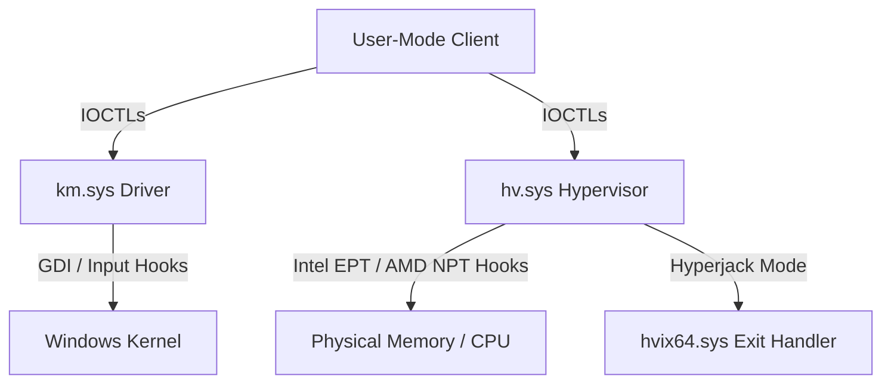

# GEMINI1.md - Codebase Analysis Report

Welcome to the analysis of the project. This workspace consists of two main components:
1. **`km` (Kernel-Mode Driver)**: A feature-rich driver handling process/memory manipulation, input filtering (mouse/keyboard/Xbox controller emulation), and GDI/graphical hooking (e.g., `BitBlt`, `TextOut`, `GreProtectSpriteContent`).
2. **`hv` (Hypervisor)**: A virtualization-based hypervisor supporting both Intel VMX and AMD SVM, featuring Second-Level Address Translation (SLAT) via EPT/NPT, page hiding, and a unique **Hyperjack mode** that hooks/parasitizes `hvix64.sys` if Hyper-V is already running.

---

## 1. Project Overview & Architecture

### Component A: Kernel-Mode Driver (`km`)
The driver exposes a standard control device (`\Device\LKHypervisor` or similar) to communicate with user-mode applications. Key capabilities include:
* **Memory & Process Management**: Standard virtual/physical read/write routines, PID queries, base address checks.
* **GDI & Screenshot Protection Hooking**: 
  * Hooks GDI routines like `BitBlt` and `TextOut` to intercept or modify screen captures.
  * Intercepts `gre_protect_sprite_content_t` (`GreProtectSpriteContent`) to toggle sprite/overlay protection.
* **Input Injection & Filtering**:
  * Emulates or hooks HID inputs, handling mouse filter driver callbacks.
  * Contains structures for processing Xbox controller inputs (`XBOX_INPUT_REPORT`) and queuing packets (`XINH_PACKET`).
* **Manual Mapping**: Support helper code (`KernelManualMap.h`) for manually mapping system images into kernel space.

### Component B: Hypervisor (`hv`)
A low-level virtualization framework that runs either in **Standalone Mode** or **Hyperjack Mode**:
* **Standalone Mode**: Builds customized SLAT (EPT for Intel, NPT for AMD) to hide pages, track reads/writes, and apply physical hooks.
* **Hyperjack Mode**: When a hypervisor (like Hyper-V) is already active, instead of nested virtualization, it locates and patches the host exit handler (`hvix64.sys`), intercepting execution flows directly.
* **IOCTL Interface**: Supports memory/page operations directly through physical mappings:
  * `IOCTL_HV_READ_PHYS` / `IOCTL_HV_WRITE_PHYS`
  * `IOCTL_HV_READ_VIRT` / `IOCTL_HV_WRITE_VIRT`
  * `IOCTL_HV_TRANSLATE_VA`
  * `IOCTL_HV_ADD_HOOK` / `IOCTL_HV_REM_HOOK`
  * `IOCTL_HV_HIDE_PAGE`

---

## 2. Directory & File Structure

### Core Repository
* [Driver.sln](file:///d:/nerd%20shit/totally%20not%20cheats/source%20-new%20builds/bo7/6-21-26/testing/laith-km-driver-main/Driver.sln): Visual Studio Solution file uniting the driver and hypervisor projects.
* [combine_files.py](file:///d:/nerd%20shit/totally%20not%20cheats/source%20-new%20builds/bo7/6-21-26/testing/laith-km-driver-main/combine_files.py): Helper python script to gather all `.cpp` and `.h` files into a single unified `combined_source.txt`.
* [run2.bat](file:///d:/nerd%20shit/totally%20not%20cheats/source%20-new%20builds/bo7/6-21-26/testing/laith-km-driver-main/run2.bat): Script wrapper to execute `combine_files.py`.

### Driver Directory (`km/`)
* [km/km.vcxproj](file:///d:/nerd%20shit/totally%20not%20cheats/source%20-new%20builds/bo7/6-21-26/testing/laith-km-driver-main/km/km.vcxproj): WDK kernel driver project configurations.
* [km/src/main.cpp](file:///d:/nerd%20shit/totally%20not%20cheats/source%20-new%20builds/bo7/6-21-26/testing/laith-km-driver-main/km/src/main.cpp): Contains the entry point, dispatch control, memory copy helpers, and hook installations (e.g., GDI Hooks, GDI Obfuscation, Input Filtering).
* [km/src/helpers.h](file:///d:/nerd%20shit/totally%20not%20cheats/source%20-new%20builds/bo7/6-21-26/testing/laith-km-driver-main/km/src/helpers.h): Deep utility macros, definitions, and scanning patterns.
* [km/src/memory.h](file:///d:/nerd%20shit/totally%20not%20cheats/source%20-new%20builds/bo7/6-21-26/testing/laith-km-driver-main/km/src/memory.h): Safe physical/virtual memory reading routines.
* [km/src/KernelManualMap.h](file:///d:/nerd%20shit/totally%20not%20cheats/source%20-new%20builds/bo7/6-21-26/testing/laith-km-driver-main/km/src/KernelManualMap.h): Structs and functions to support manual mapping of PE files in the kernel.

### Hypervisor Directory (`hv/`)
* [hv/hv.vcxproj](file:///d:/nerd%20shit/totally%20not%20cheats/source%20-new%20builds/bo7/6-21-26/testing/laith-km-driver-main/hv/hv.vcxproj): Hypervisor kernel driver configuration.
* [hv/main.cpp](file:///d:/nerd%20shit/totally%20not%20cheats/source%20-new%20builds/bo7/6-21-26/testing/laith-km-driver-main/hv/main.cpp): Implements `DriverEntry` for the hypervisor, initializing AMD SVM / Intel VMX, registering the `\Device\LKHypervisor` IOCTL device, and managing the DPC launch sequences.
* `hv/src/hv_hook/`: Hooks existing hypervisors (Hyperjack mode).
  * [hv_hook.cpp](file:///d:/nerd%20shit/totally%20not%20cheats/source%20-new%20builds/bo7/6-21-26/testing/laith-km-driver-main/hv/src/hv_hook/hv_hook.cpp): Hyperjack initialization, search, and page patching.
  * `hv_hook_asm.asm`: Assembly hook routines for hypervisor VM-exit control flow.

---

## 3. High-Level Hooking Mechanics

### 1. GDI & Display Interception
In `km/src/main.cpp`, the driver hooks `BitBlt` and related GDI functions to manipulate frame buffer reads. This is commonly used to prevent user-mode screen-capturing software from capturing custom render overlays or windows.

### 2. Page Hooking & Hiding (SLAT / EPT)
In standalone mode, the hypervisor creates its own page tables (EPT/NPT). When page hiding is requested, it marks pages as non-executable or changes physical-to-virtual address mapping flags. When a violation is triggered, a VM-Exit is caught, allowing the hypervisor to present clean copies of code pages to security scanners while executing modified code.

### 3. Hyperjack Mode
If Windows Virtualization-Based Security (VBS) or Hyper-V is running, standard VT-x/AMD-V initialization will fail or require nested virtualization. Hyperjack solves this by finding the active hypervisor in system memory, scanning for its VM-Exit handler pattern, disabling write protection, and replacing/redirecting the exit handler function pointer to intercept all VM-Exits.

---

## 4. Build Configuration

Both projects require:
* **Visual Studio 2022** with the **Windows Driver Kit (WDK)**.
* Target Platform: **x64**.
* Configurations: **Debug** or **Release** (producing `km.sys` and `hv.sys`).
