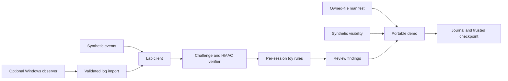

# Anti-cheat architecture lab

**Runnable reference code for documented anti-cheat concepts.** This is an independently authored teaching implementation based on the research in this repository. Its formats, algorithms and thresholds are original lab choices. It is not recovered RICOCHET source, an MW4-compatible replacement, or a reconstruction of proprietary detection coverage.

[Quick start](#quick-start) · [Source map](#source-map) · [Windows driver](windows/README.md) · [Evidence and coverage](docs/coverage.md) · [Machine-readable sources](docs/sources.json) · [Tests](#validation)

The portable pipeline runs on Python 3.11+ with no third-party runtime dependencies. The optional Windows driver and native collector are **source prototypes awaiting a WDK build and Windows runtime validation**.

## Quick start

```sh
git clone --branch reference-implementation https://github.com/ll2Rawll/ricochet-research.git
cd ricochet-research/reference
python3 -m ricochet_lab demo
```

The demo creates a temporary owned file, measures it, changes it and detects the change. It authenticates invented gameplay events, rejects a tampered message and a replay, evaluates three deliberate rule violations, filters a synthetic visibility scene, and verifies a journal against its checkpoint. Temporary files are removed automatically. No driver installation or game process is needed.

Expected highlights:

```json
{
  "tampered_message_rejected": "mac",
  "replayed_message_rejected": "challenge",
  "visible_synthetic_entities": ["observer", "near"],
  "journal_records_verified_with_checkpoint": 1
}
```

The review contains `LAB_MOVEMENT_SPEED`, `LAB_ENTITLEMENT_MISSING` and `LAB_SHOT_RATE`. These describe the supplied fictional events. A `no_rule_findings` result means only that this small rule set produced no finding.

## Source map

| Layer | Source | Implemented behavior |
| --- | --- | --- |
| Kernel observer | [driver.c](windows/driver.c) | Process/thread/image callbacks; collector-scoped collection; bounded nonpaged ring; overflow counters; callback rollback and cleanup |
| Native boundary | [protocol.h](windows/protocol.h), [collector.c](windows/collector.c) | Admin device access, owner-process checks, versioned buffered IOCTLs, bounded JSONL output |
| Log import | [telemetry.py](ricochet_lab/telemetry.py) | Strict session/batch/event framing, sequence and size checks, preserved loss counters |
| Message validation | [protocol.py](ricochet_lab/protocol.py) | Expiring single-use nonces, monotonically ordered batches, HMAC-SHA256, strict JSON and bounded session state |
| Local transport | [service.py](ricochet_lab/service.py) | Loopback HTTP, origin/host/framing checks, per-session rule state, no external service calls |
| File measurements | [integrity.py](ricochet_lab/integrity.py) | Explicit file allowlist, SHA-256 baseline comparison, path/symlink checks, read budgets |
| Fictional game rules | [rules.py](ricochet_lab/rules.py) | Movement limits, shot intervals, ammunition ledger and server-configured entitlements |
| Synthetic visibility | [visibility.py](ricochet_lab/visibility.py) | Distance and axis-aligned-box line-of-sight filtering of invented entities |
| Review journal | [replay.py](ricochet_lab/replay.py) | Versioned HMAC chain, sequence verification, separately trusted final checkpoint |
| Demo and commands | [__main__.py](ricochet_lab/__main__.py) | Runnable composition, local client, key generation, manifests and log import |



The demo composes these modules; the HTTP server does not automatically persist a journal or establish hardware trust. Kernel observations are retained as observations and produce no gameplay verdict.

<details>
<summary><strong>Run the local client/server example</strong></summary>

Create a local key once, then start the loopback server:

```sh
python3 -m ricochet_lab keygen demo.key
python3 -m ricochet_lab serve --key demo.key --port 8765
```

In another terminal, from the same directory:

```sh
python3 -m ricochet_lab submit --key demo.key --events examples/synthetic-events.json --port 8765
```

The client creates a fresh session unless `--session NAME` is supplied. Each batch obtains a new challenge and carries its required sequence. Reusing a session preserves accepted rule state. Sessions expire after ten idle minutes; challenges expire after thirty seconds. A restart loses all server state. An accepted envelope consumes its challenge even when its events produce rule findings; a lost acknowledgment cannot safely be retried as a new action without application-level reconciliation.

The protocol uses one lab key across collectors. Any key holder can invent events or create new sessions. HMAC establishes key possession, not device identity, a genuine driver, trustworthy timing or honest telemetry. The key is a 32-byte local file; POSIX creation uses mode `0600`, while Windows access follows the parent directory ACL. The local HTTP transport is unencrypted and intentionally has no deployment mode for an external interface. Its single-threaded development server has an inactivity timeout, not an absolute request deadline; a slow local client can occupy it.

The client refuses redirects and bounds/strictly decodes response bodies. The server rejects browser `Origin` headers, unexpected host names, duplicate lengths, chunked bodies and non-JSON POSTs. These checks do not turn the development server into a production security boundary.

</details>

<details>
<summary><strong>Measure explicitly selected files</strong></summary>

```sh
python3 -m ricochet_lab manifest . examples/synthetic-events.json > manifest.json
python3 -m ricochet_lab verify . manifest.json
```

Only listed files are read. Verification reports missing, modified and invalid entries; unlisted files are not scanned. Keep the expected manifest in an independently trusted location. An editable local baseline cannot establish trusted integrity. Directory-relative reads reject symlink traversal on supported platforms; the portable fallback cannot eliminate concurrent directory-replacement races. Measurements are not an atomic filesystem snapshot.

</details>

<details>
<summary><strong>Import our Windows collector output</strong></summary>

Follow the separate [Windows build and validation notes](windows/README.md) before using the native component. After a reviewed, properly signed driver is installed through the supported Windows process, the native collector emits `kernel-events.jsonl`.

```sh
python3 -m ricochet_lab import-kernel kernel-events.jsonl > imported-events.json
python3 -m ricochet_lab submit --key demo.key --events imported-events.json --port 8765
```

Import accepts one completed collector session and preserves control records as `kernel_observation` events. Truncated files, wrong versions, malformed batches, nonmonotonic sequences and invalid integers are rejected. The importer does not authenticate a file's producer. `completed` means the export has its final stop record; it does not mean lossless capture. Overflow is counted, while records discarded during stop/cleanup need not appear in that counter. Native integers outside the Python protocol's supported range of `0..2**63-1` are rejected.

</details>

<details>
<summary><strong>Use the diagnostic journal API</strong></summary>

```python
from ricochet_lab.replay import read_journal, write_journal

# key is an independently supplied 32-byte lab secret.
checkpoint = write_journal("review.journal.jsonl", [{"review": "example"}], key)
records = read_journal("review.journal.jsonl", key, checkpoint)
```

Writing refuses an existing path. Keep the checkpoint separately and protect its authenticity; a valid-prefix truncation can only be detected when the expected final checkpoint is available. A key holder can rewrite both a journal and its checkpoint. The journal does not establish whether the recorded events are true, and it is unrelated to the proprietary Replay Investigation Tool.

</details>

## Validation

```sh
python3 -m unittest discover -s tests -v
cc -std=c11 -Wall -Wextra -Werror -pedantic windows/abi_check.c -o /tmp/ricochet-reference-abi-check
/tmp/ricochet-reference-abi-check
```

The portable suite covers replay, expiry, concurrent acceptance, tampering, malformed/ambiguous JSON, message bounds, real loopback transport, state across batches, filesystem containment, fictional rule boundaries, visibility, journal alteration/truncation and collector-log framing. The CLI demo is exercised as a subprocess. [validation.md](docs/validation.md) records the completed checks and remaining platform work.

The C check verifies the portable wire-structure layout and IOCTL numbers. It does **not** compile `driver.c` or `collector.c`, test IRQL/lifetime behavior, verify effective Windows ACLs or establish driver loadability. Those require the Windows SDK/WDK and isolated runtime testing.

## Relationship to RICOCHET and MW4

Published component roles motivated the structure. Microsoft documents the OS contracts. The [coverage matrix](docs/coverage.md) distinguishes those facts from choices made here and links the supporting research. [sources.json](docs/sources.json) provides the same provenance in machine-readable form.

The reviewed material provides no authenticated complete current RICOCHET implementation or verified MW4 integration contract. This project therefore has no fidelity percentage or compatibility claim. TPM/Azure attestation, private detection signatures, game-code hardening, DMA/input classifiers, trained models, live account services and production enforcement remain unimplemented; the prototype never reports those checks as passed.

The [MIT license](LICENSE) covers the original code and documentation inside `reference/`. It does not relicense the existing research, linked third-party sources, trademarks or proprietary software. No uploaded binary dump or purported private implementation was used as a reconstruction specification. The `main` branch continues to contain the research editions.
