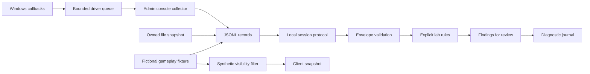

# What this implementation can establish

Reviewed **2026-10-31** against research dataset revision **12**. This branch contains an independently authored anti-cheat teaching implementation. Its relationship to RICOCHET is a comparison of published component roles; it is not recovered Activision source, a compatible replacement, or a measurement of current detection coverage.

The research identifies MW4 in vendor title/account documentation. It does **not** establish a public MW4 game integration API, telemetry schema, inventory protocol, private driver ABI, or complete implementation. This prototype's events, control codes, rules and cryptographic envelope are its own formats.

[Run the prototype](../README.md) · [Windows source and build limits](../windows/README.md) · [Machine-readable source map](sources.json) · [Research dataset](../../ricochet.jsonl)

## Read the evidence labels

| Label | Meaning |
| --- | --- |
| **PUBLISHED BEHAVIOR** | A dated Activision statement about its system. It is attributed evidence, not an independently reproduced runtime result. |
| **PLATFORM CONTRACT** | A documented Microsoft, Python or protocol capability. Its existence does not prove that RICOCHET uses it. |
| **OUR DESIGN** | A choice made for this prototype: data structures, API, policy, numeric limits and algorithms. |
| **NOT IMPLEMENTED** | A component outside the delivered source's scope. No stub result should be interpreted as a successful real check. |

Source IDs beginning `S` refer to the existing research dataset. IDs beginning `D` identify additional documentation reviewed for this implementation. [sources.json](sources.json) records the distinction and provenance.

## Component comparison

| Component and source path | Public evidence | What this source does | Limit of the comparison |
| --- | --- | --- | --- |
| Kernel observation — [`windows/driver.c`](../windows/driver.c) | **PUBLISHED BEHAVIOR:** the FAQ describes a game-session driver that monitors interactions with protected games. [S01](https://support.activision.com/articles/ricochet-overview), research C002–C005. **PLATFORM CONTRACT:** process, thread and image notification APIs exist. [S41](https://learn.microsoft.com/en-us/windows-hardware/drivers/ddi/ntddk/nf-ntddk-pssetcreateprocessnotifyroutineex), [D02](https://learn.microsoft.com/en-us/windows-hardware/drivers/ddi/ntddk/nf-ntddk-pssetcreatethreadnotifyroutine), [S43](https://learn.microsoft.com/en-us/windows-hardware/drivers/ddi/ntddk/nf-ntddk-pssetloadimagenotifyroutine). | **OUR DESIGN:** opt-in observation of the collector's thread/image events and direct child creation, fixed scalar records, a bounded queue and explicit event-loss accounting. | A process or image notification is an observation. It neither establishes another program's intent nor detects every interaction. No RICOCHET callback selection or detection rule is inferred. |
| Driver/client boundary — [`windows/protocol.h`](../windows/protocol.h), [`windows/collector.c`](../windows/collector.c) | **PLATFORM CONTRACT:** buffered IOCTLs have separate input/output lengths, and dispatch must validate the full control code and buffers. [S72](https://learn.microsoft.com/en-us/windows-hardware/drivers/kernel/buffer-descriptions-for-i-o-control-codes), [S73](https://learn.microsoft.com/en-us/windows-hardware/drivers/kernel/security-issues-for-i-o-control-codes). | **OUR DESIGN:** a versioned, fixed-width ABI with a matching console collector and JSONL output. The device has a restricted default ACL and session ownership checks. | The ABI is original to this lab. It does not speak to any Activision service or device. Administrative access control is not resistance to a hostile administrator or kernel. |
| Session lifecycle — [`windows/driver.c`](../windows/driver.c), [`ricochet_lab/protocol.py`](../ricochet_lab/protocol.py) | **PUBLISHED BEHAVIOR:** Activision describes start/stop with the game. [S01](https://support.activision.com/articles/ricochet-overview), C003. **PLATFORM CONTRACT:** callbacks must be removed before unload. [S41](https://learn.microsoft.com/en-us/windows-hardware/drivers/ddi/ntddk/nf-ntddk-pssetcreateprocessnotifyroutineex), [D06](https://learn.microsoft.com/en-us/windows-hardware/drivers/ddi/ntddk/nf-ntddk-psremoveloadimagenotifyroutine), [D07](https://learn.microsoft.com/en-us/windows-hardware/drivers/ddi/ntddk/nf-ntddk-psremovecreatethreadnotifyroutine). | **OUR DESIGN:** explicit collection start/stop, bounded in-memory verifier sessions, cleanup and expiration. | Stopping a collection session and unloading a driver are different operations. This lab does not reproduce a game launcher or automatic driver deployment. |
| Authenticated evidence intake — [`ricochet_lab/protocol.py`](../ricochet_lab/protocol.py) | **PLATFORM CONTRACT:** HMAC authenticates messages using a shared secret; Python provides HMAC and digest comparison. [D03](https://docs.python.org/3/library/hmac.html), [D05](https://datatracker.ietf.org/doc/html/rfc2104). | **OUR DESIGN:** expiring one-use challenges, ordered batches, strict bounded JSON and HMAC-SHA256 validation. | A valid MAC establishes possession of the lab key. It does not establish a genuine collector, truthful events, a TPM quote, Secure Boot, or uncompromised execution. No claim is made that RICOCHET uses this envelope. |
| File integrity — [`ricochet_lab/integrity.py`](../ricochet_lab/integrity.py) | **PLATFORM CONTRACT:** Python exposes SHA-256 for hashing bytes. [D04](https://docs.python.org/3.12/library/hashlib.html). **PUBLISHED BEHAVIOR:** Activision describes client protection; this does not specify this manifest design. [S12](https://www.callofduty.com/blog/2023/11/call-of-duty-ricochet-anti-cheat-modern-warfare-III-progress-report), C389. | **OUR DESIGN:** hash explicitly selected files under an owned root and compare them with a supplied manifest; report missing, changed or invalid entries. | The baseline must be trusted independently. A local attacker able to change the verifier or baseline can change the outcome. A file snapshot is not live memory integrity or prevention of subsequent modification. |
| Server authority and gameplay validation — [`ricochet_lab/rules.py`](../ricochet_lab/rules.py) | **PUBLISHED BEHAVIOR:** Activision describes moving selected processes to the server. [S08](https://www.callofduty.com/blog/2022/10/call-of-duty-modern-warfare-II-warzone-ricochet-anti-cheat-open-beta-recap), C028. MW4 support describes account-associated progression. [S93](https://support.activision.com/modern-warfare-4/articles/modern-warfare-4-in-game-account-registration), C312–C313. | **OUR DESIGN:** deterministic movement, ammunition and equip-request checks in a fictional game state with server-owned configuration and entitlement sets. | Numeric limits, item IDs, state transitions and findings are illustrative. They do not model COD physics, weapons, inventory storage or account enforcement. |
| Evidence review — [`ricochet_lab/`](../ricochet_lab/) and local examples | **PUBLISHED BEHAVIOR:** Activision describes replay data, investigator review and ML-assisted prioritization. [S12](https://www.callofduty.com/blog/2023/11/call-of-duty-ricochet-anti-cheat-modern-warfare-III-progress-report), C044–C045/C387; [S18](https://www.callofduty.com/blog/2025/05/call-of-duty-black-ops-6-warzone-ricochet-anti-cheat-season-three-recap), C074–C075. | **OUR DESIGN:** replay input records through explicit rules and emit traceable findings. | JSONL reprocessing is not the Replay Investigation Tool, video reconstruction, a trained model or a calibrated probability of cheating. Findings do not issue bans. |
| Server visibility — [`ricochet_lab/visibility.py`](../ricochet_lab/visibility.py) | **PUBLISHED BEHAVIOR:** Server Culling is described as withholding player information; the vendor interview does not disclose its visibility algorithm. [S57](https://x.com/CallofDuty/status/2116183418144772179), C184; [S63](https://detonated.com/exclusive-mw4-anti-cheat-interview-with-senior-game-security-director-david-andrews/), C232–C233. | **OUR DESIGN:** a synthetic distance and axis-aligned-box line-of-sight filter selects visible entities before constructing a client snapshot. | Toy geometry and visibility rules are not COD maps, networking or the production Server Culling algorithm. Publication of a rollout plan does not establish measured deployment. |
| Diagnostic journal — [`ricochet_lab/replay.py`](../ricochet_lab/replay.py) | **PLATFORM CONTRACT:** HMAC supports shared-secret message authentication. [D03](https://docs.python.org/3/library/hmac.html), [D05](https://datatracker.ietf.org/doc/html/rfc2104). | **OUR DESIGN:** an HMAC-chained journal makes record alteration or reordering detectable under its key assumptions. A separately trusted checkpoint is required to detect valid-prefix truncation. | A local journal cannot prove the truth or completeness of its inputs. A key holder can author a different journal, and an attacker controlling both journal and checkpoint can replace both. This is not the vendor replay format. |
| Local transport — [`ricochet_lab/service.py`](../ricochet_lab/service.py) | **PLATFORM CONTRACT:** Python documents `http.server` for limited development use. [D08](https://docs.python.org/3/library/http.server.html). | **OUR DESIGN:** loopback-only HTTP routes demonstrate the session/evidence boundary. | This is not a public service, production identity system, confidential transport or Activision endpoint. |

## Trust boundaries in the lab

The diagram shows the teaching pipeline, not a recovered RICOCHET call graph. Each input remains a claim about an event. The local protocol can reject malformed, altered or replayed envelopes while a key-holding client can still submit invented content. The driver offers a narrower collection scope, not an attested chain from hardware to backend. A queue-overflow counter describes missing data; it must not silently become a clean bill of health.

The gameplay rules are meaningful only when their authoritative starting state, configuration and accepted-event ordering belong to the server. A real service additionally needs trusted simulation inputs, identity, transport protection, persistence, concurrency control and a defined recovery policy. This local demonstration does not supply those production systems.

## Windows contracts that shape the source

These are implementation constraints, not inferred RICOCHET internals:

- `PsSetCreateProcessNotifyRoutineEx` requires removal before unload and waits for in-flight callbacks when removing. Registration can fail if the callback image lacks `IMAGE_DLLCHARACTERISTICS_FORCE_INTEGRITY`. [S41](https://learn.microsoft.com/en-us/windows-hardware/drivers/ddi/ntddk/nf-ntddk-pssetcreateprocessnotifyroutineex)
- A null process `CreateInfo` denotes exit. The image callback may lack a name, so code must not assume a valid string. [S80](https://learn.microsoft.com/en-us/windows-hardware/drivers/ddi/ntddk/nc-ntddk-pcreate_process_notify_routine_ex), [S81](https://learn.microsoft.com/en-us/windows-hardware/drivers/ddi/ntddk/nc-ntddk-pload_image_notify_routine)
- Thread and image removal routines wait for an active callback; calling removal from that same callback can deadlock. [D06](https://learn.microsoft.com/en-us/windows-hardware/drivers/ddi/ntddk/nf-ntddk-psremoveloadimagenotifyroutine), [D07](https://learn.microsoft.com/en-us/windows-hardware/drivers/ddi/ntddk/nf-ntddk-psremovecreatethreadnotifyroutine)
- `IoCreateDeviceSecure` applies a default security descriptor, uses `Wdmsec.lib`, and calls for a custom class GUID. An administrator can override its defaults through that class's registry settings. The API name alone does not establish the effective ACL on every machine. [D01](https://learn.microsoft.com/en-us/windows-hardware/drivers/ddi/wdmsec/nf-wdmsec-wdmlibiocreatedevicesecure)
- `METHOD_BUFFERED` shares a system buffer for input/output. Access rights, complete control-code matching, length checks and initialized output are part of a defensible interface. [S72](https://learn.microsoft.com/en-us/windows-hardware/drivers/kernel/buffer-descriptions-for-i-o-control-codes), [S73](https://learn.microsoft.com/en-us/windows-hardware/drivers/kernel/security-issues-for-i-o-control-codes), [S79](https://learn.microsoft.com/en-us/windows-hardware/drivers/kernel/defining-i-o-control-codes)
- Windows signing policy remains applicable. A checked ABI layout or successful Python test does not establish a loadable, correctly signed or runtime-safe driver. [S45](https://learn.microsoft.com/en-us/windows-hardware/drivers/install/kernel-mode-code-signing-policy--windows-vista-and-later-)

## Components not implemented

| Component | What public evidence provides | What is missing here |
| --- | --- | --- |
| TPM, Secure Boot and Microsoft Azure Attestation | Published requirements and platform protocols; dated vendor MAA announcement. [S23](https://www.callofduty.com/blog/2026/02/call-of-duty-black-ops-7-ricochet-anti-cheat-season-02), [S27](https://support.activision.com/articles/trusted-platform-module-and-secure-boot), [S46](https://learn.microsoft.com/en-us/azure/attestation/tpm-attestation-concepts), [S55](https://learn.microsoft.com/en-us/azure/attestation/virtualization-based-security-protocol). | Hardware-backed key enrollment, TPM quote validation, event-log replay, issuer trust, cloud policy and production admission decisions. The HMAC demo substitutes for none of these. |
| Client hardening and live integrity | Vendor descriptions of prevention layers. [S12](https://www.callofduty.com/blog/2023/11/call-of-duty-ricochet-anti-cheat-modern-warfare-III-progress-report). | Game-code instrumentation, executable protection and a trusted runtime integrity boundary. |
| DMA, hypervisor and input-device defenses | Platform DMA/VBS documentation and vendor statements about input patterns. [S49](https://learn.microsoft.com/en-us/windows/security/hardware-security/kernel-dma-protection-for-thunderbolt), [S50](https://learn.microsoft.com/en-us/windows-hardware/design/device-experiences/oem-hvci-enablement), [S23](https://www.callofduty.com/blog/2026/02/call-of-duty-black-ops-7-ricochet-anti-cheat-season-02). | Hardware-specific detection, IOMMU configuration, input classifiers and their evaluation datasets. |
| Statistical detection and investigator tooling | Attributed descriptions of replay and analysis workflows. [S12](https://www.callofduty.com/blog/2023/11/call-of-duty-ricochet-anti-cheat-modern-warfare-III-progress-report), [S18](https://www.callofduty.com/blog/2025/05/call-of-duty-black-ops-6-warzone-ricochet-anti-cheat-season-three-recap). | Model source, weights, features, false-positive measurements, proprietary replay formats and review tools. |
| Live mitigations, accounts and enforcement | Dated descriptions of vendor mitigation/account responses in the research dataset. | COD-compatible mitigations, inventory mutations, account decisions, appeals and ban orchestration. |
| Production operations | Broad vendor descriptions of an evolving security platform. [S01](https://support.activision.com/articles/ricochet-overview), [S08](https://www.callofduty.com/blog/2022/10/call-of-duty-modern-warfare-II-warzone-ricochet-anti-cheat-open-beta-recap). | Fleet deployment, key rotation, durable data storage, abuse handling, performance certification, incident response and update infrastructure. |

## Public code provenance

These licensed upstream projects are useful reading references. They are **not** authenticated RICOCHET code, and listing them is not a statement that their implementation was copied into this branch.

| Upstream reference | Pinned revision | License and relation |
| --- | --- | --- |
| Microsoft Windows driver samples, including ObCallback and RegFltr | [`f4c1ff842b6a0001152f44cb61788b216a1c7627`](https://github.com/microsoft/Windows-driver-samples/tree/f4c1ff842b6a0001152f44cb61788b216a1c7627) | [MS-PL](https://github.com/microsoft/Windows-driver-samples/blob/f4c1ff842b6a0001152f44cb61788b216a1c7627/LICENSE). Windows teaching samples; RegFltr explicitly has production limitations. |
| Microsoft Attestation Client Samples | [`84a502dcbedb674b505262f3eee022fd88ebc3ef`](https://github.com/microsoft/Attestation-Client-Samples/tree/84a502dcbedb674b505262f3eee022fd88ebc3ef) | [MIT](https://github.com/microsoft/Attestation-Client-Samples/blob/84a502dcbedb674b505262f3eee022fd88ebc3ef/LICENSE). TPM/enrollment examples, not an Activision production client or policy. |
| Azure SDK for Python, `azure-security-attestation` | [`21387f1976a22aae98eec2a5a5260f3c80d0772d`](https://github.com/Azure/azure-sdk-for-python/tree/21387f1976a22aae98eec2a5a5260f3c80d0772d/sdk/attestation/azure-security-attestation) | [MIT](https://github.com/Azure/azure-sdk-for-python/blob/21387f1976a22aae98eec2a5a5260f3c80d0772d/sdk/attestation/azure-security-attestation/LICENSE). SDK metadata/signature/token-validation reference; not evidence of COD's language or SDK selection. |

The reviewed official [Activision open-source index](https://research.activision.com/opensource) identifies other projects, including WebKit and tooling. It does not identify an authenticated RICOCHET implementation in that index. The broader review located no authenticated complete current implementation; that search result does not prove that no other copy exists anywhere. User-supplied dumps in the research record have unverified provenance and were not used as a reconstruction specification.

## What successful tests mean

Portable tests can establish that this source rejects the malformed, replayed and boundary-case inputs covered by those tests, and that its toy rules produce their specified results. They cannot establish effectiveness against real cheaters or similarity to a private system. Windows source requires a separate WDK build, signing review, isolated runtime testing, callback/concurrency stress, unload checks and Driver Verifier assessment before any runtime claim. This Linux workspace does not provide those Windows results.
