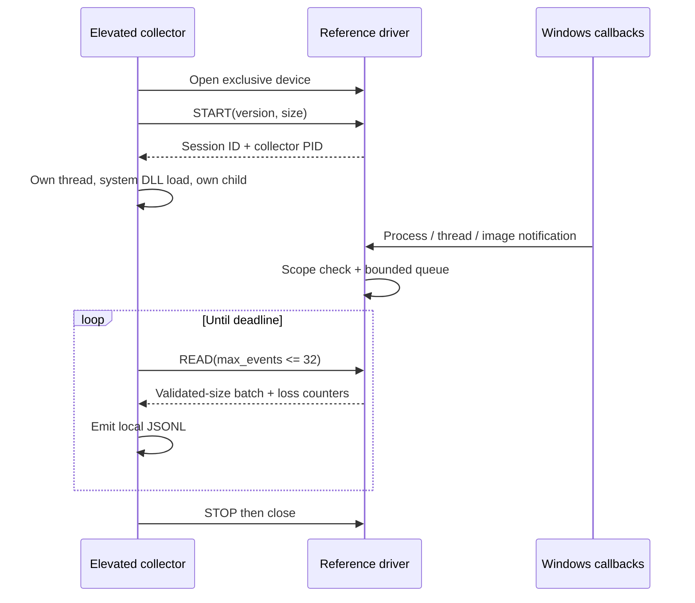

# Windows telemetry reference

**Status: source prototype; the Windows driver and collector have not been built or run in this Linux workspace.** The portable protocol-layout check passes with GCC. Windows WDK compilation, static analysis, signed deployment, and runtime validation are separate outstanding steps.

This independently authored code demonstrates a small, documented Windows callback pipeline. It is not RICOCHET source, an MW4 component, or a reconstruction of a proprietary detection engine. There is no Call of Duty process attachment or interface.

## Code map

| File | Responsibility |
| --- | --- |
| [`driver.c`](driver.c) | Session ownership, process/thread/image notifications, bounded event queue, buffered IOCTLs, cleanup |
| [`protocol.h`](protocol.h) | Versioned fixed-width ABI; compile-time layout assertions |
| [`collector.c`](collector.c) | Administrative client; self-generated activity; validated JSONL output |
| [`RicochetReference.vcxproj`](RicochetReference.vcxproj) | Windows 10+ x64 WDK compilation project |
| [`abi_check.c`](abi_check.c) | Portable structure-size and IOCTL-number checks |

## What runs

The driver registers three OS callbacks when loaded. Collection remains inactive until an elevated collector opens the device and starts a session. The session's target is the requestor process that opened the device; the interface accepts no target PID. One file object owns the device. Requests through a duplicated handle issued by a different process fail the owner-process check.

During an active session, the driver records the collector's thread creation/exit and image-load notifications. It also records process-creation notifications whose reported parent PID is the collector's PID. That parent relationship is an OS notification field, not an independently authenticated account of who initiated the creation. Descendant activity is not recursively tracked. Image records contain only the image byte count. No paths, command lines, hashes, image bases, or process memory are gathered.



The queue holds 256 records in the nonpaged device extension. A spin lock serializes callback writes, session changes, and drains of at most 32 records. Callbacks do not allocate, wait, open files, inspect process memory, or modify process creation decisions. When full, the queue drops the newest event and increments a cumulative loss counter. Attempted events still consume sequence numbers, so a later record can show a gap. Loss means incomplete telemetry, not proof of cheating.

`STOP` and handle cleanup stop collection and discard queued records; the collector drains before stopping, but events produced between that drain and `STOP` can still be discarded. The `dropped_events` counter measures queue overflow only, not these intentional shutdown discards. A `stop` line establishes complete export framing, not lossless event capture. A collector exit notification is best-effort: cleanup can deactivate collection before the process callback occurs. Session IDs increase only for the current driver load and reset on the next load; they are not cryptographic identities or globally unique IDs. Event timestamps are UTC 100-nanosecond intervals since 1601-01-01; they can change with the system clock. Ordering is determined by sequence numbers.

## Access and lifetime

`IoCreateDeviceSecure` uses a custom class GUID and a default ACL granting full access to LocalSystem and administrators. Administrators can override device-class security in the registry, so deployment must verify the effective descriptor. `FILE_DEVICE_SECURE_OPEN`, an exclusive device, a single owner file object, and the process check narrow the interface further. A nonempty device-relative path is rejected.

All three IOCTLs require read and write access and use `METHOD_BUFFERED`. Dispatch checks the complete 32-bit code, exact request/output lengths, the protocol version, reserved fields, batch count, and requestor ownership. Input is copied before the shared buffered-I/O output region is zeroed. Responses contain only initialized fixed-width scalars. There are no arbitrary memory, user-pointer, injection, or enforcement controls.

`CLEANUP` marks the file closed for further controls and disables collection. `CLOSE` releases the referenced owner process. Registration failures remove already registered callbacks before deleting the device. Unload deactivates collection and removes callbacks before releasing their state; documented removal routines wait for in-flight callbacks. This relies on the normal I/O-manager lifetime rules for a legacy control-device driver. Runtime verification of those lifecycle paths remains required.

## Build

Use a supported Windows 10/11 x64 development machine with Visual Studio C++ tools and a matching Windows SDK/WDK installation. From a WDK-enabled developer command prompt in this directory:

```bat
msbuild RicochetReference.vcxproj /p:Configuration=Debug /p:Platform=x64
cl /nologo /std:c11 /W4 /WX /D_WIN32_WINNT=0x0A00 collector.c /Fe:collector.exe
```

These are compilation commands, not evidence of a successful Windows build. The project has signing and catalog generation disabled because no deployment package or signing identity is supplied. An unsigned output is not a deployable driver on a normally secured Windows installation. `/INTEGRITYCHECK` sets the image integrity characteristic required by the process callback registration contract; it does not sign the image or establish trust. Use Microsoft's supported driver packaging/signing process before any deployment. No prebuilt binary, installation script, or change to Windows security policy is included.

Once a reviewed, properly signed build has been installed and started through the normal Windows driver deployment process, an elevated command prompt can collect **its own** activity for 1–60 seconds:

```bat
collector.exe 3 > kernel-events.jsonl
```

The collector creates a thread, loads `version.dll` only from the system directory, and launches its own executable with `--child`, which immediately exits. It then polls the device. The collection process neither starts nor modifies any game. JSONL goes to stdout; errors go to stderr; a failure returns nonzero. Native stdout redirection preserves the emitted UTF-8-compatible ASCII bytes.

On Linux/macOS, only the portable ABI check can run:

```sh
cc -std=c11 -Wall -Wextra -Werror -pedantic abi_check.c -o /tmp/ricochet-reference-abi-check
/tmp/ricochet-reference-abi-check
```

Expected output: `protocol=1 event=56 batch_header=40 batch=1832`.

## JSONL contract

Every line is one JSON object with `"schema":"ricochet-reference-kernel/1"` and a `type` string. All other values are unsigned integers; preserve 64-bit precision when importing. A session line comes first. Each batch line is immediately followed by exactly `event_count` event lines. A successful stop line comes last; a failed or interrupted process can produce an incomplete file. An imported JSON file is editable local data, not authenticated kernel evidence.

| `type` | Additional fields |
| --- | --- |
| `session` | `session_id`, `target_process_id` |
| `batch` | `session_id`, `event_count`, `dropped_events`, `next_sequence` |
| `event` | `session_id`, `sequence`, `time_100ns`, `process_id`, `thread_id`, `related_process_id`, `image_size`, `kind`, `flags` |
| `stop` | `session_id` |

`flags` is zero in version 1. Event kinds are `1` session start, `2` reported child creation, `3` collector process exit, `4` collector thread creation, `5` collector thread exit, and `6` collector image load. Unused event fields are zero. `related_process_id` contains the reported parent PID only for kind 2. `image_size` is nonzero only when the image callback supplies such a size for kind 6. There are no game-specific IDs or detection verdicts.

## Validation still needed on Windows

Before treating this as more than source to review, compile both Debug and Release builds, run WDK static analysis, and exercise the signed driver on a disposable test VM. Required cases include denied unprivileged access, duplicate handles across processes, malformed IOCTL codes/lengths/versions/counts, repeated start/stop, callback registration rollback, collector termination, queue overflow, concurrent callback/drain activity, and unload after all handles close. Use Driver Verifier's applicable checks for the reference driver and inspect for leaks, IRQL violations, and callbacks surviving unload. Neither the portable ABI check nor a code review establishes those properties at runtime.

## Public contracts used

The code is original; no Microsoft sample body or proprietary driver implementation was copied. These documents define Windows behavior, not RICOCHET's choice of APIs:

- [Process notification registration and integrity characteristic](https://learn.microsoft.com/en-us/windows-hardware/drivers/ddi/ntddk/nf-ntddk-pssetcreateprocessnotifyroutineex)
- [Thread notification registration](https://learn.microsoft.com/en-us/windows-hardware/drivers/ddi/ntddk/nf-ntddk-pssetcreatethreadnotifyroutine) and [removal](https://learn.microsoft.com/en-us/windows-hardware/drivers/ddi/ntddk/nf-ntddk-psremovecreatethreadnotifyroutine)
- [Image notification registration](https://learn.microsoft.com/en-us/windows-hardware/drivers/ddi/ntddk/nf-ntddk-pssetloadimagenotifyroutine) and [removal](https://learn.microsoft.com/en-us/windows-hardware/drivers/ddi/ntddk/nf-ntddk-psremoveloadimagenotifyroutine)
- [IoCreateDeviceSecure, custom class GUID and ACL override](https://learn.microsoft.com/en-us/windows-hardware/drivers/ddi/wdmsec/nf-wdmsec-wdmlibiocreatedevicesecure)
- [IOCTL security and buffer validation](https://learn.microsoft.com/en-us/windows-hardware/drivers/kernel/security-issues-for-i-o-control-codes)
- [Buffered I/O and the shared input/output buffer](https://learn.microsoft.com/en-us/windows-hardware/drivers/kernel/using-buffered-i-o)
- [I/O requestor-process identity](https://learn.microsoft.com/en-us/windows-hardware/drivers/ddi/ntifs/nf-ntifs-iogetrequestorprocess)
- [System timestamp units and IRQL contract](https://learn.microsoft.com/en-us/windows-hardware/drivers/ddi/wdm/nf-wdm-kequerysystemtimeprecise)
- [Driver signing](https://learn.microsoft.com/en-us/windows-hardware/drivers/install/kernel-mode-code-signing-policy--windows-vista-and-later-)
- [Linker `/INTEGRITYCHECK` and `IMAGE_DLLCHARACTERISTICS_FORCE_INTEGRITY`](https://learn.microsoft.com/en-us/cpp/build/reference/integritycheck-require-signature-check?view=msvc-170)
- [Driver Verifier](https://learn.microsoft.com/en-us/windows-hardware/drivers/devtest/driver-verifier)
